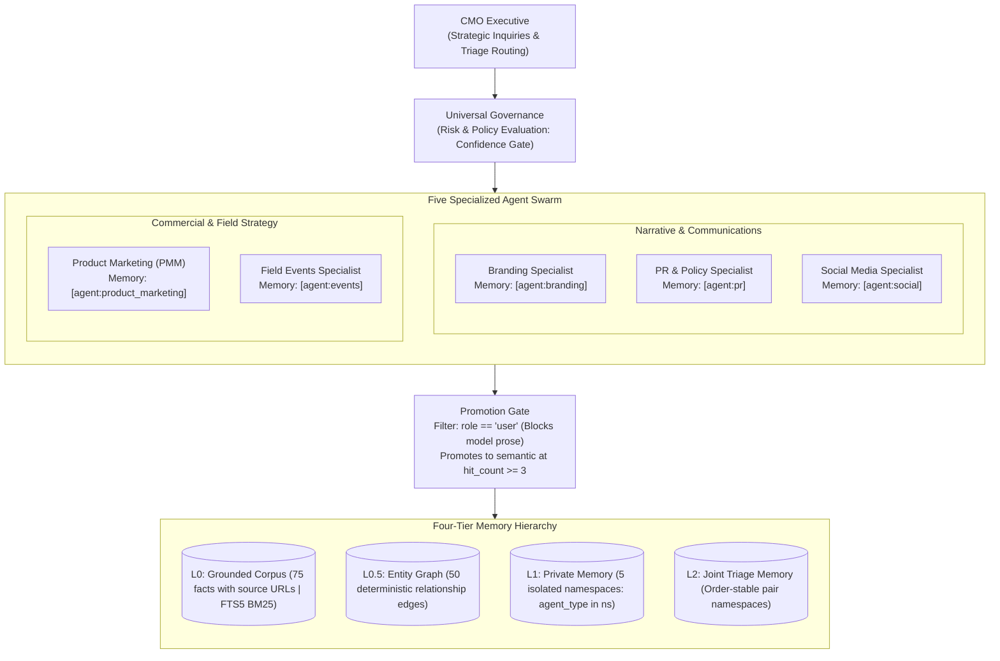

# Marketing OS

[](https://www.python.org/)
[](https://react.dev/)
[](https://vitejs.dev/)
[](https://tailwindcss.com/)
[](https://threejs.org/)
[](https://www.sqlite.org/)
[](https://github.com/langchain-ai/langgraph)
[](https://langfuse.com/)
[](https://www.docker.com/)

A governed multi-agent competitive intelligence platform for enterprise marketing teams.

Marketing OS deploys five specialized AI agents—Branding, PR, Social Media, Product Marketing, and Events—to analyze competitor intelligence, track market shifts, and formulate strategic positioning. The system enforces strict memory isolation so agents reason independently without cross-contaminating their memories, and routes high-risk recommendations through an executive governance review.

---

## Architecture



### Core Components

- **5 Specialized Personas:** Branding (narrative & positioning), PR (strategic communications & compliance), Social (advocacy & developer community), Product Marketing (competitive battlecards & rate card analysis), and Events (field marketing & keynote abstracts).
- **Universal Governance:** Reviews agent proposals for commercial, regulatory, or positioning risks, flagging high-risk actions for executive CMO sign-off.
- **Triage Collaboration (`/api/triage`):** Dynamically pairs any two specialists on a single strategic inquiry. The agents reason independently from their distinct perspectives, and only their synthesized conclusions are merged into a shared pair namespace without contaminating either agent's private memory.
- **Promotion Gate:** Enforces that only explicit user decisions, preferences, and corrections are admitted into memory. Generated assistant prose is discarded from long-term memory, preventing circular hallucination feedback loops.

---

## Retrieval Benchmarks

Evaluated against a golden set of domain queries comparing standard full-text search against deterministic taxonomy-expanded search:

| Metric | Baseline Search | Taxonomy-Expanded Search | Impact |
|---|:---:|:---:|:---:|
| **Overall Recall@5** | 0.726 | **0.943** | +21.7% |
| **Paraphrase Recall@5** | 0.283 | **0.900** | +61.7% (Resolves vocabulary mismatch) |
| **Lexical Recall@5** | 0.967 | **0.967** | Exact keyword precision |
| **Mean Reciprocal Rank (MRR)** | 0.771 | **0.985** | Top-ranked evidence retrieval |
| **Zero-Hit Queries** | 5 | **0** | Complete candidate coverage |

---

## API Reference

| Method | Endpoint | Description |
|---|---|---|
| `GET` | `/api/health` | Health check verifying database and application status |
| `POST` | `/api/login` / `/api/logout` | Session authentication for the executive console |
| `GET` | `/api/me` | Validates active session state |
| `POST` | `/api/run` | Executes one-shot supervisor agent graph with governance review |
| `POST` | `/api/chat` | Multi-turn chat with an isolated specialist, returning citation recall |
| `GET` | `/api/chat/threads` | Lists conversation threads scoped by namespace (`?agent=` or `?agents=a,b`) |
| `GET` | `/api/chat/thread/<id>` | Retrieves ordered turns and recalled memory IDs for a thread |
| `POST` | `/api/triage` | Bridges two specialists on one question with isolated joint memory |
| `GET` | `/api/memory` | Inspects stored memories scoped to an agent or joint pair |
| `POST` | `/api/digest` | Generates weekly 5-agent competitive intelligence synthesis |
| `GET` | `/api/digest/network` | Returns competitor entity network projection |
| `POST` | `/api/export/markdown` | Exports structured positioning brief with citations |
| `GET` | `/api/history` | Paginated decision history (`?limit=50&offset=0`) |
| `GET` | `/api/decisions/<id>` | Complete saved result, current review status, and review history |
| `POST` | `/api/decisions/<id>/review` | Record an authenticated operator's approval or rejection |

### Result, review, and provider contracts

New one-shot, chat, and triage results are stored in full. History rows and decision
detail include `workflow_type`, `result_available`, and `result`. Clients should reopen
the saved `result`, which contains the original statement, recall/knowledge payload,
governance, and metrics. Older rows keep `workflow_type: "legacy"`,
`result_available: false`, and `result: null`; their missing output cannot be recovered
from a strategy title. A result-storage failure returns HTTP 503 rather than a success
with an unusable audit ID. Digests remain on-demand results without decision history.

Review example (requires the session cookie from login):

```json
{"status": "approved", "reason": "Reviewed the evidence and risks"}
```

Use `approved` or `rejected`. The server records the authenticated username, UTC time,
and reason in a new review entry, and updates that decision's current review status.
New escalated decisions start `pending`; other decisions start `unreviewed`. Reviews
do not transfer to another decision, alter the original output, erase its risk flag,
or admit a memory. This records a human review; it does not execute or authorize an
external marketing action. The application appends reviews, but the SQLite database
is not tamper-proof storage. The console loads review state from this endpoint and
waits for a successful save before showing approval/rejection. Reopening a saved
result restores its original payload and its current decision-specific review state.

All four generation workflows expose `metrics`. `source` identifies `live`, `mock`,
or an explicitly unknown/mixed execution. `requested_model` is the server-configured
model; `model` is the provider-reported version, or `unknown` if omitted.
`served_model_verified` means the provider supplied the identifier, not an independent
attestation. A versioned model name does not mean a fallback occurred.

Missing token measurements remain `null`. `total_tokens` comes from upstream
`totalTokenCount`, rather than a possibly incomplete sum. Mock calls have zero outbound
attempts, no provider latency, and no fabricated usage. For each live call,
`latency_ms` measures the final successful HTTP request and `total_wall_ms` includes
its retries/waits. Multi-call workflows expose individual `calls` and aggregate known
counts; parallel-call latency/wall time is not added into a misleading workflow total.
Usage describes successful provider responses; a failed attempt's unreported token
usage remains unknown even though every outbound attempt counts against call quota.

There is no automatic model downgrade or live-to-mock fallback. HTTP 503 and connection
failures get at most three attempts against the same configured model, with 2s/4s waits.
Each outbound attempt consumes a quota unit; parallel workers share the workflow's
reservation. HTTP 429 stops immediately and propagates a retry delay. Incomplete,
blocked, empty, and invalid structured outputs fail visibly. Live responses must report
`finishReason: "STOP"`; thought parts are excluded from public text. A configured model's
availability and its generation options still require verification with actual provider
credentials; controlled offline responses do not establish that availability.

Product retrieval enables deterministic taxonomy expansion by default through
`RETRIEVAL_EXPAND_TAXONOMY`; raw search retains an unexpanded baseline. Sourced retrieval,
competitor digests, corpus graph derivation, and the citation grader accept only
`grounded_crawler` rows with a well-formed HTTP(S) source URL. This eligibility check
does not prove that a source supports every generated claim, is fresh, or is still
reachable. Reusing a chat thread under another agent's namespace is rejected before
transcript writes or model calls. These are specialist boundaries within the shared
operator workspace, not separate tenants for users.

Malformed JSON shapes and wrong field types return HTTP 400. Existing authentication,
prompt-size, injection, and quota checks still apply. Build the frontend and serve it
through Flask/Gunicorn for same-origin API access; direct `/console` navigation is
supported. Standalone Vite development still needs an API proxy/base configuration.

---

## Instructions to Build & Run

### 1. Installation

```bash
# Clone the repository
git clone https://github.com/namm9an/Marketing-OS.git
cd Marketing-OS

# Set up virtual environment
python -m venv venv
source venv/bin/activate  # On Windows: .\venv\Scripts\activate

# Install dependencies
pip install -r requirements.txt
```

### 2. Seed Database

Populate the local SQLite database with verified competitor facts and derive the initial entity graph:

```bash
python -m app.db.grounded_seed
```

### 3. Start Application Server

```bash
python -m app.main
```

The application server defaults to `http://localhost:10000` (override with `PORT`). You can verify it is healthy via:

```bash
curl http://localhost:10000/api/health
```

For frontend development, run `npm ci` and `npm run dev` in `frontend/` while Flask
is running. Vite proxies `/api` to `http://127.0.0.1:10000`, keeping API requests and
session cookies on the browser's frontend origin. Set `MARKETING_OS_API_TARGET` in
the Vite process environment if Flask uses another address. Build with
`npm run build`; Flask serves `frontend/dist`, including direct `/console` routes.
The console shows the execution mode reported by each response. The server owns
model configuration; there is no client model switch or file-upload capability.

---

## Instructions to Run Test Suites

Run the automated test suite offline against a temporary database:

```bash
test_db_dir="$(mktemp -d)"
DB_PATH="$test_db_dir/tests.db" python -m pytest -q
```

The backend repair regressions are in `tests/integration/test_backend_repairs.py`.
They cover the eight repair groups and a ninth combined workflow. Provider responses
are controlled fixtures; the suite makes no paid provider calls. Frontend browser
integration is a separate required check; backend test-client success alone does
not establish a working browser product.

From `frontend/` (Node 24 was used for the F01 verification):

```bash
npm ci
npm run test:unit
npm run lint
npm run build
npm run test:integration
npm run test:integration:built -- baseline.spec.js workflow.spec.js examples.spec.js
```

The browser harness starts its own API with a temporary SQLite database, synthetic
operator credentials and mock inference; it does not use production credentials or
spend provider tokens. The development suite uses Vite on port 5179 and the API on
5120. The built suite serves the compiled SPA directly through two Gunicorn workers
on Linux; native Windows uses Flask for that local route check. Run the two suites
sequentially because they share the test API port. Python dependencies must be
installed first; the launcher finds `.venv` or falls back to `python`, or use
`MARKETING_OS_TEST_PYTHON` to select the interpreter explicitly.

Playwright uses `/usr/bin/chromium` when available, otherwise its managed browser.
Use `npx playwright install chromium` when needed, or set
`PLAYWRIGHT_CHROMIUM_EXECUTABLE_PATH` for another installed compatible browser.
Screenshots, traces and accessibility attachments go to the ignored
`frontend/test-results/` directory. These controlled tests do not establish genuine
live-provider recordings, final visual acceptance, production deployment or a
complete accessibility/performance audit; see the phase record in
[the build plan](docs/MARKETING_OS_BLUEPRINT_PLAN.md).

### Saved public agent examples

F02 separates controlled test fixtures from genuine public recordings. The static
catalog in `frontend/public/examples/manifest.json` stays blocked until all five
specialists have captured live responses. The public-recording browser test
requires that complete catalog; it deliberately fails while capture is blocked.
The other browser tests use controlled inference and do not require paid access.

When the configured provider has generation access, capture from the repository
root using the project Python environment:

```bash
python -m app.recordings.capture --output frontend/public/examples --mode live --resume
```

This deliberate preparation step makes provider calls. Keep `GEMINI_API_KEY` in
secure environment settings and retain the configured `DEFAULT_MODEL`. Capture
uses a temporary, seeded database and the authenticated Flask handler. Each bundle
keeps the original response, supplied fictional scenario, observed metrics and
source rows collected during that same request. It does not search again after
generation. Resume reuses checksum-validated successes instead of generating them
again. A provider or evidence-validation failure leaves the catalog blocked.

For offline capture-tool checks, use `--mode controlled` with a separate temporary
output directory. Its `controlled-only` catalog is rejected by the public loader;
do not copy those fixtures into the public recording directory.

The optional recorded-example viewer appears only for a complete live catalog.
Selecting an example performs anonymous static-file reads, with no generation,
review or memory request. It verifies exact-file SHA-256 checksums, agent/mode
metadata and citation membership in the captured rows. Checksums detect changed
bytes; they do not independently authenticate provider origin or prove every
generated claim. Scene bindings are data only; comparison and physical animation
remain later phases.

Run the retrieval benchmark suite:

```bash
python -m app.eval.retrieval --expand-taxonomy
```
