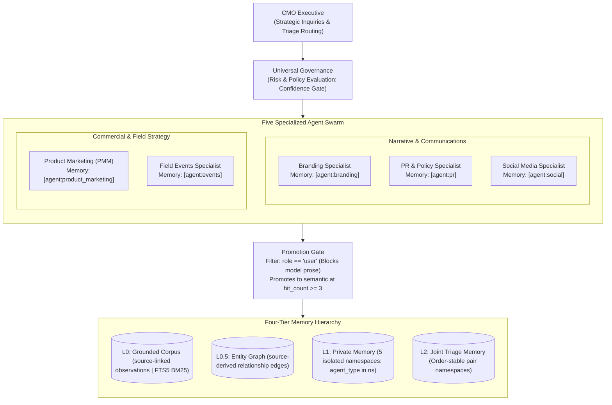

# Marketing OS

[](https://www.python.org/)
[](https://react.dev/)
[](https://vitejs.dev/)
[](https://tailwindcss.com/)
[](https://threejs.org/)
[](https://www.sqlite.org/)
[](https://github.com/langchain-ai/langgraph)
[](https://langfuse.com/)
[](https://www.docker.com/)

A governed multi-agent competitive intelligence platform for enterprise marketing teams.

Marketing OS deploys five specialized AI agents—Branding, PR, Social Media, Product Marketing, and Events—to analyze competitor intelligence, track market shifts, and formulate strategic positioning. The system enforces strict memory isolation so agents reason independently without cross-contaminating their memories, and routes high-risk recommendations through an executive governance review.

---

## Architecture



### Core Components

- **5 Specialized Personas:** Branding (narrative & positioning), PR (strategic communications & compliance), Social (advocacy & developer community), Product Marketing (competitive battlecards & rate card analysis), and Events (field marketing & keynote abstracts).
- **Universal Governance:** Reviews agent proposals for commercial, regulatory, or positioning risks, flagging high-risk actions for executive CMO sign-off.
- **Triage Collaboration (`/api/triage`):** Dynamically pairs any two specialists on a single strategic inquiry. The agents reason independently from their distinct perspectives, and only their synthesized conclusions are merged into a shared pair namespace without contaminating either agent's private memory.
- **Promotion Gate:** Enforces that only explicit user decisions, preferences, and corrections are admitted into memory. Generated assistant prose is discarded from long-term memory, preventing circular hallucination feedback loops.

---

## Retrieval Benchmarks

Run `python -m app.eval.retrieval` against a fresh database to compare
standard full-text search with taxonomy expansion on the bundled starter
sources. Both the corpus and the judged questions affect the results.

## API Reference

| Method | Endpoint | Description |
|---|---|---|
| `GET` | `/api/health` | Health check verifying database and application status |
| `POST` | `/api/login` / `/api/logout` | Session authentication for the executive console |
| `GET` | `/api/me` | Validates active session state |
| `POST` | `/api/run` | Executes one-shot supervisor agent graph with governance review |
| `POST` | `/api/chat` | Multi-turn chat with an isolated specialist, returning citation recall |
| `GET` | `/api/chat/threads` | Lists conversation threads scoped by namespace (`?agent=` or `?agents=a,b`) |
| `GET` | `/api/chat/thread/<id>` | Retrieves ordered turns and recalled memory IDs for a thread |
| `POST` | `/api/triage` | Bridges two specialists on one question with isolated joint memory |
| `GET` | `/api/memory` | Inspects stored memories scoped to an agent or joint pair |
| `POST` | `/api/digest` | Generates weekly 5-agent competitive intelligence synthesis |
| `GET` | `/api/digest/network` | Returns competitor entity network projection |
| `POST` | `/api/export/markdown` | Exports structured positioning brief with citations |
| `GET` | `/api/history` | Paginated decision history (`?limit=50&offset=0`) |

---

## Instructions to Build & Run

### 1. Installation

```bash
# Clone the repository
git clone https://github.com/namm9an/Marketing-OS.git
cd Marketing-OS

# Set up virtual environment
python -m venv venv
source venv/bin/activate  # On Windows: .\venv\Scripts\activate

# Install dependencies
pip install -r requirements.txt
```

### Start the API

Configure `ADMIN_USER` and `ADMIN_PASSWORD` in your local environment.
Set `TARGET_ORGANIZATION` and `TARGET_INDUSTRY` when running for a specific
organization. Leave `GEMINI_API_KEY` unset for controlled responses.

```bash
python -m app.main
```

The server listens on <http://localhost:10000> by default. Check `/api/health`.
Startup installs the bundled source observations and updates the search index
and graph. Operator records and memory are preserved.

---

## Instructions to Run Test Suites

Run the automated test suite (190 unit and integration tests, runs 100% offline):

```bash
pytest
```

Run the retrieval benchmark suite:

```bash
python -m app.eval.retrieval --expand-taxonomy
```
