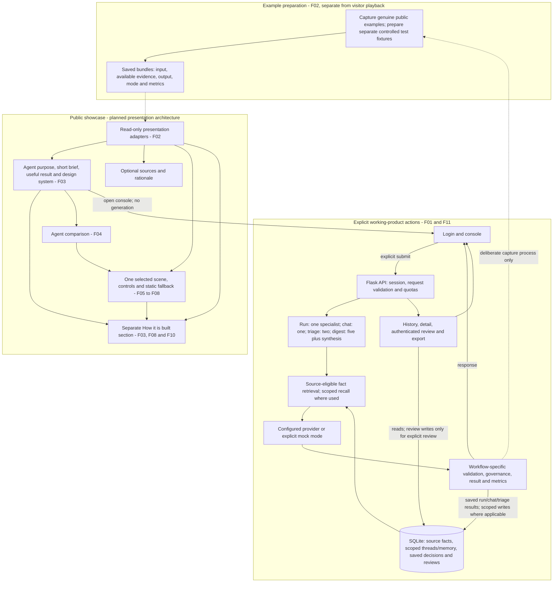
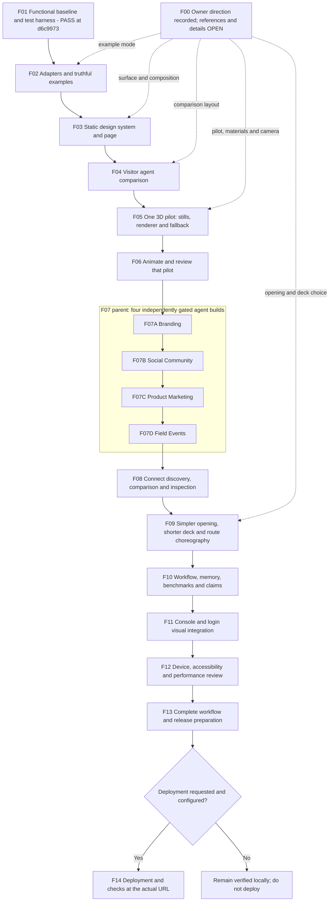
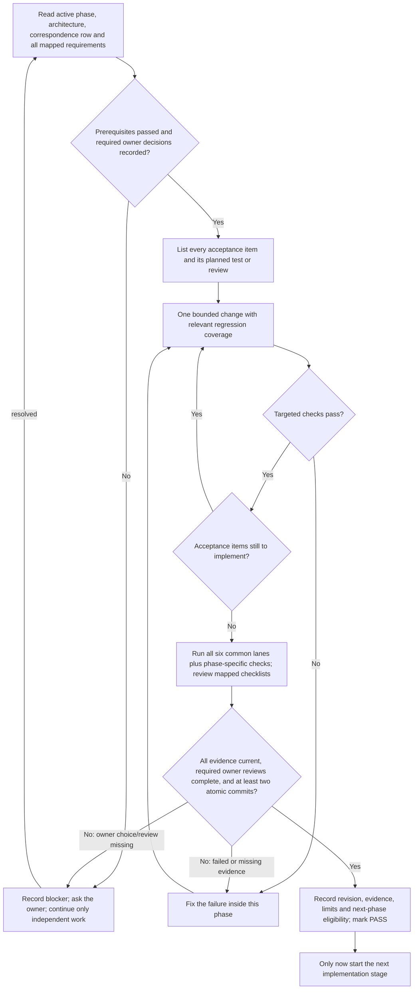

# Marketing OS — blueprint and phased build plan

Updated: 17 November 2026 (Asia/Calcutta).
Status: F01 functional baseline PASS at `d6c9973`; F02 data/capture foundation PASS at `0dc18d6`, documented through `827ed61`. F03's candidate is technically verified through `9f0a3e7` on `feat/frontend-page-foundation`, but the owner rejected the book-like visual/motion study on 17 November. F03 visual acceptance FAILS for that study; redesign/alignment and promotion remain OPEN. See section 15 for F02 evidence/limits and section 17 for the current F03 record. F00 visual reviews remain open.

Subsequent owner approval: public agent views follow purpose → short example brief → visual explanation → useful result, with optional sources/rationale and a separate “How it’s built” section. Section 16 records this presentation correction. Public timestamps/operational notes in the existing F02 inspector still need removal; this documentation update does not claim the UI has changed.

## 1. Purpose and authority

Build an outstanding portfolio case study with a working product at its centre. An ordinary visitor should understand the business value through an engaging visual story. A hiring manager or ML engineer should be able to inspect the implementation, evidence, trade-offs, and limits.

Read these three current documents together:

- [Blueprint and build plan](MARKETING_OS_BLUEPRINT_PLAN.md): scope, dependencies, phases, verification, progress.
- [Design and layout](DESIGN_AND_LAYOUT.md): visual system, content, agent comparison, research, design checklists.
- [Animation](ANIMATION.md): miniature 3D scenes, interactions, truthful choreography, motion acceptance.

The owner's latest instructions govern. Confirmed decisions are requirements. Research shortlists and proposed scene ideas are not final selections. Resolve a relevant open choice before implementing the part that depends on it; independent work may continue.

The original three Claude documents remain unchanged in section 16 of [the historical working record](FRONTEND_DESIGN_WORKING.md). Their old phase prompts, copy, counts, and flat-SVG constraints do not override this blueprint or the owner's newer decisions. Anti Gravity's reports are background evidence. This document does not authorize deployment or automatic publication.

### One roadmap across three documents

There are **15 top-level phases, F00–F14**. F07 is a parent containing four sequential, independently verified subphases, F07A–F07D. Replacing that parent with its four children gives **18 separately tracked stages: one research/decision stage and 17 implementation stages**. Do not count F07 again as a fifth agent build or a separate exit gate.

| Document | Responsibility in every phase | Independent phase sequence? |
|---|---|---|
| This blueprint | What to build, prerequisites, decisions, order, required verification, and completion evidence | Yes: the single F00–F14 roadmap |
| [DESIGN_AND_LAYOUT.md](DESIGN_AND_LAYOUT.md) | How that phase should look and communicate; layout, palette, comparison, content, accessibility, U01–U20 and S01–S19 review | No: requirements mapped to the same phase IDs |
| [ANIMATION.md](ANIMATION.md) | How that phase should move and respond; scene meaning, state/data boundaries, controls, M01–M21, P01–P21, resource/fallback checks | No: requirements mapped to the same phase IDs |

Design/layout and animation currently each have 16 numbered specification sections. Those sections, animation beats, research inventories, and checklists are **not extra build phases**. The archived Claude plan's older Phase/S identifiers remain historical references; Anti Gravity's completed work is retained rather than restarted. Use the current phase IDs below for new implementation and evidence.

**Mandatory lookup rule, requested by the owner on 15 November:** at the start or resumption of a phase, before each atomic change, and before declaring a phase complete, read this document's [architecture and correspondence map](#10-architecture-and-phase-correspondence-map), the active phase's section 6 scope, and its mapped design/animation sections. Use the [phase execution checklist](#11-required-phase-execution-checklist) to record what was built and what was tested. Do not advance from memory, a diagram alone, old chat context, or a green targeted test. Missing evidence or a required owner decision keeps the affected phase OPEN/BLOCKED.

## 2. Decisions and open choices

| Item | Status | Consequence |
|---|---|---|
| Portfolio showcase with business clarity and inspectable engineering | CONFIRMED by owner | Design for both audiences in one coherent journey |
| Public agent presentation: purpose, short brief, visual explanation, useful result; optional sources/rationale; separate “How it’s built” section | CONFIRMED by owner, 16 November, after reviewing developer examples | Apply in F03 and subsequent scene phases. Keep capture/test dates, quota explanations and debugging notes out of the public presentation; fix weak outputs before promoting them as finished examples |
| Paper/dossier concept | CONFIRMED by owner | Use it as the outer identity for the experience |
| Clicking an agent plays a miniature physical 3D machine/scene explaining its job | CONFIRMED by owner | Develop meaningful physical scenes; the old flat-SVG-only restriction is superseded |
| Visitors can compare agents before choosing one to explore | CONFIRMED by owner | Comparison is a product feature, not merely our internal design exercise |
| Two-agent side-by-side comparison with one shared animation stage | CONFIRMED by owner, 15 November | Keep all five roles discoverable; compare two at a time; adapt the two records accessibly on mobile |
| Genuine saved model responses for public examples; controlled/mock responses for routine tests | CONFIRMED by owner, 15 November | F02 capture requires an available provider and credentials; do not silently substitute mocks for the public recording gate |
| PR & Policy is the first physical pilot | CONFIRMED by owner, 15 November | Build its checkpoint and separate human-review route in F05/F06 before the other four agents |
| Light paper page with subtle graphite speckling as the starting surface comparison | CONFIRMED by owner, 15 November | Compare with the plain base; retain palette and text clarity; exact texture/intensity needs visual review |
| Guided camera that clearly shows the machine's story | CONFIRMED by owner, 15 November | User-controlled rotation is not approved; machine materials and visual quality need references/stills before implementation |
| Preserve stacked cards, investigate a shorter scroll and simpler opening | CONFIRMED by owner, 15 November | Keep the inherited implementation until the revised composition/boundaries are reviewed and tested |
| Separate shortlists for six backgrounds and five trends | CONFIRMED research approach | Compare candidates and narrow them; do not combine all candidates |
| Three editable current documents | CONFIRMED by owner | Keep decisions consistent across these files; retain historical originals |
| Build phase by phase; check backend integration, unit/integration tests, and agents before advancing | REQUIRED by owner | Every implementation phase uses the common gate below |
| Exact five colours recorded by Claude | EXISTING OWNER REFERENCE, retained | Keep values until the owner changes them; final appearance with 3D materials needs review |
| Speckled graphite, dithering/dithered images, and pixel loaders | OWNER LIKED, 15 November | Preferred research candidates; exact reference, intensity, placement, and loading treatment remain open |
| Renaissance branding | OWNER REJECTED, 15 November | Incompatible with the owner's intended existing direction; do not reintroduce it as a composition or branding recommendation |
| Original paper/halftone and other shortlist suggestions | EARLIER RECOMMENDATIONS | Retain as references, not current owner selections or required research tasks |
| Cream backgrounds, text wrapping, and explanatory diagrams | CLARIFIED ROLES | Existing light base is already cream-like; wrapping is typography work; meaningful process explanation can live inside the 3D scenes |
| Machine materials/modelling, detailed camera framing, responsive comparison layout, exact opening/scroll composition | OPEN DETAILS | Resolve through references and one representative scene; guided camera, two-agent/shared-stage comparison and shorter-stack direction are settled |
| Five-sheet opening transforming into the deck | CLAUDE PROPOSAL, NOT ADOPTED | The owner prefers investigating a simpler opening; do not build the old morph by default |
| Availability of provider/credentials for genuine public recordings | VERIFIED for F02's explicit `gemini-3.5-flash-lite` capture | Five original recordings exist; other model/runtime availability is a separate check |

“Hero” means the opening section. “Deck” means the stack of agent cards. “Hero-to-deck” means an opening graphic transforms into that stack as the visitor scrolls. These terms describe an option, not a design decision the owner must already understand or accept.

## 3. Where we stand

- Frontend base: pushed `showcase-redesign` at `31698d4c6efb9ef5969bc9e1a21e5b08c10bc4c3`.
- Backend repairs: five commits on `fix/backend-contracts`, delivered through `67a1c57`; see [backend tracker](BACKEND_REPAIR_TRACKER.md) and the API contracts in [README](../README.md).
- Previously verified: 323 offline backend tests, 23 actual HTTP workflow checks, frontend build and lint. Existing warnings remain. These are historical results, not checks newly run for these planning documents.
- Anti Gravity built the 600vh deck, opaque stacking/dimming, opening morph, shared Lenis scrolling, clickable tabs, navigation, and two-panel cards.
- Agent scene panels are empty. Three.js-related packages already exist for a decorative console shader; this is not an implemented set of agent scenes.
- F01 removed fabricated dossier metrics and false live/production/zero-hallucination assertions. F02 subsequently captured five genuine examples; hand-written examples remain labelled illustrative. F10 retains the broader copy/benchmark audit, while known weak claims in examples need correction before the approved F03 public presentation uses them as finished results.
- F01 PASS: full saved results/legacy states, server-owned reviews, stale-response isolation, all five selectable specialists, truthful model/loading/error controls, development proxy/cookies, logout cleanup, mobile navigation and reduced-motion baseline are verified. See the exact commits and complete gate in section 13.
- Frontend now has real `test:unit`, `test:integration`, and `test:integration:built` commands. The gate passed 29 frontend tests, 10 Vite/Flask browser checks and 7 compiled-SPA/Gunicorn checks; the backend suite passed 323 tests. Automated axe checks passed for login, workbench, chat and generated result/review states; this is bounded evidence, not complete accessibility certification.
- F02 verified genuine Gemini generation for its five Flash-Lite recordings. Production deployment, held-out quality evaluation and complete accessibility/performance acceptance remain unestablished. Its functional inspector still uses public-facing capture metadata that the owner has now rejected; section 16 specifies the pending presentation change.

Do not declare all backend/product work complete simply because the repair suite passes. Keep broader open issues visible in the backend tracker.

## 4. Product and evidence boundaries

1. A one-shot run routes to one chosen specialist. Chat uses that specialist's permitted memory/transcript scope. Triage independently briefs two specialists and merges their views. The digest fans out to all five and synthesizes on demand.
2. Five specialists share a fact corpus and execution core, with different prompts and memory scopes. They are not five independently trained models.
3. Source eligibility and valid fact IDs establish source linkage; they do not prove every generated claim is supported or current.
4. Risk flags, authenticated human review, and memory admission are different mechanisms. An operator review does not execute an external marketing action or automatically promote memory.
5. A physical machine is an explanatory metaphor. Never depict unavailable inner reasoning, automatic phrase removal, sentiment collection, scheduling, or optimization as an observed backend event.
6. Comparison defaults to presentation/replay data. Opening, comparing, or replaying scenes must not silently invoke paid models or write agent memory.
7. Public examples use concise, honest example/fictional-case identification and never imply replay is a fresh model run. Preserve recording mode/source provenance in the original records; their existence does not require displaying capture dates or operational metadata. Optional sources/rationale support the result. Missing measurements remain unknown internally; do not invent numbers or synthetic progress percentages.

## 5. Mandatory gate for every implementation phase

Work one phase at a time. Within it: reproduce the relevant defect or define acceptance, make one bounded change, run targeted checks, then the complete phase gate. Fix failures within the current phase before starting the next one.

| Lane | Required evidence at every implementation phase exit |
|---|---|
| Backend connection | Running frontend reaches the intended Flask API; authentication/session handling and actual response shapes work. Check direct console navigation and chosen development-origin configuration |
| Unit tests | Existing backend unit tests plus meaningful frontend tests pass. Add tests for changed logic/adapters/interactions, not tests that merely repeat CSS or implementation details |
| Integration tests | Existing backend integration tests pass; exercise the affected client-to-API flow in a browser with isolated state and controlled inference |
| Agent operation | Exercise all five one-shot specialists, chat continuation and memory, two-agent triage, five-agent digest, history/detail/review, export, and logout. Check attribution and namespace boundaries |
| UI regression | Build/lint pass; browser console has no application errors in covered journeys; compare relevant screenshots, mobile behaviour, keyboard use, reduced motion, and error/empty/loading states |
| Design review | Apply both checklists in DESIGN_AND_LAYOUT.md; mark applicable items PASS/FAIL, or N/A with a reason. Review material visual changes with the owner |

No “done” or “next phase” while a required lane fails or is untested. A skipped required check is not a pass. A phase that reveals a shared integration defect must fix it or explicitly revise scope with the owner before closing.

Documentation/research phase F00 has a review gate rather than fabricated application-test results: verify references, decision status, document consistency, and that source code stayed unchanged. Do not rerun a paid agent for a documentation edit.

### Commands and tooling reality

Current backend checks, from the repository root with the project environment active:

```bash
phase_test_dir="$(mktemp -d)"
DB_PATH="$phase_test_dir/tests.db" python -m pytest -q tests/unit tests/integration
```

Current frontend checks, from `frontend/`:

```bash
npm run lint
npm run build
```

F01 introduced these frontend test commands; they must remain runnable before a visual implementation phase begins:

```bash
npm run test:unit
npm run test:integration
npm run test:integration:built
```

The integration configurations use temporary SQLite databases, controlled/mock inference and synthetic test credentials. The normal suite starts Flask plus a Vite proxy; the built suite requires `npm run build` and serves the actual SPA directly through two Gunicorn workers on Linux (Flask on native Windows). Run the suites sequentially because they share port 5120. See `frontend/playwright.config.js`, `frontend/playwright.built.config.js` and `frontend/tests/integration/start-api.mjs`; set `PLAYWRIGHT_CHROMIUM_EXECUTABLE_PATH` or `MARKETING_OS_TEST_PYTHON` for alternate installed executables. Install Playwright's Chromium if no compatible browser is available. Use controlled inference for routine checks; do not require paid calls at every phase. Future phases must rerun the complete gate rather than reuse F01's results.

The full agent workflow consumes nine successful AI actions in the existing helper. Use fresh test identities/databases for additional error cases so visitor/IP quotas do not invalidate a test. Verify quota behaviour in its own cases; do not disable product limits to make the test pass.

### Evidence saved at each phase boundary

Record phase ID, source revision/working changes, changed files, commands and exit codes, test summaries, API/browser workflow results, screenshots at named states, device sizes, design checklist results, known limits, and next-phase eligibility. Store durable tests in the repository; record where local-only evidence can be found. Counts alone do not prove integration.

## 6. Build sequence

Every implementation phase F01 onward inherits all six gate lanes. Phase-specific checks below are additional. The phases are a proposed implementation sequence for this blueprint, not claims of work completed.

### F00 — references and decisions

- Narrow the original lists using the owner's 15 November preferences: subtle graphite speckling on the light paper base, dithering/dithered images and pixel loaders. Renaissance branding is rejected. Compare the light graphite surface with the plain base before combining treatments.
- Compare physical machine references and guided camera framing; establish a crafted, coherent visual family. User-controlled rotation is not adopted. Material and modelling choices need concrete references/stills, not an assumed match between the implementer's taste and the owner's.
- Q01–Q06 now have owner direction: genuine public recordings, two-agent/shared-stage comparison, PR & Policy first, light graphite-speckled paper, guided camera and a shorter stack/simpler opening. Exact materials, responsive details and opening/scroll geometry still require review; do not reopen settled choices unnecessarily or mark the entire visual direction approved.
- Preserve the reference palette unless the owner changes it. Define how physical lighting/shadows should relate to the UI palette.
- Exit: decisions and reasons are recorded, unresolved choices have bounded impact, and the owner can explain the proposed experience without design jargon. These documents are ready for that discussion; F00 research itself remains open.

### F01 — functional frontend baseline and verification harness

- Add frontend unit/browser integration tooling and reproducible commands. Start with the actual flows, not screenshots alone.
- Reopen `row.result` by workflow type; handle legacy rows and missing fields honestly. Restore the original result rather than reconstructing it from the option title.
- Wire review to the authenticated decision-review endpoint; reload status from the server, retain risk flags, and prevent approval carrying to another decision.
- Prevent a delayed chat response from replacing a newly selected agent's thread/state. Configure development API origin/proxy and session cookies consistently.
- Correct misleading mode/model controls and unsupported attachment behaviour; show real loading/error/empty states. Do not leave false “live”/“zero hallucination” claims while doing later restyling.
- Check mobile overflow and reduced-motion baseline issues in affected UI. Establish a reproducible list of remaining visual-only issues.
- Exit: login → run → reload → reopen → review → new decision → export → logout works, alongside the full agent gate. Known blocking history/approval failures are closed. Test scripts are real and passing.

### F02 — data adapters, example capture, and truthful content mode

- Define one presentation adapter family for run, chat, triage, digest, saved history, and the five agent scenes. Keep backend result snapshots unchanged.
- Map exact fields and null/legacy/error cases; distinguish generated `knowledge_units` summaries from original retrieved corpus rows.
- Create deterministic test fixtures with explicit mock/control labels. The owner selected genuine saved model responses for public examples. Capture actual responses and the evidence used by that request; do not hand-edit them or reconstruct a convenient retrieval afterwards.
- An unavailable field such as full retrieved rows or `flagged_phrase` remains unavailable. If essential, identify a bounded capture/API change and test it before closing this phase.
- Verify the provider and credentials needed for the chosen genuine public recordings without exposing secrets. Mock fixtures remain valid for routine tests, but cannot close the public-recording requirement. A missing credential is a visible capture blocker, not permission to fabricate a recording or silently change mode.
- Exit: five examples in the chosen truthful mode, tested adapters, citation/mode/metric checks, and comparison/scene data available without inference on selection. If the chosen mode requires live recordings and they cannot be captured, this phase remains open.

### F03 — static design system and page foundation

- Record the 17 November scroll direction: calm opening → a small initial movement → a larger scroll-driven reveal → agent dossiers within the same visual story. Treat “1.5 scrolls” as a pacing description, not a wheel-event count.
- Build an isolated opening-to-PR-dossier motion study with simple temporary visuals for review before locking composition/choreography. Direct scroll progress holds/reverses the main sequence; exact distances and inner scene scroll-versus-click behaviour remain review choices. This is a research preview, not F05's finished physical machine or an early implementation of all F09 choreography.
- Apply the reviewed tokens, typography, spacing, surfaces, and selected background treatment across the shell.
- Establish a clear opening explanation, agent discovery, comparison entry, engineering evidence, and console entry using real or explicitly labelled example data.
- Apply the owner-approved presentation correction in section 16: clear agent purpose, short example brief and useful result; optional sources/rationale; a separate “How it’s built” section. Remove public capture/test timestamps, quota explanations and debugging notes from the F02 inspector. Later scene phases add the visual explanation without making result reading depend on playback.
- Review the actual example outputs before using them as finished public results. Correct known weak/unsupported claims and source-quality problems internally, then genuinely recapture if needed; preserve original records. Do not simply hide a caveat and retain a known misleading assertion or invent a deliverable that the backend does not produce. Ask the owner before adopting a new output format or changing the product's behaviour.
- Keep a simple static product explanation usable while the 3D experience is loading or unavailable.
- Exit: static desktop/mobile states make the product understandable, contrast/layout checks pass, and existing API journeys remain intact. No new ambient motion yet.

### F04 — usable agent comparison

- Build the reviewed comparison layout for actual visitors. Compare jobs, suitable tasks, evidence available, and sample results; distinguish qualitative capability from recorded execution metrics.
- The owner selected two agents side by side and one shared animation stage. Keep all five discoverable; use a readable stacked/tabular adaptation for those same two records on mobile rather than shrinking desktop columns.
- Provide clear select/remove/open actions, accessible selection state, mobile layout, and an understandable empty state. Comparison is a client presentation interaction, not an automatic triage request.
- Use one labelled scenario where comparable examples exist, with agent-specific roles and provenance. Missing examples or noncomparable timings must be explained.
- Exit: a visitor can compare agents and choose one to explore; selecting/comparing triggers no generation, review, or memory writes. Unit tests and browser/API regression pass.

### F05 — one physical 3D pilot, still frames and rendering proof

- Start with the owner-confirmed PR & Policy pilot: a risk checkpoint and separate human-review route. Its exact materials, camera, stills and story still require review before full scene implementation.
- Compare two material/composition interpretations of its physical checkpoint. Review start/end frames and a static fallback before animation.
- Apply the pilot quality checkpoint below before committing to full modelling/animation. The owner likes the machine concept but explicitly wants concrete alignment and a crafted result rather than cheap/generic AI animation.
- Prove lazy loading, DOM text/controls, renderer/context-loss fallback, scene cleanup, and device viability. Evaluate the existing Three.js/React Three Fiber stack; dependency presence alone is not a reason to retain the old shader.
- Measure initial and first-open payloads and set a reviewed scene budget. Do not claim the old SVG element budget covers real 3D.
- Exit: the approved pilot can render its truthful static states and fallback without breaking comparison or backend workflows. Scope remains one scene.

#### Pilot quality checkpoint before full animation

Prepare a short, concrete brief and reference/still-frame review with the owner. A generic promise of a premium machine or a list of animation principles is not acceptance.

1. State the visitor question: how does PR & Policy turn a recommendation into a result with a visible risk flag and, when needed, a separate human-review route?
2. Bind the three readable states to a genuine selected example: actual input/output context; its recorded risk/escalation state; result or pending/recorded human review. Name exact fields/IDs and unavailable evidence. No invented scanning, automatic rewriting, approval, legal clearance or model thinking.
3. Show references and two small composition/material interpretations of the **same machine/story**, with guided camera framing, start/end stills and a static fallback. Identify the useful quality of each reference and its source/licence. These are review candidates, not automatically approved assets.
4. Explain each major physical part and movement. It should support the document/evidence/checkpoint/result story, with readable silhouettes, coherent scale/light/contact and plausible mechanics. Arbitrary gears, conveyors, glow, noise, or excessive tiny detail do not establish quality or technical depth.
5. Review the stills and brief with the owner before full animation. Record what they accept, reject or want changed. Exact materials/modelling remain open until this review; the outer paper dossier does not force a cardboard machine. Do not build five generic machines and seek alignment afterwards.
6. Keep the guided story camera as the baseline. Optional visitor rotation requires a separate visible prototype and owner decision before inclusion; it cannot be assumed from the owner's curiosity. Reading, essential controls and mobile/reduced-motion fallback must work without rotation.

F06 adds motion review to this accepted static brief, then verifies timing, mechanics, controls and the full gate. A technically passing renderer alone cannot close the owner's visual acceptance requirement.

### F06 — animate the PR pilot

- Follow ANIMATION.md: short brief → reviewed stills → animation, using observable risk/review behaviour.
- Click starts the scene; playback is replayable, pausable, and ends in an inspectable result. No inference or automatic approval is caused by playback.
- Test rapid interaction, cancellation, reduced motion, touch/keyboard, and missing evidence.
- Exit: the owner accepts the scene's story and feel, its meaning is clear without motion, and all common gate lanes pass before another scene is built.

### F07 — the other four agents, one at a time

Each subphase is an independent gate boundary. Do not build all four before checking integration.

| Subphase | Scene | Additional evidence |
|---|---|---|
| F07A | Branding | Input/evidence/output remain attributable; no invented ranking or model reasoning |
| F07B | Social Community | Supplied/simulated audience signal is labelled; no implied live social monitoring |
| F07C | Product Marketing | Exact hardware/pricing fields and units survive the adapter; no invented TCO calculations |
| F07D | Field Events | Recommendations match recorded output; no implied bookings, scheduling, or budget optimization |

For each: confirm the brief, review stills, animate, run targeted checks, run the full common gate, and record acceptance before advancing. Reuse scene infrastructure while keeping each agent's story distinct.

### F08 — integrate discovery, comparison, and deeper inspection

- Connect dossier selection and comparison to the same scene/data system. Restore focus and selection when closing a scene.
- Make optional technical inspection expose available Input, Retrieve, Model, Validate, Govern, and Output evidence without duplicating an entire second agent directory.
- Stop/unmount inactive scenes. If comparison contains two scenes, give explicit play control and keep one primary animation active at a time.
- Exit: discover → compare → open → inspect → close works by mouse, keyboard, and touch; replay remains read-only and the full API/agent gate passes.

### F09 — opening, deck, and route choreography

- Follow the owner-selected investigation: preserve the stacked-card idea with a shorter scroll and simpler opening. Review the exact static composition/scroll geometry, then implement and test it. The five-sheet morph is not adopted by default.
- Preserve or intentionally revise the current deck constants with tests: 600vh desktop; opening boundaries 0.06 / 0.13 / 0.15; five arrivals 0.15 / 0.32 / 0.49 / 0.66 / 0.83.
- Keep navigation interruptible. Do not force desktop pinning on mobile, autoplay all five 3D machines on scroll, or trap page scrolling inside a scene.
- Exit: forward/reverse navigation and tab jumps are correct at named positions; reduced motion is readable; selection and API state are preserved.

### F10 — workflow, memory, benchmarks, and claim audit

- Explain single-agent routing, two-agent triage, five-agent digest, memory scopes, and operator review accurately.
- Generate displayed counts from evidence. A prior seed had 75 records across 13 organizations, including target records and 12 competitors; do not call all 75 competitor facts.
- Distinguish tuned retrieval results from genuinely unseen evaluation. Do not show a held-out bar until its real result exists; no invented benchmark.
- Replace verbose/pseudo-technical copy and audit every public claim with the checklists.
- Exit: ordinary visitors can explain the value, engineers can locate evidence and limits, and frontend/API/agent checks remain green.

### F11 — complete console/login visual integration

- Apply the same system to the actual working console, including async, error, review, history, chat, triage, digest, and export states.
- Remove the unrelated decorative shader after its replacement is verified. Retain dependencies genuinely needed for the new agent scenes; do not blindly remove Three.js because an old plan said so.
- Add a console transition only if it helps continuity and remains quick, interruptible, and accessible.
- Exit: all existing controls have truthful behaviour, session/reload flows pass, and styling does not regress the backend integration fixed in F01.

### F12 — complete device, accessibility, and performance review

- Consolidate checks already performed in every phase: 360/390/768px widths and 1280×720, 1366×768, 1440×900, 1920×1080 desktop sizes, zoom, touch, keyboard, reduced motion, and unavailable WebGL.
- Run automated accessibility plus manual focus/readability review. Measure landing load and first-open 3D cost, frame pacing, memory/cleanup, and actual laptop behaviour.
- Starting targets: initial landing JS ≤180 kB gzip, desktop Lighthouse performance ≥80/accessibility ≥95. Revisit the separate 3D budget using F05 evidence; targets are not verified results.
- Exit: no unintended horizontal scroll, clipped essential content, inaccessible comparison, or broken static fallback. All common gates pass.

### F13 — final combined workflow and release preparation

- Run one combined visit through opening → comparison → every agent scene → technical evidence → console login → all five runs → chat → triage → digest → history/review reload → export → logout.
- Use fresh isolated test state and controlled inference. Repeat relevant error, provider/quota, stale-response, and unavailable-renderer cases.
- Review all design/motion checklists, source/recording labels, and remaining limits. Record exact revision, results, screenshots, and reproducible commands.
- Exit: the complete local workflow passes. No claim of a fully finished website while its browser workflow fails. Prepare README/demo material using the actual resulting product.

### F14 — deployment and deployed smoke checks, when requested

- Use the owner's selected hosting/runtime mode; verify persistence/cold-start implications, health, sessions, source data, static assets, direct console routes, and the deployed browser journey.
- Verify recordings and runtime labels remain truthful after deployment. Keep automated CI free of provider credentials and paid calls.
- Exit: checks pass against the real deployment URL, and limits are visible. Local success alone does not establish deployed readiness.

## 7. Research handoff

The original shortlists have now been narrowed by owner feedback. **Speckled graphite**, **dithering/dithered images**, and **pixel loaders** are liked candidates. The owner selected the light paper page with subtle graphite speckling as the starting comparison and explicitly rejected **Renaissance branding**. Exact texture, intensity and dithering/loader placement still need review; a dark page or palette change is not authorized by the graphite preference.

From the follow-up suggestions (dithered images, stippled gradients, pixel mosaics, infinite canvases, Renaissance branding), only dithered images received positive selection. Keep the other entries in the historical inventory without treating them as current requirements or repeatedly promoting them. Continue within the owner's original lists; do not restart the visual direction or force more styles to meet a shortlist count.

Compare plain base → graphite texture alone → graphite with one selectively dithered graphic. Speckling describes a surface texture; dithering approximates tonal shading with distributed dots/pixels. They may look similar, so combining them is not a requirement and may add redundant noise. Keep text, source details, and important values clear.

The existing page is already off-white/cream-like. Cream is a base-colour choice, not a missing effect to add. Text wrapping is layout work the implementation should solve. Useful process diagrams are explanatory techniques that can be incorporated into the selected miniature machines; they do not require another decorative flowchart section. Do not require the owner to find reference images for those implementation techniques before proceeding with the meaningful visual decisions.

Next useful references: the specific graphite treatment the owner likes, one dithered graphic/material example, and a restrained pixel loader for real asset/API waiting. The remaining background/trend inventory stays in DESIGN_AND_LAYOUT.md for context, without an obligation to research all candidates.

For each reference capture its URL/source/license, the specific useful property, where it would go, a simpler alternative, interaction/mobile/reduced-motion implications, and the eventual owner decision. A list of names is not visual-reference research already completed.

## 8. Progress and revision record

| Phase | Current status | Evidence needed next |
|---|---|---|
| F00 | PARTIAL; Q01–Q06 owner direction recorded, references/details still open | Exact machine material/modelling/stills and camera framing; graphite comparison, shorter-opening geometry and responsive comparison details. Optional visitor rotation is not approved |
| F01 | PASS — functional baseline, 15 November | Application revision `d6c9973`; five atomic implementation commits; all six gate lanes have evidence in section 13. Final art direction and complete visual/performance acceptance remain later work |
| F02 | PASS — data/capture foundation, 16 November; section 15 | Five genuine recordings at `0dc18d6`, all current gates pass. Generated claims remain unverified; later content/quality review is still required |
| F03 | IN PROGRESS — section 17 | Technical gates pass for the candidate; owner rejected the book-like motion/visual treatment. Revision and visual acceptance are required before promotion or closure |
| F04–F14, including every F07 subphase | NOT STARTED | Implement sequentially after the preceding phase passes |

Update these three documents when a decision changes: record the decision, source/date, affected phases, superseded choice, and required retesting. Keep the original Claude archive unchanged.

Future commits should remain atomic and use the owner's `fix:`, `feat:`, or `docs:` style. Attribute commits only to the owner's established identity; add no AI co-author trailers. This document does not itself request a commit, push, PR, or deployment.

Owner clarification for implementation: every completed build phase requires **at least two atomic commits**, each containing a coherent change with its relevant regression coverage. Do not split implementation from its required tests merely to reach the count. Record targeted checks per change and the full common gate before advancing to the next phase.

F01 work starts on `feat/frontend-foundation`, based on `fix/backend-contracts` through `67a1c57`, which already contains `showcase-redesign` through `31698d4`. Anti Gravity's committed phases are preserved as ancestors. The recommended integration target for verified phase work is `showcase-redesign`; no automatic merge into it or `main` is implied. Visual F00 choices remain open but do not block this independently authorized functional integration work. Do not mark F00 or the visual overhaul complete because F01 starts.

Integration sequence discussed with the owner: a verified phase branch merges into `showcase-redesign`; the next phase branches from that updated integration branch. The first frontend phase already includes the backend repair commits, so its eventual merge can bring those repairs along without duplicating them. Use regular merges that preserve the atomic commit history. The final `showcase-redesign` → `main` PR follows complete project verification; this discussion has not requested an immediate merge.

### Phase completion entry template

```text
Phase / source revision / date:
Phase-map row and design/animation sections consulted:
Entry prerequisites and owner decision IDs/status:
Scope and changed files:
Acceptance item -> implementation -> test/evidence mapping:
Atomic commit hashes (at least two for each implementation stage):
Backend connection result:
Unit-test commands, exit codes, summary:
Integration-test commands, exit codes, summary:
Full agent workflow result:
Browser/visual/accessibility/performance evidence:
Design and motion checklist results:
Owner visual decisions where needed:
Failures, limitations, and blocked checks:
Phase status: OPEN / PASS (all required lanes supported by evidence)
Next phase eligible: YES / NO, with reason:
If BLOCKED: exact missing evidence/decision and the question asked:
```

## 9. Additional UX/animation research and phase acceptance

Added 13 November 2026 (Asia/Calcutta): the owner's 21 new principles are retained and mapped in [ANIMATION.md, sections 14–15](ANIMATION.md#14-additional-ux-and-animation-principles--research-register), with interface criteria in [DESIGN_AND_LAYOUT.md, section 15](DESIGN_AND_LAYOUT.md#15-ux-principles-added-to-the-research-and-review-criteria). “Pose a pose” is interpreted as pose-to-pose, “Jacob” as Jakob, and the owner explicitly confirmed Postel's law for the item written as “Pasteur's law.” These additions refine acceptance criteria; they do not start an implementation phase or finalize an art direction.

| Phase | Additional acceptance |
|---|---|
| F00 | Decide which physical motion techniques fit the chosen materials. Treat overlaps and optional flourishes as such; do not plan 21 independent effects |
| F01 | Keep strict backend validation, useful input errors, immediate frontend acknowledgement, and server-authoritative approval state. The full unit/integration/agent gates remain mandatory |
| F04 | Check meaningful agent choices, visible/chunked comparison data, hit areas, familiar controls, and convenient repeated actions. No arbitrary three-choice or seven-control cap |
| F05–F06 | Review key poses, one main focus, plausible form/weight/lighting, timing, and optional anticipation/settling. Static and reduced-motion states retain meaning |
| F07A–F07D | Apply the same principles to each specialist independently and pass all common gates before the next subphase |
| F12–F13 | Measure actual target size/spacing and interaction acknowledgement. Assess task clarity through use; distinguish responsive UI from asynchronous model completion |

Fitts/Hick/Miller/Jakob/frequency guide the frontend experience; they do not require new backend features. Doherty motivates prompt acknowledgement of real work. Postel's input forgiveness must not undo request schemas, source eligibility, namespace boundaries, provider-output rejection, persistence guarantees, or quota handling.

Research updates are not test passes. The earlier research-only update added no application implementation. Subsequent F01 implementation and test results are recorded separately in section 13. Every future implementation phase must produce current section 5 evidence before advancing.

## 10. Architecture and phase correspondence map

This is the mandatory navigation map for phase work, not evidence that its planned components exist. Re-read it on resumption and keep it synchronized with the three specifications when a decision or dependency changes.

### System boundaries and data flow

Solid arrows show runtime data/actions. Dashed arrows show deliberate preparation or saved-data adaptation. F02's adapters, capture tooling and static inspector now pass with five genuine saved examples. The diagram's comparison/physical scene system remains planned F04–F08 work. The console and Flask workflows passed F01 and the current F02 regression gate; later visual integration remains F11 work. Scene station bindings are data, not an implemented animation.



Boundary checks: comparison/playback never submits generation or review or writes memory; human review is separate from risk flags and memory admission; a digest response is not currently a saved decision snapshot. Retrieval/recall and validation differ by workflow; this overview does not claim every workflow runs the strategy JSON validator or uses private memory. The adapter preserves saved payloads rather than fabricating missing retrieval, reasoning, timing, or review events. Exact endpoint/result contracts remain in [README](../README.md#api-reference) and implementation/tests.

The owner selected genuine public recordings (Q01). Controlled mock fixtures belong to test/example-development contexts with explicit labels; preparing them does not satisfy the genuine public capture requirement.

### Phase order and decision dependencies

Each solid arrow between implementation stages means **the preceding stage's full exit gate has passed**. F07A–F07D each run that gate independently. Dashed arrows mean the relevant F00 owner choice must be resolved before the dependent work; F00 does not block independent F01 repairs. A phase's more specific prerequisites in the table also apply.



The owner confirmed PR & Policy first; F07A–F07D therefore cover Branding, Social Community, Product Marketing and Field Events. If the owner later changes the pilot, revise F05–F07 in all three files and this diagram before modelling; do not build one agent twice or omit another.

### Phase-to-specification and verification table

`D §` refers to [DESIGN_AND_LAYOUT.md](DESIGN_AND_LAYOUT.md); `A §` refers to [ANIMATION.md](ANIMATION.md). **Every F01–F14 implementation row below adds to all six common gate lanes in section 5**, not a smaller replacement gate. Also review D §11/§15 and A §12/§15 at each exit, recording applicable checks and reasoned N/A items. Future tests named by behaviour below are required acceptance work, not claims that those tests already exist.

| Stage | Entry dependencies and owner choices | Design requirements | Animation requirements | Additional evidence required before advancing |
|---|---|---|---|---|
| F00 | Owner's confirmed direction and original research inventories | D §1, §4, §6–§10, §14, §16 | A §2, §4, §7–§9, §13–§16 | Reference sources, decision register and consistency check; unresolved choices have named dependent phases. Research is not an application test pass |
| F01 | Backend repair contracts; preserve Anti Gravity's existing work. No new visual choice is needed to repair integration | D §2, §3, §12, §13, §15 | A §3, §10, §15, §16 | Real browser login/run/reload/history/review/new-decision/export/logout; old responses cannot cross agents/decisions; honest modes/errors; affected mobile/reduced-motion states; full agent gate |
| F02 | F01 PASS; Q01 public example mode | D §3, §7, §8, §12 | A §3, §4, §6 | Tested adapters for exact/null/legacy fields; five attributable examples in the chosen mode; citation/model/metric provenance; no inference during example selection |
| F03 | F02 PASS; Q04 surface and Q06 opening composition resolved enough for static layout; Q08 presentation approved | D §3–§6, §9, §10, §12, §13, §16 | A §1, §3, §6, §9, §10, §16 | Approved purpose/brief/result hierarchy; optional supporting detail and separate engineering section; no public capture/test dates or operational notes; examples checked for known weak claims before promotion; reviewed static desktop/mobile page, readable text/contrast, static scene fallback and unchanged API journeys |
| F04 | F03 PASS; Q02 comparison layout | D §3, §7, §13, §15 | A §3, §5, §10, §15 | Select/remove/compare/open by mouse, touch and keyboard; visible comparable fields; no generation/review/memory writes caused by comparison |
| F05 | F04 PASS; Q03 pilot, Q05 material/camera direction; actual example bindings from F02 | D §4, §5, §8, §13 | A §3–§6, §8, §10, §11, §14 | Owner-reviewed stills and fallback; lazy renderer loading, asset/context failure, cleanup and payload/startup measurements; set an evidence-based scene budget before expanding |
| F06 | F05 PASS; approved pilot stills/story | D §7, §8, §13 | A §3–§8, §10–§12, §14–§16 | Owner-reviewed pilot motion; deterministic play/pause/replay/close; interruption/rapid switching; truthful review state; reduced motion and static equivalent; no replay writes |
| F07A | F06 PASS; first remaining agent brief/stills accepted | D §8, §12, §13 | A §4 Branding, §5–§8, §10–§12, §14–§16 | Branding input/evidence/output attributable; no invented evidence ranking; its own motion review, targeted tests and complete common gate |
| F07B | F07A PASS; Social brief/stills accepted | D §8, §12, §13 | A §4 Social Community, §5–§8, §10–§12, §14–§16 | Supplied/simulated signal labelled; no implied social monitoring; independent review and full gate |
| F07C | F07B PASS; Product Marketing brief/stills accepted | D §8, §12, §13 | A §4 Product Marketing, §5–§8, §10–§12, §14–§16 | Exact source-backed hardware/pricing values and units; no invented TCO/optimization; independent review and full gate |
| F07D | F07C PASS; Field Events brief/stills accepted | D §8, §12, §13 | A §4 Field Events, §5–§8, §10–§12, §14–§16 | Attributable recommendation; no implied booking/scheduling; independent review and full gate |
| F08 | All four F07 children PASS; comparison and scene systems available | D §3, §6–§8, §13 | A §3, §5, §6, §8, §10 | Discover/compare/open/inspect/close journey; retained selection, returned focus, stale callbacks blocked, inactive renderers stopped; no unintended API writes |
| F09 | F08 PASS; Q06 opening/deck choice; reviewed static F03 layout | D §5, §6, §13 | A §7–§10 | Forward/reverse scroll and interrupted navigation at chosen deck boundaries; mobile native flow and reduced motion; route/hash/state consistency |
| F10 | F09 PASS; attributable recordings/data and evaluation evidence | D §3, §6, §11, §12 | A §1, §3, §6 | Claims linked to implementation/evidence; single/triage/digest and memory distinctions accurate; no invented live, production or held-out results |
| F11 | F10 PASS; F01 functional contracts and reviewed design system | D §3–§5, §11–§13, §15, §16 | A §3, §7, §8, §10, §15, §16 | All real console/login states retain function and styling; old shader removed only after replacement verification; no session/history/review regression |
| F12 | F11 PASS; cumulative device/fallback/performance evidence | D §5, §7, §11, §13, §15 | A §5, §8–§10, §12, §14–§16 | Named viewport/zoom/touch/keyboard checks, automated plus manual accessibility, unavailable WebGL, measured payload/frame pacing/cleanup and recorded remaining limits |
| F13 | F12 PASS; all preceding stage evidence recorded | D §3, §6, §11–§15 | A §3, §5, §6, §9, §10, §12, §15 | One complete showcase-to-console visit, every agent scene, all five runs, chat/memory, triage, digest, reload/review/export/logout; relevant failure cases; exact revision and release material |
| F14 | F13 PASS; Q07 hosting/runtime/persistence choices and deployment explicitly requested | D §12, §13 | A §3, §10, §12 | Health, sessions, persistent data, assets, direct routes and complete browser smoke flow at the actual deployment URL; preserve truthful example/runtime labels |

### Verification loop for each implementation stage



F00 uses its research/decision review, not this implementation test loop. A later code change invalidates affected evidence: rerun its targeted checks and the required phase gate against the resulting revision before closing. A phase PASS does not authorize a merge, deployment, or environment publication by itself.

## 11. Required phase execution checklist

Copy this checklist into the active stage's completion entry. Do not check an item because a previous phase or another agent reported it passed.

- [ ] Read section 10 diagrams and the active row, section 6 scope, section 5 gates, mapped D/A sections, current Git status and relevant implementation/contracts.
- [ ] Record active stage, branch/base revision, inherited work and existing uncommitted changes. Keep unrelated edits and the original Claude archive intact.
- [ ] Verify predecessor exits and all owner decisions needed for this stage. Ask about unresolved choices before dependent implementation; no reply or preselected option is not approval.
- [ ] Enumerate every scope/exit bullet as an acceptance item. Map each to the intended code change, targeted test/manual review and required evidence. Map applicable U/S/M/P and motion acceptance checks; give N/A items a reason.
- [ ] For each bounded change: reproduce the defect or establish acceptance, implement, run meaningful targeted checks, fix failures, then create a coherent atomic commit with its relevant tests. Maintain at least two atomic commits per implementation stage, including each F07 child; do not manufacture empty commits or separate required regression tests to reach a count. Use the owner's identity and message style, without AI co-author trailers.
- [ ] Run backend connection checks, backend and frontend unit suites, backend and browser integration suites, the full agent workflow, UI regression checks and design review. Use the real commands in section 5; capture exit codes and evidence, not only a test count.
- [ ] Full workflow explicitly covers all five specialists, chat continuation and scoped memory, two-agent triage, five-agent digest, history/detail, decision-specific review/reload/new decision, export and logout. Verify actual browser-to-Flask integration in addition to API test-client coverage.
- [ ] Add the active row's specific checks, affected failure/loading/empty states, mobile/keyboard/reduced-motion checks and any renderer/performance checks. Compare/replay phases must prove no unintended generation, review or memory writes.
- [ ] Read the diagram and active row again. Match **every** acceptance item to actual current evidence, apply D §11/§15 and A §12/§15 as applicable, and obtain required owner visual reviews. A required pending review is BLOCKED, not PASS or N/A.
- [ ] Save the completion entry using section 8's template: exact tested revision plus any uncommitted delta, commit hashes, commands/results, evidence locations, decisions, checklist findings and limitations. Fix/retest failures before marking PASS; do not reuse stale success after new code changes.
- [ ] Update this blueprint and affected design/animation sections consistently. Mark the next stage eligible only when every required item passes. Keep deployment/publication and merge actions subject to the owner's instructions.

For each acceptance item use: `ID | requirement/spec reference | implementation/files | targeted check | common gate evidence | PASS/FAIL/BLOCKED/N/A + reason`. This is the durable record to resume from in a new chat. This Markdown rule is a procedural requirement; it is not an automated CI enforcement mechanism. Do not claim a machine-enforced phase gate unless one is separately implemented and verified.

## 12. Owner decision register and questions

Ask the owner when a choice is unclear or changes their intended experience. Make a recommendation and explain its effect in familiar language; do not infer acceptance from an assistant proposal, an old attachment, a preselected answer, or elapsed time. Ask technical questions only when the choice has a material product, scope, cost, hosting or visual consequence; routine implementation details stay the implementer's responsibility.

| ID | Decision to resolve with the owner | Needed before | Current status / question |
|---|---|---|---|
| Q01 | Public example provenance | F02 exit and any public claim of genuine model output | CONFIRMED: genuine saved responses, controlled/mock routine tests. Owner subsequently authorised a lower-tier model. All five genuine captures succeeded with explicit `gemini-3.5-flash-lite`; requested/reported models and evidence are retained. No automatic fallback or environment publication; interactive server configuration remains separate |
| Q02 | Visitor comparison layout and selection count | F04 implementation | CONFIRMED by owner, 15 November: choose two agents side by side, then open one shared animation stage. All five remain discoverable; detailed mobile arrangement still needs review |
| Q03 | First physical pilot | F05; update F06/F07 mapping if changed | CONFIRMED by owner, 15 November: PR & Policy first, with a risk checkpoint and separate human-review route. F07 covers the other four agents |
| Q04 | Graphite reference, texture placement, and how selective dithering complements it | F03 surface implementation | DIRECTION CONFIRMED by owner, 15 November: keep the light paper page and try subtle graphite speckling. Compare plain/textured surfaces; exact asset/intensity and selective dithering placement remain for visual review |
| Q05 | Machine material/style and camera behaviour | F05 modelling and scene budget review | GUIDED CAMERA CONFIRMED by owner, 15 November. Owner likes the machine concept but wants concrete references/brief/stills to avoid a cheap/generic result. Exact materials/modelling remain OPEN. Visitor-controlled rotation is unapproved and requires a visible prototype before any future choice; use the F05 pilot quality checkpoint |
| Q06 | Opening composition and shorter stacked-card scroll | Static composition in F03; choreography in F09 | DIRECTION CONFIRMED by owner, 15 November: preserve the stacked-card idea, review a shorter scroll and simpler opening. Exact layout/boundaries remain for review; existing 600vh stays until a tested deliberate change |
| Q07 | Hosting, runtime mode, persistent storage and release timing | F14 only | DEFERRED: ask when deployment is requested; do not infer a provider, paid runtime, or publication from the frontend plan |
| Q08 | Public agent content and engineering-detail placement | F03 and subsequent scene/content work | CONFIRMED by owner, 16 November: purpose → short brief → visual explanation → useful result; optional sources/rationale; separate “How it’s built” section. Capture/test timestamps, quota explanations and debug notes stay out of public presentation. Exact layout/copy/stills still need their phase reviews |
| Q09 | Landing-page scroll pacing and relation to agent scenes | Motion study in F03; final scene/choreography phases | Owner's 17 November direction: calm opening, small first movement, then a larger continuous scroll reveal connected to the dossiers. Compare a concrete motion study before choosing exact distances or whether scroll controls the inner miniature. The radio-dial reference supplies motion qualities, not an adopted dial/glass/blue-fringe design |

Q01–Q06 were answered and recorded in all three specifications during this documentation turn. Q05 intentionally retains a material/modelling review: the owner has not seen a concrete proposal and should not have to approve an unseen style or camera interaction. Bring references and the F05 brief/stills before asking for that decision. Scene stills, pilot motion approval, exact texture/scroll geometry and measured budgets remain later review checkpoints. F01 can continue independently. Ask any new product/visual questions before dependent implementation; do not make the owner settle an unused package or animation technique.

Earlier 15 November documentation-only revision: added the shared phase count, architecture diagrams, correspondence table, execution checklist and owner-decision register. That edit did not change application code or close an implementation gate. F01 was subsequently completed as recorded below.

That earlier document check verified 15 phase definitions, 18 correspondence rows, the two 16-section specifications, links/fences and three rendered Mermaid diagrams. Application-source hashes and the Claude appendix were unchanged during that documentation-only turn. Its local `frontend-phase-map-*` artifacts remain separate from F01's subsequent application verification.

## 13. F01 completion record

Date: 15 November 2026 (Asia/Calcutta). Status: **PASS for the functional baseline**. Application revision: **`d6c9973`**, branch `feat/frontend-foundation`, based on backend repair head `67a1c57` and the retained Anti Gravity redesign `31698d4`. The following documentation commit records this evidence without changing the tested application. No F02 implementation, merge, deployment or environment publication is included.

Entry/lookup: read sections 5, 6/F01, 10/F01 and 11; D §2/§3/§11–§13/§15; A §3/§10/§12/§15/§16. Backend repair contracts were available. Q01–Q06 owner direction was recorded; no additional owner decision was needed for these functional repairs. Machine material/still review remains F00/F05 work. The scoped accessibility corrections and readable mobile fallback do not establish acceptance of a new art direction.

### Atomic implementation commits

| Commit | Coherent change and relevant coverage |
|---|---|
| `26b9880` | Restore complete run/chat/triage history, truthful legacy state, Vitest/Playwright harness and Vite API proxy |
| `adf1fb2` | Server-owned decision reviews, save/error/stale-decision checks, reload and next-decision browser coverage |
| `dd9c9ca` | Cancel/invalidate old chat, memory and workbench requests; delayed-response unit/browser checks and duplicate triage validation |
| `0e1b354` | Expose all five specialists; actual execution mode/metrics; remove unsupported controls/fake progress; clear operator state on logout; label illustrative content; complete browser agent workflow |
| `d6c9973` | Usable mobile navigation/focus/layout, reduced-motion/native dossier fallback, contrast and keyboard-accessible source graph, recorded specialist attribution, and compiled-SPA browser harness |

All five use `namm9an <naman.moudgill77@gmail.com>` as author and committer, without AI co-author trailers. Each implementation commit includes its relevant regression coverage; the final common gate checks the combined result.

### Acceptance to implementation and evidence

| ID | F01 acceptance | Implementation / durable checks | Result |
|---|---|---|---|
| F01-01 | Reproducible frontend unit/browser harness and actual Flask connection | `frontend/vitest.config.js`, both Playwright configs, `tests/integration/start-api.mjs`, Vite `/api` proxy; clean Linux `npm ci` without force | PASS |
| F01-02 | Original saved output, all workflow types, legacy/missing fields | `savedDecisions.js`, `SavedConversation.jsx`, console history tests and browser reload/export; preserve original payload and select the recorded run's specialist | PASS |
| F01-03 | Decision-bound, persistent review; no optimistic success or risk erasure | `DecisionReview.jsx`/tests; real endpoint approval, reload and next decision; controlled save failure and late-response checks | PASS |
| F01-04 | Stale responses cannot cross agents, memory scopes or operator sessions | `useRequestScope.js`, ChatPanel and console tests; held real chat response, fresh PR thread/follow-up, logout cleanup | PASS |
| F01-05 | Truthful supported controls and useful async/error/empty states | Shared five-agent registry, `ExecutionDetails`, API helper, all-five UI submissions, controlled 429/export/review/memory errors; unsupported model/upload and fake progress removed | PASS |
| F01-06 | Mounted showcase does not fabricate live execution or provider recordings | Hand-written workflow/dossier examples labelled illustrative; fake latency/token/model strings removed; unsupported live/immutable/zero-hallucination claims corrected. Full F10 copy audit is still due | PASS for the bounded F01 claims cleanup |
| F01-07 | Mobile/reduced-motion/keyboard baseline usable | `baseline.spec.js`, Lenis unit tests, source-graph keyboard test; native readable cards under reduced motion or ≤1023px, useful console width, modal focus/escape and no unintended page overflow at covered widths | PASS |
| F01-08 | Complete agent/product workflow and unchanged backend regressions | `workflow.spec.js`, `console.spec.js`, 323-test backend suite; all five runs, chat continuation/recall, triage, digest/network, review/reload/history/export/logout | PASS |

### All six verification lanes

Commands below exited **0**. Local logs live in `/workspace/reviews/`; durable source tests/configurations are committed. These are overlapping verification layers, not distinct test counts to add together.

| Lane | Actual verification | Evidence |
|---|---|---|
| Backend connection | Real cookie-authenticated browser → Vite proxy → Flask, plus direct built `/console`/reload → two Gunicorn workers; no fake API success in the combined workflow | `f01-final-browser-dev.log`, `f01-final-browser-built.log`; server log confirms two workers |
| Unit tests | `.venv/bin/python -m pytest -q tests/unit tests/integration` with isolated `DB_PATH` and blank `GEMINI_API_KEY`: **323 passed**; `npm run test:unit`: **29 passed across 9 files** | `f01-backend-full.log`, `f01-final-unit.log` |
| Integration tests | `npm run test:integration`: **10 passed**; `npm run test:integration:built -- baseline.spec.js workflow.spec.js`: **7 passed** against compiled assets, not Vite | Same two browser logs; backend integration cases included in the 323-test suite |
| Agent operation | One combined browser session executes all five one-shot agents, two-turn chat with recalled user memory, two-specialist triage, five briefs plus synthesis, source inspection by keyboard, saved review/history, actual Markdown download and logout/401 | `workflow.spec.js`; passed in both browser modes. Existing API repair suite also covers namespace and provider/quota/persistence boundaries |
| UI regression | Clean `npm ci`; build PASS; lint PASS with **27 warnings / 0 errors**; normal-motion history/review/race checks and native/reduced-motion navigation; no page errors in the combined workflow | `f01-npm-ci.log`, `f01-final-build.log`, `f01-final-lint.log`, both browser logs and screenshots |
| Design review | Scoped U/S review below; axe WCAG 2 A/AA and 2.1 AA checks report zero violations for login, initial workbench, chat and generated result/review states; mobile/keyboard screenshots inspected | `baseline.spec.js`, generated-result audit in `workflow.spec.js`; this does not claim complete WCAG conformance or final visual acceptance |

The complete workflow uses nine successful AI actions per fresh session. Controlled error cases use separate browser contexts; test databases are temporary. Product quotas and validation stay enabled. All inference here is controlled/mock, with actual response metadata; **no genuine live-provider success is claimed**.

Initial defects were reproduced before repair: history/approval failures, delayed-response/scope errors, unavailable controls, low contrast, mobile width and reduced-motion Lenis failures. New focused tests failed before the relevant fix and passed afterwards. An initial combined browser run timed out while the old shader ignored reduced motion; the corrected full journey passes with reduced motion, while separate normal-motion journeys still run. Earlier failures are evidence of the repair process, not open failures at this revision.

### Scoped design and motion checklist review

PASS below applies to F01's changed functional UI, not to every legacy section. N/A means a named later phase owns that visual task; it is not a final-project pass. Keep the master D §11 checkboxes open until their full intended scope has been reviewed.

| Checklist items | F01 disposition and reason |
|---|---|
| U01, U02 | PASS in changed controls: false-live/unsupported badges and duplicate server-model label removed; truthful execution/review state retained |
| U03, U04 | PASS for new controls: no arbitrary italic headline or decorative mono added; legacy typography remains an F03/F10 review |
| U05 | N/A for global completion: unified showcase/login/console system is F03/F11, not implied by functional integration |
| U06 | PASS: actual console payloads/history/reviews, and explicit illustrative labels for unrecorded showcase examples |
| U07, U08, U09 | N/A for final composition/grouping/headline treatment: F03/F10/F11; current existing layout remains a baseline |
| U10 | PASS for working actions: run/review/export/send/digest controls have real enabled/busy/error behaviour |
| U11 | N/A for final palette roles: F03; contrast corrections use existing ink/surface colours rather than introducing the selected graphite/dither art direction |
| U12 | PASS for specialist controls: shared registry and consistent Lucide icon family |
| U13, U14 | N/A for global ornament/nested geometry redesign: F03/F11. The inherited decorative shader remains in normal-motion console mode |
| U15, U16 | PASS in covered forms/results: contrast/focus, readable widths, wrapping, keyboard and axe checks; full-site/zoom acceptance remains F12 |
| U17, U18 | N/A: final optical alignment and any future aligned/changing numeric typography belong to F03/F11; no numeric animation was introduced |
| U19, U20 | PASS: genuine loading/error/legacy/empty/success state and pending feedback, without fabricated model stages or approval |
| S01 | PASS for changed controls: meaningful agent selection/review/mode replaces filler or unsupported status; global badge audit remains F03/F10 |
| S02, S03, S04 | N/A for global italic/serif/kerning cleanup: inherited showcase typography is F03/F10 |
| S05, S06, S07, S08, S09 | N/A for global UI/container/divider/detail redesign: F03/F10/F11. New execution details are collapsed; review controls have an actual decision-bound purpose |
| S10, S11 | PASS for bounded claims/controls cleanup: invented pipeline/production claims removed; technical namespaces/models are actual metadata. Broader prose and proof audit remains F10 |
| S12, S13, S14, S15, S16, S17 | N/A for global numbering/eyebrow/ASCII/corner/mono/subtitle art direction: F03/F10/F11; no new decorative counterpart introduced |
| S18 | N/A for global gradient removal until F11; existing shader is disabled under reduced motion, without claiming it is the new scene system |
| S19 | N/A for full title punctuation/copy consistency until F10 |

Motion/UX review: A §12 rapid-switch/stale-state, meaningful final state, truthful state and reduced-motion checks apply and pass for the changed UI. Scene story/poses, replay controls, WebGL scene failure/resource budgets and comparison focus are N/A until F04–F08; no new scene exists. M01–M21 physical/transition techniques were reviewed as conditional guidance, not added as 21 effects. Continuous indicators/scroll smoothing stop under reduced motion; status text remains. P14/P15/P18/P19/P20 apply to usable targets, keyboard/focus, immediate pending state, readable errors and strict server contracts; tests support those behaviours, not a new latency guarantee. Other physical principles and comparison-memory-load review remain F04–F07/F12 acceptance.

### Evidence, remaining limits and next stage

- Current screenshots: `/workspace/reviews/f01-browser-built-artifacts/` (mobile console, mobile showcase and reduced-motion showcase). Playwright writes its reproducible outputs under ignored `frontend/test-results/`. Local artifacts are not committed public provider recordings.
- Build measurements: initial landing JS **133.38 kB gzip**; console chunk **17.04 kB gzip**; inherited lazy shader **279.43 kB gzip**. The shader's large-chunk/deprecation warnings remain; do not infer a complete performance pass. F05/F11/F12 own scene budget/replacement/final measurements.
- Covered baseline widths: 360, 390 and 768px for overflow/console interaction; 1366×768 desktop and runtime motion-preference change. Full device/zoom/touch/screen-reader/manual accessibility acceptance remains F12. External font preload availability produced warnings in this environment; fallback text stayed usable. Font delivery is not established by these tests.
- Genuine provider recordings, final texture/palette application, precise machine materials/stills, visitor comparison and the five physical scenes remain unimplemented. No reviewed scene budget, held-out quality result, real deployment or production data-durability verification is inferred.
- Broader open backend/product items remain in the backend tracker; F01 does not silently change memory policy, add triage conversational continuity, or complete container/deployment work.
- Section 11's lookup, prerequisite, per-change coverage/commit, full-gate, design/motion review and evidence steps were applied. No required F01 item is failed or untested. Required visual decisions for later phases remain explicitly open.

At F01 closure, next phase eligible: **YES, F02**, subject to its own entry scope and evidence. The subsequent F02 work is recorded below. Its genuine public-capture requirement stays BLOCKED while generation access is unavailable. F00's concrete visual reviews continue before dependent phases. A phase pass does not merge or deploy the branch.

## 14. F02 implementation and initial blocked verification record

Historical snapshot, 16 November 2026 (Asia/Calcutta): **IN PROGRESS / BLOCKED at that revision**. Section 15 supersedes this status, blocker and resume instructions with the completed gate. Earlier failures below are preserved as evidence, not current failures.
Application revision: **`9fab905270b56a7001386802812bea39acd62f62`**, branch
`feat/frontend-data-contracts`, based on F01's documentation head `8613424`.
F01 and the earlier backend/Anti Gravity commits remain ancestors. This branch is
stacked on F01 because the integration branch has not been merged; no merge into
`showcase-redesign` or `main`, deployment or environment publication is included.
The documentation commit following that application revision records these results.

### Scope, prerequisites and atomic changes

Consulted section 6 F02, section 10's diagrams/correspondence row, section 11,
D §3/§7/§8/§12 and A §3/§4/§6. F01 PASS and owner decision Q01 establish entry;
Q02–Q06 remain preserved rather than reopened. Exact materials/camera/layout are
not dependencies of these data contracts. No physical scene or new visual system
has been built.

| Commit | Coherent change and targeted evidence |
|---|---|
| `5229fca` `feat: add truthful workflow presentation adapters` | Run/chat/triage/digest/history and five scene bindings, immutable snapshots, exact/null/legacy/zero handling and truthful evidence/metrics. Thirteen new adapter tests; frontend suite then 42 passed; combined API/browser workflow and error checks 2 passed |
| `4ab124d` `feat: capture request-bound example evidence` | Optional context-local retrieval observation and isolated authenticated capture/resume CLI. Eleven new backend tests prove exact response preservation, same-request source rows, concurrent capture isolation, no post-hoc search, mock rejection, partial resume, checksum failure and credential-safe errors |
| `9fab905` `feat: inspect verified saved agent examples` | Live-only static catalog, checksums/attribution checks, readiness-gated plain inspector, LF protection, labelled controlled contract fixtures and usage documentation. Nine catalog tests; frontend suite 51 passed; focused browser rerun 3 passed including existing review and the new selection/empty-state cases |

All three commits use `namm9an <naman.moudgill77@gmail.com>` as author and committer,
with no AI co-author trailers. The original Claude appendix in the working record
is byte-identical to `67a1c57` (section-16 suffix SHA-256
`0450ab2b35bd06660cdfd676f365de39788a921ae7265e2bcaa314e5ee9f9491`).

### Acceptance mapping

| ID | Requirement/spec reference | Implementation and targeted check | Current disposition |
|---|---|---|---|
| F02-01 | Section 6: common adapter family and untouched snapshots; D §12 | `presentation.js` and `presentation.test.js`; real consumers in execution details, saved conversation and generated-summary display | PASS for controlled contract cases: run/chat/triage/digest/saved history and five scene projections; raw snapshots cloned, not repaired |
| F02-02 | Exact/null/legacy/error fields and source boundaries; D §12, A §3/§6 | Adapter tests preserve zero, missing measurements/IDs, original risk versus current review, per-agent triage context and digest corpus links | PASS for tested contracts; generated summaries never become retrieved rows; missing flagged phrase/review remains unavailable |
| F02-03 | Explicit deterministic test fixtures | `workflowFixtures.js`, `recordingFixtures.js`, backend controlled upstream fixtures | PASS: labelled test inputs; live-shaped positive contract fixtures remain in tests and are not accepted public captures |
| F02-04 | Same-request capture, bounded instrumentation, no later search | `evidence_capture.py`, one-shot observer in `base.py`, `recordings/capture.py`; backend capture tests compare original stored response and exact observed retrieval | PASS with controlled inference; ordinary API/result shape unchanged, temporary database isolated, quotas retained |
| F02-05 | Verify provider/credentials securely; Q01 | Runtime key binding and provider host available; authenticated model-list HTTP 200; attempted live CLI capture and bounded upstream diagnostic | BLOCKED for generation: upstream HTTP 402; API capture surfaces HTTP 502. No configured-model change, fallback, repeated retry loop or credential disclosure |
| F02-06 | Five genuine public examples, actual citations/mode/metrics | `frontend/public/examples/manifest.json` remains `blocked`, zero example files; actual-public-catalog browser test requires all five | BLOCKED: zero accepted genuine recordings. No hand-edited or controlled output substituted |
| F02-07 | Comparison/scene data available without inference; A §6 | `adaptAgentScene` binds six explanatory stations for each attributable one-shot agent; catalog validates SHA-256 and citation membership | PASS for controlled data contracts; genuine-recording acceptance remains BLOCKED. No renderer, comparison UI or hidden-reasoning replay is claimed |
| F02-08 | Static selection/read-only boundary; D §7, A §3 | Optional `RecordedAgentExamples` plus browser request observation; keyboard selection, mobile widths, scoped axe audit | PASS with controlled catalog: zero `/api/` requests on selection. Missing/blocked manifest exposes no pretend recording. Actual five-recording playback remains BLOCKED |
| F02-09 | All common gate lanes, current evidence | Results below; all tests use controlled inference except deliberate genuine capture | OPEN: public catalog requirement fails; initial normal-motion review timeout passed isolated rerun, but no clean full development-suite result is claimed |

### Common gate results and evidence

Logs below are local-only files in `/workspace/reviews/`; the reproducible tests
are committed. These overlapping layers must not be added together as distinct tests.

| Lane | Command/result | Evidence and limits |
|---|---|---|
| Backend connection | Real browser → Vite proxy → Flask; compiled SPA → two Gunicorn workers | Combined workflow passes in both modes; built direct console navigation/reload and cookie sessions work |
| Backend unit/integration | Isolated `DB_PATH`, blank key: `.venv/bin/python -m pytest -q tests/unit tests/integration` — exit 0, **334 passed** | `f02-final-backend.log`; includes all earlier repair cases and eleven new capture cases; no paid calls |
| Frontend unit | `npm run test:unit` — exit 0, **51 passed / 11 files** | `f02-final-unit.log`; adapter and catalog contract cases included |
| Development browser integration | `npm run test:integration` — exit 1, **11 passed / 2 failed** | `f02-final-browser.log`: required genuine-catalog failure plus 90-second normal-motion approval timeout. This run preceded the added mobile/axe assertions in the inspector test; application code is unchanged |
| Focused development rerun | `npm run test:integration -- console.spec.js examples.spec.js --grep 'operator approval\|controlled recording\|empty public'` — exit 0, **3 passed** | `f02-browser-focused.log`: approval passed unchanged in 46.8s; latest inspector keyboard/mobile/axe and empty-state checks pass. This does not erase the initial timeout or produce a clean full-suite pass |
| Compiled browser integration | `npm run test:integration:built -- baseline.spec.js workflow.spec.js examples.spec.js` — exit 1, **9 passed / 1 failed** | `f02-final-built.log`: sole failure is the required actual-public-catalog check (`blocked` rather than `ready`); no test is skipped or relabelled as a success |
| Agent operation | `workflow.spec.js` passes in development and compiled modes | Five one-shot agents; two-turn scoped chat memory; two-agent triage; five briefs plus digest synthesis; original saved chat/triage restoration; source inspection; review/reload/new decision; Markdown download and logout/401 |
| UI/build/lint | Build exit 0; lint exit 0, **27 warnings / 0 errors**; tested browser journeys report no application page errors where asserted | `f02-final-build.log`, `f02-final-lint.log`. Landing JS 138.40 kB gzip; console 16.22 kB; inherited lazy shader 279.43 kB. Existing shader/chunk/font warnings remain; no final performance pass |
| Design/accessibility | Inspector keyboard opening/select, 360/390/768px overflow checks and scoped axe WCAG 2 A/AA + 2.1 AA audit pass | Controlled mobile screenshot inspected at `f02-focused-browser-artifacts/examples-controlled-record-d8407-eneration-or-memory-request/recorded-example-mobile-controlled.png`; compiled baseline checks also pass. Not a final visual approval or complete accessibility audit |

### Scoped design/motion review

- **U01–U04, U06, U08, U13, U19; S01–S04, S09–S11, S13–S14, S16–S17:** PASS for this limited addition: no decorative badges/italics/serif/mono/diagrams, optional technical detail, concise provenance, attributable output, honest source/model/review states and real loading/failure behaviour. Genuine content availability is still blocked.
- **U15–U16:** PASS for controlled inspector keyboard, contrast audit and tested mobile wrapping. U05/U07/U09–U12/U14/U17–U18/U20 are N/A to final-site completion in F02: design-system composition, new palette/icon/geometry/typographic treatment and motion remain mapped later work. No new transition was added to satisfy a list item.
- **S05–S08, S12, S15, S18–S19:** N/A for the global overhaul at this phase. The plain inspector uses the existing shell; no global container/divider/numbering/corner/gradient/copy audit is claimed. Master D §11 checkboxes remain open.
- **A §12/§15:** Data attribution, missing-state honesty, stale selection guards and no unintended API request are supported by controlled tests. Six station projections are not physical motion. Scene poses/materials, replay/pause/close/focus, renderer cleanup/fallback and scene budgets remain N/A until their implementation phases. Genuine input/output acceptance is blocked.
- **M01–M21 / P01–P21:** Physical-motion techniques are N/A because no animation was introduced. Relevant P14/P15/P18/P19/P20 checks apply through native controls, keyboard, immediate loading text, understandable failure state and strict capture/catalog contracts; no provider latency guarantee is inferred. Final motion and full-site UX acceptance remain open.

### Execution checklist and resume boundary

- [x] Read phase map, active scope, common gates and mapped design/motion requirements.
- [x] Record branch/base, inherited work and uncommitted scope; preserve Claude archive.
- [x] Verify F01 exit and Q01; retain all other owner decisions.
- [x] Map each F02 acceptance item to implementation/tests and honest status.
- [x] Make at least two coherent atomic implementation/test commits under the owner's identity.
- [x] Run all common lanes and record failures, not just successful counts.
- [x] Exercise the full real browser/API agent workflow in development and compiled modes.
- [x] Add static-selection, checksum, provenance, missing-data, keyboard/mobile and scoped accessibility checks.
- [ ] Close every F02 acceptance item: five genuine recordings and current full-suite evidence remain required.
- [x] Save revision, commands/results, local evidence and limits; synchronize the three specifications.
- [ ] Mark PASS / authorize next phase: **not eligible**. No F03 implementation begins.

The credential is present and model listing works; the outstanding access check
belongs to generation. HTTP 402 alone does not prove the exact project/account/
billing cause. The owner has been asked to check the API project's generation
access without sharing credentials or payment details. No payment/account setting
was changed by this implementation.

When the owner confirms access is ready, run one bounded resume attempt from the
repository root:

```bash
.venv/bin/python -m app.recordings.capture --output frontend/public/examples --mode live --resume
```

Retain the configured model. Inspect all five original outputs, actual metrics and
same-request citations; preserve file bytes and hashes. Do not manually change a
failed output into a successful recording. Once five genuine examples pass, rerun
the full common/phase-specific gates, including the public-file browser test in
both modes and the previously timed-out review journey. Address any reproduced
failure before marking F02 PASS. Only then make F03 eligible. Routine test runs
continue using controlled inference; replaying saved data never makes paid calls.

## 15. F02 completion record

Date: 16 November 2026 (Asia/Calcutta). Status: **PASS for the data/capture foundation**.
Tested application/data revision: **`0dc18d6f484ea88e65f383478ae840e098a73dd7`**
on `feat/frontend-data-contracts`. This documentation commit follows the tested
revision; its README command update and three-specification status changes do not
alter the tested application or recorded bytes. Section 14 is the earlier blocked
snapshot and is superseded for current status/resumption.

### Entry, bounded changes and provenance

Re-read section 6 F02, section 10's architecture/correspondence row, section 11,
D §3/§7/§8/§12 and A §3/§4/§6 on resumption and before closure. F01 PASS is retained.
The owner authorised a lower-tier model after repeated 3.8 Flash failures; this
resolves capture selection without changing the genuine-public-example decision.
No unrelated working changes were present. Original Claude files remain intact.

F02 already had three implementation commits (`5229fca`, `4ab124d`, `9fab905`) and
the blocked-state documentation commit `9acfbec`. This completion adds:

| Commit | Change and targeted evidence |
|---|---|
| `bea1e7f` `fix: use compatible generation settings for gemini 3` | Stop forcing the legacy zero-thinking-budget override on Gemini 3 requests; retain earlier-family request behaviour and server-owned model enforcement. Two regression cases failed before the change. Provider/capture suites then passed **19 tests**; current complete backend suite passes **336** |
| `0dc18d6` `feat: add genuine agent recordings with captured evidence` | Five original live responses, exact request-bound source rows and SHA-256 manifest. Plain inspector visibly identifies the observed unsupported hardware-limit claims; controlled and genuine selection checks pass **3/3**, without API calls. Raw outputs are not rewritten |

All F02 commits use the owner's author/committer identity, with no AI co-author
trailers. The original Claude archive is byte-identical to `67a1c57` (section-16
suffix SHA-256 `0450ab2b35bd06660cdfd676f365de39788a921ae7265e2bcaa314e5ee9f9491`).

### Genuine capture and acceptance mapping

`frontend/public/examples/manifest.json` is **ready**, with Branding, PR, Social,
Product Marketing and Events. Each bundle records capture revision `bea1e7f`,
the supplied fictional Vanguard Cloud scenario, original API response and five
source rows observed during that same request. Requested and reported models
are both **`gemini-3.5-flash-lite`**, source is `live`, finish reason is `STOP`,
and every cited ID belongs to that bundle's captured rows.

The successful capture run made **seven provider attempts**: five successes and
two temporary HTTP 503 responses. Per-agent attempts are 1/1/2/1/2 in manifest
order. A process-local eight-call ceiling bounded that run. Earlier manual/model
diagnostics made additional attempts; seven is not a claimed account-wide daily
total or remaining-quota measurement. No further generation was needed for tests.

Capture explicitly set `DEFAULT_MODEL=gemini-3.5-flash-lite` for that process.
The interactive server's environment/default remains separate; its model was not
silently switched. The latest 3.8 test timed out, previous 3.8 attempts included
temporary high demand, and the 2.5 Lite endpoint reported unavailable to new users.
The precise cause of the earlier 3.5 HTTP 400 was not independently isolated across
the credential/configuration changes. Genuine 3.5 capture succeeded with provider
default thinking settings; no automatic model fallback was introduced.

| Acceptance ID | Current evidence | Result |
|---|---|---|
| F02-01 | Common run/chat/triage/digest/history/scene projections; original snapshot preservation; unit and real browser consumers | PASS |
| F02-02 | Exact/null/legacy/error/zero fields; generated summaries versus captured rows, chat excerpts, triage scopes and digest corpus links; missing phrase/review/usage remains unknown | PASS |
| F02-03 | Deterministic labelled controlled fixtures remain test-only; actual public files are genuine saved responses | PASS |
| F02-04 | Actual authenticated Flask capture, context-scoped source observation, isolated seeded database, unchanged original response contract; capture unit/API tests | PASS |
| F02-05 | Key accepted; all five real generation responses accepted with explicit requested/reported model and no fallback | PASS for capture model; no claim that every listed model can generate |
| F02-06 | Five schema-valid bundles, exact-byte SHA-256 checks, source eligibility and cited-ID membership; browser loads every original response | PASS for provenance/structure; claim entailment is not established |
| F02-07 | All five six-station scene bindings available without inference; per-workflow evidence boundaries retained | PASS for data only; no physical renderer or comparison interface claimed |
| F02-08 | Controlled/genuine static selection produces zero `/api/` requests; keyboard/mobile/axe/empty-state checks; real PR mobile inspection | PASS |
| F02-09 | All six common lanes pass against current source/data; full results below | PASS |

### Current common gate

All commands below exit **0**. Logs/artifacts live locally in `/workspace/reviews/`;
tests, capture tooling and the genuine JSON artifacts are committed. Overlapping
verification layers are not separate test counts to add together.

| Lane | Current verification | Evidence |
|---|---|---|
| Backend connection | Authenticated browser → Vite proxy → Flask, plus compiled SPA/direct console navigation/reload → two Gunicorn workers | Both complete browser suites pass; cookies and original result contracts work |
| Backend unit/integration | Temporary `DB_PATH`, blank key: `.venv/bin/python -m pytest -q tests/unit tests/integration` — **336 passed** | `f02-current-backend.log`; all earlier repairs plus capture/model compatibility coverage; controlled inference |
| Frontend unit | `npm run test:unit` — **51 passed / 11 files** | `f02-complete-unit.log` |
| Development integration | `npm run test:integration` — **13 passed** | `f02-complete-browser-dev.log`; current approval/race cases pass with normal motion, including the earlier timeout case |
| Compiled integration | `npm run test:integration:built` — **13 passed** | `f02-complete-browser-built.log`; full suite, including all three console tests as well as baseline/workflow/example cases |
| Agent operation | Full combined journey passes in both modes: all five one-shot agents, two-turn scoped chat memory, two-specialist triage, five-agent digest plus synthesis, source inspection, saved history/detail/review/reload/new decision, Markdown download and logout/401 | `workflow.spec.js`; ordinary product generation is controlled in these tests. Separate saved files establish genuine model capture |
| UI/build/lint | Build PASS; lint **27 warnings / 0 errors**; mobile, native/reduced-motion and keyboard checks pass | `f02-complete-build.log`, `f02-complete-lint.log`; landing JS **138.45 kB gzip**, console **16.22 kB**, inherited lazy shader **279.43 kB** |
| Design/accessibility | Scoped axe WCAG 2 A/AA + 2.1 AA checks pass for inspector and covered console states; actual PR recording inspected at 390px with scroll width 390 and zero API requests | `f02-complete-dev-artifacts/`, compiled `frontend/test-results/`, `f02-genuine-pr-mobile.png`; this is not full-site WCAG/performance or final visual approval |
| Recording/resume boundary | All five file hashes/attribution/citations validated; genuine `--resume` run with generation prohibited leaves all six JSON files byte-identical | `f02-final-artifact-audit.json`, `f02-genuine-resume-check.log`: ready, five examples, zero model calls on resume. Targeted browser evidence: `f02-recordings-verified.log`, **3 passed** |

### Quality limits and later work

These are genuine **unverified recommendations**, not a verified competitive
assessment. Review found unsupported hardware-limit inferences from incomplete
source coverage. Some seeded rows contain navigation/cookie boilerplate. Capture
retrieved that stored corpus; it did not perform a fresh web crawl. Citation-ID
membership and valid JSON do not establish entailment, corpus completeness,
freshness or useful specialist differentiation. The public inspector visibly
marks the observed competitor-claim limitation and preserves the actual rows.
F10's content/proof review must address these issues before polished marketing
claims or quality/benchmark assertions; do not hand-edit these recorded responses
or present them as approved competitive facts.

Scoped U/S and M/P dispositions from section 14 remain applicable to the data-only
addition. U06/U19, S09/S10 and A §3/§6/§12 attribution/read-only criteria now have
genuine-file evidence in addition to controlled coverage. U15/U16 and relevant
P14/P15/P18/P19/P20 have keyboard, wrapping, loading/failure and contract evidence.
The explicit unverified-output caveat addresses the observed claim issue rather
than hiding it. Global U/S checkboxes stay open. Physical-motion techniques,
material/still approval, scene controls/cleanup/budgets and final typography,
surface, opening and comparison design remain N/A to F02 completion and owned by
their mapped later phases. No new visual system, renderer, motion or dependency
has been implemented; no owner scene/material choice is inferred.

### Required execution checklist and next stage

- [x] Read phase scope, architecture/correspondence row, common gates and mapped D/A requirements on resumption and closure.
- [x] Record stage, branch/base, inherited work and working changes; preserve original Claude archive.
- [x] Verify F01 PASS and owner Q01/lower-tier model authorisation; preserve other owner decisions.
- [x] Map every F02 exit item to current evidence, with quality/performance limits and reasoned N/A items.
- [x] Maintain at least two coherent implementation/test commits; all owner-only authorship, no AI trailers.
- [x] Run every common lane and the complete browser/API workflow in both modes; fix and retest the bounded model-request compatibility change.
- [x] Test all five genuine examples, checksum/citation/model checks, empty/error/controlled states and no unintended generation/review/memory request.
- [x] Review scoped mobile/keyboard/reduced-motion/accessibility and data-truth requirements; preserve later visual/quality reviews.
- [x] Save exact revision, commands/results, local evidence, decisions and limits; synchronize the three specifications.
- [x] Re-read architecture and match every F02 acceptance item before marking PASS.

**Next stage: F03 is eligible and has not started.** Its static composition and
surface review follows the recorded light-paper/subtle-graphite and shorter-stack
directions; material/camera stills remain for F05. No merge, deployment or
environment publication is included. The tested phase branch can be reviewed
before any later integration into `showcase-redesign` and eventually `main`.

## 16. Approved public presentation correction

Owner approval, 16 November 2026 (Asia/Calcutta), after research/discussion:

1. Explain each agent's job in one clear sentence.
2. Give a short, relatable example brief.
3. Use the planned miniature machine to explain supported behaviour; its animation does not replace the readable result.
4. Emphasise a useful, agent-appropriate result, including business-relevant risks or review needs where actually supported.
5. Offer sources and the model's written rationale as secondary detail.
6. Put the broader architecture/workflow/engineering explanation in a separate “How it’s built” section for interested visitors.

The owner explicitly rejected public capture/test timestamps and explanations of
quotas, debugging or operational bottlenecks. Retain those records for internal
verification. Do not use a public disclaimer as the resolution to known weak
outputs: improve the underlying output/source quality before presenting a finished
example. Keep original genuine records unchanged and capture corrected responses
genuinely where necessary. A concise “Example” label can identify saved data
without implying fresh generation.

Research inputs reviewed were the public [OpenAI ChatKit examples](https://github.com/openai/openai-chatkit-advanced-samples),
[LangChain Agent Chat UI](https://github.com/langchain-ai/agent-chat-ui#rendering-artifacts),
[OpenAI customer-service demo](https://github.com/openai/openai-cs-agents-demo),
and [GOV.UK Details guidance source](https://github.com/alphagov/govuk-design-system/blob/main/src/components/details/index.md).
These support task-shaped results, separate result/engineering views and optional
secondary information; they do not establish a universal layout or approve copying
their visual style.

This is a documentation-only decision update. F02's existing data/contract pass
remains historical evidence, not approval of its now-superseded public metadata
presentation or of generated-claim quality. F03 has not started. Its first public
presentation work must address these requirements and run the full common gate.
No source code, recording bytes, original Claude archive, environment setting,
merge or publication is changed by this update.

## 17. F03 active work record

Started 17 November 2026 (Asia/Calcutta), branch `feat/frontend-page-foundation`
from `827ed61`. F02's defined data/capture exit is complete: five genuine examples,
336 backend tests, 51 frontend unit tests and 13 browser tests in each mode at
its recorded application revision. Semantic claim/source quality and the rejected
public metadata presentation are explicitly F03 dependencies, not hidden F02
failures or evidence of a finished public product.

The owner authorised recording the scroll vision and proceeding with F03. Scope:
the existing palette/typography foundation, light paper versus subtle graphite
comparison, clear agent role/brief/result, optional sources/rationale, separate
engineering section, working console entry and a standalone motion study of the
opening/first PR dossier. Preserve existing branch history, backend contracts and
original genuine captures. Keep the inherited public deck until its replacement
composition has been reviewed; use a review preview for the new foundation.

Acceptance mapping at application revision `9f0a3e7`:

| ID | Requirement | Implementation/check required | Status |
|---|---|---|---|
| F03-01 | F02 predecessor and all mapped D/A requirements | Original F02 catalog retained byte-for-byte; original Claude archive retained; mapped criteria/dispositions below | PASS for preservation; visual choices still open |
| F03-02 | Correct known example weaknesses before presentation | Qualified source snapshots, no inferred SKU/price mapping or competitor absence, task-shaped prompts, genuine corrected catalog and regressions | PASS for identified defects; not a claim of universal model accuracy |
| F03-03 | Static design system and useful information hierarchy | `foundation/PageFoundation.jsx`, `agentCopy.js`, `foundation.css`; exact palette, existing sans family, role/brief/result, optional support and separate engineering section; working console entry | IMPLEMENTED in preview; owner acceptance/promotion pending |
| F03-04 | Remove public capture/operational exposition | All five preview examples show no capture/test dates, provider quota/debug notes or unverified-output caveats used instead of a quality fix | PASS in preview; legacy homepage promotion pending |
| F03-05 | Concrete scroll-motion study | `foundation/MotionStudy.jsx`: calm start, small anticipation, larger reveal, direct hold/reverse and readable native fallback; zero API calls on scrolling | IMPLEMENTED / technically verified; pacing/composition approval pending |
| F03-06 | Common functional gate | 349 backend, 55 frontend unit tests; 18 browser tests in each mode including all five agents/chat/triage/digest/history/review/export/logout; build/lint pass | PASS; exact evidence below |
| F03-07 | Responsive/accessibility/static fallback | 360/390/768px overflow checks, keyboard selection, scoped WCAG axe check, loading/retry/stale-response tests and renderer-independent content | PASS for tested scope; visual acceptance pending |
| F03-08 | Owner visual acceptance | Review the concrete page and motion study, including paper/grain comparison, before promoting the new composition or marking PASS | FAIL for the book-like study: owner rejected it on 17 November; revised direction required |

The motion study resolves visual questions; it does not authorise five completed
machines, arbitrary effects or library additions. Current research references
include React Bits ScrollStack/ScrollReveal and Codrops ScrollPanels,
OneElementScroll and OnScrollLayoutFormations. Choose behaviour against our
content and test it before adopting a component. F04 remains ineligible until
F03's full exit, including the required owner visual review, passes.

### Implemented candidate and preserved boundaries

- `/preview/f03`: calm opening, CSS paper dossier, five discoverable roles,
  short editorial briefs, untouched genuine result statements, business risks and
  human-review flags where present, optional sources/rationale and a separate
  “How it’s built” section. The brief summaries are editorial presentation, not
  fabricated additional model output. Console entry uses the existing real API
  and authentication flow.
- `/preview/f03/motion`: isolated native-scroll study with direct
  `useScroll`/`useTransform` progress, no spring or Lenis owner on this route.
  Its experimental 320vh track is not a replacement for the inherited 600vh
  homepage deck. At widths ≤900px or with reduced motion it becomes native,
  readable static content. The CSS paper opening is not the PR checkpoint machine.
- Plain paper and static subtle graphite can be compared in a review-only toolbar.
  No new colour, typeface, dependency, 3D renderer, visitor-controlled camera or
  dither/loader effect was added. The toolbar and final placement need resolution
  when promoting the reviewed composition.
- The existing homepage stays available during review. Its old inspector is not
  claimed to meet the new presentation direction. F04 comparison, F05/F06 physical
  scenes and F09 final page choreography have not been implemented by this preview.
- Both preview paths now work on direct navigation through Flask's compiled SPA
  server as well as Vite. A real compiled-only 404 was found, fixed and regression
  tested; a Vite-only pass was not treated as sufficient.

### Source/output correction and genuine recording provenance

Known navigation/cookie chrome is filtered without rejecting genuine privacy
content simply because it mentions cookies. Seeded hardware/pricing text is
explicitly a partial source snapshot; unassociated page prices no longer create
fabricated SKU-price graph edges. Agent instructions avoid invented rates, SLAs,
availability promises and claims that an absent observation proves a competitor
lacks a capability. Output JSON contracts remain unchanged.

Cleaning the seed initially reduced hardware-query relevance. Qualified labels
retain useful retrieval vocabulary, and explicit SKU/family queries prioritise
matching hardware rows before BM25 tie ordering. Existing evaluation thresholds
were kept intact. Tests cover actual privacy text, page chrome, price mapping,
persona assumptions and hardware relevance; broader retrieval/quality evaluation
still belongs to F10.

The five original F02 files and manifest are unchanged. Corrected, genuine
`gemini-3.5-flash-lite` results live separately in
`frontend/public/examples/f03-reviewed/`, with their own checksums and original
request/response/source evidence. The first corrected set is retained in
`docs/recordings/f03-first-correction/`; one later PMM response suggesting
unsupported immediate availability/waitlist implications is retained with a
rejection record in `docs/recordings/f03-rejected-product-marketing/`. It was
genuinely recaptured after tightening the goal, not rewritten by hand.

F03 used eleven deliberate provider attempts: five first-pass corrections,
five second-pass captures including the rejected PMM record, and one PMM
replacement. These are F03 attempt counts, not an assertion about account-wide
daily usage or quota. The first four accepted records identify capture revision
`465441d`; PMM identifies `2bd3c6a`. Routine verification used controlled inference.
No new website crawl, universal factual-accuracy claim or held-out model quality
benchmark is implied. No environment provider/default was changed.

Capture resumption now validates complete historical scenarios against their
saved request goals and preserves their original scenario IDs. Incomplete unknown
historical profiles block instead of silently mixing new goals. Both complete
F02 and F03 catalogs resume with zero model calls and unchanged files.

### Atomic implementation history

All commits below have only `namm9an <naman.moudgill77@gmail.com>` as author and
committer, with no AI co-author trailer. No merge or environment publication is
part of this phase.

| Revision | Change |
|---|---|
| `150409b` | `fix: ground agent examples in partial source evidence` — grounding regressions and synchronised scroll direction in all three specifications |
| `465441d` | `fix: produce task-focused recommendations from clean snapshots` — source cleanup and agent-specific task output |
| `2bd3c6a` | `fix: keep launch messaging clear of availability promises` — PMM capture goal correction |
| `afd17cb` | `fix: retain hardware relevance after source cleanup` — retrieval regression repair without relaxing evaluation thresholds |
| `794ddb3` | `fix: resume original captures without regenerating examples` — historical request/profile preservation |
| `59f997f` | `feat: add reviewed examples alongside original captures` — genuine catalogs and rejected/first-pass provenance |
| `41b75c1` | `feat: build a reviewable page foundation and scroll study` — isolated review UI, motion study and browser/unit coverage |
| `9f0a3e7` | `fix: serve review routes from the compiled application` — direct-navigation SPA fix with failing-before/passing-after tests |

### Complete technical gate and review evidence

Logs are local artifacts under `/workspace/reviews/`. The frontend source tested
at `41b75c1` is unchanged at `9f0a3e7`; the latter adds only Flask preview routing
and its integration regressions. Backend and compiled-browser suites were rerun
after that fix. Final documentation-only changes do not invalidate those results.

| Lane | Result | Evidence |
|---|---|---|
| Backend unit/integration | Temporary `DB_PATH`, blank provider key; `.venv/bin/python -m pytest -q tests/unit tests/integration`: **349 passed** at `9f0a3e7` | `f03-backend-complete.log` |
| Frontend unit | `npm run test:unit`: **55 passed / 12 files** | `f03-final-unit.log` |
| Lint | `npm run lint`: exit 0; 27 existing warnings, no errors | `f03-final-lint.log` |
| Build | `npm run build`: exit 0; initial landing JS 136.00kB gzip, lazy page foundation 2.79kB and study 1.51kB; existing lazy shader warning retained | `f03-final-build.log`; not a final performance-budget pass |
| Development browser/API | `npm run test:integration`: **18 passed** | `f03-final-browser-dev.log` |
| Compiled browser/API | `npm run test:integration:built`: **18 passed**, two Gunicorn workers | `f03-built-verified.log` |
| Recording resume/integrity | Both genuine catalogs ready, five files each, no byte changes or model calls | `f03-both-capture-resume.log`; manifest/hash and original-F02 comparison |
| Responsive/accessibility/motion | Five new browser cases: 360/390/768px, keyboard, scoped axe, zero API requests on selection/scroll, direct progress hold/reverse, reduced-motion/native fallback | `frontend/tests/integration/foundation.spec.js`; unit coverage for retry and stale fetch |

Both browser modes include all five runs, two-turn chat memory, two-agent triage
and merge, five-agent digest and synthesis, history reopen/reload, server-owned
review, a new unreviewed decision, export and logout/401. No paid inference was
used for these suites. The earlier stopped compiled run and failing routing/
source-quality experiments are diagnostic artifacts, not current passing evidence.

Concrete owner review artifacts, captured from the compiled review application:

- [Desktop with subtle graphite](/workspace/reviews/f03-review/desktop.png)
  and [plain paper](/workspace/reviews/f03-review/desktop-plain.png).
- [Mobile page](/workspace/reviews/f03-review/mobile.png).
- [Scroll study clip](/workspace/reviews/f03-review/scroll-study.mp4), 9.8 seconds,
  plus [opening](/workspace/reviews/f03-review/motion-start.png) and
  [open dossier](/workspace/reviews/f03-review/motion-open.png) stills.

These are a technical/visual review candidate, not an approved final animation.
The clip was recorded with zero API requests, and an extracted playback frame
was inspected. Captures contain no credentials. A loopback review server uses
temporary state on port 5000; this is not deployment or environment publication.

### Scoped D/A and design checklist disposition

The master checkboxes stay open for the eventual full site. These findings apply
only to the F03 preview and bounded backend changes:

| Criteria | Disposition |
|---|---|
| U01–U04; S01–S04, S11–S17, S19 | No filler badges, arbitrary italics/serif/mono/kerning, fake breadcrumbs, section numbers, decorative ASCII/squircles or all-caps subtitles added. Example and human-review labels have actual meaning. Final owner typography/label review pending |
| U05 | Exact five-token foundation and existing type family implemented in preview; global showcase/login/console unification remains F11 and promotion work |
| U06–U13; S05–S10, S18 | Genuine output, prominent brief/result, spacing, scoped accent and consistent icons; no glass/gradient/new colour treatment. Containers/dividers serve dossier/content groups. Composition, borders, grain, headline and copy await owner review, not declared aesthetically PASS |
| U14 | N/A: square corners; no nested rounded surfaces introduced |
| U15–U17 | Tested overflow, keyboard/focus and scoped WCAG axe checks pass. Actual desktop/mobile captures available; optical alignment, texture and headline wrapping still require owner visual review. No exhaustive zoom/device/accessibility certification claimed |
| U18 | N/A: preview has no changing/aligned numerical metrics needing tabular numerals |
| U19 | Loading, failed-load retry and stale-response isolation tested; real console API/error flows retained |
| U20 | Direct scroll feedback and static fallback tested. Final interaction timing/material motion remains F05/F06/F09; no ambient filler added |
| D §3–§6, §9–§10, §12–§13, §16 | Required hierarchy, palette, read-only evidence and responsive candidate implemented; no new background/trend adopted as final without comparison |
| A §1, §3, §6, §9–§10, §16 | Agent examples remain readable without a renderer; optional supporting details, no inference on playback, direct hold/reverse and native fallback tested. Machine semantics/stills/resources/performance stay with mapped later phases |
| Physical-motion principles / final render budgets | N/A to this CSS paper study: squash/stretch, mechanical arcs, secondary machine action, three key poses, camera/material/asset budgets are not implicitly approved or completed |

### Closure checklist and next action

- [x] Re-read architecture, phase mapping and common gates; preserve F02 and Claude evidence.
- [x] Record scroll vision in all three working specifications without approving final materials or inner controls.
- [x] Correct known source/output defects and capture genuine replacements; retain rejected/historical records.
- [x] Build a concrete desktop/mobile foundation and isolated scroll study; keep existing public composition during review.
- [x] Make more than two coherent atomic implementation/test commits with owner-only authorship.
- [x] Pass full backend, unit, lint, build and both complete browser/API gates; repair compiled routing before claiming success.
- [x] Record scoped checklist findings, artifacts, provenance, limitations and remaining owner decisions.
- [ ] Owner reviews page hierarchy, plain/grain surface and motion pacing/composition.
- [ ] Promote the reviewed foundation, resolve/remove review-only controls and public legacy inspector, then rerun affected gates.
- [ ] Recheck every F03 acceptance item and mark PASS only after visual and functional exit are complete.

**F03 remains OPEN; F04 is not eligible.** Following the owner feedback below,
the next action is visual/motion realignment, not promotion of the current study.
No unreviewed machine, final scroll geometry or next-phase build is authorised
by the technical pass alone.

### Owner review — 17 November: current study rejected

The owner viewed the MP4 and said it reads like a library or children's book
rather than a tech product, and does not match the supplied animation reference.
Font and padding were raised as possible contributors, not confirmed diagnoses
or instructions to adopt a new typeface/palette. The literal hinged-paper/book
metaphor and its visual treatment are not an accepted design baseline. Do not
carry them into the final page simply because the implementation passes tests.

The original reference described coordinated scroll-controlled selection,
focus, visual content and transitions. The implemented paper-cover rotation
demonstrates direct scroll ownership but does not establish the intended
choreographic richness. A stronger technical/product direction must be made
concrete and reviewed before another substantial animation implementation.
The paper/dossier organisational concept, approved palette, graphite preference,
two-agent comparison and genuine-results requirements are not automatically
revoked by rejection of this particular visual interpretation. New materials,
fonts, dark backgrounds or a literal radio dial are not thereby approved.

Preview delivery also remains unresolved: the owner could not reach cloud
localhost and could not download the ZIP. The downloadable package is not
evidence that an interactive review was successfully delivered. The environment
reports desktop support, but this turn offers no shared-browser/viewer or
port-forwarding tool. Do not repeat an unreachable cloud loopback URL as a
laptop-accessible link or claim interactive access has been established.

The current code/artifacts remain historical review evidence. This feedback
update changes documentation only: F02 stays complete, technical test evidence
remains valid for its recorded revision, and no new UI/motion, model request,
merge, deployment or environment publication is performed.
