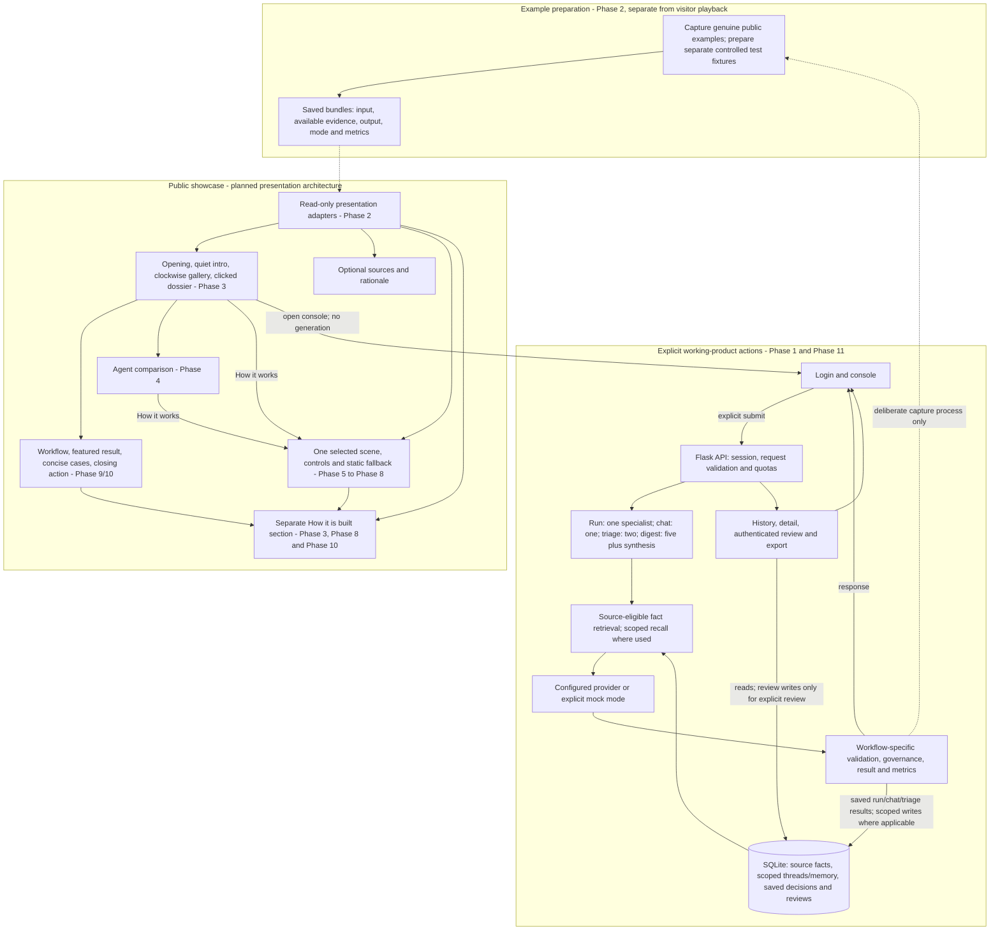
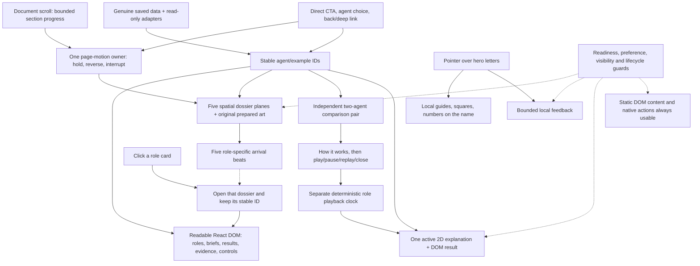
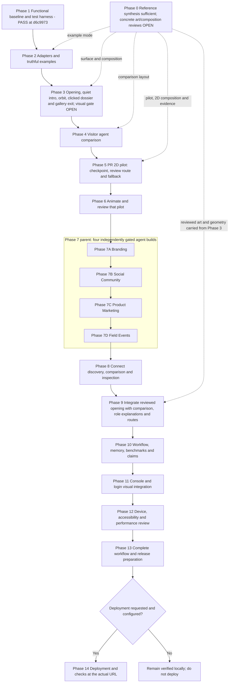
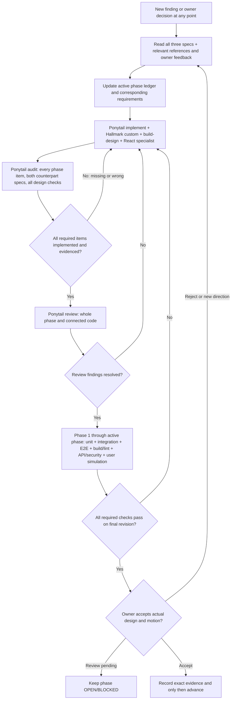

# Marketing OS — blueprint and phased build plan

Updated: 18 November 2026 (Asia/Calcutta).
Status: sitewide design/reference reconciliation, not only an Phase 3 amendment.
Phase 1 PASS at d6c9973; Phase 2 PASS at 0dc18d6, documented through 827ed61. Phase 3's book
and static-machine candidates were rejected; useful data/API/security work is
retained but the intended motion-led experience is not built. Phase 3 OPEN; Phase 4–Phase 14
not started. Historical evidence is in §13–§19; current direction is §1–§12/§20.

**Before phase work or resumption:** read [PHASE_EXECUTION_GUIDE.md](PHASE_EXECUTION_GUIDE.md),
including its saved checkpoint. It explains how to correlate these files, resolve
placement/behaviour questions, choose skills/subagents, execute the audit/fix/
review/test loop and then understand the next phase. Do not code an unresolved
product/art decision or unfamiliar mechanism by guessing.

**Standing project-wide rule:** every owner instruction about design, skills,
audit, testing or process applies to all affected phases by default, past/current/
future. An imminent-phase example does not narrow it. Read the blueprint's
standing instructions and this file's all-phase counterpart contracts; update
all three files and affected acceptance evidence before continuing changed work.

Local working copy only: the owner removed these three planning files from
GitHub. Do not stage, commit or push them without a new explicit instruction.
This revision changes no application, recordings, dependency or environment.

## 1. Purpose and authority

Build an outstanding motion-led portfolio case study with a working product at its centre. An ordinary visitor should understand the business value through an engaging visual story. A hiring manager or ML engineer should be able to inspect the implementation, evidence, trade-offs, and limits.

Read these three current documents together:

- [Blueprint and build plan](MARKETING_OS_BLUEPRINT_PLAN.md): scope, dependencies, phases, verification, progress.
- [Design and layout](DESIGN_AND_LAYOUT.md): visual system, content, agent comparison, research, design checklists.
- [Animation](ANIMATION.md): sitewide clocks/geometry/interruption, component effects, role explanations, lifecycle and motion acceptance.
- Local [website reference study](/workspace/reviews/WEBSITE_REFERENCE_STUDY.md): evidence from Freeland, Strata and earlier Antimatter; use as reference, not literal recreation instructions.

The owner's latest instructions govern. Confirmed decisions are requirements. Research shortlists and proposed scene ideas are not final selections. Resolve a relevant open choice before implementing the part that depends on it; independent work may continue.

The original three Claude documents remain unchanged in section 16 of [the historical working record](FRONTEND_DESIGN_WORKING.md). Their old phase prompts, copy, counts, and flat-SVG constraints do not override this blueprint or the owner's newer decisions. Anti Gravity's reports are background evidence. This document does not authorize deployment or automatic publication.

### Standing instructions for every phase — owner clarification, 18 November

**Project-wide by default:** the owner's design, skill, audit, testing and process
instructions govern ALL phases, including completed phases affected by later
changes, the current phase and every future phase. An example naming Phase 3 does
not restrict a general instruction to Phase 3. A restriction applies only when
the owner explicitly scopes it. Do not ask the owner to repeat standing rules.

Every phase inherits the same evolving three-file contract, original design
checklists, reference-study decisions, component/palette/art/motion principles,
Ponytail/Hallmark/build-design/React-specialist workflow, completeness audit and
remediation, connected-code review, full final verification and owner acceptance.
Use the tools according to actual phase scope; do not force a UI redesign into a
backend-only change or invent effects so every optional technique looks used.

Translate each new instruction into every affected phase's concrete deliverables,
both counterpart specifications, shared architecture and verification. Record
unchanged/out-of-scope items with reasons. Rejected work returns to specification
revision and implementation; invalidate affected passes at that revision, while
preserving what historical tests actually established. No completed phase is
exempt from later owner direction. Scope does not stop at the imminent phase.

Each phase below now contains its own linked contract and 39-item design audit
grid. Design/layout and animation each contain matching all-phase counterparts.
These are OPEN evidence ledgers, not claims that checks or code reviews ran.
Phase 7's four children are independent gates; its parent has no duplicate gate.
Phase 0 applies the same reconciliation/review discipline to documents and actual
reference evidence, without fabricating implementation/runtime results.

### One roadmap across three documents

There are **15 top-level phases, Phase 0–Phase 14**. Phase 7 is a parent containing four sequential, independently verified subphases, Phase 7A–Phase 7D. Replacing that parent with its four children gives **18 separately tracked stages: one research/decision stage and 17 implementation stages**. Do not count Phase 7 again as a fifth agent build or a separate exit gate.

| Document | Responsibility in every phase | Independent phase sequence? |
|---|---|---|
| This blueprint | What to build, prerequisites, decisions, order, required verification, and completion evidence | Yes: the single Phase 0–Phase 14 roadmap |
| [DESIGN_AND_LAYOUT.md](DESIGN_AND_LAYOUT.md) | How that phase should look and communicate; layout, palette, comparison, content, accessibility, U01–U20 and S01–S19 review | No: requirements mapped to the same phase IDs |
| [ANIMATION.md](ANIMATION.md) | How that phase should move and respond; scene meaning, state/data boundaries, controls, M01–M21, P01–P21, resource/fallback checks | No: requirements mapped to the same phase IDs |

Design/layout and animation currently each have 16 numbered specification sections. Those sections, animation beats, research inventories, and checklists are **not extra build phases**. The archived Claude plan's older Phase/S identifiers remain historical references; Anti Gravity's completed work is retained rather than restarted. Use the current phase IDs below for new implementation and evidence.

**Mandatory lookup rule, requested by the owner on 15 November:** at the start or resumption of a phase, before each atomic change, and before declaring a phase complete, read this document's [architecture and correspondence map](#10-architecture-and-phase-correspondence-map), the active phase's section 6 scope, and its mapped design/animation sections. Use the [phase execution checklist](#11-required-phase-execution-checklist) to record what was built and what was tested. Do not advance from memory, a diagram alone, old chat context, or a green targeted test. Missing evidence or a required owner decision keeps the affected phase OPEN/BLOCKED.

### Sitewide direction and precedence

The opening explains the product, the first scroll reaches a quiet
two-level introduction, and the clockwise five-agent gallery comes third.
Scroll focuses a role. Selecting its card opens the dossier, and **How it works**
explicitly starts that role's explanation. Continue below the gallery to
workflow, featured result, concise case previews and the closing console action.
Use the same Phase 3 dither treatment across the site, with the existing light
palette and crisp text and controls.

**Open console** is the primary opening action. The Spider Button belongs on
**Explore the agents** as the secondary action. The Vector reference applies
only to the product name at its current hero scale. Pointer position near the
letters drives the dotted contours, lines, squares and coordinates. The
working name is **Marketing Helper**, pending a final choice.

Use semantic page content, original prepared art, spatial DOM/CSS and bounded
Canvas2D decoration where useful. Same-page handoffs follow native scroll.
The pointer wordmark, scroll-linked orbit and intentionally opened explanations
have separate clocks. Phase 3 trials glides, nav and hover. Phase 9 finishes
the selected choreography. Keep text motion brief. Set aside dedicated SVG
animation, a separate slider, WebGL shaders, physics and live 3D. Retain the
palette, genuine records and backend contracts. [Motion and case research](/workspace/reviews/WEBSITE_REFERENCE_STUDY.md#phase-motion-and-case-study-research)

Current specifications supersede earlier implementation instructions in the
historical §13–§19 records. Keep their tests/provenance intact. §20 lists what
was retained, revised, discarded or left for bounded visual review throughout
all three files; do not implement contradictory old paragraphs from memory.

## 2. Decisions and open choices

| Item | Current status | Consequence across phases |
|---|---|---|
| Motion-led portfolio, business clarity and inspectable engineering | CONFIRMED purpose | Design one whole journey, not static generic SaaS sections |
| Exact paper/ink/yellow/peach/brown reference | RETAINED | All page, component and scene art roles mapped in D §4; no template dark theme |
| Paper/dossier | CONFIRMED, organisational identity | Not a literal book/library or cardboard-machine mandate |
| Opening → quiet introduction → clockwise gallery | CONFIRMED sequence, Q17 | Intro has its own space before agents; Phase 3 proves the first three sections and gallery exit |
| Clockwise circular/spiral five-agent cards | CONFIRMED latest owner selection, Q14 | Supersedes earlier stack-only investigation; Phase 3 geometry and Phase 8/Phase 9 handoffs |
| Open console primary, Explore the agents secondary | CONFIRMED Q10 | Direct console and gallery destinations, usable targets and focus |
| Spider on Explore | CONFIRMED Q13 | Secondary gallery action retains its pointer, keyboard and fallback contracts |
| Vector Wordmark | CONFIRMED first-screen, current-scale, pointer-driven name treatment, Q12 | Local letter guides, dotted contours, squares and numbers. Final name and rendered effect remain for review |
| Two-agent comparison, one shared stage | CONFIRMED Q02 | All five discoverable, pair and active playback separate; Phase 4/Phase 8 |
| Distinct scenes under How it works, PR first | CONFIRMED Q03/Q18 | Card click opens the dossier first. Phase 5/6 pilot and Phase 7A–D prove different actions and components for each role |
| Guided 2D sequencing | Q05 revised by Q20 | Review the 2D checkpoint and explicit human review in Phase 5 |
| Same-page glide, animated navigation and hover | CONFIRMED scope, Q20 | Trial actual behavior in Phase 3 and settle it in Phase 9 |
| Purpose/brief/visual/result; optional support; engineering separate | CONFIRMED Q08 | Apply every surface; public capture timestamps/quota/debug notes excluded |
| Genuine saved public responses; controlled routine tests | CONFIRMED Q01, Phase 2 PASS | Immutable captures and read-only adapters; no live call on replay/selection |
| Existing Phase 3 dithering across the whole website | CONFIRMED Q04/Q16 | Reuse its texture character on site surfaces, preserve contrast, keep pixel loaders tied to genuine pending work |
| Separate background/trend lists | RETAINED research history | All original items retained in D §9/§10; no need to fill a shortlist quota |
| Desktop first | CONFIRMED current priority | Preserve baseline responsive safety, bespoke mobile polish Phase 12 |
| Whole-project staged verification, atomic implementation commits | REQUIRED | Full phase gate and owner visual acceptance; no next phase on stale evidence |
| Hybrid render/asset strategy | IMPLEMENTER RECOMMENDATION from study | DOM for content, spatial planes/art, optional local Canvas2D; prove quality and budgets |
| Clicked dossier expansion from the foreground card | CONFIRMED interaction, proposed layout | Keep one stable agent ID and test continuity. Scroll alone focuses the card; it does not open the dossier |
| Book/box candidates, Renaissance, literal dial imitation | REJECTED/not selected | Do not revive as baseline or fallback art direction |
| Autodrifting gallery, timed fake percentages, template leaves/voxels/clients | NOT ADOPTED | Keep reference facts separate from our spec; no default inclusion |
| Extra general reference website | NOT REQUIRED | Existing study sufficient; create/review original art and working prototype next |
| Hosting/runtime/publication | DEFERRED Q07 | Local owner review via checkout; no Render or deployment prerequisite |

“Hero” is the opening; “gallery/deck” is agent discovery. Current gallery means
clockwise circular/spiral cards, not a promise to retain the old 600vh stack.
Open details are the final name, contemporary role art, orbit geometry and entrances,
role-specific component choices, navigation expansion, scroll pacing and budgets.

## 3. Where we stand

| Area | Evidence / current boundary |
|---|---|
| Inherited frontend | showcase-redesign at 31698d4c6efb9ef5969bc9e1a21e5b08c10bc4c3; deck/tabs/Lenis/navigation preserved as history |
| Backend repair foundation | fix/backend-contracts through 67a1c57; bounded repairs, not universal backend/security completion |
| Phase 1 | PASS at d6c9973; saved results, actual server review, namespace/request isolation, honest modes/errors, browser/API harness and responsive baseline |
| Phase 2 | PASS at 0dc18d6; adapters, five genuine gemini-3.5-flash-lite records, request-captured evidence and read-only selection |
| Phase 3 technical work | Original/corrected separate catalogs, SPA/integration/security work retained; original captures unchanged |
| Phase 3 rejected visuals | Book study at /preview/f03/motion and schematic frames at /preview/f03 are not accepted or promoted |
| Latest historical loop | §19: 411 backend tests, 56 frontend units, 18 dev +18 built browser checks; dependency/deployment limits remain, not a fresh test run now |
| New visual experience | The connected draft exists at /; current gallery art, Wordmark and opening sequence are superseded by revision 7. Role-specific 2D explanations and comparison remain later work |
| Repository / review | Frontend design work is on `feat/frontend-overhaul`; API-only `main` has verified backend repairs through Phase 3. These three working documents remain local |

Dated command/test counts are historical evidence, not reusable phase PASS.
Owner interaction uses a GitHub checkout locally in Anti Gravity when reviewing
application changes. Cloud loopback is not the laptop's localhost. No hosting
setup is required for that route and no existing deployment is assumed.
Keep [backend repair](BACKEND_REPAIR_TRACKER.md) and
[phase security checklist](BACKEND_PHASE_CHECKLIST.md) limitations visible.

## 4. Product and evidence boundaries

1. A one-shot run routes to one chosen specialist. Chat uses that specialist's permitted memory/transcript scope. Triage independently briefs two specialists and merges their views. The digest fans out to all five and synthesizes on demand.
2. Five specialists share a fact corpus and execution core, with different prompts and memory scopes. They are not five independently trained models.
3. Source eligibility and valid fact IDs establish source linkage; they do not prove every generated claim is supported or current.
4. Risk flags, authenticated human review, and memory admission are different mechanisms. An operator review does not execute an external marketing action or automatically promote memory.
5. A staged 2D explanation illustrates the saved brief, evidence and outcome. Never depict unavailable inner reasoning, automatic phrase removal, sentiment collection, scheduling, or optimization as an observed backend event.
6. Comparison defaults to presentation/replay data. Opening, comparing, or replaying scenes must not silently invoke paid models or write agent memory.
7. Public examples use concise, honest example/fictional-case identification and never imply replay is a fresh model run. Preserve recording mode/source provenance in the original records; their existence does not require displaying capture dates or operational metadata. Optional sources/rationale support the result. Missing measurements remain unknown internally; do not invent numbers or synthetic progress percentages.

8. Use prepared art and CSS projection for depth. Keep actual results and controls in semantic DOM.
9. Scroll, hover and playback change presentation only. A foreground card counter is not selected workflow state; stable IDs must coordinate the actual brief/result.
10. Loading reports real asset/request readiness, not fake progress or hidden reasoning. Semantic content cannot depend on a timer overlay, zero-opacity initialization or graphics initialization.
11. New case studies use real companies and independently reviewed public sources. Mark the submitted brief and agent recommendations as such. Retire the old corpus and E2E Networks material from active use, migrate existing databases and recapture genuine examples before promoting replacements. Q19 and Phase 10 own this source data boundary.

## 5. Mandatory gate for every implementation phase

Work one phase at a time using [milestone checkpoints](#milestones-for-every-phase).
Define acceptance, work in bounded changes and run targeted checks at each
milestone. The final milestone verifies Phase 1 through the active phase on the
same candidate revision. Link shared suite runs to every phase they cover and
record each phase's distinct acceptance evidence. Fix findings in the owning
milestone, then repeat the applicable audit, review and final tests.

| Lane | Required evidence at every implementation phase exit |
|---|---|
| Backend connection | Running frontend reaches the intended Flask API; authentication/session handling and actual response shapes work. Check direct console navigation and chosen development-origin configuration |
| Unit tests | Existing backend unit tests plus meaningful frontend tests pass. Add tests for changed logic/adapters/interactions, not tests that merely repeat CSS or implementation details |
| Integration tests | Existing backend integration tests pass; exercise the affected client-to-API flow in a browser with isolated state and controlled inference |
| Agent operation | Exercise all five one-shot specialists, chat continuation and memory, two-agent triage, five-agent digest, history/detail/review, export, and logout. Check attribution and namespace boundaries |
| UI regression | Build/lint pass; browser console has no application errors in covered journeys; compare relevant screenshots, mobile behaviour, keyboard use, reduced motion, and error/empty/loading states |
| Design review | Apply D U/S/V/C and A acceptance/M/P criteria; inspect actual normal-motion composition, art quality, clocks/interruptions and static fallback. Mark PASS/FAIL/BLOCKED/N/A with evidence; owner acceptance is separate from green tests |

The owner subsequently required a repeatable backend/API/security loop at every
phase. Use [the backend phase checklist](BACKEND_PHASE_CHECKLIST.md) and
`tools/verify_phase.py`; its technical report supplements these six lanes and
never closes an unapproved visual gate. Every registered API needs explicit
healthy-contract/auth tests. Record threat applicability, dependency findings
and deployment-layer limits rather than claiming universal security.

No “done” or “next phase” while a required lane fails or is untested. A skipped required check is not a pass. A phase that reveals a shared integration defect must fix it or explicitly revise scope with the owner before closing.

When any backend gap is found, add it as an extra repair step in the discovery
phase's own contract and enter it in the [backend gap register](BACKEND_PHASE_CHECKLIST.md#backend-gap-register).
Follow the [gap repair loop](PHASE_EXECUTION_GUIDE.md#backend-gap-discovered-during-any-phase):
Ponytail Audit and Review of the cause, Ponytail repair and targeted checks,
independent re-audit and code review, then cumulative verification from Phase 1
through the discovery phase on the repaired revision. Record each phase's
acceptance checks and the full shared test/security gate before clearing the
gap. This rule applies even when the discovery phase's plan is already written.
Every verified backend fix ships to `main` even if it was first implemented
during an overhaul phase. Keep the backend-only `main` contract and exercise
the fix with any affected browser workflow on `feat/frontend-overhaul`.

Documentation/research Phase 0 has a review gate rather than fabricated application-test results: verify references, decision status, document consistency, and that source code stayed unchanged. Do not rerun a paid agent for a documentation edit.

### Evolving phases and mandatory skill loop — owner instruction, 18 November

Call the work Phase 0, Phase 1, Phase 2, Phase 3 … Phase 14. Legacy F-prefixed
codes remain only where an existing test command, artifact or historical record
needs its exact identifier. A phase is an evolving implementation contract,
not an immutable ticket or permission to ignore later owner feedback.

At the start/resumption of every phase, read its complete scope here, corresponding
design/layout and animation sections, relevant website-study findings and latest
owner decisions. Put the actual required work into the active phase's own ledger:
requirement, design/animation correspondence, implementation location, evidence,
status and current revision. A cross-reference to an unchecked master list alone
is insufficient. Every phase has its own concrete contract in §6 and matching
all-phase design/animation counterparts; update them before implementation begins.

When the owner adds/rejects a design or implementation reveals a new requirement:
update the affected phase ledger AND corresponding sections in both other files,
then update downstream phases/architecture and record what supersedes what. Reopen
affected checks and invalidate their earlier PASS evidence. Previously completed
phases are evidence at their tested revision, not frozen scope; reopen affected
parts when new requirements reach them without rewriting historical results.
No deletion, N/A or deferral merely to make a missing required feature pass.

Required order for every implementation phase:

1. **Read and reconcile:** all three current specs plus relevant references;
   enumerate exact current requirements and applicable U/S/V/C/M/P/A checks.
2. **Implement with Ponytail:** smallest COMPLETE solution, including the wanted
   motion, all affected callers/states and meaningful targeted checks. Apply
   Hallmark within our custom direction and build-design against actual supplied
   or reviewed frames. Delegate scoped React work/review to the React specialist.
3. **Ponytail audit:** explicitly scope it to the entire implemented phase and
   its integration boundaries, and add the owner's completeness requirement:
   check EVERY phase-ledger item against both other files, including all 39 U/S
   checks and phase-assigned trends/background/motion/component requirements.
   Report implementation, observed evidence and PASS/FAIL/BLOCKED/N/A per row.
4. **Remediate and re-audit:** audit is report-only; use a separate Ponytail build
   pass for missing/wrong work. Repeat until all required items are implemented
   and evidenced, or report an exact genuine blocker. Do not use a skill's default
   finding cap/fix budget to drop checklist rows or stop before the agreed result.
5. **Ponytail review:** review all phase code and connected frontend/backend
   callers, dependencies and tests, including relevant unchanged code—not only
   the diff. Fix findings in a build pass and re-review affected paths. This is
   separate from completeness auditing; neither report silently edits code.
6. **Full verification loop:** backend/frontend unit and integration, real-browser
   end-to-end development AND compiled-app workflows, build, lint, API health/auth
   contracts, full five-agent workflow and backend security checklist. Simulate
   actual use and failure/interruption states, inspect normal-motion design and
   recordings, and verify padding/type/colour/state consistency. Use controlled
   inference for routine checks and preserve quota/security controls.
7. **Repair, recheck and close:** failures go back to implementation, relevant
   completeness/code reviews and affected/full verification on the final revision.
   Owner rejection returns to specification revision and remediation. Close only
   with current required evidence and actual owner visual acceptance; then move
   to the next phase. Missing evidence is OPEN/BLOCKED, never presumed PASS.

Skill application follows owner instructions: Hallmark does not deal a new theme,
replace our palette or limit the repeat-until-complete loop. Build-design treats
inspiration sites as references, not exact frames to copy; screenshot dimensions
are estimates, and exact match requires actual design evidence. Do not demand a
new Figma file simply to repeat settled direction. Use the supplied components
and review the concrete original composition; essential existing accessibility,
error/security states remain even if a reference image does not draw them.

Ponytail audit is not a visual linter and does not replace Hallmark/rendered
inspection. Include both actual design/motion evidence and code/test evidence in
the completeness result. All reports identify what was not checked. This rule
is procedural, not a claim that CI automatically enforces human visual review.
The current edit establishes this loop; it is not a completed implementation audit,
code review or passing app test run, and authorises no publication or doc push.

### Commands and tooling reality

Current backend checks, from the repository root with the project environment active:

```bash
phase_test_dir="$(mktemp -d)"
DB_PATH="$phase_test_dir/tests.db" python -m pytest -q tests/unit tests/integration
```

Current frontend checks, from `frontend/`:

```bash
npm run lint
npm run build
```

Phase 1 introduced these frontend test commands; they must remain runnable before a visual implementation phase begins:

```bash
npm run test:unit
npm run test:integration
npm run test:integration:built
```

The integration configurations use temporary SQLite databases, controlled/mock inference and synthetic test credentials. The normal suite starts Flask plus a Vite proxy; the built suite requires `npm run build` and serves the actual SPA directly through two Gunicorn workers on Linux (Flask on native Windows). Run the suites sequentially because they share port 5120. See `frontend/playwright.config.js`, `frontend/playwright.built.config.js` and `frontend/tests/integration/start-api.mjs`; set `PLAYWRIGHT_CHROMIUM_EXECUTABLE_PATH` or `MARKETING_OS_TEST_PYTHON` for alternate installed executables. Install Playwright's Chromium if no compatible browser is available. Use controlled inference for routine checks; do not require paid calls at every phase. Future phases must rerun the complete gate rather than reuse Phase 1's results.

The full agent workflow consumes nine successful AI actions in the existing helper. Use fresh test identities/databases for additional error cases so visitor/IP quotas do not invalidate a test. Verify quota behaviour in its own cases; do not disable product limits to make the test pass.

### Evidence saved at each phase boundary

Record phase ID, source revision/working changes, changed files, commands and exit codes, test summaries, API/browser workflow results, screenshots at named states, device sizes, design checklist results, known limits, and next-phase eligibility. Store durable tests in the repository; record where local-only evidence can be found. Counts alone do not prove integration.

### Additional sitewide verification from the reference study

Verify each subsystem rather than treating a reduced-motion screenshot or one
Lighthouse score as the whole experience. Include clock/selection synchronization,
CTA/focus, overlap/keyboard access, fast direction changes, deep/direct entry,
resize, unavailable graphics, broken or undecodable assets,
runtime preference changes, hidden/offscreen work and repeated mount/unmount.
Record actual budgets/frame pacing and unexplained gaps; no source-template
performance claim transfers automatically. Preserve existing responsive checks;
deferred bespoke mobile art is tracked until Phase 12, not falsely passed now.

Screenshots are useful key-pose evidence; motion requires an actual recording
and interactive owner review. No application changes occur during this doc-only
revision, so no new implementation/test/security PASS is asserted.

## 6. Build sequence

Every implementation phase from Phase 1 onward inherits all six gate lanes. Phase-specific checks below are additional. The phases are a proposed implementation sequence for this blueprint, not claims of work completed.

<a id="f00--reference-synthesis-and-bounded-art-decisions"></a>
### Phase 0 — reference synthesis and bounded art decisions

- Apply the existing Freeland/Strata/Antimatter study and component audit across
  the whole site. Enough general research exists; no further website upload
  blocks the connected prototype. Preserve evidence confidence and source unknowns.
- Record retain/revise/discard decisions in §20. Adopt coherent art/typography,
  selective depth, mixed rendering and explicit clocks; reject copied identity,
  fake counters/progress and assumptions of universal WebGL/global pinning.
- Keep owner palette, Spider Explore, wanted Wordmark, clockwise five-agent
  discovery, genuine examples, pair comparison, PR-first guided scene and light
  graphite direction. Earlier book/box/stack-only plans are superseded.
- Resolve art/composition/texture/wordmark trials in Phase 3; 2D composition and field binding
  proof in Phase 5; mobile art Phase 12. Do not make every later choice an immediate blocker.
- Exit: source evidence and current direction reconciled; dependent reviews have
  named phases. General study is sufficient; unreviewed concrete art remains open.

<a id="f01--functional-frontend-baseline-and-verification-harness"></a>

<a id="phase-0-completion-contract"></a>
#### Phase 0 completion contract — revision 1, 18 November

Standing owner instructions and the complete §5/§11 loop apply to this phase.
Read this scope, D §1–§10, §14, §16 and A §1–§4, §8, §13–§16, plus this phase's entries in the all-phase design
and animation counterpart tables. Update all three when new input affects them.
Historical results remain dated; these new rows do not claim implementation or
reverification. Each required item needs current evidence before a new closure.

| ID | Concrete phase requirement | Corresponding design / animation requirement | Required evidence | Status |
|---|---|---|---|---|
| P0-01 | Apply the existing Freeland/Strata/Antimatter study and component audit across the whole site. Enough general research exists; no further website upload blocks the connected prototype. Preserve evidence confidence and source unknowns. | D §1–§10, §14, §16; A §1–§4, §8, §13–§16 | Actual source/decision and cross-file consistency evidence; runtime implementation/tests N/A | OPEN |
| P0-02 | Record retain/revise/discard decisions in §20. Adopt coherent art/typography, selective depth, mixed rendering and explicit clocks; reject copied identity, fake counters/progress and assumptions of universal WebGL/global pinning. | D §1–§10, §14, §16; A §1–§4, §8, §13–§16 | Actual source/decision and cross-file consistency evidence; runtime implementation/tests N/A | OPEN |
| P0-03 | Keep owner palette, Spider Explore, wanted Wordmark, clockwise five-agent discovery, genuine examples, pair comparison, PR-first guided scene and light graphite direction. Earlier book/box/stack-only plans are superseded. | D §1–§10, §14, §16; A §1–§4, §8, §13–§16 | Actual source/decision and cross-file consistency evidence; runtime implementation/tests N/A | OPEN |
| P0-04 | Resolve art/composition/texture/wordmark trials in Phase 3; 2D composition and field binding proof in Phase 5; mobile art Phase 12. Do not make every later choice an immediate blocker. | D §1–§10, §14, §16; A §1–§4, §8, §13–§16 | Actual source/decision and cross-file consistency evidence; runtime implementation/tests N/A | OPEN |
| P0-05 | Exit: source evidence and current direction reconciled; dependent reviews have named phases. General study is sufficient; unreviewed concrete art remains open. | D §1–§10, §14, §16; A §1–§4, §8, §13–§16 | Actual source/decision and cross-file consistency evidence; runtime implementation/tests N/A | OPEN |
| P0-D | Record current palette, art/motion direction, components, retained/rejected trends and 39-check expectations across all phases; keep genuine unknowns bounded. | D §1–§10, §14, §16 | Documented design requirements and owner dispositions + all 39 rows below; no rendered-app claim | OPEN |
| P0-M | Record scroll/pointer/playback distinctions, geometry/renderer uncertainty, static/reduced-motion and original scene-story requirements without claiming implementation. | A §1–§4, §8, §13–§16 | Documented clock/state/fallback requirements and source confidence + A/M/P dispositions; runtime proof N/A | OPEN |
| P0-V | Document/source/decision consistency and owner direction; no fabricated runtime test or paid capture. | §5/§11 and both counterpart files | Exact document revision, completeness/source consistency audit, corrections/re-audit and owner direction; app code review/tests N/A | OPEN |

Phase 0 uses the same named skill/React expertise to reconcile real design,
implementation and verification requirements. Its deliverable is the cross-file
research/decision contract, so audit/correction/re-audit covers those documents,
source confidence and owner choices. App implementation, code review, browser
simulation and runtime suites are N/A for this research-only scope; they remain
mandatory in every implementation phase. Do not fabricate a render/test or owner
acceptance. New decisions propagate to every affected phase before coding.

<details>
<summary>Phase 0: all 20 unslop checks and 19 slop-indicator checks</summary>

Every row is required in this phase's completeness report. Document/reference requirements review; no runtime claims. For each row
record implementation/files, observation or test, revision and PASS/FAIL/BLOCKED
or a concrete N/A reason. Absence of required work is not N/A.

| ID | Required design check | Implementation / evidence / verdict | Current audit status |
|---|---|---|---|
| U01 | Delete filler badges; truthful mode/review state must remain inspectable. | Not yet recorded for this current contract | OPEN |
| U02 | Drop redundant labels and unnecessary hierarchy levels. | Not yet recorded for this current contract | OPEN |
| U03 | Remove the arbitrary italic word from headings. | Not yet recorded for this current contract | OPEN |
| U04 | Use mono only where it adds clarity. | Not yet recorded for this current contract | OPEN |
| U05 | Use one coherent design system across showcase, login, and console. | Not yet recorded for this current contract | OPEN |
| U06 | Show the actual product and attributable results. | Not yet recorded for this current contract | OPEN |
| U07 | Enlarge/emphasize the main feature rather than making every element loud. | Not yet recorded for this current contract | OPEN |
| U08 | Group related information with spacing. | Not yet recorded for this current contract | OPEN |
| U09 | Make the headline specific to the actual system and use case. | Not yet recorded for this current contract | OPEN |
| U10 | Emphasize the primary action; keep alternatives visibly secondary. | Not yet recorded for this current contract | OPEN |
| U11 | Give the accent colour a defined role. | Not yet recorded for this current contract | OPEN |
| U12 | Keep icon family, stroke, size, meaning and optical weight beside labels consistent; see C05 in §5. | Not yet recorded for this current contract | OPEN |
| U13 | Remove unnecessary embellishments. | Not yet recorded for this current contract | OPEN |
| U14 | Check nested rounded geometry using outer radius minus full applicable inset, including border/padding (C01 in §5); otherwise record N/A for square corners. | Not yet recorded for this current contract | OPEN |
| U15 | Verify text contrast and focus visibility in actual states. | Not yet recorded for this current contract | OPEN |
| U16 | Wrap headings correctly across widths and zoom levels. | Not yet recorded for this current contract | OPEN |
| U17 | Check optical alignment as well as numerical alignment. | Not yet recorded for this current contract | OPEN |
| U18 | Clarify the original “Tabular notes”; if tabular numerals were intended, apply them to changing/aligned metrics. | Not yet recorded for this current contract | OPEN |
| U19 | Provide real loading, error, empty, and retry states. | Not yet recorded for this current contract | OPEN |
| U20 | Animate useful feedback for actual interactions and results. | Not yet recorded for this current contract | OPEN |
| S01 | No filler tags and pills. | Not yet recorded for this current contract | OPEN |
| S02 | No excessive italicized words. | Not yet recorded for this current contract | OPEN |
| S03 | No trend-led adoption of Instrument Serif. | Not yet recorded for this current contract | OPEN |
| S04 | No cramped/excessive negative kerning. | Not yet recorded for this current contract | OPEN |
| S05 | No unnecessarily detailed UI in the primary view. | Not yet recorded for this current contract | OPEN |
| S06 | No excessive dividers. | Not yet recorded for this current contract | OPEN |
| S07 | No uncontrolled colour shades and opacities. | Not yet recorded for this current contract | OPEN |
| S08 | No unnecessary bordered containers nested around every block. | Not yet recorded for this current contract | OPEN |
| S09 | No overloaded diagrams; reveal technical detail intentionally. | Not yet recorded for this current contract | OPEN |
| S10 | No verbose, redundant copy. | Not yet recorded for this current contract | OPEN |
| S11 | No fake code breadcrumbs or terminal paths. | Not yet recorded for this current contract | OPEN |
| S12 | No purposeless section numbering; explain retained agent identifiers/navigation. | Not yet recorded for this current contract | OPEN |
| S13 | No redundant eyebrows. | Not yet recorded for this current contract | OPEN |
| S14 | No decorative ASCII images. | Not yet recorded for this current contract | OPEN |
| S15 | No arbitrary squircle styling. | Not yet recorded for this current contract | OPEN |
| S16 | No excessive monofonts. | Not yet recorded for this current contract | OPEN |
| S17 | No long, unreadable all-caps subtitles. | Not yet recorded for this current contract | OPEN |
| S18 | No gratuitous gradient backgrounds. | Not yet recorded for this current contract | OPEN |
| S19 | No habitual periods on short titles; preserve natural punctuation where needed. | Not yet recorded for this current contract | OPEN |

</details>

### Phase 1 — functional frontend baseline and verification harness

- Add frontend unit/browser integration tooling and reproducible commands. Start with the actual flows, not screenshots alone.
- Reopen `row.result` by workflow type; handle legacy rows and missing fields honestly. Restore the original result rather than reconstructing it from the option title.
- Wire review to the authenticated decision-review endpoint; reload status from the server, retain risk flags, and prevent approval carrying to another decision.
- Prevent a delayed chat response from replacing a newly selected agent's thread/state. Configure development API origin/proxy and session cookies consistently.
- Correct misleading mode/model controls and unsupported attachment behaviour; show real loading/error/empty states. Do not leave false “live”/“zero hallucination” claims while doing later restyling.
- Check mobile overflow and reduced-motion baseline issues in affected UI. Establish a reproducible list of remaining visual-only issues.
- Exit: login → run → reload → reopen → review → new decision → export → logout works, alongside the full agent gate. Known blocking history/approval failures are closed. Test scripts are real and passing.

<a id="f02--data-adapters-example-capture-and-truthful-content-mode"></a>

<a id="phase-1-completion-contract"></a>
#### Phase 1 completion contract — revision 1, 18 November

Standing owner instructions and the complete §5/§11 loop apply to this phase.
Read this scope, D §2, §3, §12, §13, §15 and A §3, §10, §15, plus this phase's entries in the all-phase design
and animation counterpart tables. Update all three when new input affects them.
Historical results remain dated; these new rows do not claim implementation or
reverification. Each required item needs current evidence before a new closure.

| ID | Concrete phase requirement | Corresponding design / animation requirement | Required evidence | Status |
|---|---|---|---|---|
| P1-01 | Add frontend unit/browser integration tooling and reproducible commands. Start with the actual flows, not screenshots alone. | D §2, §3, §12, §13, §15; A §3, §10, §15 | Exact implementation and targeted observation/test, then full phase loop | OPEN |
| P1-02 | Reopen `row.result` by workflow type; handle legacy rows and missing fields honestly. Restore the original result rather than reconstructing it from the option title. | D §2, §3, §12, §13, §15; A §3, §10, §15 | Exact implementation and targeted observation/test, then full phase loop | OPEN |
| P1-03 | Wire review to the authenticated decision-review endpoint; reload status from the server, retain risk flags, and prevent approval carrying to another decision. | D §2, §3, §12, §13, §15; A §3, §10, §15 | Exact implementation and targeted observation/test, then full phase loop | OPEN |
| P1-04 | Prevent a delayed chat response from replacing a newly selected agent's thread/state. Configure development API origin/proxy and session cookies consistently. | D §2, §3, §12, §13, §15; A §3, §10, §15 | Exact implementation and targeted observation/test, then full phase loop | OPEN |
| P1-05 | Correct misleading mode/model controls and unsupported attachment behaviour; show real loading/error/empty states. Do not leave false “live”/“zero hallucination” claims while doing later restyling. | D §2, §3, §12, §13, §15; A §3, §10, §15 | Exact implementation and targeted observation/test, then full phase loop | OPEN |
| P1-06 | Check mobile overflow and reduced-motion baseline issues in affected UI. Establish a reproducible list of remaining visual-only issues. | D §2, §3, §12, §13, §15; A §3, §10, §15 | Exact implementation and targeted observation/test, then full phase loop | OPEN |
| P1-07 | Exit: login → run → reload → reopen → review → new decision → export → logout works, alongside the full agent gate. Known blocking history/approval failures are closed. Test scripts are real and passing. | D §2, §3, §12, §13, §15; A §3, §10, §15 | Exact implementation and targeted observation/test, then full phase loop | OPEN |
| P1-D | All role controls, forms, history/review and error/empty/loading surfaces remain honest, readable, consistently styled and accessible. | D §2, §3, §12, §13, §15 | Rendered/spec evidence + all 39 rows below, V/C dispositions | OPEN |
| P1-M | Request/agent switching cancels stale work; pending/success/review follows real events, preference changes preserve readable flow and navigation. | A §3, §10, §15 | Real state/motion/failure evidence + applicable A/M/P dispositions | OPEN |
| P1-V | Browser login, all agents, chat/memory, triage/digest, history/review/new decision, export/logout and API/session regressions. | §5/§11 and both counterpart files | Exact final revision, audit/fixes/re-audit, code review/fixes, tests and acceptance | OPEN |

Phase 1 uses Ponytail for implementation, Hallmark/build-design within the
owner's actual custom design/evidence, and scoped React specialist support where
React/UI is involved. Audit the entire phase and both counterparts; fix and repeat,
then review all phase/connected code and run the full backend/frontend/API/security
and real-user simulation gate. Unchanged visual aspects still get explicit
evidence/dispositions, not a silent skip. Actual runtime work applies to code
phases; Phase 0 cannot manufacture app-test or screenshot results. No required
review/test is presumed complete; owner rejection reopens affected work.

<details>
<summary>Phase 1: all 20 unslop checks and 19 slop-indicator checks</summary>

Every row is required in this phase's completeness report. Historical pass retained; this current audit needs evidence. For each row
record implementation/files, observation or test, revision and PASS/FAIL/BLOCKED
or a concrete N/A reason. Absence of required work is not N/A.

| ID | Required design check | Implementation / evidence / verdict | Current audit status |
|---|---|---|---|
| U01 | Delete filler badges; truthful mode/review state must remain inspectable. | Not yet recorded for this current contract | OPEN |
| U02 | Drop redundant labels and unnecessary hierarchy levels. | Not yet recorded for this current contract | OPEN |
| U03 | Remove the arbitrary italic word from headings. | Not yet recorded for this current contract | OPEN |
| U04 | Use mono only where it adds clarity. | Not yet recorded for this current contract | OPEN |
| U05 | Use one coherent design system across showcase, login, and console. | Not yet recorded for this current contract | OPEN |
| U06 | Show the actual product and attributable results. | Not yet recorded for this current contract | OPEN |
| U07 | Enlarge/emphasize the main feature rather than making every element loud. | Not yet recorded for this current contract | OPEN |
| U08 | Group related information with spacing. | Not yet recorded for this current contract | OPEN |
| U09 | Make the headline specific to the actual system and use case. | Not yet recorded for this current contract | OPEN |
| U10 | Emphasize the primary action; keep alternatives visibly secondary. | Not yet recorded for this current contract | OPEN |
| U11 | Give the accent colour a defined role. | Not yet recorded for this current contract | OPEN |
| U12 | Keep icon family, stroke, size, meaning and optical weight beside labels consistent; see C05 in §5. | Not yet recorded for this current contract | OPEN |
| U13 | Remove unnecessary embellishments. | Not yet recorded for this current contract | OPEN |
| U14 | Check nested rounded geometry using outer radius minus full applicable inset, including border/padding (C01 in §5); otherwise record N/A for square corners. | Not yet recorded for this current contract | OPEN |
| U15 | Verify text contrast and focus visibility in actual states. | Not yet recorded for this current contract | OPEN |
| U16 | Wrap headings correctly across widths and zoom levels. | Not yet recorded for this current contract | OPEN |
| U17 | Check optical alignment as well as numerical alignment. | Not yet recorded for this current contract | OPEN |
| U18 | Clarify the original “Tabular notes”; if tabular numerals were intended, apply them to changing/aligned metrics. | Not yet recorded for this current contract | OPEN |
| U19 | Provide real loading, error, empty, and retry states. | Not yet recorded for this current contract | OPEN |
| U20 | Animate useful feedback for actual interactions and results. | Not yet recorded for this current contract | OPEN |
| S01 | No filler tags and pills. | Not yet recorded for this current contract | OPEN |
| S02 | No excessive italicized words. | Not yet recorded for this current contract | OPEN |
| S03 | No trend-led adoption of Instrument Serif. | Not yet recorded for this current contract | OPEN |
| S04 | No cramped/excessive negative kerning. | Not yet recorded for this current contract | OPEN |
| S05 | No unnecessarily detailed UI in the primary view. | Not yet recorded for this current contract | OPEN |
| S06 | No excessive dividers. | Not yet recorded for this current contract | OPEN |
| S07 | No uncontrolled colour shades and opacities. | Not yet recorded for this current contract | OPEN |
| S08 | No unnecessary bordered containers nested around every block. | Not yet recorded for this current contract | OPEN |
| S09 | No overloaded diagrams; reveal technical detail intentionally. | Not yet recorded for this current contract | OPEN |
| S10 | No verbose, redundant copy. | Not yet recorded for this current contract | OPEN |
| S11 | No fake code breadcrumbs or terminal paths. | Not yet recorded for this current contract | OPEN |
| S12 | No purposeless section numbering; explain retained agent identifiers/navigation. | Not yet recorded for this current contract | OPEN |
| S13 | No redundant eyebrows. | Not yet recorded for this current contract | OPEN |
| S14 | No decorative ASCII images. | Not yet recorded for this current contract | OPEN |
| S15 | No arbitrary squircle styling. | Not yet recorded for this current contract | OPEN |
| S16 | No excessive monofonts. | Not yet recorded for this current contract | OPEN |
| S17 | No long, unreadable all-caps subtitles. | Not yet recorded for this current contract | OPEN |
| S18 | No gratuitous gradient backgrounds. | Not yet recorded for this current contract | OPEN |
| S19 | No habitual periods on short titles; preserve natural punctuation where needed. | Not yet recorded for this current contract | OPEN |

</details>

### Phase 2 — data adapters, example capture, and truthful content mode

- Define one presentation adapter family for run, chat, triage, digest, saved history, and the five agent scenes. Keep backend result snapshots unchanged.
- Map exact fields and null/legacy/error cases; distinguish generated `knowledge_units` summaries from original retrieved corpus rows.
- Create deterministic test fixtures with explicit mock/control labels. The owner selected genuine saved model responses for public examples. Capture actual responses and the evidence used by that request; do not hand-edit them or reconstruct a convenient retrieval afterwards.
- An unavailable field such as full retrieved rows or `flagged_phrase` remains unavailable. If essential, identify a bounded capture/API change and test it before closing this phase.
- Verify the provider and credentials needed for the chosen genuine public recordings without exposing secrets. Mock fixtures remain valid for routine tests, but cannot close the public-recording requirement. A missing credential is a visible capture blocker, not permission to fabricate a recording or silently change mode.
- Exit: five examples in the chosen truthful mode, tested adapters, citation/mode/metric checks, and comparison/scene data available without inference on selection. If the chosen mode requires live recordings and they cannot be captured, this phase remains open.

<a id="f03--connected-desktop-opening-agent-discovery-and-page-foundation"></a>

<a id="phase-2-completion-contract"></a>
#### Phase 2 completion contract — revision 1, 18 November

Standing owner instructions and the complete §5/§11 loop apply to this phase.
Read this scope, D §2, §3, §7, §8, §12 and A §3, §4, §6, §16, plus this phase's entries in the all-phase design
and animation counterpart tables. Update all three when new input affects them.
Historical results remain dated; these new rows do not claim implementation or
reverification. Each required item needs current evidence before a new closure.

| ID | Concrete phase requirement | Corresponding design / animation requirement | Required evidence | Status |
|---|---|---|---|---|
| P2-01 | Define one presentation adapter family for run, chat, triage, digest, saved history, and the five agent scenes. Keep backend result snapshots unchanged. | D §2, §3, §7, §8, §12; A §3, §4, §6, §16 | Exact implementation and targeted observation/test, then full phase loop | OPEN |
| P2-02 | Map exact fields and null/legacy/error cases; distinguish generated `knowledge_units` summaries from original retrieved corpus rows. | D §2, §3, §7, §8, §12; A §3, §4, §6, §16 | Exact implementation and targeted observation/test, then full phase loop | OPEN |
| P2-03 | Create deterministic test fixtures with explicit mock/control labels. The owner selected genuine saved model responses for public examples. Capture actual responses and the evidence used by that request; do not hand-edit them or reconstruct a convenient retrieval afterwards. | D §2, §3, §7, §8, §12; A §3, §4, §6, §16 | Exact implementation and targeted observation/test, then full phase loop | OPEN |
| P2-04 | An unavailable field such as full retrieved rows or `flagged_phrase` remains unavailable. If essential, identify a bounded capture/API change and test it before closing this phase. | D §2, §3, §7, §8, §12; A §3, §4, §6, §16 | Exact implementation and targeted observation/test, then full phase loop | OPEN |
| P2-05 | Verify the provider and credentials needed for the chosen genuine public recordings without exposing secrets. Mock fixtures remain valid for routine tests, but cannot close the public-recording requirement. A missing credential is a visible capture blocker, not permission to fabricate a recording or silently change mode. | D §2, §3, §7, §8, §12; A §3, §4, §6, §16 | Exact implementation and targeted observation/test, then full phase loop | OPEN |
| P2-06 | Exit: five examples in the chosen truthful mode, tested adapters, citation/mode/metric checks, and comparison/scene data available without inference on selection. If the chosen mode requires live recordings and they cannot be captured, this phase remains open. | D §2, §3, §7, §8, §12; A §3, §4, §6, §16 | Exact implementation and targeted observation/test, then full phase loop | OPEN |
| P2-D | Actual product/brief/result and optional sources stay attributable; no fabricated metrics, decorative diagnostics or inconsistent example presentation. | D §2, §3, §7, §8, §12 | Rendered/spec evidence + all 39 rows below, V/C dispositions | OPEN |
| P2-M | Saved selection has no inference/write; exact identity, absent fields and risk/review data support later scenes without invented timings or hidden reasoning. | A §3, §4, §6, §16 | Real state/motion/failure evidence + applicable A/M/P dispositions | OPEN |
| P2-V | Adapter/null/legacy/source/recording hashes and read-only selection/network checks; controlled fixtures distinct from genuine captures. | §5/§11 and both counterpart files | Exact final revision, audit/fixes/re-audit, code review/fixes, tests and acceptance | OPEN |

Phase 2 uses Ponytail for implementation, Hallmark/build-design within the
owner's actual custom design/evidence, and scoped React specialist support where
React/UI is involved. Audit the entire phase and both counterparts; fix and repeat,
then review all phase/connected code and run the full backend/frontend/API/security
and real-user simulation gate. Unchanged visual aspects still get explicit
evidence/dispositions, not a silent skip. Actual runtime work applies to code
phases; Phase 0 cannot manufacture app-test or screenshot results. No required
review/test is presumed complete; owner rejection reopens affected work.

<details>
<summary>Phase 2: all 20 unslop checks and 19 slop-indicator checks</summary>

Every row is required in this phase's completeness report. Historical pass retained; this current audit needs evidence. For each row
record implementation/files, observation or test, revision and PASS/FAIL/BLOCKED
or a concrete N/A reason. Absence of required work is not N/A.

| ID | Required design check | Implementation / evidence / verdict | Current audit status |
|---|---|---|---|
| U01 | Delete filler badges; truthful mode/review state must remain inspectable. | Not yet recorded for this current contract | OPEN |
| U02 | Drop redundant labels and unnecessary hierarchy levels. | Not yet recorded for this current contract | OPEN |
| U03 | Remove the arbitrary italic word from headings. | Not yet recorded for this current contract | OPEN |
| U04 | Use mono only where it adds clarity. | Not yet recorded for this current contract | OPEN |
| U05 | Use one coherent design system across showcase, login, and console. | Not yet recorded for this current contract | OPEN |
| U06 | Show the actual product and attributable results. | Not yet recorded for this current contract | OPEN |
| U07 | Enlarge/emphasize the main feature rather than making every element loud. | Not yet recorded for this current contract | OPEN |
| U08 | Group related information with spacing. | Not yet recorded for this current contract | OPEN |
| U09 | Make the headline specific to the actual system and use case. | Not yet recorded for this current contract | OPEN |
| U10 | Emphasize the primary action; keep alternatives visibly secondary. | Not yet recorded for this current contract | OPEN |
| U11 | Give the accent colour a defined role. | Not yet recorded for this current contract | OPEN |
| U12 | Keep icon family, stroke, size, meaning and optical weight beside labels consistent; see C05 in §5. | Not yet recorded for this current contract | OPEN |
| U13 | Remove unnecessary embellishments. | Not yet recorded for this current contract | OPEN |
| U14 | Check nested rounded geometry using outer radius minus full applicable inset, including border/padding (C01 in §5); otherwise record N/A for square corners. | Not yet recorded for this current contract | OPEN |
| U15 | Verify text contrast and focus visibility in actual states. | Not yet recorded for this current contract | OPEN |
| U16 | Wrap headings correctly across widths and zoom levels. | Not yet recorded for this current contract | OPEN |
| U17 | Check optical alignment as well as numerical alignment. | Not yet recorded for this current contract | OPEN |
| U18 | Clarify the original “Tabular notes”; if tabular numerals were intended, apply them to changing/aligned metrics. | Not yet recorded for this current contract | OPEN |
| U19 | Provide real loading, error, empty, and retry states. | Not yet recorded for this current contract | OPEN |
| U20 | Animate useful feedback for actual interactions and results. | Not yet recorded for this current contract | OPEN |
| S01 | No filler tags and pills. | Not yet recorded for this current contract | OPEN |
| S02 | No excessive italicized words. | Not yet recorded for this current contract | OPEN |
| S03 | No trend-led adoption of Instrument Serif. | Not yet recorded for this current contract | OPEN |
| S04 | No cramped/excessive negative kerning. | Not yet recorded for this current contract | OPEN |
| S05 | No unnecessarily detailed UI in the primary view. | Not yet recorded for this current contract | OPEN |
| S06 | No excessive dividers. | Not yet recorded for this current contract | OPEN |
| S07 | No uncontrolled colour shades and opacities. | Not yet recorded for this current contract | OPEN |
| S08 | No unnecessary bordered containers nested around every block. | Not yet recorded for this current contract | OPEN |
| S09 | No overloaded diagrams; reveal technical detail intentionally. | Not yet recorded for this current contract | OPEN |
| S10 | No verbose, redundant copy. | Not yet recorded for this current contract | OPEN |
| S11 | No fake code breadcrumbs or terminal paths. | Not yet recorded for this current contract | OPEN |
| S12 | No purposeless section numbering; explain retained agent identifiers/navigation. | Not yet recorded for this current contract | OPEN |
| S13 | No redundant eyebrows. | Not yet recorded for this current contract | OPEN |
| S14 | No decorative ASCII images. | Not yet recorded for this current contract | OPEN |
| S15 | No arbitrary squircle styling. | Not yet recorded for this current contract | OPEN |
| S16 | No excessive monofonts. | Not yet recorded for this current contract | OPEN |
| S17 | No long, unreadable all-caps subtitles. | Not yet recorded for this current contract | OPEN |
| S18 | No gratuitous gradient backgrounds. | Not yet recorded for this current contract | OPEN |
| S19 | No habitual periods on short titles; preserve natural punctuation where needed. | Not yet recorded for this current contract | OPEN |

</details>

### Phase 3 — connected desktop opening, agent discovery and page foundation

**OPEN for the revised desktop journey.** The current connected homepage is
the editable starting point. Its vintage props, CSS depth wordmark and early
gallery arrival were rejected. This contract supersedes the previous visual
direction while preserving the backend, console and read-only example contracts.

- **Opening.** A small number of lines explain the product. Use an original
  outcome headline, short description toward the upper right, and two
  actions. **Open console** is primary. **Explore the agents** uses Spider
  and links directly to the gallery. Keep shared padding, tokens, hit areas,
  and focus treatment across both.
- **Wordmark.** Marketing Helper is the working name. Retain the current
  text scale on the first screen. With the pointer near the letters, form local
  dotted contours, connecting guides, outlined squares and coordinate numbers
  as shown around E/C in the supplied Vector reference. Page scroll carries
  the whole opening out of view. Keep an accessible, crisp resting wordmark.
- **Quiet introduction.** The first scroll leads to its own section. Give it one
  short primary statement and a quieter supporting line, with space before the
  third section. Use the Strata study for hierarchy and pace. The gallery starts
  after this introduction. Compare a light view-progress glide in normal flow
  with a short sticky overlap at the introduction-to-orbit boundary. Keep the
  existing Phase 3 dither character across the
  opening, intro, gallery and downstream site surfaces.
- **Navigation and hover.** The owner chose visible top links for **Agents**,
  **Results** and **How it’s built** in the type-led opening. Keep **Open
  console** visible. Use short hover/focus feedback, stable targets and
  keyboard/touch access. Phase 9 carries this navigation through the full page.
- **Orbit and dossier.** Chapter three uses measured scroll for stage entry
  and exit. The new trial arranges images from the five roles in a spherical
  shell. Try local pointer rotation while the stage is in view. Keep the
  scroll handoff reversible. Activating a tile brings its image forward and
  opens the role, short brief, useful result and optional sources.
  Use an explicit **How it works** action inside the dossier for the distinct
  role explanation. Keep scroll focus, opened dossier and scene playback
  independent. The owner rejected the M1 wheel and supplied Orbit Sphere
  and Moss Island. Prototype a pointer-responsive shell of agent images
  with selected-tile pull-forward. Review the control behavior and the
  native scroll entry and exit before implementing the production gallery.
  Phase 3 validates the gallery handoff and readable states. Phases 5–6
  prove PR & Policy, then Phase 7A–D completes the other four explanations.
  [Clip study](/workspace/reviews/WEBSITE_REFERENCE_STUDY.md#orbit-sphere-and-moss-island)
- **Exit from orbit.** Scroll onward in document flow. Reserve the next area for
  the product workflow, featured result and compact case previews; keep the
  Phase 3 boundary usable and prove the gallery releases. Phase 9 owns the
  finished section transitions and dotted wordmark close. Phase 10 owns case
  scope, verified evidence and detailed results. Keep **Bring a brief** linked
  to the console as the closing action, with pricing omitted.
- **Build order.** Storyboard the opening (rest and pointer over letters),
  quiet intro, five focal poses, one clicked dossier, its separate How it
  works handoff and the scroll exit. Review the two opening sections and one
  role before scaling to all five. Shortlist candidate component and motion
  patterns for all five explanations during Phase 3 planning. Validate each
  option against its role and later implementation phase. Use original visuals and the
  [Strata source study](/workspace/reviews/WEBSITE_REFERENCE_STUDY.md#2-strata-studio)
  to reason about section-specific clocks, layering and flow. Compare source
  behavior and input checks from the [motion research](/workspace/reviews/WEBSITE_REFERENCE_STUDY.md#phase-motion-and-case-study-research).
- **Exit gate.** Review actual desktop motion, preserve existing responsive
  and reduced-motion paths, then rerun the full gate. Include primary/secondary
  action routing, first-scroll separation, pointer/scroll independence,
  direct agent entry, five arrivals, click-to-open, rapid switch/close/back,
  true stage loading and read-only result access. Frame review alone does not
  establish implementation or acceptance.

<a id="phase-3-completion-contract"></a>
#### Phase 3 completion contract — revision 7, 18 November

Read with the [design counterpart](DESIGN_AND_LAYOUT.md#phase-3-design-counterpart--revision-7-18-november)
and [animation counterpart](ANIMATION.md#phase-3-animation-counterpart--revision-7-18-november).
The three files specify the same journey. Use scoped work on
`feat/frontend-overhaul`; verified backend repairs still go to `main`.

**Historical baseline.** The previous connected draft and frontend cleanup
passed their scoped gates at the tested revisions. See the
[connected candidate audit](/workspace/reviews/phase-3-connected/ponytail-candidate-audit.md),
[render comparison](/workspace/reviews/phase-3-frontend-cleanup/render-comparison.json)
and [cleanup verification report](/workspace/reviews/phase-3-frontend-cleanup/verification/report.json).
The earlier bookmark aliases and `f03` fragments are part of that evidence.
Revision 7 uses `/`, `/console` and meaningfully named anchors. Retire the
old preview URLs and verify a clear not-found state for them. Workflow results
and route behavior need rechecking on the next implementation. This revision
records planned work and preserves the prior evidence separately.

| ID | Required Phase 3 implementation / review | Correspondence | Evidence required | Status |
|---|---|---|---|---|
| P3-01 | Product opening → separate quiet first-scroll introduction → clockwise gallery → clicked dossier → normal-flow results handoff. Compare a native view-progress glide with a short orbit-entry overlap | D §§1/3/6; A §§1/9 | Storyboard and compare rendered handoffs using the same content. First scroll reads, orbit follows, hold/reverse/fast skip and direct Explore work | OPEN |
| P3-02 | Five contemporary, job-specific work artifacts and one art family | D §§4–6/8; A §4 | Five readable card faces and an inspected dossier; clear relationship between imagery and role | OPEN |
| P3-03 | Primary Open console; secondary Spider Explore the agents; stable focus and hit targets | D §6; A §§5/8/9 | Pointer, keyboard and native destination tests, fallback and rendered hierarchy | OPEN |
| P3-04 | Current-scale name on first screen; local pointer-driven contours, guide lines, outlined squares and coordinate numbers; crisp resting name | D §6; A §§2/8/10 | Real recording over adjacent letters, pointer exit, scroll and static/failed-graphics equivalents | OPEN |
| P3-05 | Existing Phase 3 dithering across the site with crisp reading surfaces and approved palette | D §§4/9/10/16; A §16 | Opening, introduction, orbit and result/closing surface samples; inspect shimmer, noise layering and contrast | OPEN |
| P3-06 | Real pixel pending state in the loading stage, usable navigation, failure/retry and cached path | D §§6/10/16; A §§3/16 | Slow/failed/ready assets and cached visit; accurate status | OPEN |
| P3-07 | A native scroll handoff introduces the pointer-responsive spherical tile trial. Each of the five roles remains directly reachable and linked to its work images | D §§5/6/13; A §9 | Wheel, trackpad and reverse/fast scroll for entry and release. Local pointer rotation, usable hit targets at depth, keyboard and direct access to all five roles | OPEN |
| P3-08 | Separate focused agent, clicked dossier and How it works playback. One stable agent/example ID for art, brief, result and controls | D §§3/6/7/12; A §§3/5/9 | Card click and close/back, fast input, stale-result tests, a How it works handoff and a role-specific research shortlist covering all five | OPEN |
| P3-09 | Stop holds, reverse retraces, latest input wins. Direct links, resize and navigation preserve state | D §§3/6; A §9 | Mouse/trackpad/keyboard, direct choice, back and resize observations | OPEN |
| P3-10 | Short purpose/brief/result and optional evidence; read-only dossier and link to actual console; short downstream case preview boundary | D §§3/6/12; A §§3/6 | Real sources or clearly identified storyboard fixtures; long/missing data states and no public operational notes | OPEN |
| P3-11 | Approved palette, shared typography and spacing. Use the approved visible Agents, Results and How it’s built links. Check scoped hover/focus on links, Spider and cards | D §§4/5/6/11/13; A §10 | Stable target, correct links, tap and keyboard access, contrast/spacing and unchanged role selection on hover | OPEN |
| P3-12 | Local CSS/Canvas2D Wordmark and Spider, native orbit and bounded hover. Check offscreen cleanup, asset failure and static states | D §§6/13; A §§8/10 | Asset/module/graphics fallback, runtime preference, repeated mount and resources | OPEN |
| P3-13 | Usable keyboard, focus, zoom, reduced motion and narrow flow; bespoke mobile art in Phase 12 | D §13; A §§5/10 | Actual interaction/fallback tests; normal flow and all five roles reachable | OPEN |
| P3-14 | Measure startup, decoded assets, frame pacing, idle/repeated-switch costs | D §§6/13; A §§8/10/16 | Current captures and bounded engine budgets | OPEN |
| P3-15 | Read-only browsing and playback; preserved capture provenance and separate review actions | D §§7/12; A §§3/6 | Network/write assertions and recording integrity checks | OPEN |
| P3-16 | Working frontend-to-Flask and complete operator and agent workflows | B §5; D §12; A §3 | All five specialists, chat/memory, triage, digest, history/review/reload/export/logout in development and compiled modes | OPEN |
| P3-17 | Current backend/API/security, unit, integration, E2E, lint and build gates | B §5/§11; backend checklist | Exact final revision/commands, API, auth and cache cases, applicable security results and limits | OPEN |
| P3-18 | Required skills, completeness audit, implementation review, fixes, retest and owner motion acceptance | B §5; D/A phase correspondence | Audit the actual revision and preserve owner review evidence | OPEN |

<a id="phase-3-milestones"></a>
##### Phase 3 milestones

Phase 3 covers one connected desktop homepage, through the opening, quiet
introduction, five-agent gallery, clicked dossier and exit into results.

| Milestone | What to deliver and verify | Contract |
|---|---|---|
| M1 · Scope and storyboard | Compare the current connected draft with the three specs and supplied references. Show the opening, introduction, orbit and dossier/result handoff in sequence. Carry over actual saved data and console routes. Bring composition options and the header choice to the owner where needed. | P3-01–P3-04, P3-08, P3-10, P3-11 |
| M2 · Hero and header | Build the first-screen copy, pointer-local Wordmark, primary Open console and secondary Spider Explore. Verify the selected visible desktop links, dither on readable surfaces, stable targets, focus and fallbacks. | P3-02–P3-05, P3-11–P3-14 |
| M3 · Introduction and native orbit | Build the quiet first scroll and compare the scoped glides. Review the supplied wheel clips and agree on a trajectory for all five role artifacts before revising the gallery. Verify small scroll, stop, reverse, rapid skip, direct access and the native exit. | P3-01, P3-02, P3-05, P3-07, P3-09, P3-12–P3-14 |
| M4 · Dossier and results handoff | Connect a card click to the saved brief and result, and a separate How it works action to its handoff. Cover one pattern per role in the research shortlist. Verify loader/failure/retry, close/back, read-only behavior and the results/case boundary. Inspect the full connected motion. | P3-05, P3-06, P3-08–P3-10, P3-12–P3-16 |
| M5 · Phase acceptance | Audit all 18 requirements and all 39 original checks with rendered evidence. Repair, re-audit and review connected code, then run cumulative Phase 1–3 verification and obtain owner motion acceptance. Record the exact revision and Phase 4 handoff. | P3-01–P3-18, U01–U20, S01–S19, applicable D/A checks |

**Candidate evidence, 19 November.** M1–M4 are implemented at `cfb4db1`.
The gallery includes 25 original work images and direct access for all five
agents. The 18-row acceptance ledger and 39 design-check dispositions live in
the [completion audit](/workspace/reviews/phase-3-final/completion-audit.md).
M5 uses the [exact revision verification](/workspace/reviews/phase-3-final/final-verification/report.json)
and [owner motion review](/workspace/reviews/phase-3-final/walkthrough.mp4).
Owner motion review is open.

<a id="phase-3-backend-gap-p3-gap-01"></a>
##### Added repair step — P3-GAP-01, SQLite startup seeding

Found during Phase 3's compiled-app browser gate. Two Gunicorn workers could
both start seeding an empty database while one was dropping the corpus table.
Repair the shared seeder so the empty check and write happen in one transaction,
preserve the search index on failure, and verify the two-worker app startup.
Re-run the Phase 1 console/API, Phase 2 data/recording, and Phase 3 showcase and
integration contracts on the repaired code. See the
[backend gap register](BACKEND_PHASE_CHECKLIST.md#backend-gap-register) for the
cause review and targeted checks. **Verified:** Phase 1 through Phase 3 passed
their cumulative technical regression checks on the repaired candidate.
[Cumulative report](/workspace/reviews/phase-3-backend-gap/cumulative/report.json)

#### Phase 3's twenty unslop checks and nineteen slop-indicator checks

These actual requirements are part of Phase 3's audit, not merely linked elsewhere.
Apply each to the implemented phase and its affected existing surfaces. Preserve
prior phase evidence separately; an unimplemented required item cannot be deferred
silently. U18 needs a reasoned interpretation, not an invented metric widget.

| ID | Required check | Design / animation correspondence | Required evidence / verdict | Status |
|---|---|---|---|---|
| U01 | Delete filler badges; truthful mode/review state must remain inspectable. | D §11; A §§7/10/12/14/15 as applicable | Inspect actual rendered phase + owning code; cite evidence or justified N/A | OPEN for revision 7 |
| U02 | Drop redundant labels and unnecessary hierarchy levels. | D §11; A §§7/10/12/14/15 as applicable | Inspect actual rendered phase + owning code; cite evidence or justified N/A | OPEN for revision 7 |
| U03 | Remove the arbitrary italic word from headings. | D §11; A §§7/10/12/14/15 as applicable | Inspect actual rendered phase + owning code; cite evidence or justified N/A | OPEN for revision 7 |
| U04 | Use mono only where it adds clarity. | D §11; A §§7/10/12/14/15 as applicable | Inspect actual rendered phase + owning code; cite evidence or justified N/A | OPEN for revision 7 |
| U05 | Use one coherent design system across showcase, login, and console. | D §11; A §§7/10/12/14/15 as applicable | Inspect actual rendered phase + owning code; cite evidence or justified N/A | OPEN for revision 7 |
| U06 | Show the actual product and attributable results. | D §11; A §§7/10/12/14/15 as applicable | Inspect actual rendered phase + owning code; cite evidence or justified N/A | OPEN for revision 7 |
| U07 | Enlarge/emphasize the main feature rather than making every element loud. | D §11; A §§7/10/12/14/15 as applicable | Inspect actual rendered phase + owning code; cite evidence or justified N/A | OPEN for revision 7 |
| U08 | Group related information with spacing. | D §11; A §§7/10/12/14/15 as applicable | Inspect actual rendered phase + owning code; cite evidence or justified N/A | OPEN for revision 7 |
| U09 | Make the headline specific to the actual system and use case. | D §11; A §§7/10/12/14/15 as applicable | Inspect actual rendered phase + owning code; cite evidence or justified N/A | OPEN for revision 7 |
| U10 | Emphasize the primary action; keep alternatives visibly secondary. | D §11; A §§7/10/12/14/15 as applicable | Inspect actual rendered phase + owning code; cite evidence or justified N/A | OPEN for revision 7 |
| U11 | Give the accent colour a defined role. | D §11; A §§7/10/12/14/15 as applicable | Inspect actual rendered phase + owning code; cite evidence or justified N/A | OPEN for revision 7 |
| U12 | Keep icon family, stroke, size, meaning and optical weight beside labels consistent; see C05 in §5. | D §11; A §§7/10/12/14/15 as applicable | Inspect actual rendered phase + owning code; cite evidence or justified N/A | OPEN for revision 7 |
| U13 | Remove unnecessary embellishments. | D §11; A §§7/10/12/14/15 as applicable | Inspect actual rendered phase + owning code; cite evidence or justified N/A | OPEN for revision 7 |
| U14 | Check nested rounded geometry using outer radius minus full applicable inset, including border/padding (C01 in §5); otherwise record N/A for square corners. | D §11; A §§7/10/12/14/15 as applicable | Inspect actual rendered phase + owning code; cite evidence or justified N/A | OPEN for revision 7 |
| U15 | Verify text contrast and focus visibility in actual states. | D §11; A §§7/10/12/14/15 as applicable | Inspect actual rendered phase + owning code; cite evidence or justified N/A | OPEN for revision 7 |
| U16 | Wrap headings correctly across widths and zoom levels. | D §11; A §§7/10/12/14/15 as applicable | Inspect actual rendered phase + owning code; cite evidence or justified N/A | OPEN for revision 7 |
| U17 | Check optical alignment as well as numerical alignment. | D §11; A §§7/10/12/14/15 as applicable | Inspect actual rendered phase + owning code; cite evidence or justified N/A | OPEN for revision 7 |
| U18 | Clarify the original “Tabular notes”; if tabular numerals were intended, apply them to changing/aligned metrics. | D §11; A §§7/10/12/14/15 as applicable | Inspect actual rendered phase + owning code; cite evidence or justified N/A | OPEN for revision 7 |
| U19 | Provide real loading, error, empty, and retry states. | D §11; A §§7/10/12/14/15 as applicable | Inspect actual rendered phase + owning code; cite evidence or justified N/A | OPEN for revision 7 |
| U20 | Animate useful feedback for actual interactions and results. | D §11; A §§7/10/12/14/15 as applicable | Inspect actual rendered phase + owning code; cite evidence or justified N/A | OPEN for revision 7 |
| S01 | No filler tags and pills. | D §11; A §§7/10/12/14/15 as applicable | Inspect actual rendered phase + owning code; cite evidence or justified N/A | OPEN for revision 7 |
| S02 | No excessive italicized words. | D §11; A §§7/10/12/14/15 as applicable | Inspect actual rendered phase + owning code; cite evidence or justified N/A | OPEN for revision 7 |
| S03 | No trend-led adoption of Instrument Serif. | D §11; A §§7/10/12/14/15 as applicable | Inspect actual rendered phase + owning code; cite evidence or justified N/A | OPEN for revision 7 |
| S04 | No cramped/excessive negative kerning. | D §11; A §§7/10/12/14/15 as applicable | Inspect actual rendered phase + owning code; cite evidence or justified N/A | OPEN for revision 7 |
| S05 | No unnecessarily detailed UI in the primary view. | D §11; A §§7/10/12/14/15 as applicable | Inspect actual rendered phase + owning code; cite evidence or justified N/A | OPEN for revision 7 |
| S06 | No excessive dividers. | D §11; A §§7/10/12/14/15 as applicable | Inspect actual rendered phase + owning code; cite evidence or justified N/A | OPEN for revision 7 |
| S07 | No uncontrolled colour shades and opacities. | D §11; A §§7/10/12/14/15 as applicable | Inspect actual rendered phase + owning code; cite evidence or justified N/A | OPEN for revision 7 |
| S08 | No unnecessary bordered containers nested around every block. | D §11; A §§7/10/12/14/15 as applicable | Inspect actual rendered phase + owning code; cite evidence or justified N/A | OPEN for revision 7 |
| S09 | No overloaded diagrams; reveal technical detail intentionally. | D §11; A §§7/10/12/14/15 as applicable | Inspect actual rendered phase + owning code; cite evidence or justified N/A | OPEN for revision 7 |
| S10 | No verbose, redundant copy. | D §11; A §§7/10/12/14/15 as applicable | Inspect actual rendered phase + owning code; cite evidence or justified N/A | OPEN for revision 7 |
| S11 | No fake code breadcrumbs or terminal paths. | D §11; A §§7/10/12/14/15 as applicable | Inspect actual rendered phase + owning code; cite evidence or justified N/A | OPEN for revision 7 |
| S12 | No purposeless section numbering; explain retained agent identifiers/navigation. | D §11; A §§7/10/12/14/15 as applicable | Inspect actual rendered phase + owning code; cite evidence or justified N/A | OPEN for revision 7 |
| S13 | No redundant eyebrows. | D §11; A §§7/10/12/14/15 as applicable | Inspect actual rendered phase + owning code; cite evidence or justified N/A | OPEN for revision 7 |
| S14 | No decorative ASCII images. | D §11; A §§7/10/12/14/15 as applicable | Inspect actual rendered phase + owning code; cite evidence or justified N/A | OPEN for revision 7 |
| S15 | No arbitrary squircle styling. | D §11; A §§7/10/12/14/15 as applicable | Inspect actual rendered phase + owning code; cite evidence or justified N/A | OPEN for revision 7 |
| S16 | No excessive monofonts. | D §11; A §§7/10/12/14/15 as applicable | Inspect actual rendered phase + owning code; cite evidence or justified N/A | OPEN for revision 7 |
| S17 | No long, unreadable all-caps subtitles. | D §11; A §§7/10/12/14/15 as applicable | Inspect actual rendered phase + owning code; cite evidence or justified N/A | OPEN for revision 7 |
| S18 | No gratuitous gradient backgrounds. | D §11; A §§7/10/12/14/15 as applicable | Inspect actual rendered phase + owning code; cite evidence or justified N/A | OPEN for revision 7 |
| S19 | No habitual periods on short titles; preserve natural punctuation where needed. | D §11; A §§7/10/12/14/15 as applicable | Inspect actual rendered phase + owning code; cite evidence or justified N/A | OPEN for revision 7 |

The rest of the active check families also need explicit dispositions: V01–V12
for reference/art/continuity, C01–C10 for geometry/colour/icons/viewport/compositing,
M01–M21 for chosen interactions, P01–P21 for UX/physical principles and A01–A24
for motion/resilience. Expand relevant entries in the implementation audit; report
all IDs accounted for, even where a technique is inapplicable. Detailed role-specific
machines/visitor comparison remain their assigned later phases; their future
scope does not excuse missing opening/gallery/CTA motion in this phase.

<a id="f04--comparison-within-the-same-visual-journey"></a>
### Phase 4 — comparison within the same visual journey

- Extend the Phase 3 gallery/dossier identity; choose/remove/replace two of all five
  agents with clear useful task, brief/result and optional evidence fields.
- Keep comparison pair separate from active stage/scroll position. Preserve
  visible context and use restrained, interruptible state/shared-object transitions.
  No duplicate directory, autonomous carousel or fabricated intelligence ranking.
- Provide the shared-stage handoff using meaningful static representation until
  the 2D pilot exists. Preserve a distinct How it works action for the
  selected dossier and the current pair when returning.
- Test empty/one/two selections, rapid replacements, keyboard, long/missing values,
  returning focus and no generation/review/memory calls. Preserve existing mobile
  flow; bespoke comparison layout is reviewed in Phase 12.
- Exit: owner-reviewed desktop comparison and all common gates pass.

<a id="f05--one-physical-pr-pilot-art-pipeline-and-renderer-proof"></a>

<a id="phase-4-completion-contract"></a>
#### Phase 4 completion contract — revision 1, 18 November

Standing owner instructions and the complete §5/§11 loop apply to this phase.
Read this scope, D §3–§7, §11–§13, §15 and A §3, §5, §7–§10, §12, §15, plus this phase's entries in the all-phase design
and animation counterpart tables. Update all three when new input affects them.
Historical results remain dated; these new rows do not claim implementation or
reverification. Each required item needs current evidence before a new closure.

| ID | Concrete phase requirement | Corresponding design / animation requirement | Required evidence | Status |
|---|---|---|---|---|
| P4-01 | Extend the Phase 3 gallery/dossier identity; choose/remove/replace two of all five agents with clear useful task, brief/result and optional evidence fields. | D §3–§7, §11–§13, §15; A §3, §5, §7–§10, §12, §15 | Exact implementation and targeted observation/test, then full phase loop | OPEN |
| P4-02 | Keep comparison pair separate from active stage/scroll position. Preserve visible context and use restrained, interruptible state/shared-object transitions. No duplicate directory, autonomous carousel or fabricated intelligence ranking. | D §3–§7, §11–§13, §15; A §3, §5, §7–§10, §12, §15 | Exact implementation and targeted observation/test, then full phase loop | OPEN |
| P4-03 | Provide the shared-stage handoff using meaningful static representation until the 2D pilot exists. Do not claim finished animation before Phase 5/Phase 6. | D §3–§7, §11–§13, §15; A §3, §5, §7–§10, §12, §15 | Exact implementation and targeted observation/test, then full phase loop | OPEN |
| P4-04 | Test empty/one/two selections, rapid replacements, keyboard, long/missing values, returning focus and no generation/review/memory calls. Preserve existing mobile flow; bespoke comparison layout is reviewed in Phase 12. | D §3–§7, §11–§13, §15; A §3, §5, §7–§10, §12, §15 | Exact implementation and targeted observation/test, then full phase loop | OPEN |
| P4-05 | Exit: owner-reviewed desktop comparison and all common gates pass. | D §3–§7, §11–§13, §15; A §3, §5, §7–§10, §12, §15 | Exact implementation and targeted observation/test, then full phase loop | OPEN |
| P4-D | Two real-role comparison entries inherit gallery/dossier identity, useful task/brief/results, readable fields, intentional spacing, controls and all design checks. | D §3–§7, §11–§13, §15 | Rendered/spec evidence + all 39 rows below, V/C dispositions | OPEN |
| P4-M | Pair and active agent/stage stay separate; replacement/open/close preserves context and focus, cancels obsolete transitions and never starts inference. | A §3, §5, §7–§10, §12, §15 | Real state/motion/failure evidence + applicable A/M/P dispositions | OPEN |
| P4-V | Empty/one/two/replace/long/missing comparison states, direct return, keyboard/focus and network/write assertions. | §5/§11 and both counterpart files | Exact final revision, audit/fixes/re-audit, code review/fixes, tests and acceptance | OPEN |

Phase 4 uses Ponytail for implementation, Hallmark/build-design within the
owner's actual custom design/evidence, and scoped React specialist support where
React/UI is involved. Audit the entire phase and both counterparts; fix and repeat,
then review all phase/connected code and run the full backend/frontend/API/security
and real-user simulation gate. Unchanged visual aspects still get explicit
evidence/dispositions, not a silent skip. Actual runtime work applies to code
phases; Phase 0 cannot manufacture app-test or screenshot results. No required
review/test is presumed complete; owner rejection reopens affected work.

<details>
<summary>Phase 4: all 20 unslop checks and 19 slop-indicator checks</summary>

Every row is required in this phase's completeness report. Current implementation/rendered evidence required. For each row
record implementation/files, observation or test, revision and PASS/FAIL/BLOCKED
or a concrete N/A reason. Absence of required work is not N/A.

| ID | Required design check | Implementation / evidence / verdict | Current audit status |
|---|---|---|---|
| U01 | Delete filler badges; truthful mode/review state must remain inspectable. | Not yet recorded for this current contract | OPEN |
| U02 | Drop redundant labels and unnecessary hierarchy levels. | Not yet recorded for this current contract | OPEN |
| U03 | Remove the arbitrary italic word from headings. | Not yet recorded for this current contract | OPEN |
| U04 | Use mono only where it adds clarity. | Not yet recorded for this current contract | OPEN |
| U05 | Use one coherent design system across showcase, login, and console. | Not yet recorded for this current contract | OPEN |
| U06 | Show the actual product and attributable results. | Not yet recorded for this current contract | OPEN |
| U07 | Enlarge/emphasize the main feature rather than making every element loud. | Not yet recorded for this current contract | OPEN |
| U08 | Group related information with spacing. | Not yet recorded for this current contract | OPEN |
| U09 | Make the headline specific to the actual system and use case. | Not yet recorded for this current contract | OPEN |
| U10 | Emphasize the primary action; keep alternatives visibly secondary. | Not yet recorded for this current contract | OPEN |
| U11 | Give the accent colour a defined role. | Not yet recorded for this current contract | OPEN |
| U12 | Keep icon family, stroke, size, meaning and optical weight beside labels consistent; see C05 in §5. | Not yet recorded for this current contract | OPEN |
| U13 | Remove unnecessary embellishments. | Not yet recorded for this current contract | OPEN |
| U14 | Check nested rounded geometry using outer radius minus full applicable inset, including border/padding (C01 in §5); otherwise record N/A for square corners. | Not yet recorded for this current contract | OPEN |
| U15 | Verify text contrast and focus visibility in actual states. | Not yet recorded for this current contract | OPEN |
| U16 | Wrap headings correctly across widths and zoom levels. | Not yet recorded for this current contract | OPEN |
| U17 | Check optical alignment as well as numerical alignment. | Not yet recorded for this current contract | OPEN |
| U18 | Clarify the original “Tabular notes”; if tabular numerals were intended, apply them to changing/aligned metrics. | Not yet recorded for this current contract | OPEN |
| U19 | Provide real loading, error, empty, and retry states. | Not yet recorded for this current contract | OPEN |
| U20 | Animate useful feedback for actual interactions and results. | Not yet recorded for this current contract | OPEN |
| S01 | No filler tags and pills. | Not yet recorded for this current contract | OPEN |
| S02 | No excessive italicized words. | Not yet recorded for this current contract | OPEN |
| S03 | No trend-led adoption of Instrument Serif. | Not yet recorded for this current contract | OPEN |
| S04 | No cramped/excessive negative kerning. | Not yet recorded for this current contract | OPEN |
| S05 | No unnecessarily detailed UI in the primary view. | Not yet recorded for this current contract | OPEN |
| S06 | No excessive dividers. | Not yet recorded for this current contract | OPEN |
| S07 | No uncontrolled colour shades and opacities. | Not yet recorded for this current contract | OPEN |
| S08 | No unnecessary bordered containers nested around every block. | Not yet recorded for this current contract | OPEN |
| S09 | No overloaded diagrams; reveal technical detail intentionally. | Not yet recorded for this current contract | OPEN |
| S10 | No verbose, redundant copy. | Not yet recorded for this current contract | OPEN |
| S11 | No fake code breadcrumbs or terminal paths. | Not yet recorded for this current contract | OPEN |
| S12 | No purposeless section numbering; explain retained agent identifiers/navigation. | Not yet recorded for this current contract | OPEN |
| S13 | No redundant eyebrows. | Not yet recorded for this current contract | OPEN |
| S14 | No decorative ASCII images. | Not yet recorded for this current contract | OPEN |
| S15 | No arbitrary squircle styling. | Not yet recorded for this current contract | OPEN |
| S16 | No excessive monofonts. | Not yet recorded for this current contract | OPEN |
| S17 | No long, unreadable all-caps subtitles. | Not yet recorded for this current contract | OPEN |
| S18 | No gratuitous gradient backgrounds. | Not yet recorded for this current contract | OPEN |
| S19 | No habitual periods on short titles; preserve natural punctuation where needed. | Not yet recorded for this current contract | OPEN |

</details>

### Phase 5 — PR & Policy 2D explanation pilot

- Review candidate DOM/CSS components for a claim, cited evidence, a risk
  checkpoint and a separately labelled human-review route. Compare two
  compositions in the same art family as the dossier and comparison thumbnail.
- Bind exact saved-case fields and explicit missing states. Review the start,
  checkpoint and result frames with the static and reduced-motion equivalents.
- Use readable DOM and prepared artwork. Consider Canvas2D only for bounded
  ornament. Verify asset readiness, fallback, repeated open/close, offscreen
  cleanup, initial and first-open payload, startup and frame cost.
- Exit when the owner accepts the 2D story and fallback and the product gate
  passes. Phase 6 adds the timed PR sequence.

#### Pilot quality checkpoint before full animation

Name the visitor question, exact saved fields, public sources and separate
human-review state. Show three readable stills, identify assets and controls
and record clock, cancellation, fallback and budget. Verify the risk/result
and review remain legible without playback.

<a id="f06--animate-and-review-the-pr-pilot"></a>

<a id="phase-5-completion-contract"></a>
#### Phase 5 completion contract — revision 1, 18 November

Standing owner instructions and the complete §5/§11 loop apply to this phase.
Read this scope, D §4–§8, §11–§13, §16 and A §3–§6, §8, §10–§12, §14–§16, plus this phase's entries in the all-phase design
and animation counterpart tables. Update all three when new input affects them.
Historical results remain dated; these new rows do not claim implementation or
reverification. Each required item needs current evidence before a new closure.

| ID | Concrete phase requirement | Corresponding design / animation requirement | Required evidence | Status |
|---|---|---|---|---|
| P5-01 | Compare two original 2D compositions of the PR checkpoint and human-review route with start, checkpoint and result frames. | D §4–§8, §11–§13, §16; A §3–§6, §8, §10–§12, §14–§16 | Exact implementation and targeted observation/test, then full phase loop | OPEN |
| P5-02 | Bind saved-case evidence, risk and human-review status and explicit unavailable states. Keep actor and decision attribution clear. | D §4–§8, §11–§13, §16; A §3–§6, §8, §10–§12, §14–§16 | Exact implementation and targeted observation/test, then full phase loop | OPEN |
| P5-03 | Choose DOM/CSS and prepared art with exact fields in readable text. Consider bounded Canvas2D ornament only if it adds clarity. Check source and reuse terms. | D §4–§8, §11–§13, §16; A §3–§6, §8, §10–§12, §14–§16 | Exact implementation and targeted observation/test, then full phase loop | OPEN |
| P5-04 | Prove real asset readiness, static and reduced-motion controls, asset failure, hidden/offscreen cleanup, repeated open/close and measured startup/frame cost. | D §4–§8, §11–§13, §16; A §3–§6, §8, §10–§12, §14–§16 | Exact implementation and targeted observation/test, then full phase loop | OPEN |
| P5-05 | Exit with owner approval of the 2D stills, readable fallback and full product gate including comparison/API regressions. | D §4–§8, §11–§13, §16; A §3–§6, §8, §10–§12, §14–§16 | Exact implementation and targeted observation/test, then full phase loop | OPEN |
| P5-D | Two 2D PR checkpoint compositions, one shared art family and readable result/review states. | D §4–§8, §11–§13, §16 | Rendered/spec evidence + all 39 rows below, V/C dispositions | OPEN |
| P5-M | Readable start/checkpoint/result frames, exact bindings, real asset loading, fallback, cancellation and measured cost. | A §3–§6, §8, §10–§12, §14–§16 | Real state/motion/failure evidence + applicable A/M/P dispositions | OPEN |
| P5-V | Accepted compositions and exact fields, readiness/failure/resource proofs, and comparison and full product regressions. | §5/§11 and both counterpart files | Exact final revision, audit/fixes/re-audit, code review/fixes, tests and acceptance | OPEN |

Phase 5 uses Ponytail for implementation, Hallmark/build-design within the
owner's actual custom design/evidence, and scoped React specialist support where
React/UI is involved. Audit the entire phase and both counterparts; fix and repeat,
then review all phase/connected code and run the full backend/frontend/API/security
and real-user simulation gate. Unchanged visual aspects still get explicit
evidence/dispositions, not a silent skip. Actual runtime work applies to code
phases; Phase 0 cannot manufacture app-test or screenshot results. No required
review/test is presumed complete; owner rejection reopens affected work.

<details>
<summary>Phase 5: all 20 unslop checks and 19 slop-indicator checks</summary>

Every row is required in this phase's completeness report. Current implementation/rendered evidence required. For each row
record implementation/files, observation or test, revision and PASS/FAIL/BLOCKED
or a concrete N/A reason. Absence of required work is not N/A.

| ID | Required design check | Implementation / evidence / verdict | Current audit status |
|---|---|---|---|
| U01 | Delete filler badges; truthful mode/review state must remain inspectable. | Not yet recorded for this current contract | OPEN |
| U02 | Drop redundant labels and unnecessary hierarchy levels. | Not yet recorded for this current contract | OPEN |
| U03 | Remove the arbitrary italic word from headings. | Not yet recorded for this current contract | OPEN |
| U04 | Use mono only where it adds clarity. | Not yet recorded for this current contract | OPEN |
| U05 | Use one coherent design system across showcase, login, and console. | Not yet recorded for this current contract | OPEN |
| U06 | Show the actual product and attributable results. | Not yet recorded for this current contract | OPEN |
| U07 | Enlarge/emphasize the main feature rather than making every element loud. | Not yet recorded for this current contract | OPEN |
| U08 | Group related information with spacing. | Not yet recorded for this current contract | OPEN |
| U09 | Make the headline specific to the actual system and use case. | Not yet recorded for this current contract | OPEN |
| U10 | Emphasize the primary action; keep alternatives visibly secondary. | Not yet recorded for this current contract | OPEN |
| U11 | Give the accent colour a defined role. | Not yet recorded for this current contract | OPEN |
| U12 | Keep icon family, stroke, size, meaning and optical weight beside labels consistent; see C05 in §5. | Not yet recorded for this current contract | OPEN |
| U13 | Remove unnecessary embellishments. | Not yet recorded for this current contract | OPEN |
| U14 | Check nested rounded geometry using outer radius minus full applicable inset, including border/padding (C01 in §5); otherwise record N/A for square corners. | Not yet recorded for this current contract | OPEN |
| U15 | Verify text contrast and focus visibility in actual states. | Not yet recorded for this current contract | OPEN |
| U16 | Wrap headings correctly across widths and zoom levels. | Not yet recorded for this current contract | OPEN |
| U17 | Check optical alignment as well as numerical alignment. | Not yet recorded for this current contract | OPEN |
| U18 | Clarify the original “Tabular notes”; if tabular numerals were intended, apply them to changing/aligned metrics. | Not yet recorded for this current contract | OPEN |
| U19 | Provide real loading, error, empty, and retry states. | Not yet recorded for this current contract | OPEN |
| U20 | Animate useful feedback for actual interactions and results. | Not yet recorded for this current contract | OPEN |
| S01 | No filler tags and pills. | Not yet recorded for this current contract | OPEN |
| S02 | No excessive italicized words. | Not yet recorded for this current contract | OPEN |
| S03 | No trend-led adoption of Instrument Serif. | Not yet recorded for this current contract | OPEN |
| S04 | No cramped/excessive negative kerning. | Not yet recorded for this current contract | OPEN |
| S05 | No unnecessarily detailed UI in the primary view. | Not yet recorded for this current contract | OPEN |
| S06 | No excessive dividers. | Not yet recorded for this current contract | OPEN |
| S07 | No uncontrolled colour shades and opacities. | Not yet recorded for this current contract | OPEN |
| S08 | No unnecessary bordered containers nested around every block. | Not yet recorded for this current contract | OPEN |
| S09 | No overloaded diagrams; reveal technical detail intentionally. | Not yet recorded for this current contract | OPEN |
| S10 | No verbose, redundant copy. | Not yet recorded for this current contract | OPEN |
| S11 | No fake code breadcrumbs or terminal paths. | Not yet recorded for this current contract | OPEN |
| S12 | No purposeless section numbering; explain retained agent identifiers/navigation. | Not yet recorded for this current contract | OPEN |
| S13 | No redundant eyebrows. | Not yet recorded for this current contract | OPEN |
| S14 | No decorative ASCII images. | Not yet recorded for this current contract | OPEN |
| S15 | No arbitrary squircle styling. | Not yet recorded for this current contract | OPEN |
| S16 | No excessive monofonts. | Not yet recorded for this current contract | OPEN |
| S17 | No long, unreadable all-caps subtitles. | Not yet recorded for this current contract | OPEN |
| S18 | No gratuitous gradient backgrounds. | Not yet recorded for this current contract | OPEN |
| S19 | No habitual periods on short titles; preserve natural punctuation where needed. | Not yet recorded for this current contract | OPEN |

</details>

### Phase 6 — animate and review the PR pilot

- Animate the F05-approved poses with an elapsed-time playback clock distinct
  from gallery scroll. The dossier’s **How it works** action starts the reviewed explanation;
  play/pause/replay/close remain usable and completion holds a useful result.
- Use selective anticipation/arcs/settle where material/story justify them, not
  generic bouncing. Keep real output readable without watching playback.
- Verify switching/close during load or play, latest-intent cancellation, runtime
  reduced motion, missing evidence, no-GL/failure and one active scene. Playback
  never generates, reviews or writes memory; actual review stays server-owned.
- Exit: actual motion/meaning accepted by owner, measured limits recorded and all
  common gates pass before building another specialist.

<a id="f07--remaining-four-agents-independently-verified"></a>

<a id="phase-6-completion-contract"></a>
#### Phase 6 completion contract — revision 1, 18 November

Standing owner instructions and the complete §5/§11 loop apply to this phase.
Read this scope, D §3, §6–§8, §11–§13 and A §3–§8, §10–§12, §14–§16, plus this phase's entries in the all-phase design
and animation counterpart tables. Update all three when new input affects them.
Historical results remain dated; these new rows do not claim implementation or
reverification. Each required item needs current evidence before a new closure.

| ID | Concrete phase requirement | Corresponding design / animation requirement | Required evidence | Status |
|---|---|---|---|---|
| P6-01 | Animate the F05-approved poses with an elapsed-time playback clock distinct from gallery scroll. Explicit scene activation starts the reviewed explanation; play/pause/replay/close remain usable and completion holds a useful result. | D §3, §6–§8, §11–§13; A §3–§8, §10–§12, §14–§16 | Exact implementation and targeted observation/test, then full phase loop | OPEN |
| P6-02 | Use selective anticipation/arcs/settle when they clarify the 2D explanation. Keep real output readable without watching playback. | D §3, §6–§8, §11–§13; A §3–§8, §10–§12, §14–§16 | Exact implementation and targeted observation/test, then full phase loop | OPEN |
| P6-03 | Verify switching/close during load or play, latest-intent cancellation, runtime reduced motion, missing evidence, no-GL/failure and one active scene. Playback never generates, reviews or writes memory; actual review stays server-owned. | D §3, §6–§8, §11–§13; A §3–§8, §10–§12, §14–§16 | Exact implementation and targeted observation/test, then full phase loop | OPEN |
| P6-04 | Exit: actual motion/meaning accepted by owner, measured limits recorded and all common gates pass before building another specialist. | D §3, §6–§8, §11–§13; A §3–§8, §10–§12, §14–§16 | Exact implementation and targeted observation/test, then full phase loop | OPEN |
| P6-D | Preserve the accepted pilot/art/UI identity and truthful useful result; risk and review routes readable without motion; check every design item. | D §3, §6–§8, §11–§13 | Rendered/spec evidence + all 39 rows below, V/C dispositions | OPEN |
| P6-M | Elapsed-time play/pause/replay/close, purposeful anticipation/arcs/settle, held final result, latest-intent cancellation and one active scene. | A §3–§8, §10–§12, §14–§16 | Real state/motion/failure evidence + applicable A/M/P dispositions | OPEN |
| P6-V | Actual owner motion review, mid-load/play close/switch/preference/failure tests, replay read-only and full gate. | §5/§11 and both counterpart files | Exact final revision, audit/fixes/re-audit, code review/fixes, tests and acceptance | OPEN |

Phase 6 uses Ponytail for implementation, Hallmark/build-design within the
owner's actual custom design/evidence, and scoped React specialist support where
React/UI is involved. Audit the entire phase and both counterparts; fix and repeat,
then review all phase/connected code and run the full backend/frontend/API/security
and real-user simulation gate. Unchanged visual aspects still get explicit
evidence/dispositions, not a silent skip. Actual runtime work applies to code
phases; Phase 0 cannot manufacture app-test or screenshot results. No required
review/test is presumed complete; owner rejection reopens affected work.

<details>
<summary>Phase 6: all 20 unslop checks and 19 slop-indicator checks</summary>

Every row is required in this phase's completeness report. Current implementation/rendered evidence required. For each row
record implementation/files, observation or test, revision and PASS/FAIL/BLOCKED
or a concrete N/A reason. Absence of required work is not N/A.

| ID | Required design check | Implementation / evidence / verdict | Current audit status |
|---|---|---|---|
| U01 | Delete filler badges; truthful mode/review state must remain inspectable. | Not yet recorded for this current contract | OPEN |
| U02 | Drop redundant labels and unnecessary hierarchy levels. | Not yet recorded for this current contract | OPEN |
| U03 | Remove the arbitrary italic word from headings. | Not yet recorded for this current contract | OPEN |
| U04 | Use mono only where it adds clarity. | Not yet recorded for this current contract | OPEN |
| U05 | Use one coherent design system across showcase, login, and console. | Not yet recorded for this current contract | OPEN |
| U06 | Show the actual product and attributable results. | Not yet recorded for this current contract | OPEN |
| U07 | Enlarge/emphasize the main feature rather than making every element loud. | Not yet recorded for this current contract | OPEN |
| U08 | Group related information with spacing. | Not yet recorded for this current contract | OPEN |
| U09 | Make the headline specific to the actual system and use case. | Not yet recorded for this current contract | OPEN |
| U10 | Emphasize the primary action; keep alternatives visibly secondary. | Not yet recorded for this current contract | OPEN |
| U11 | Give the accent colour a defined role. | Not yet recorded for this current contract | OPEN |
| U12 | Keep icon family, stroke, size, meaning and optical weight beside labels consistent; see C05 in §5. | Not yet recorded for this current contract | OPEN |
| U13 | Remove unnecessary embellishments. | Not yet recorded for this current contract | OPEN |
| U14 | Check nested rounded geometry using outer radius minus full applicable inset, including border/padding (C01 in §5); otherwise record N/A for square corners. | Not yet recorded for this current contract | OPEN |
| U15 | Verify text contrast and focus visibility in actual states. | Not yet recorded for this current contract | OPEN |
| U16 | Wrap headings correctly across widths and zoom levels. | Not yet recorded for this current contract | OPEN |
| U17 | Check optical alignment as well as numerical alignment. | Not yet recorded for this current contract | OPEN |
| U18 | Clarify the original “Tabular notes”; if tabular numerals were intended, apply them to changing/aligned metrics. | Not yet recorded for this current contract | OPEN |
| U19 | Provide real loading, error, empty, and retry states. | Not yet recorded for this current contract | OPEN |
| U20 | Animate useful feedback for actual interactions and results. | Not yet recorded for this current contract | OPEN |
| S01 | No filler tags and pills. | Not yet recorded for this current contract | OPEN |
| S02 | No excessive italicized words. | Not yet recorded for this current contract | OPEN |
| S03 | No trend-led adoption of Instrument Serif. | Not yet recorded for this current contract | OPEN |
| S04 | No cramped/excessive negative kerning. | Not yet recorded for this current contract | OPEN |
| S05 | No unnecessarily detailed UI in the primary view. | Not yet recorded for this current contract | OPEN |
| S06 | No excessive dividers. | Not yet recorded for this current contract | OPEN |
| S07 | No uncontrolled colour shades and opacities. | Not yet recorded for this current contract | OPEN |
| S08 | No unnecessary bordered containers nested around every block. | Not yet recorded for this current contract | OPEN |
| S09 | No overloaded diagrams; reveal technical detail intentionally. | Not yet recorded for this current contract | OPEN |
| S10 | No verbose, redundant copy. | Not yet recorded for this current contract | OPEN |
| S11 | No fake code breadcrumbs or terminal paths. | Not yet recorded for this current contract | OPEN |
| S12 | No purposeless section numbering; explain retained agent identifiers/navigation. | Not yet recorded for this current contract | OPEN |
| S13 | No redundant eyebrows. | Not yet recorded for this current contract | OPEN |
| S14 | No decorative ASCII images. | Not yet recorded for this current contract | OPEN |
| S15 | No arbitrary squircle styling. | Not yet recorded for this current contract | OPEN |
| S16 | No excessive monofonts. | Not yet recorded for this current contract | OPEN |
| S17 | No long, unreadable all-caps subtitles. | Not yet recorded for this current contract | OPEN |
| S18 | No gratuitous gradient backgrounds. | Not yet recorded for this current contract | OPEN |
| S19 | No habitual periods on short titles; preserve natural punctuation where needed. | Not yet recorded for this current contract | OPEN |

</details>

### Phase 7 — remaining four agents, independently verified

| Child | Distinct artifact/story to develop | Boundary / independent exit |
|---|---|---|
| Phase 7A Branding | Brief/evidence composed into positioning output | No invented evidence ranking or hidden reasoning |
| Phase 7B Social Community | Supplied signal/context becomes editorial recommendation | No scraping/live listening/sentiment/posting claims |
| Phase 7C Product Marketing | Exact supported facts/units align with output | No invented prices, absence claims, TCO or optimization |
| Phase 7D Field Events | Brief/context become a field-activity recommendation | No bookings/scheduling/budget execution |

Each child reuses infrastructure and coherent artwork and playback controls,
but researches and selects its own artifact, component and motion for the job.
Record the source/reference, role meaning, behavior, palette, fallback and budget
before implementation. Distinguish the scroll-arrival beat from that role’s
click-initiated How it works animation. Update its discovery card,
comparison thumbnail, stage poses/result and static fallback consistently. Confirm
brief/stills, animate, test interruption/resources/data, run every common gate,
obtain owner motion review and record at least two meaningful atomic commits
before the next child. Do not clone a generic machine or build all four first.

<a id="f08--join-discovery-comparison-scene-and-evidence"></a>

The parent passes only when each child below passes independently. Each child
inherits every standing design/reference/skill/audit/test requirement, not just
the PR pilot's implementation. New shared direction updates all four children
and their earlier-phase/downstream counterparts as affected.

#### Phase 7A — Branding scene


<a id="phase-7a-completion-contract"></a>
#### Phase 7A completion contract — revision 1, 18 November

Standing owner instructions and the complete §5/§11 loop apply to this phase.
Read this scope, D §4–§8, §11–§13 and A §3–§8, §10–§12, §14–§16, plus this phase's entries in the all-phase design
and animation counterpart tables. Update all three when new input affects them.
Historical results remain dated; these new rows do not claim implementation or
reverification. Each required item needs current evidence before a new closure.

| ID | Concrete phase requirement | Corresponding design / animation requirement | Required evidence | Status |
|---|---|---|---|---|
| P7A-01 | Original positioning artifact and source-backed brief/result, consistent card/thumbnail/art/spacing/palette and meaningful role distinction. | D §4–§8, §11–§13; A §3–§8, §10–§12, §14–§16 | Exact implementation and targeted observation/test, then full phase loop | OPEN |
| P7A-02 | Purposeful input/evidence/output poses, no invented ranking/thought; guided deterministic controls, real loading and static/lifecycle equivalents. | D §4–§8, §11–§13; A §3–§8, §10–§12, §14–§16 | Exact implementation and targeted observation/test, then full phase loop | OPEN |
| P7A-03 | Review distinct original brief/art/stills, implement and test its distinct 2D explanation using the shared stage and controls. | D §4–§8, §11–§13; A §3–§8, §10–§12, §14–§16 | Exact implementation and targeted observation/test, then full phase loop | OPEN |
| P7A-04 | Update discovery card, comparison thumbnail, scene, useful result and fallback together; preserve exact source/example attribution. | D §4–§8, §11–§13; A §3–§8, §10–§12, §14–§16 | Exact implementation and targeted observation/test, then full phase loop | OPEN |
| P7A-05 | Pass its own skill audit/remediation/review and full technical/visual gate before the next child. | D §4–§8, §11–§13; A §3–§8, §10–§12, §14–§16 | Exact implementation and targeted observation/test, then full phase loop | OPEN |
| P7A-D | Original positioning artifact and source-backed brief/result, consistent card/thumbnail/art/spacing/palette and meaningful role distinction. | D §4–§8, §11–§13 | Rendered/spec evidence + all 39 rows below, V/C dispositions | OPEN |
| P7A-M | Purposeful input/evidence/output poses, no invented ranking/thought; guided deterministic controls, real loading and static/lifecycle equivalents. | A §3–§8, §10–§12, §14–§16 | Real state/motion/failure evidence + applicable A/M/P dispositions | OPEN |
| P7A-V | Branding-specific attribution and scene/compare handoff, owner review, all 39 design checks and independent full gate. | §5/§11 and both counterpart files | Exact final revision, audit/fixes/re-audit, code review/fixes, tests and acceptance | OPEN |

Phase 7A uses Ponytail for implementation, Hallmark/build-design within the
owner's actual custom design/evidence, and scoped React specialist support where
React/UI is involved. Audit the entire phase and both counterparts; fix and repeat,
then review all phase/connected code and run the full backend/frontend/API/security
and real-user simulation gate. Unchanged visual aspects still get explicit
evidence/dispositions, not a silent skip. Actual runtime work applies to code
phases; Phase 0 cannot manufacture app-test or screenshot results. No required
review/test is presumed complete; owner rejection reopens affected work.

<details>
<summary>Phase 7A: all 20 unslop checks and 19 slop-indicator checks</summary>

Every row is required in this phase's completeness report. Current implementation/rendered evidence required. For each row
record implementation/files, observation or test, revision and PASS/FAIL/BLOCKED
or a concrete N/A reason. Absence of required work is not N/A.

| ID | Required design check | Implementation / evidence / verdict | Current audit status |
|---|---|---|---|
| U01 | Delete filler badges; truthful mode/review state must remain inspectable. | Not yet recorded for this current contract | OPEN |
| U02 | Drop redundant labels and unnecessary hierarchy levels. | Not yet recorded for this current contract | OPEN |
| U03 | Remove the arbitrary italic word from headings. | Not yet recorded for this current contract | OPEN |
| U04 | Use mono only where it adds clarity. | Not yet recorded for this current contract | OPEN |
| U05 | Use one coherent design system across showcase, login, and console. | Not yet recorded for this current contract | OPEN |
| U06 | Show the actual product and attributable results. | Not yet recorded for this current contract | OPEN |
| U07 | Enlarge/emphasize the main feature rather than making every element loud. | Not yet recorded for this current contract | OPEN |
| U08 | Group related information with spacing. | Not yet recorded for this current contract | OPEN |
| U09 | Make the headline specific to the actual system and use case. | Not yet recorded for this current contract | OPEN |
| U10 | Emphasize the primary action; keep alternatives visibly secondary. | Not yet recorded for this current contract | OPEN |
| U11 | Give the accent colour a defined role. | Not yet recorded for this current contract | OPEN |
| U12 | Keep icon family, stroke, size, meaning and optical weight beside labels consistent; see C05 in §5. | Not yet recorded for this current contract | OPEN |
| U13 | Remove unnecessary embellishments. | Not yet recorded for this current contract | OPEN |
| U14 | Check nested rounded geometry using outer radius minus full applicable inset, including border/padding (C01 in §5); otherwise record N/A for square corners. | Not yet recorded for this current contract | OPEN |
| U15 | Verify text contrast and focus visibility in actual states. | Not yet recorded for this current contract | OPEN |
| U16 | Wrap headings correctly across widths and zoom levels. | Not yet recorded for this current contract | OPEN |
| U17 | Check optical alignment as well as numerical alignment. | Not yet recorded for this current contract | OPEN |
| U18 | Clarify the original “Tabular notes”; if tabular numerals were intended, apply them to changing/aligned metrics. | Not yet recorded for this current contract | OPEN |
| U19 | Provide real loading, error, empty, and retry states. | Not yet recorded for this current contract | OPEN |
| U20 | Animate useful feedback for actual interactions and results. | Not yet recorded for this current contract | OPEN |
| S01 | No filler tags and pills. | Not yet recorded for this current contract | OPEN |
| S02 | No excessive italicized words. | Not yet recorded for this current contract | OPEN |
| S03 | No trend-led adoption of Instrument Serif. | Not yet recorded for this current contract | OPEN |
| S04 | No cramped/excessive negative kerning. | Not yet recorded for this current contract | OPEN |
| S05 | No unnecessarily detailed UI in the primary view. | Not yet recorded for this current contract | OPEN |
| S06 | No excessive dividers. | Not yet recorded for this current contract | OPEN |
| S07 | No uncontrolled colour shades and opacities. | Not yet recorded for this current contract | OPEN |
| S08 | No unnecessary bordered containers nested around every block. | Not yet recorded for this current contract | OPEN |
| S09 | No overloaded diagrams; reveal technical detail intentionally. | Not yet recorded for this current contract | OPEN |
| S10 | No verbose, redundant copy. | Not yet recorded for this current contract | OPEN |
| S11 | No fake code breadcrumbs or terminal paths. | Not yet recorded for this current contract | OPEN |
| S12 | No purposeless section numbering; explain retained agent identifiers/navigation. | Not yet recorded for this current contract | OPEN |
| S13 | No redundant eyebrows. | Not yet recorded for this current contract | OPEN |
| S14 | No decorative ASCII images. | Not yet recorded for this current contract | OPEN |
| S15 | No arbitrary squircle styling. | Not yet recorded for this current contract | OPEN |
| S16 | No excessive monofonts. | Not yet recorded for this current contract | OPEN |
| S17 | No long, unreadable all-caps subtitles. | Not yet recorded for this current contract | OPEN |
| S18 | No gratuitous gradient backgrounds. | Not yet recorded for this current contract | OPEN |
| S19 | No habitual periods on short titles; preserve natural punctuation where needed. | Not yet recorded for this current contract | OPEN |

</details>


#### Phase 7B — Social scene


<a id="phase-7b-completion-contract"></a>
#### Phase 7B completion contract — revision 1, 18 November

Standing owner instructions and the complete §5/§11 loop apply to this phase.
Read this scope, D §4–§8, §11–§13 and A §3–§8, §10–§12, §14–§16, plus this phase's entries in the all-phase design
and animation counterpart tables. Update all three when new input affects them.
Historical results remain dated; these new rows do not claim implementation or
reverification. Each required item needs current evidence before a new closure.

| ID | Concrete phase requirement | Corresponding design / animation requirement | Required evidence | Status |
|---|---|---|---|---|
| P7B-01 | Original editorial artifact, explicitly supplied/simulated signal and useful recommendation; same design system and readable evidence. | D §4–§8, §11–§13; A §3–§8, §10–§12, §14–§16 | Exact implementation and targeted observation/test, then full phase loop | OPEN |
| P7B-02 | Signal/context/output explanation without fake monitoring/sentiment/posting; guided play/close/switch/fallback with correct active identity. | D §4–§8, §11–§13; A §3–§8, §10–§12, §14–§16 | Exact implementation and targeted observation/test, then full phase loop | OPEN |
| P7B-03 | Review distinct original brief/art/stills, implement and test its distinct 2D explanation using the shared stage and controls. | D §4–§8, §11–§13; A §3–§8, §10–§12, §14–§16 | Exact implementation and targeted observation/test, then full phase loop | OPEN |
| P7B-04 | Update discovery card, comparison thumbnail, scene, useful result and fallback together; preserve exact source/example attribution. | D §4–§8, §11–§13; A §3–§8, §10–§12, §14–§16 | Exact implementation and targeted observation/test, then full phase loop | OPEN |
| P7B-05 | Pass its own skill audit/remediation/review and full technical/visual gate before the next child. | D §4–§8, §11–§13; A §3–§8, §10–§12, §14–§16 | Exact implementation and targeted observation/test, then full phase loop | OPEN |
| P7B-D | Original editorial artifact, explicitly supplied/simulated signal and useful recommendation; same design system and readable evidence. | D §4–§8, §11–§13 | Rendered/spec evidence + all 39 rows below, V/C dispositions | OPEN |
| P7B-M | Signal/context/output explanation without fake monitoring/sentiment/posting; guided play/close/switch/fallback with correct active identity. | A §3–§8, §10–§12, §14–§16 | Real state/motion/failure evidence + applicable A/M/P dispositions | OPEN |
| P7B-V | Signal provenance, original card/stage story, no unsupported action, all design checks and independent full gate. | §5/§11 and both counterpart files | Exact final revision, audit/fixes/re-audit, code review/fixes, tests and acceptance | OPEN |

Phase 7B uses Ponytail for implementation, Hallmark/build-design within the
owner's actual custom design/evidence, and scoped React specialist support where
React/UI is involved. Audit the entire phase and both counterparts; fix and repeat,
then review all phase/connected code and run the full backend/frontend/API/security
and real-user simulation gate. Unchanged visual aspects still get explicit
evidence/dispositions, not a silent skip. Actual runtime work applies to code
phases; Phase 0 cannot manufacture app-test or screenshot results. No required
review/test is presumed complete; owner rejection reopens affected work.

<details>
<summary>Phase 7B: all 20 unslop checks and 19 slop-indicator checks</summary>

Every row is required in this phase's completeness report. Current implementation/rendered evidence required. For each row
record implementation/files, observation or test, revision and PASS/FAIL/BLOCKED
or a concrete N/A reason. Absence of required work is not N/A.

| ID | Required design check | Implementation / evidence / verdict | Current audit status |
|---|---|---|---|
| U01 | Delete filler badges; truthful mode/review state must remain inspectable. | Not yet recorded for this current contract | OPEN |
| U02 | Drop redundant labels and unnecessary hierarchy levels. | Not yet recorded for this current contract | OPEN |
| U03 | Remove the arbitrary italic word from headings. | Not yet recorded for this current contract | OPEN |
| U04 | Use mono only where it adds clarity. | Not yet recorded for this current contract | OPEN |
| U05 | Use one coherent design system across showcase, login, and console. | Not yet recorded for this current contract | OPEN |
| U06 | Show the actual product and attributable results. | Not yet recorded for this current contract | OPEN |
| U07 | Enlarge/emphasize the main feature rather than making every element loud. | Not yet recorded for this current contract | OPEN |
| U08 | Group related information with spacing. | Not yet recorded for this current contract | OPEN |
| U09 | Make the headline specific to the actual system and use case. | Not yet recorded for this current contract | OPEN |
| U10 | Emphasize the primary action; keep alternatives visibly secondary. | Not yet recorded for this current contract | OPEN |
| U11 | Give the accent colour a defined role. | Not yet recorded for this current contract | OPEN |
| U12 | Keep icon family, stroke, size, meaning and optical weight beside labels consistent; see C05 in §5. | Not yet recorded for this current contract | OPEN |
| U13 | Remove unnecessary embellishments. | Not yet recorded for this current contract | OPEN |
| U14 | Check nested rounded geometry using outer radius minus full applicable inset, including border/padding (C01 in §5); otherwise record N/A for square corners. | Not yet recorded for this current contract | OPEN |
| U15 | Verify text contrast and focus visibility in actual states. | Not yet recorded for this current contract | OPEN |
| U16 | Wrap headings correctly across widths and zoom levels. | Not yet recorded for this current contract | OPEN |
| U17 | Check optical alignment as well as numerical alignment. | Not yet recorded for this current contract | OPEN |
| U18 | Clarify the original “Tabular notes”; if tabular numerals were intended, apply them to changing/aligned metrics. | Not yet recorded for this current contract | OPEN |
| U19 | Provide real loading, error, empty, and retry states. | Not yet recorded for this current contract | OPEN |
| U20 | Animate useful feedback for actual interactions and results. | Not yet recorded for this current contract | OPEN |
| S01 | No filler tags and pills. | Not yet recorded for this current contract | OPEN |
| S02 | No excessive italicized words. | Not yet recorded for this current contract | OPEN |
| S03 | No trend-led adoption of Instrument Serif. | Not yet recorded for this current contract | OPEN |
| S04 | No cramped/excessive negative kerning. | Not yet recorded for this current contract | OPEN |
| S05 | No unnecessarily detailed UI in the primary view. | Not yet recorded for this current contract | OPEN |
| S06 | No excessive dividers. | Not yet recorded for this current contract | OPEN |
| S07 | No uncontrolled colour shades and opacities. | Not yet recorded for this current contract | OPEN |
| S08 | No unnecessary bordered containers nested around every block. | Not yet recorded for this current contract | OPEN |
| S09 | No overloaded diagrams; reveal technical detail intentionally. | Not yet recorded for this current contract | OPEN |
| S10 | No verbose, redundant copy. | Not yet recorded for this current contract | OPEN |
| S11 | No fake code breadcrumbs or terminal paths. | Not yet recorded for this current contract | OPEN |
| S12 | No purposeless section numbering; explain retained agent identifiers/navigation. | Not yet recorded for this current contract | OPEN |
| S13 | No redundant eyebrows. | Not yet recorded for this current contract | OPEN |
| S14 | No decorative ASCII images. | Not yet recorded for this current contract | OPEN |
| S15 | No arbitrary squircle styling. | Not yet recorded for this current contract | OPEN |
| S16 | No excessive monofonts. | Not yet recorded for this current contract | OPEN |
| S17 | No long, unreadable all-caps subtitles. | Not yet recorded for this current contract | OPEN |
| S18 | No gratuitous gradient backgrounds. | Not yet recorded for this current contract | OPEN |
| S19 | No habitual periods on short titles; preserve natural punctuation where needed. | Not yet recorded for this current contract | OPEN |

</details>


#### Phase 7C — Product Marketing scene


<a id="phase-7c-completion-contract"></a>
#### Phase 7C completion contract — revision 1, 18 November

Standing owner instructions and the complete §5/§11 loop apply to this phase.
Read this scope, D §4–§8, §11–§13 and A §3–§8, §10–§12, §14–§16, plus this phase's entries in the all-phase design
and animation counterpart tables. Update all three when new input affects them.
Historical results remain dated; these new rows do not claim implementation or
reverification. Each required item needs current evidence before a new closure.

| ID | Concrete phase requirement | Corresponding design / animation requirement | Required evidence | Status |
|---|---|---|---|---|
| P7C-01 | Original fact/comparison artifact with exact supported values/units, meaningful result and consistent art/type/spacing; no fake prices or absence claims. | D §4–§8, §11–§13; A §3–§8, §10–§12, §14–§16 | Exact implementation and targeted observation/test, then full phase loop | OPEN |
| P7C-02 | Facts-to-output explanation without invented TCO/optimization; guided playback, direct switches, long-value readability and fallback/resource ownership. | D §4–§8, §11–§13; A §3–§8, §10–§12, §14–§16 | Exact implementation and targeted observation/test, then full phase loop | OPEN |
| P7C-03 | Review distinct original brief/art/stills, implement and test its distinct 2D explanation using the shared stage and controls. | D §4–§8, §11–§13; A §3–§8, §10–§12, §14–§16 | Exact implementation and targeted observation/test, then full phase loop | OPEN |
| P7C-04 | Update discovery card, comparison thumbnail, scene, useful result and fallback together; preserve exact source/example attribution. | D §4–§8, §11–§13; A §3–§8, §10–§12, §14–§16 | Exact implementation and targeted observation/test, then full phase loop | OPEN |
| P7C-05 | Pass its own skill audit/remediation/review and full technical/visual gate before the next child. | D §4–§8, §11–§13; A §3–§8, §10–§12, §14–§16 | Exact implementation and targeted observation/test, then full phase loop | OPEN |
| P7C-D | Original fact/comparison artifact with exact supported values/units, meaningful result and consistent art/type/spacing; no fake prices or absence claims. | D §4–§8, §11–§13 | Rendered/spec evidence + all 39 rows below, V/C dispositions | OPEN |
| P7C-M | Facts-to-output explanation without invented TCO/optimization; guided playback, direct switches, long-value readability and fallback/resource ownership. | A §3–§8, §10–§12, §14–§16 | Real state/motion/failure evidence + applicable A/M/P dispositions | OPEN |
| P7C-V | Exact source/unit/availability attribution, no fake computation, owner review, all design checks and independent full gate. | §5/§11 and both counterpart files | Exact final revision, audit/fixes/re-audit, code review/fixes, tests and acceptance | OPEN |

Phase 7C uses Ponytail for implementation, Hallmark/build-design within the
owner's actual custom design/evidence, and scoped React specialist support where
React/UI is involved. Audit the entire phase and both counterparts; fix and repeat,
then review all phase/connected code and run the full backend/frontend/API/security
and real-user simulation gate. Unchanged visual aspects still get explicit
evidence/dispositions, not a silent skip. Actual runtime work applies to code
phases; Phase 0 cannot manufacture app-test or screenshot results. No required
review/test is presumed complete; owner rejection reopens affected work.

<details>
<summary>Phase 7C: all 20 unslop checks and 19 slop-indicator checks</summary>

Every row is required in this phase's completeness report. Current implementation/rendered evidence required. For each row
record implementation/files, observation or test, revision and PASS/FAIL/BLOCKED
or a concrete N/A reason. Absence of required work is not N/A.

| ID | Required design check | Implementation / evidence / verdict | Current audit status |
|---|---|---|---|
| U01 | Delete filler badges; truthful mode/review state must remain inspectable. | Not yet recorded for this current contract | OPEN |
| U02 | Drop redundant labels and unnecessary hierarchy levels. | Not yet recorded for this current contract | OPEN |
| U03 | Remove the arbitrary italic word from headings. | Not yet recorded for this current contract | OPEN |
| U04 | Use mono only where it adds clarity. | Not yet recorded for this current contract | OPEN |
| U05 | Use one coherent design system across showcase, login, and console. | Not yet recorded for this current contract | OPEN |
| U06 | Show the actual product and attributable results. | Not yet recorded for this current contract | OPEN |
| U07 | Enlarge/emphasize the main feature rather than making every element loud. | Not yet recorded for this current contract | OPEN |
| U08 | Group related information with spacing. | Not yet recorded for this current contract | OPEN |
| U09 | Make the headline specific to the actual system and use case. | Not yet recorded for this current contract | OPEN |
| U10 | Emphasize the primary action; keep alternatives visibly secondary. | Not yet recorded for this current contract | OPEN |
| U11 | Give the accent colour a defined role. | Not yet recorded for this current contract | OPEN |
| U12 | Keep icon family, stroke, size, meaning and optical weight beside labels consistent; see C05 in §5. | Not yet recorded for this current contract | OPEN |
| U13 | Remove unnecessary embellishments. | Not yet recorded for this current contract | OPEN |
| U14 | Check nested rounded geometry using outer radius minus full applicable inset, including border/padding (C01 in §5); otherwise record N/A for square corners. | Not yet recorded for this current contract | OPEN |
| U15 | Verify text contrast and focus visibility in actual states. | Not yet recorded for this current contract | OPEN |
| U16 | Wrap headings correctly across widths and zoom levels. | Not yet recorded for this current contract | OPEN |
| U17 | Check optical alignment as well as numerical alignment. | Not yet recorded for this current contract | OPEN |
| U18 | Clarify the original “Tabular notes”; if tabular numerals were intended, apply them to changing/aligned metrics. | Not yet recorded for this current contract | OPEN |
| U19 | Provide real loading, error, empty, and retry states. | Not yet recorded for this current contract | OPEN |
| U20 | Animate useful feedback for actual interactions and results. | Not yet recorded for this current contract | OPEN |
| S01 | No filler tags and pills. | Not yet recorded for this current contract | OPEN |
| S02 | No excessive italicized words. | Not yet recorded for this current contract | OPEN |
| S03 | No trend-led adoption of Instrument Serif. | Not yet recorded for this current contract | OPEN |
| S04 | No cramped/excessive negative kerning. | Not yet recorded for this current contract | OPEN |
| S05 | No unnecessarily detailed UI in the primary view. | Not yet recorded for this current contract | OPEN |
| S06 | No excessive dividers. | Not yet recorded for this current contract | OPEN |
| S07 | No uncontrolled colour shades and opacities. | Not yet recorded for this current contract | OPEN |
| S08 | No unnecessary bordered containers nested around every block. | Not yet recorded for this current contract | OPEN |
| S09 | No overloaded diagrams; reveal technical detail intentionally. | Not yet recorded for this current contract | OPEN |
| S10 | No verbose, redundant copy. | Not yet recorded for this current contract | OPEN |
| S11 | No fake code breadcrumbs or terminal paths. | Not yet recorded for this current contract | OPEN |
| S12 | No purposeless section numbering; explain retained agent identifiers/navigation. | Not yet recorded for this current contract | OPEN |
| S13 | No redundant eyebrows. | Not yet recorded for this current contract | OPEN |
| S14 | No decorative ASCII images. | Not yet recorded for this current contract | OPEN |
| S15 | No arbitrary squircle styling. | Not yet recorded for this current contract | OPEN |
| S16 | No excessive monofonts. | Not yet recorded for this current contract | OPEN |
| S17 | No long, unreadable all-caps subtitles. | Not yet recorded for this current contract | OPEN |
| S18 | No gratuitous gradient backgrounds. | Not yet recorded for this current contract | OPEN |
| S19 | No habitual periods on short titles; preserve natural punctuation where needed. | Not yet recorded for this current contract | OPEN |

</details>


#### Phase 7D — Field Events scene


<a id="phase-7d-completion-contract"></a>
#### Phase 7D completion contract — revision 1, 18 November

Standing owner instructions and the complete §5/§11 loop apply to this phase.
Read this scope, D §4–§8, §11–§13 and A §3–§8, §10–§12, §14–§16, plus this phase's entries in the all-phase design
and animation counterpart tables. Update all three when new input affects them.
Historical results remain dated; these new rows do not claim implementation or
reverification. Each required item needs current evidence before a new closure.

| ID | Concrete phase requirement | Corresponding design / animation requirement | Required evidence | Status |
|---|---|---|---|---|
| P7D-01 | Original brief/plan artifact and real contextual output with the same family of card/scene/result surfaces and all design checks. | D §4–§8, §11–§13; A §3–§8, §10–§12, §14–§16 | Exact implementation and targeted observation/test, then full phase loop | OPEN |
| P7D-02 | Brief/context/recommendation motion without booking/scheduling/budget execution; deterministic controls, loading/failure/static and cancellation. | D §4–§8, §11–§13; A §3–§8, §10–§12, §14–§16 | Exact implementation and targeted observation/test, then full phase loop | OPEN |
| P7D-03 | Review distinct original brief/art/stills, implement and test its distinct 2D explanation using the shared stage and controls. | D §4–§8, §11–§13; A §3–§8, §10–§12, §14–§16 | Exact implementation and targeted observation/test, then full phase loop | OPEN |
| P7D-04 | Update discovery card, comparison thumbnail, scene, useful result and fallback together; preserve exact source/example attribution. | D §4–§8, §11–§13; A §3–§8, §10–§12, §14–§16 | Exact implementation and targeted observation/test, then full phase loop | OPEN |
| P7D-05 | Pass its own skill audit/remediation/review and full technical/visual gate before the next child. | D §4–§8, §11–§13; A §3–§8, §10–§12, §14–§16 | Exact implementation and targeted observation/test, then full phase loop | OPEN |
| P7D-D | Original brief/plan artifact and real contextual output with the same family of card/scene/result surfaces and all design checks. | D §4–§8, §11–§13 | Rendered/spec evidence + all 39 rows below, V/C dispositions | OPEN |
| P7D-M | Brief/context/recommendation motion without booking/scheduling/budget execution; deterministic controls, loading/failure/static and cancellation. | A §3–§8, §10–§12, §14–§16 | Real state/motion/failure evidence + applicable A/M/P dispositions | OPEN |
| P7D-V | Recommendation attribution and no implied execution, owner review, separate full gate and retained prior-agent regressions. | §5/§11 and both counterpart files | Exact final revision, audit/fixes/re-audit, code review/fixes, tests and acceptance | OPEN |

Phase 7D uses Ponytail for implementation, Hallmark/build-design within the
owner's actual custom design/evidence, and scoped React specialist support where
React/UI is involved. Audit the entire phase and both counterparts; fix and repeat,
then review all phase/connected code and run the full backend/frontend/API/security
and real-user simulation gate. Unchanged visual aspects still get explicit
evidence/dispositions, not a silent skip. Actual runtime work applies to code
phases; Phase 0 cannot manufacture app-test or screenshot results. No required
review/test is presumed complete; owner rejection reopens affected work.

<details>
<summary>Phase 7D: all 20 unslop checks and 19 slop-indicator checks</summary>

Every row is required in this phase's completeness report. Current implementation/rendered evidence required. For each row
record implementation/files, observation or test, revision and PASS/FAIL/BLOCKED
or a concrete N/A reason. Absence of required work is not N/A.

| ID | Required design check | Implementation / evidence / verdict | Current audit status |
|---|---|---|---|
| U01 | Delete filler badges; truthful mode/review state must remain inspectable. | Not yet recorded for this current contract | OPEN |
| U02 | Drop redundant labels and unnecessary hierarchy levels. | Not yet recorded for this current contract | OPEN |
| U03 | Remove the arbitrary italic word from headings. | Not yet recorded for this current contract | OPEN |
| U04 | Use mono only where it adds clarity. | Not yet recorded for this current contract | OPEN |
| U05 | Use one coherent design system across showcase, login, and console. | Not yet recorded for this current contract | OPEN |
| U06 | Show the actual product and attributable results. | Not yet recorded for this current contract | OPEN |
| U07 | Enlarge/emphasize the main feature rather than making every element loud. | Not yet recorded for this current contract | OPEN |
| U08 | Group related information with spacing. | Not yet recorded for this current contract | OPEN |
| U09 | Make the headline specific to the actual system and use case. | Not yet recorded for this current contract | OPEN |
| U10 | Emphasize the primary action; keep alternatives visibly secondary. | Not yet recorded for this current contract | OPEN |
| U11 | Give the accent colour a defined role. | Not yet recorded for this current contract | OPEN |
| U12 | Keep icon family, stroke, size, meaning and optical weight beside labels consistent; see C05 in §5. | Not yet recorded for this current contract | OPEN |
| U13 | Remove unnecessary embellishments. | Not yet recorded for this current contract | OPEN |
| U14 | Check nested rounded geometry using outer radius minus full applicable inset, including border/padding (C01 in §5); otherwise record N/A for square corners. | Not yet recorded for this current contract | OPEN |
| U15 | Verify text contrast and focus visibility in actual states. | Not yet recorded for this current contract | OPEN |
| U16 | Wrap headings correctly across widths and zoom levels. | Not yet recorded for this current contract | OPEN |
| U17 | Check optical alignment as well as numerical alignment. | Not yet recorded for this current contract | OPEN |
| U18 | Clarify the original “Tabular notes”; if tabular numerals were intended, apply them to changing/aligned metrics. | Not yet recorded for this current contract | OPEN |
| U19 | Provide real loading, error, empty, and retry states. | Not yet recorded for this current contract | OPEN |
| U20 | Animate useful feedback for actual interactions and results. | Not yet recorded for this current contract | OPEN |
| S01 | No filler tags and pills. | Not yet recorded for this current contract | OPEN |
| S02 | No excessive italicized words. | Not yet recorded for this current contract | OPEN |
| S03 | No trend-led adoption of Instrument Serif. | Not yet recorded for this current contract | OPEN |
| S04 | No cramped/excessive negative kerning. | Not yet recorded for this current contract | OPEN |
| S05 | No unnecessarily detailed UI in the primary view. | Not yet recorded for this current contract | OPEN |
| S06 | No excessive dividers. | Not yet recorded for this current contract | OPEN |
| S07 | No uncontrolled colour shades and opacities. | Not yet recorded for this current contract | OPEN |
| S08 | No unnecessary bordered containers nested around every block. | Not yet recorded for this current contract | OPEN |
| S09 | No overloaded diagrams; reveal technical detail intentionally. | Not yet recorded for this current contract | OPEN |
| S10 | No verbose, redundant copy. | Not yet recorded for this current contract | OPEN |
| S11 | No fake code breadcrumbs or terminal paths. | Not yet recorded for this current contract | OPEN |
| S12 | No purposeless section numbering; explain retained agent identifiers/navigation. | Not yet recorded for this current contract | OPEN |
| S13 | No redundant eyebrows. | Not yet recorded for this current contract | OPEN |
| S14 | No decorative ASCII images. | Not yet recorded for this current contract | OPEN |
| S15 | No arbitrary squircle styling. | Not yet recorded for this current contract | OPEN |
| S16 | No excessive monofonts. | Not yet recorded for this current contract | OPEN |
| S17 | No long, unreadable all-caps subtitles. | Not yet recorded for this current contract | OPEN |
| S18 | No gratuitous gradient backgrounds. | Not yet recorded for this current contract | OPEN |
| S19 | No habitual periods on short titles; preserve natural punctuation where needed. | Not yet recorded for this current contract | OPEN |

</details>

### Phase 8 — join discovery, comparison, scene and evidence

- One authoritative agent/example identity drives art, selected dossier, result
  and shared stage; comparison pair and playback clock remain distinct states.
- Connect scroll focus, card click, separate How it works, compare, inspect
  and close/back. Resume normal document flow into results below the gallery;
  retain pair, active ID, focus and intended document position. Never maintain
  two contradictory galleries or mount two running scenes for comparison.
- Support optional actual Input/Retrieve/Model/Validate/Govern/Output evidence
  without forcing a second technical directory or public troubleshooting panel.
- Test switching during route/asset/playback, stale callbacks, hidden focus,
  inactive renderer disposal and read-only showcase vs explicit console requests.
- Exit: complete joined journey and full API/agent/design gate pass.

<a id="f09--production-wide-choreography-and-navigation"></a>

<a id="phase-8-completion-contract"></a>
#### Phase 8 completion contract — revision 1, 18 November

Standing owner instructions and the complete §5/§11 loop apply to this phase.
Read this scope, D §3, §6–§8, §11–§13 and A §3, §5, §6, §8–§12, §15, plus this phase's entries in the all-phase design
and animation counterpart tables. Update all three when new input affects them.
Historical results remain dated; these new rows do not claim implementation or
reverification. Each required item needs current evidence before a new closure.

| ID | Concrete phase requirement | Corresponding design / animation requirement | Required evidence | Status |
|---|---|---|---|---|
| P8-01 | One authoritative agent/example identity drives art, selected dossier, result and shared stage; comparison pair and playback clock remain distinct states. | D §3, §6–§8, §11–§13; A §3, §5, §6, §8–§12, §15 | Exact implementation and targeted observation/test, then full phase loop | OPEN |
| P8-02 | Connect opening/direct selections, compare, open, inspect and close/back; retain pair, active ID, focus and intended document position. Never maintain two contradictory galleries or mount two running scenes for comparison. | D §3, §6–§8, §11–§13; A §3, §5, §6, §8–§12, §15 | Exact implementation and targeted observation/test, then full phase loop | OPEN |
| P8-03 | Support optional actual Input/Retrieve/Model/Validate/Govern/Output evidence without forcing a second technical directory or public troubleshooting panel. | D §3, §6–§8, §11–§13; A §3, §5, §6, §8–§12, §15 | Exact implementation and targeted observation/test, then full phase loop | OPEN |
| P8-04 | Test switching during route/asset/playback, stale callbacks, hidden focus, inactive renderer disposal and read-only showcase vs explicit console requests. | D §3, §6–§8, §11–§13; A §3, §5, §6, §8–§12, §15 | Exact implementation and targeted observation/test, then full phase loop | OPEN |
| P8-05 | Exit: complete joined journey and full API/agent/design gate pass. | D §3, §6–§8, §11–§13; A §3, §5, §6, §8–§12, §15 | Exact implementation and targeted observation/test, then full phase loop | OPEN |
| P8-D | One coherent gallery/dossier/comparison/viewer/evidence flow; real data, stable component treatment, no duplicate directory or conflicting art family. | D §3, §6–§8, §11–§13 | Rendered/spec evidence + all 39 rows below, V/C dispositions | OPEN |
| P8-M | One agent/example source of truth, independent pair/playback, focus/scroll/back restoration, canceled stale loads and one active renderer. | A §3, §5, §6, §8–§12, §15 | Real state/motion/failure evidence + applicable A/M/P dispositions | OPEN |
| P8-V | Discover/compare/open/inspect/close/back through each agent under rapid input/asset/preference failure, read-only plus full gate. | §5/§11 and both counterpart files | Exact final revision, audit/fixes/re-audit, code review/fixes, tests and acceptance | OPEN |

Phase 8 uses Ponytail for implementation, Hallmark/build-design within the
owner's actual custom design/evidence, and scoped React specialist support where
React/UI is involved. Audit the entire phase and both counterparts; fix and repeat,
then review all phase/connected code and run the full backend/frontend/API/security
and real-user simulation gate. Unchanged visual aspects still get explicit
evidence/dispositions, not a silent skip. Actual runtime work applies to code
phases; Phase 0 cannot manufacture app-test or screenshot results. No required
review/test is presumed complete; owner rejection reopens affected work.

<details>
<summary>Phase 8: all 20 unslop checks and 19 slop-indicator checks</summary>

Every row is required in this phase's completeness report. Current implementation/rendered evidence required. For each row
record implementation/files, observation or test, revision and PASS/FAIL/BLOCKED
or a concrete N/A reason. Absence of required work is not N/A.

| ID | Required design check | Implementation / evidence / verdict | Current audit status |
|---|---|---|---|
| U01 | Delete filler badges; truthful mode/review state must remain inspectable. | Not yet recorded for this current contract | OPEN |
| U02 | Drop redundant labels and unnecessary hierarchy levels. | Not yet recorded for this current contract | OPEN |
| U03 | Remove the arbitrary italic word from headings. | Not yet recorded for this current contract | OPEN |
| U04 | Use mono only where it adds clarity. | Not yet recorded for this current contract | OPEN |
| U05 | Use one coherent design system across showcase, login, and console. | Not yet recorded for this current contract | OPEN |
| U06 | Show the actual product and attributable results. | Not yet recorded for this current contract | OPEN |
| U07 | Enlarge/emphasize the main feature rather than making every element loud. | Not yet recorded for this current contract | OPEN |
| U08 | Group related information with spacing. | Not yet recorded for this current contract | OPEN |
| U09 | Make the headline specific to the actual system and use case. | Not yet recorded for this current contract | OPEN |
| U10 | Emphasize the primary action; keep alternatives visibly secondary. | Not yet recorded for this current contract | OPEN |
| U11 | Give the accent colour a defined role. | Not yet recorded for this current contract | OPEN |
| U12 | Keep icon family, stroke, size, meaning and optical weight beside labels consistent; see C05 in §5. | Not yet recorded for this current contract | OPEN |
| U13 | Remove unnecessary embellishments. | Not yet recorded for this current contract | OPEN |
| U14 | Check nested rounded geometry using outer radius minus full applicable inset, including border/padding (C01 in §5); otherwise record N/A for square corners. | Not yet recorded for this current contract | OPEN |
| U15 | Verify text contrast and focus visibility in actual states. | Not yet recorded for this current contract | OPEN |
| U16 | Wrap headings correctly across widths and zoom levels. | Not yet recorded for this current contract | OPEN |
| U17 | Check optical alignment as well as numerical alignment. | Not yet recorded for this current contract | OPEN |
| U18 | Clarify the original “Tabular notes”; if tabular numerals were intended, apply them to changing/aligned metrics. | Not yet recorded for this current contract | OPEN |
| U19 | Provide real loading, error, empty, and retry states. | Not yet recorded for this current contract | OPEN |
| U20 | Animate useful feedback for actual interactions and results. | Not yet recorded for this current contract | OPEN |
| S01 | No filler tags and pills. | Not yet recorded for this current contract | OPEN |
| S02 | No excessive italicized words. | Not yet recorded for this current contract | OPEN |
| S03 | No trend-led adoption of Instrument Serif. | Not yet recorded for this current contract | OPEN |
| S04 | No cramped/excessive negative kerning. | Not yet recorded for this current contract | OPEN |
| S05 | No unnecessarily detailed UI in the primary view. | Not yet recorded for this current contract | OPEN |
| S06 | No excessive dividers. | Not yet recorded for this current contract | OPEN |
| S07 | No uncontrolled colour shades and opacities. | Not yet recorded for this current contract | OPEN |
| S08 | No unnecessary bordered containers nested around every block. | Not yet recorded for this current contract | OPEN |
| S09 | No overloaded diagrams; reveal technical detail intentionally. | Not yet recorded for this current contract | OPEN |
| S10 | No verbose, redundant copy. | Not yet recorded for this current contract | OPEN |
| S11 | No fake code breadcrumbs or terminal paths. | Not yet recorded for this current contract | OPEN |
| S12 | No purposeless section numbering; explain retained agent identifiers/navigation. | Not yet recorded for this current contract | OPEN |
| S13 | No redundant eyebrows. | Not yet recorded for this current contract | OPEN |
| S14 | No decorative ASCII images. | Not yet recorded for this current contract | OPEN |
| S15 | No arbitrary squircle styling. | Not yet recorded for this current contract | OPEN |
| S16 | No excessive monofonts. | Not yet recorded for this current contract | OPEN |
| S17 | No long, unreadable all-caps subtitles. | Not yet recorded for this current contract | OPEN |
| S18 | No gratuitous gradient backgrounds. | Not yet recorded for this current contract | OPEN |
| S19 | No habitual periods on short titles; preserve natural punctuation where needed. | Not yet recorded for this current contract | OPEN |

</details>

### Phase 9 — production-wide choreography and navigation

- Extend the already reviewed Phase 3 opening/gallery into completed comparison,
  role-specific explanations and inspection/console routes. Core motion does not first
  arrive here. Keep one original identity, section-local progress and normal
  flow between suitable stages. Carry the original dither throughout. Finish
  the accepted Phase 3 same-page glides, header and hover behavior. Check native
  scroll release, direct section links, pointer transitions and focus return.
- Connect the gallery exit to a changing workflow panel, one featured result,
  concise case previews and the **Bring a brief** closing action with the
  original dot-matrix wordmark. Use ordinary flow between the bounded effects.
- Replace inherited deck constants intentionally using reviewed actual geometry;
  old 600vh/0.06/0.13/0.15/arrival values describe history, not requirements.
  Do not restore stack-only discovery against the newer clockwise choice.
- Reconcile hash/route/back, direct CTA entry, focus, scroll transport, resize
  and deep entry. One owner per animated property; no idle drift/queued wipes
  fighting current selection or agent explanations autoplaying on arrival.
- Exit: named forward/reverse/interrupted routes and loading/failure/reduced-motion
  states work, with retained selection and no accidental API action; full gate.

<a id="f10--engineering-evidence-benchmarks-and-public-claim-audit"></a>

<a id="phase-9-completion-contract"></a>
#### Phase 9 completion contract — revision 1, 18 November

Standing owner instructions and the complete §5/§11 loop apply to this phase.
Read this scope, D §3–§8, §11, §13 and A §5, §7–§12, §15, plus this phase's entries in the all-phase design
and animation counterpart tables. Update all three when new input affects them.
Historical results remain dated; these new rows do not claim implementation or
reverification. Each required item needs current evidence before a new closure.

| ID | Concrete phase requirement | Corresponding design / animation requirement | Required evidence | Status |
|---|---|---|---|---|
| P9-01 | Extend Phase 3 glides, header and hover into the completed gallery, comparison, 2D explanations, evidence and close. Keep native section progress and dither across the whole site. | D §3–§8/§16; A §5/§7–§12/§16 | Compare the accepted motion in the combined journey. Test reverse/fast scroll, focus, tap/Escape where relevant, asset failures and reduced motion | OPEN |
| P9-02 | Replace inherited deck constants intentionally using reviewed actual geometry; old 600vh/0.06/0.13/0.15/arrival values describe history, not requirements. Do not restore stack-only discovery against the newer clockwise choice. | D §3–§8, §11, §13; A §5, §7–§12, §15 | Exact implementation and targeted observation/test, then full phase loop | OPEN |
| P9-03 | Reconcile hash/route/back, direct CTA entry, focus, scroll transport, resize and deep entry. One owner per animated property; no idle drift/queued wipes fighting current selection or agent explanations autoplaying on arrival. | D §3–§8, §11, §13; A §5, §7–§12, §15 | Exact implementation and targeted observation/test, then full phase loop | OPEN |
| P9-04 | Exit: named forward/reverse/interrupted routes and loading/failure/reduced-motion states work, with retained selection and no accidental API action; full gate. | D §3–§8, §11, §13; A §5, §7–§12, §15 | Exact implementation and targeted observation/test, then full phase loop | OPEN |
| P9-D | Carry the accepted identity across every opening/gallery/compare/scene/evidence/console boundary; responsive composition and purposeful hierarchy. | D §3–§8, §11, §13 | Rendered/spec evidence + all 39 rows below, V/C dispositions | OPEN |
| P9-M | Section-local progress and normal document flow, actual geometry/constants, direct/deep/back/resize interruption, no idle drift or five-machine autoplay. | A §5, §7–§12, §15 | Real state/motion/failure evidence + applicable A/M/P dispositions | OPEN |
| P9-V | Named forward/reverse/direct route states and original trend treatments remain consistent; no API side effects and full gate. | §5/§11 and both counterpart files | Exact final revision, audit/fixes/re-audit, code review/fixes, tests and acceptance | OPEN |

Phase 9 uses Ponytail for implementation, Hallmark/build-design within the
owner's actual custom design/evidence, and scoped React specialist support where
React/UI is involved. Audit the entire phase and both counterparts; fix and repeat,
then review all phase/connected code and run the full backend/frontend/API/security
and real-user simulation gate. Unchanged visual aspects still get explicit
evidence/dispositions, not a silent skip. Actual runtime work applies to code
phases; Phase 0 cannot manufacture app-test or screenshot results. No required
review/test is presumed complete; owner rejection reopens affected work.

<details>
<summary>Phase 9: all 20 unslop checks and 19 slop-indicator checks</summary>

Every row is required in this phase's completeness report. Current implementation/rendered evidence required. For each row
record implementation/files, observation or test, revision and PASS/FAIL/BLOCKED
or a concrete N/A reason. Absence of required work is not N/A.

| ID | Required design check | Implementation / evidence / verdict | Current audit status |
|---|---|---|---|
| U01 | Delete filler badges; truthful mode/review state must remain inspectable. | Not yet recorded for this current contract | OPEN |
| U02 | Drop redundant labels and unnecessary hierarchy levels. | Not yet recorded for this current contract | OPEN |
| U03 | Remove the arbitrary italic word from headings. | Not yet recorded for this current contract | OPEN |
| U04 | Use mono only where it adds clarity. | Not yet recorded for this current contract | OPEN |
| U05 | Use one coherent design system across showcase, login, and console. | Not yet recorded for this current contract | OPEN |
| U06 | Show the actual product and attributable results. | Not yet recorded for this current contract | OPEN |
| U07 | Enlarge/emphasize the main feature rather than making every element loud. | Not yet recorded for this current contract | OPEN |
| U08 | Group related information with spacing. | Not yet recorded for this current contract | OPEN |
| U09 | Make the headline specific to the actual system and use case. | Not yet recorded for this current contract | OPEN |
| U10 | Emphasize the primary action; keep alternatives visibly secondary. | Not yet recorded for this current contract | OPEN |
| U11 | Give the accent colour a defined role. | Not yet recorded for this current contract | OPEN |
| U12 | Keep icon family, stroke, size, meaning and optical weight beside labels consistent; see C05 in §5. | Not yet recorded for this current contract | OPEN |
| U13 | Remove unnecessary embellishments. | Not yet recorded for this current contract | OPEN |
| U14 | Check nested rounded geometry using outer radius minus full applicable inset, including border/padding (C01 in §5); otherwise record N/A for square corners. | Not yet recorded for this current contract | OPEN |
| U15 | Verify text contrast and focus visibility in actual states. | Not yet recorded for this current contract | OPEN |
| U16 | Wrap headings correctly across widths and zoom levels. | Not yet recorded for this current contract | OPEN |
| U17 | Check optical alignment as well as numerical alignment. | Not yet recorded for this current contract | OPEN |
| U18 | Clarify the original “Tabular notes”; if tabular numerals were intended, apply them to changing/aligned metrics. | Not yet recorded for this current contract | OPEN |
| U19 | Provide real loading, error, empty, and retry states. | Not yet recorded for this current contract | OPEN |
| U20 | Animate useful feedback for actual interactions and results. | Not yet recorded for this current contract | OPEN |
| S01 | No filler tags and pills. | Not yet recorded for this current contract | OPEN |
| S02 | No excessive italicized words. | Not yet recorded for this current contract | OPEN |
| S03 | No trend-led adoption of Instrument Serif. | Not yet recorded for this current contract | OPEN |
| S04 | No cramped/excessive negative kerning. | Not yet recorded for this current contract | OPEN |
| S05 | No unnecessarily detailed UI in the primary view. | Not yet recorded for this current contract | OPEN |
| S06 | No excessive dividers. | Not yet recorded for this current contract | OPEN |
| S07 | No uncontrolled colour shades and opacities. | Not yet recorded for this current contract | OPEN |
| S08 | No unnecessary bordered containers nested around every block. | Not yet recorded for this current contract | OPEN |
| S09 | No overloaded diagrams; reveal technical detail intentionally. | Not yet recorded for this current contract | OPEN |
| S10 | No verbose, redundant copy. | Not yet recorded for this current contract | OPEN |
| S11 | No fake code breadcrumbs or terminal paths. | Not yet recorded for this current contract | OPEN |
| S12 | No purposeless section numbering; explain retained agent identifiers/navigation. | Not yet recorded for this current contract | OPEN |
| S13 | No redundant eyebrows. | Not yet recorded for this current contract | OPEN |
| S14 | No decorative ASCII images. | Not yet recorded for this current contract | OPEN |
| S15 | No arbitrary squircle styling. | Not yet recorded for this current contract | OPEN |
| S16 | No excessive monofonts. | Not yet recorded for this current contract | OPEN |
| S17 | No long, unreadable all-caps subtitles. | Not yet recorded for this current contract | OPEN |
| S18 | No gratuitous gradient backgrounds. | Not yet recorded for this current contract | OPEN |
| S19 | No habitual periods on short titles; preserve natural punctuation where needed. | Not yet recorded for this current contract | OPEN |

</details>

### Phase 10 — engineering, evidence, benchmarks and public claim audit

- Design normal readable How it's built content in the same visual system:
  accurate one/two/five-agent workflows, memory scopes, schema/governance/review
  and persistence. Diagrams reveal real relationships rather than fake success
  stages, oversized decorative graphs or inherited six-panel debug chrome.
- Build compact landing case previews with a real company name, headline and
  one or two short lines. Put the detailed brief, output, methodology and
  source links behind one case or result link. Show the company profile and
  distinguish a demonstrated recommendation from company action or measurable
  outcome. Draft a few short lines per case and judge the rendered hierarchy.
  [Case writing research](/workspace/reviews/WEBSITE_REFERENCE_STUDY.md#phase-motion-and-case-study-research)
- Approve a company profile, decision brief and independently researched public
  sources. Replace the old corpus/seed and E2E Networks references, migrate
  affected existing records while protecting unrelated data, then genuinely
  recapture the five examples; preserve captures as historical evidence. Scope
  the data work separately with the Phase 2 contracts and earlier if needed to
  bind a real case for the pilot. Backend repairs ship to main. Phase 3
  repaired ingestion and recaptured against the original corpus. Replacement,
  migration of existing data and five new captures remain open.
- Counts/benchmarks require actual methodology/evidence. The historical 75 rows
  include target plus competitor records; tuned retrieval is not held-out proof.
  No fake agency clients/awards/stats or operating UI represented by screenshots.
- Keep optional evidence accessible, public operational capture/quotas/debug
  metadata out and console errors useful. No hidden-reasoning/zero-hallucination
  or unsupported monitoring/rewriting/scheduling claims.
- Exit: both audiences can navigate understandable value and inspectable evidence;
  real source links/content/long-value cases and full phase gate pass.

<a id="f11--consolelogin-and-component-system-completion"></a>

<a id="phase-10-completion-contract"></a>
#### Phase 10 completion contract — revision 1, 18 November

Standing owner instructions and the complete §5/§11 loop apply to this phase.
Read this scope, D §3, §6, §11–§15 and A §1, §3, §6, §10–§12, plus this phase's entries in the all-phase design
and animation counterpart tables. Update all three when new input affects them.
Historical results remain dated; these new rows do not claim implementation or
reverification. Each required item needs current evidence before a new closure.

| ID | Concrete phase requirement | Corresponding design / animation requirement | Required evidence | Status |
|---|---|---|---|---|
| P10-01 | Design normal readable How it's built content in the same visual system: accurate one/two/five-agent workflows, memory scopes, schema/governance/review and persistence. Diagrams reveal real relationships rather than fake success stages, oversized decorative graphs or inherited six-panel debug chrome. | D §3, §6, §11–§15; A §1, §3, §6, §10–§12 | Exact implementation and targeted observation/test, then full phase loop | OPEN |
| P10-02 | Write short previews of real-company cases and link the profile, brief, evidence, recommendation and limits. Retire the old corpus and E2E Networks material from active data, migrate existing stores and capture five new examples with Phase 2 provenance. | D §§3/6/12; A §§1/3/6/10–12 | Verified sources, existing-store migration and five genuine captures, independently attributable brief/result, concise copy and full-detail path | OPEN |
| P10-03 | Counts/benchmarks require actual methodology/evidence. The historical 75 rows include target plus competitor records; tuned retrieval is not held-out proof. No fake agency clients/awards/stats or operating UI represented by screenshots. | D §3, §6, §11–§15; A §1, §3, §6, §10–§12 | Exact implementation and targeted observation/test, then full phase loop | OPEN |
| P10-04 | Keep optional evidence accessible, public operational capture/quotas/debug metadata out and console errors useful. No hidden-reasoning/zero-hallucination or unsupported monitoring/rewriting/scheduling claims. | D §3, §6, §11–§15; A §1, §3, §6, §10–§12 | Exact implementation and targeted observation/test, then full phase loop | OPEN |
| P10-05 | Exit: both audiences can navigate understandable value and inspectable evidence; real source links/content/long-value cases and full phase gate pass. | D §3, §6, §11–§15; A §1, §3, §6, §10–§12 | Exact implementation and targeted observation/test, then full phase loop | OPEN |
| P10-D | Readable real engineering diagrams, source/case attribution and honest benchmarks/counts; full original design checks, no decorative code/diagram clutter. | D §3, §6, §11–§15 | Rendered/spec evidence + all 39 rows below, V/C dispositions | OPEN |
| P10-M | Bounded useful disclosure/reveal/navigation, no fake execution trace, source-linked actual workflow/memory/review distinctions and semantic fallbacks. | A §1, §3, §6, §10–§12 | Real state/motion/failure evidence + applicable A/M/P dispositions | OPEN |
| P10-V | Claims/methodology, source URLs, real-company demonstration attribution, long/missing evidence, actual links and full backend/frontend gate. | §5/§11 and both counterpart files | Exact final revision, audit/fixes/re-audit, code review/fixes, tests and acceptance | OPEN |

Phase 10 uses Ponytail for implementation, Hallmark/build-design within the
owner's actual custom design/evidence, and scoped React specialist support where
React/UI is involved. Audit the entire phase and both counterparts; fix and repeat,
then review all phase/connected code and run the full backend/frontend/API/security
and real-user simulation gate. Unchanged visual aspects still get explicit
evidence/dispositions, not a silent skip. Actual runtime work applies to code
phases; Phase 0 cannot manufacture app-test or screenshot results. No required
review/test is presumed complete; owner rejection reopens affected work.

<details>
<summary>Phase 10: all 20 unslop checks and 19 slop-indicator checks</summary>

Every row is required in this phase's completeness report. Current implementation/rendered evidence required. For each row
record implementation/files, observation or test, revision and PASS/FAIL/BLOCKED
or a concrete N/A reason. Absence of required work is not N/A.

| ID | Required design check | Implementation / evidence / verdict | Current audit status |
|---|---|---|---|
| U01 | Delete filler badges; truthful mode/review state must remain inspectable. | Not yet recorded for this current contract | OPEN |
| U02 | Drop redundant labels and unnecessary hierarchy levels. | Not yet recorded for this current contract | OPEN |
| U03 | Remove the arbitrary italic word from headings. | Not yet recorded for this current contract | OPEN |
| U04 | Use mono only where it adds clarity. | Not yet recorded for this current contract | OPEN |
| U05 | Use one coherent design system across showcase, login, and console. | Not yet recorded for this current contract | OPEN |
| U06 | Show the actual product and attributable results. | Not yet recorded for this current contract | OPEN |
| U07 | Enlarge/emphasize the main feature rather than making every element loud. | Not yet recorded for this current contract | OPEN |
| U08 | Group related information with spacing. | Not yet recorded for this current contract | OPEN |
| U09 | Make the headline specific to the actual system and use case. | Not yet recorded for this current contract | OPEN |
| U10 | Emphasize the primary action; keep alternatives visibly secondary. | Not yet recorded for this current contract | OPEN |
| U11 | Give the accent colour a defined role. | Not yet recorded for this current contract | OPEN |
| U12 | Keep icon family, stroke, size, meaning and optical weight beside labels consistent; see C05 in §5. | Not yet recorded for this current contract | OPEN |
| U13 | Remove unnecessary embellishments. | Not yet recorded for this current contract | OPEN |
| U14 | Check nested rounded geometry using outer radius minus full applicable inset, including border/padding (C01 in §5); otherwise record N/A for square corners. | Not yet recorded for this current contract | OPEN |
| U15 | Verify text contrast and focus visibility in actual states. | Not yet recorded for this current contract | OPEN |
| U16 | Wrap headings correctly across widths and zoom levels. | Not yet recorded for this current contract | OPEN |
| U17 | Check optical alignment as well as numerical alignment. | Not yet recorded for this current contract | OPEN |
| U18 | Clarify the original “Tabular notes”; if tabular numerals were intended, apply them to changing/aligned metrics. | Not yet recorded for this current contract | OPEN |
| U19 | Provide real loading, error, empty, and retry states. | Not yet recorded for this current contract | OPEN |
| U20 | Animate useful feedback for actual interactions and results. | Not yet recorded for this current contract | OPEN |
| S01 | No filler tags and pills. | Not yet recorded for this current contract | OPEN |
| S02 | No excessive italicized words. | Not yet recorded for this current contract | OPEN |
| S03 | No trend-led adoption of Instrument Serif. | Not yet recorded for this current contract | OPEN |
| S04 | No cramped/excessive negative kerning. | Not yet recorded for this current contract | OPEN |
| S05 | No unnecessarily detailed UI in the primary view. | Not yet recorded for this current contract | OPEN |
| S06 | No excessive dividers. | Not yet recorded for this current contract | OPEN |
| S07 | No uncontrolled colour shades and opacities. | Not yet recorded for this current contract | OPEN |
| S08 | No unnecessary bordered containers nested around every block. | Not yet recorded for this current contract | OPEN |
| S09 | No overloaded diagrams; reveal technical detail intentionally. | Not yet recorded for this current contract | OPEN |
| S10 | No verbose, redundant copy. | Not yet recorded for this current contract | OPEN |
| S11 | No fake code breadcrumbs or terminal paths. | Not yet recorded for this current contract | OPEN |
| S12 | No purposeless section numbering; explain retained agent identifiers/navigation. | Not yet recorded for this current contract | OPEN |
| S13 | No redundant eyebrows. | Not yet recorded for this current contract | OPEN |
| S14 | No decorative ASCII images. | Not yet recorded for this current contract | OPEN |
| S15 | No arbitrary squircle styling. | Not yet recorded for this current contract | OPEN |
| S16 | No excessive monofonts. | Not yet recorded for this current contract | OPEN |
| S17 | No long, unreadable all-caps subtitles. | Not yet recorded for this current contract | OPEN |
| S18 | No gratuitous gradient backgrounds. | Not yet recorded for this current contract | OPEN |
| S19 | No habitual periods on short titles; preserve natural punctuation where needed. | Not yet recorded for this current contract | OPEN |

</details>

### Phase 11 — console/login and component-system completion

- Carry palette, type, spacing, icon weight, button/list/table/status/disclosure
  and input states from the reviewed showcase; avoid a separate generic dashboard.
  Restrained feedback serves real actions, while primary visual spectacle stays
  with the showcase. No requirement to put Spider/magnets on every control.
- Preserve all run/chat/triage/digest/history/review/export/session contracts,
  honest loading/empty/error/retry states, usable unsupported-mode handling and
  rapid request/agent isolation. No fake model-stage timing/progress.
- Remove unrelated old shader only after the replacement presentation works;
  retain dependencies actually used by agent scenes/components. Console entry
  transition is quick/interruptible with correct focus and browser navigation.
- Exit: all real states use the same system, function through reload/logout/error
  and pass full frontend-to-backend/agent/security/design gates.

<a id="f12--bespoke-mobile-accessibility-and-performance-completion"></a>

<a id="phase-11-completion-contract"></a>
#### Phase 11 completion contract — revision 1, 18 November

Standing owner instructions and the complete §5/§11 loop apply to this phase.
Read this scope, D §3–§6, §11–§16 and A §3, §7, §8, §10–§12, §15, §16, plus this phase's entries in the all-phase design
and animation counterpart tables. Update all three when new input affects them.
Historical results remain dated; these new rows do not claim implementation or
reverification. Each required item needs current evidence before a new closure.

| ID | Concrete phase requirement | Corresponding design / animation requirement | Required evidence | Status |
|---|---|---|---|---|
| P11-01 | Carry palette, type, spacing, icon weight, button/list/table/status/disclosure and input states from the reviewed showcase; avoid a separate generic dashboard. Restrained feedback serves real actions, while primary visual spectacle stays with the showcase. No requirement to put Spider/magnets on every control. | D §3–§6, §11–§16; A §3, §7, §8, §10–§12, §15, §16 | Exact implementation and targeted observation/test, then full phase loop | OPEN |
| P11-02 | Preserve all run/chat/triage/digest/history/review/export/session contracts, honest loading/empty/error/retry states, usable unsupported-mode handling and rapid request/agent isolation. No fake model-stage timing/progress. | D §3–§6, §11–§16; A §3, §7, §8, §10–§12, §15, §16 | Exact implementation and targeted observation/test, then full phase loop | OPEN |
| P11-03 | Remove unrelated old shader only after the replacement presentation works; retain dependencies actually used by agent scenes/components. Console entry transition is quick/interruptible with correct focus and browser navigation. | D §3–§6, §11–§16; A §3, §7, §8, §10–§12, §15, §16 | Exact implementation and targeted observation/test, then full phase loop | OPEN |
| P11-04 | Exit: all real states use the same system, function through reload/logout/error and pass full frontend-to-backend/agent/security/design gates. | D §3–§6, §11–§16; A §3, §7, §8, §10–§12, §15, §16 | Exact implementation and targeted observation/test, then full phase loop | OPEN |
| P11-D | Shared typography/palette/padding/icons/buttons/lists/tables/chat/status/forms; actual loading/error/empty/retry and all 39 design checks. | D §3–§6, §11–§16 | Rendered/spec evidence + all 39 rows below, V/C dispositions | OPEN |
| P11-M | Prompt real feedback with no fake stage/progress, interruptible entry, stale-request isolation, honest review/session and no unrelated decorative shader. | A §3, §7, §8, §10–§12, §15, §16 | Real state/motion/failure evidence + applicable A/M/P dispositions | OPEN |
| P11-V | Every run/chat/triage/digest/history/review/export/login/logout state, provider/auth failures, actual APIs and full gate. | §5/§11 and both counterpart files | Exact final revision, audit/fixes/re-audit, code review/fixes, tests and acceptance | OPEN |

Phase 11 uses Ponytail for implementation, Hallmark/build-design within the
owner's actual custom design/evidence, and scoped React specialist support where
React/UI is involved. Audit the entire phase and both counterparts; fix and repeat,
then review all phase/connected code and run the full backend/frontend/API/security
and real-user simulation gate. Unchanged visual aspects still get explicit
evidence/dispositions, not a silent skip. Actual runtime work applies to code
phases; Phase 0 cannot manufacture app-test or screenshot results. No required
review/test is presumed complete; owner rejection reopens affected work.

<details>
<summary>Phase 11: all 20 unslop checks and 19 slop-indicator checks</summary>

Every row is required in this phase's completeness report. Current implementation/rendered evidence required. For each row
record implementation/files, observation or test, revision and PASS/FAIL/BLOCKED
or a concrete N/A reason. Absence of required work is not N/A.

| ID | Required design check | Implementation / evidence / verdict | Current audit status |
|---|---|---|---|
| U01 | Delete filler badges; truthful mode/review state must remain inspectable. | Not yet recorded for this current contract | OPEN |
| U02 | Drop redundant labels and unnecessary hierarchy levels. | Not yet recorded for this current contract | OPEN |
| U03 | Remove the arbitrary italic word from headings. | Not yet recorded for this current contract | OPEN |
| U04 | Use mono only where it adds clarity. | Not yet recorded for this current contract | OPEN |
| U05 | Use one coherent design system across showcase, login, and console. | Not yet recorded for this current contract | OPEN |
| U06 | Show the actual product and attributable results. | Not yet recorded for this current contract | OPEN |
| U07 | Enlarge/emphasize the main feature rather than making every element loud. | Not yet recorded for this current contract | OPEN |
| U08 | Group related information with spacing. | Not yet recorded for this current contract | OPEN |
| U09 | Make the headline specific to the actual system and use case. | Not yet recorded for this current contract | OPEN |
| U10 | Emphasize the primary action; keep alternatives visibly secondary. | Not yet recorded for this current contract | OPEN |
| U11 | Give the accent colour a defined role. | Not yet recorded for this current contract | OPEN |
| U12 | Keep icon family, stroke, size, meaning and optical weight beside labels consistent; see C05 in §5. | Not yet recorded for this current contract | OPEN |
| U13 | Remove unnecessary embellishments. | Not yet recorded for this current contract | OPEN |
| U14 | Check nested rounded geometry using outer radius minus full applicable inset, including border/padding (C01 in §5); otherwise record N/A for square corners. | Not yet recorded for this current contract | OPEN |
| U15 | Verify text contrast and focus visibility in actual states. | Not yet recorded for this current contract | OPEN |
| U16 | Wrap headings correctly across widths and zoom levels. | Not yet recorded for this current contract | OPEN |
| U17 | Check optical alignment as well as numerical alignment. | Not yet recorded for this current contract | OPEN |
| U18 | Clarify the original “Tabular notes”; if tabular numerals were intended, apply them to changing/aligned metrics. | Not yet recorded for this current contract | OPEN |
| U19 | Provide real loading, error, empty, and retry states. | Not yet recorded for this current contract | OPEN |
| U20 | Animate useful feedback for actual interactions and results. | Not yet recorded for this current contract | OPEN |
| S01 | No filler tags and pills. | Not yet recorded for this current contract | OPEN |
| S02 | No excessive italicized words. | Not yet recorded for this current contract | OPEN |
| S03 | No trend-led adoption of Instrument Serif. | Not yet recorded for this current contract | OPEN |
| S04 | No cramped/excessive negative kerning. | Not yet recorded for this current contract | OPEN |
| S05 | No unnecessarily detailed UI in the primary view. | Not yet recorded for this current contract | OPEN |
| S06 | No excessive dividers. | Not yet recorded for this current contract | OPEN |
| S07 | No uncontrolled colour shades and opacities. | Not yet recorded for this current contract | OPEN |
| S08 | No unnecessary bordered containers nested around every block. | Not yet recorded for this current contract | OPEN |
| S09 | No overloaded diagrams; reveal technical detail intentionally. | Not yet recorded for this current contract | OPEN |
| S10 | No verbose, redundant copy. | Not yet recorded for this current contract | OPEN |
| S11 | No fake code breadcrumbs or terminal paths. | Not yet recorded for this current contract | OPEN |
| S12 | No purposeless section numbering; explain retained agent identifiers/navigation. | Not yet recorded for this current contract | OPEN |
| S13 | No redundant eyebrows. | Not yet recorded for this current contract | OPEN |
| S14 | No decorative ASCII images. | Not yet recorded for this current contract | OPEN |
| S15 | No arbitrary squircle styling. | Not yet recorded for this current contract | OPEN |
| S16 | No excessive monofonts. | Not yet recorded for this current contract | OPEN |
| S17 | No long, unreadable all-caps subtitles. | Not yet recorded for this current contract | OPEN |
| S18 | No gratuitous gradient backgrounds. | Not yet recorded for this current contract | OPEN |
| S19 | No habitual periods on short titles; preserve natural punctuation where needed. | Not yet recorded for this current contract | OPEN |

</details>

### Phase 12 — bespoke mobile, accessibility and performance completion

- Consolidate prior safeguards and complete deferred responsive/touch composition:
  360/390/768 widths; 1280×720,1366×768,1440×900,1920×1080 desktop; zoom, long text,
  keyboard, reduced motion and unavailable graphics. No desktop minima/scroll trap.
- Review native/static five-role discovery and readable pair comparison on narrow
  screens. Choose lower-cost scene/art from measured capability, not a new theme.
  Verify relevant real Safari viewport bars/rotation/keyboard, not Chromium alone.
- Measure normal-motion frame pacing, initial/first-open transfer/startup, idle
  CPU/offscreen scheduling, DPR and repeated-switch memory; automated accessibility
  plus manual focus/readability. Check every subsystem, not only the PR pilot.
- Starting targets: landing JS ≤180kB gzip, desktop Lighthouse performance ≥80 /
  accessibility ≥95; separate scene/component budgets set from Phase 5/earlier evidence.
  Targets and source-template optimization claims are not verified passes.
- Exit: complete usable device/fallback experience and documented measurements,
  owner review plus all common gates; unresolved required checks stay OPEN.

<a id="f13--final-combined-workflow-and-release-preparation"></a>

<a id="phase-12-completion-contract"></a>
#### Phase 12 completion contract — revision 1, 18 November

Standing owner instructions and the complete §5/§11 loop apply to this phase.
Read this scope, D §4–§8, §11, §13, §15, §16 and A §5, §8–§12, §14–§16, plus this phase's entries in the all-phase design
and animation counterpart tables. Update all three when new input affects them.
Historical results remain dated; these new rows do not claim implementation or
reverification. Each required item needs current evidence before a new closure.

| ID | Concrete phase requirement | Corresponding design / animation requirement | Required evidence | Status |
|---|---|---|---|---|
| P12-01 | Consolidate prior safeguards and complete deferred responsive/touch composition: 360/390/768 widths; 1280×720,1366×768,1440×900,1920×1080 desktop; zoom, long text, keyboard, reduced motion and unavailable graphics. Test tap and focus in the accepted header and orbit with hover unavailable. Check natural scroll and readable rest states. | D §4–§8, §11, §13, §15, §16; A §5, §8–§12, §14–§16 | Exact implementation and targeted observation/test, then full phase loop | OPEN |
| P12-02 | Review native/static five-role discovery and readable pair comparison on narrow screens. Choose lower-cost scene/art from measured capability, not a new theme. Verify relevant real Safari viewport bars/rotation/keyboard, not Chromium alone. | D §4–§8, §11, §13, §15, §16; A §5, §8–§12, §14–§16 | Exact implementation and targeted observation/test, then full phase loop | OPEN |
| P12-03 | Measure normal-motion frame pacing, initial/first-open transfer/startup, idle CPU/offscreen scheduling, DPR and repeated-switch memory; automated accessibility plus manual focus/readability. Check every subsystem, not only the PR pilot. | D §4–§8, §11, §13, §15, §16; A §5, §8–§12, §14–§16 | Exact implementation and targeted observation/test, then full phase loop | OPEN |
| P12-04 | Starting targets: landing JS ≤180kB gzip, desktop Lighthouse performance ≥80 / accessibility ≥95; separate scene/component budgets set from Phase 5/earlier evidence. Targets and source-template optimization claims are not verified passes. | D §4–§8, §11, §13, §15, §16; A §5, §8–§12, §14–§16 | Exact implementation and targeted observation/test, then full phase loop | OPEN |
| P12-05 | Exit: complete usable device/fallback experience and documented measurements, owner review plus all common gates; unresolved required checks stay OPEN. | D §4–§8, §11, §13, §15, §16; A §5, §8–§12, §14–§16 | Exact implementation and targeted observation/test, then full phase loop | OPEN |
| P12-D | Complete deferred mobile/touch/zoom/long-text art/layout, readable pair comparison, all role states and consistent graphite/dither/loader treatment. | D §4–§8, §11, §13, §15, §16 | Rendered/spec evidence + all 39 rows below, V/C dispositions | OPEN |
| P12-M | Native/reduced-motion alternatives, real Safari viewport/keyboard, capability/failure, frame/DPR/startup/idle/memory and complete lifecycle measurement. | A §5, §8–§12, §14–§16 | Real state/motion/failure evidence + applicable A/M/P dispositions | OPEN |
| P12-V | Named desktop/mobile widths, real-browser/manual+a11y evidence, every effect and all common workflows/checklists. | §5/§11 and both counterpart files | Exact final revision, audit/fixes/re-audit, code review/fixes, tests and acceptance | OPEN |

Phase 12 uses Ponytail for implementation, Hallmark/build-design within the
owner's actual custom design/evidence, and scoped React specialist support where
React/UI is involved. Audit the entire phase and both counterparts; fix and repeat,
then review all phase/connected code and run the full backend/frontend/API/security
and real-user simulation gate. Unchanged visual aspects still get explicit
evidence/dispositions, not a silent skip. Actual runtime work applies to code
phases; Phase 0 cannot manufacture app-test or screenshot results. No required
review/test is presumed complete; owner rejection reopens affected work.

<details>
<summary>Phase 12: all 20 unslop checks and 19 slop-indicator checks</summary>

Every row is required in this phase's completeness report. Current implementation/rendered evidence required. For each row
record implementation/files, observation or test, revision and PASS/FAIL/BLOCKED
or a concrete N/A reason. Absence of required work is not N/A.

| ID | Required design check | Implementation / evidence / verdict | Current audit status |
|---|---|---|---|
| U01 | Delete filler badges; truthful mode/review state must remain inspectable. | Not yet recorded for this current contract | OPEN |
| U02 | Drop redundant labels and unnecessary hierarchy levels. | Not yet recorded for this current contract | OPEN |
| U03 | Remove the arbitrary italic word from headings. | Not yet recorded for this current contract | OPEN |
| U04 | Use mono only where it adds clarity. | Not yet recorded for this current contract | OPEN |
| U05 | Use one coherent design system across showcase, login, and console. | Not yet recorded for this current contract | OPEN |
| U06 | Show the actual product and attributable results. | Not yet recorded for this current contract | OPEN |
| U07 | Enlarge/emphasize the main feature rather than making every element loud. | Not yet recorded for this current contract | OPEN |
| U08 | Group related information with spacing. | Not yet recorded for this current contract | OPEN |
| U09 | Make the headline specific to the actual system and use case. | Not yet recorded for this current contract | OPEN |
| U10 | Emphasize the primary action; keep alternatives visibly secondary. | Not yet recorded for this current contract | OPEN |
| U11 | Give the accent colour a defined role. | Not yet recorded for this current contract | OPEN |
| U12 | Keep icon family, stroke, size, meaning and optical weight beside labels consistent; see C05 in §5. | Not yet recorded for this current contract | OPEN |
| U13 | Remove unnecessary embellishments. | Not yet recorded for this current contract | OPEN |
| U14 | Check nested rounded geometry using outer radius minus full applicable inset, including border/padding (C01 in §5); otherwise record N/A for square corners. | Not yet recorded for this current contract | OPEN |
| U15 | Verify text contrast and focus visibility in actual states. | Not yet recorded for this current contract | OPEN |
| U16 | Wrap headings correctly across widths and zoom levels. | Not yet recorded for this current contract | OPEN |
| U17 | Check optical alignment as well as numerical alignment. | Not yet recorded for this current contract | OPEN |
| U18 | Clarify the original “Tabular notes”; if tabular numerals were intended, apply them to changing/aligned metrics. | Not yet recorded for this current contract | OPEN |
| U19 | Provide real loading, error, empty, and retry states. | Not yet recorded for this current contract | OPEN |
| U20 | Animate useful feedback for actual interactions and results. | Not yet recorded for this current contract | OPEN |
| S01 | No filler tags and pills. | Not yet recorded for this current contract | OPEN |
| S02 | No excessive italicized words. | Not yet recorded for this current contract | OPEN |
| S03 | No trend-led adoption of Instrument Serif. | Not yet recorded for this current contract | OPEN |
| S04 | No cramped/excessive negative kerning. | Not yet recorded for this current contract | OPEN |
| S05 | No unnecessarily detailed UI in the primary view. | Not yet recorded for this current contract | OPEN |
| S06 | No excessive dividers. | Not yet recorded for this current contract | OPEN |
| S07 | No uncontrolled colour shades and opacities. | Not yet recorded for this current contract | OPEN |
| S08 | No unnecessary bordered containers nested around every block. | Not yet recorded for this current contract | OPEN |
| S09 | No overloaded diagrams; reveal technical detail intentionally. | Not yet recorded for this current contract | OPEN |
| S10 | No verbose, redundant copy. | Not yet recorded for this current contract | OPEN |
| S11 | No fake code breadcrumbs or terminal paths. | Not yet recorded for this current contract | OPEN |
| S12 | No purposeless section numbering; explain retained agent identifiers/navigation. | Not yet recorded for this current contract | OPEN |
| S13 | No redundant eyebrows. | Not yet recorded for this current contract | OPEN |
| S14 | No decorative ASCII images. | Not yet recorded for this current contract | OPEN |
| S15 | No arbitrary squircle styling. | Not yet recorded for this current contract | OPEN |
| S16 | No excessive monofonts. | Not yet recorded for this current contract | OPEN |
| S17 | No long, unreadable all-caps subtitles. | Not yet recorded for this current contract | OPEN |
| S18 | No gratuitous gradient backgrounds. | Not yet recorded for this current contract | OPEN |
| S19 | No habitual periods on short titles; preserve natural punctuation where needed. | Not yet recorded for this current contract | OPEN |

</details>

### Phase 13 — final combined workflow and release preparation

- Fresh isolated complete visit: arrival/small scroll/clockwise discovery → direct
  entry/compare → every role explanation/pause/replay/close/back → evidence → console
  login → all five runs → chat/memory → triage → digest → history/review/new-decision
  reload → export → logout. Separate read-only showcase actions from real writes.
- Include rapid reverse/direct navigation, stale requests, slow/broken assets,
  failed graphics/context, reduced-motion changes, provider/quota/auth/error cases.
  Routine inference controlled; no paid capture for every recording/test.
- Reconcile every U/S/V/C/M/P/A requirement and §20 disposition with current
  revision evidence; actual owner desktop motion review, not old screenshots or
  counts. Document actual remaining limits and reproducible local review commands.
- Exit: whole product and design pass together. Prepare accurate README/demo/release
  material; no automatic merge/deploy/environment publication follows.

<a id="f14--deployment-and-deployed-smoke-checks-only-when-requested"></a>

<a id="phase-13-completion-contract"></a>
#### Phase 13 completion contract — revision 1, 18 November

Standing owner instructions and the complete §5/§11 loop apply to this phase.
Read this scope, D §1–§16 and A §1–§16, plus this phase's entries in the all-phase design
and animation counterpart tables. Update all three when new input affects them.
Historical results remain dated; these new rows do not claim implementation or
reverification. Each required item needs current evidence before a new closure.

| ID | Concrete phase requirement | Corresponding design / animation requirement | Required evidence | Status |
|---|---|---|---|---|
| P13-01 | Fresh isolated complete visit: arrival/small scroll/clockwise discovery → direct entry/compare → every role explanation/pause/replay/close/back → evidence → console login → all five runs → chat/memory → triage → digest → history/review/new-decision reload → export → logout. Separate read-only showcase actions from real writes. | D §1–§16; A §1–§16 | Exact implementation and targeted observation/test, then full phase loop | OPEN |
| P13-02 | Include rapid reverse/direct navigation, stale requests, slow/broken assets, failed graphics/context, reduced-motion changes, provider/quota/auth/error cases. Routine inference controlled; no paid capture for every recording/test. | D §1–§16; A §1–§16 | Exact implementation and targeted observation/test, then full phase loop | OPEN |
| P13-03 | Reconcile every U/S/V/C/M/P/A requirement and §20 disposition with current revision evidence; actual owner desktop motion review, not old screenshots or counts. Document actual remaining limits and reproducible local review commands. | D §1–§16; A §1–§16 | Exact implementation and targeted observation/test, then full phase loop | OPEN |
| P13-04 | Exit: whole product and design pass together. Prepare accurate README/demo/release material; no automatic merge/deploy/environment publication follows. | D §1–§16; A §1–§16 | Exact implementation and targeted observation/test, then full phase loop | OPEN |
| P13-D | Audit the whole site and every 39-check item, original art, palette, spacing, icon/copy/claim and actual-product presentation; owner acceptance. | D §1–§16 | Rendered/spec evidence + all 39 rows below, V/C dispositions | OPEN |
| P13-M | Full normal/reduced/failed-graphics and interrupted motion journey, every agent scene/control, no stale identity or hidden essential content. | A §1–§16 | Real state/motion/failure evidence + applicable A/M/P dispositions | OPEN |
| P13-V | Fresh full showcase→console user simulation, all agents/workflows/error/security cases, exact final revision and release evidence. | §5/§11 and both counterpart files | Exact final revision, audit/fixes/re-audit, code review/fixes, tests and acceptance | OPEN |

Phase 13 uses Ponytail for implementation, Hallmark/build-design within the
owner's actual custom design/evidence, and scoped React specialist support where
React/UI is involved. Audit the entire phase and both counterparts; fix and repeat,
then review all phase/connected code and run the full backend/frontend/API/security
and real-user simulation gate. Unchanged visual aspects still get explicit
evidence/dispositions, not a silent skip. Actual runtime work applies to code
phases; Phase 0 cannot manufacture app-test or screenshot results. No required
review/test is presumed complete; owner rejection reopens affected work.

<details>
<summary>Phase 13: all 20 unslop checks and 19 slop-indicator checks</summary>

Every row is required in this phase's completeness report. Current implementation/rendered evidence required. For each row
record implementation/files, observation or test, revision and PASS/FAIL/BLOCKED
or a concrete N/A reason. Absence of required work is not N/A.

| ID | Required design check | Implementation / evidence / verdict | Current audit status |
|---|---|---|---|
| U01 | Delete filler badges; truthful mode/review state must remain inspectable. | Not yet recorded for this current contract | OPEN |
| U02 | Drop redundant labels and unnecessary hierarchy levels. | Not yet recorded for this current contract | OPEN |
| U03 | Remove the arbitrary italic word from headings. | Not yet recorded for this current contract | OPEN |
| U04 | Use mono only where it adds clarity. | Not yet recorded for this current contract | OPEN |
| U05 | Use one coherent design system across showcase, login, and console. | Not yet recorded for this current contract | OPEN |
| U06 | Show the actual product and attributable results. | Not yet recorded for this current contract | OPEN |
| U07 | Enlarge/emphasize the main feature rather than making every element loud. | Not yet recorded for this current contract | OPEN |
| U08 | Group related information with spacing. | Not yet recorded for this current contract | OPEN |
| U09 | Make the headline specific to the actual system and use case. | Not yet recorded for this current contract | OPEN |
| U10 | Emphasize the primary action; keep alternatives visibly secondary. | Not yet recorded for this current contract | OPEN |
| U11 | Give the accent colour a defined role. | Not yet recorded for this current contract | OPEN |
| U12 | Keep icon family, stroke, size, meaning and optical weight beside labels consistent; see C05 in §5. | Not yet recorded for this current contract | OPEN |
| U13 | Remove unnecessary embellishments. | Not yet recorded for this current contract | OPEN |
| U14 | Check nested rounded geometry using outer radius minus full applicable inset, including border/padding (C01 in §5); otherwise record N/A for square corners. | Not yet recorded for this current contract | OPEN |
| U15 | Verify text contrast and focus visibility in actual states. | Not yet recorded for this current contract | OPEN |
| U16 | Wrap headings correctly across widths and zoom levels. | Not yet recorded for this current contract | OPEN |
| U17 | Check optical alignment as well as numerical alignment. | Not yet recorded for this current contract | OPEN |
| U18 | Clarify the original “Tabular notes”; if tabular numerals were intended, apply them to changing/aligned metrics. | Not yet recorded for this current contract | OPEN |
| U19 | Provide real loading, error, empty, and retry states. | Not yet recorded for this current contract | OPEN |
| U20 | Animate useful feedback for actual interactions and results. | Not yet recorded for this current contract | OPEN |
| S01 | No filler tags and pills. | Not yet recorded for this current contract | OPEN |
| S02 | No excessive italicized words. | Not yet recorded for this current contract | OPEN |
| S03 | No trend-led adoption of Instrument Serif. | Not yet recorded for this current contract | OPEN |
| S04 | No cramped/excessive negative kerning. | Not yet recorded for this current contract | OPEN |
| S05 | No unnecessarily detailed UI in the primary view. | Not yet recorded for this current contract | OPEN |
| S06 | No excessive dividers. | Not yet recorded for this current contract | OPEN |
| S07 | No uncontrolled colour shades and opacities. | Not yet recorded for this current contract | OPEN |
| S08 | No unnecessary bordered containers nested around every block. | Not yet recorded for this current contract | OPEN |
| S09 | No overloaded diagrams; reveal technical detail intentionally. | Not yet recorded for this current contract | OPEN |
| S10 | No verbose, redundant copy. | Not yet recorded for this current contract | OPEN |
| S11 | No fake code breadcrumbs or terminal paths. | Not yet recorded for this current contract | OPEN |
| S12 | No purposeless section numbering; explain retained agent identifiers/navigation. | Not yet recorded for this current contract | OPEN |
| S13 | No redundant eyebrows. | Not yet recorded for this current contract | OPEN |
| S14 | No decorative ASCII images. | Not yet recorded for this current contract | OPEN |
| S15 | No arbitrary squircle styling. | Not yet recorded for this current contract | OPEN |
| S16 | No excessive monofonts. | Not yet recorded for this current contract | OPEN |
| S17 | No long, unreadable all-caps subtitles. | Not yet recorded for this current contract | OPEN |
| S18 | No gratuitous gradient backgrounds. | Not yet recorded for this current contract | OPEN |
| S19 | No habitual periods on short titles; preserve natural punctuation where needed. | Not yet recorded for this current contract | OPEN |

</details>

### Phase 14 — deployment and deployed smoke checks, only when requested

- Ask hosting/runtime/persistence/release choices only when deployment is requested;
  no Render requirement or deployment prerequisite for owner's local interaction.
- Verify actual URL health, sessions/auth/cache/origin, assets/fonts/chunks/cold
  starts, direct console/deep routes, saved examples and browser flow. Recheck
  persistence/proxy/TLS/deployment-layer security limits at the actual host.
- Keep CI provider secrets/paid calls out. Measure real deployed loading/fallback
  rather than transplanting local scores; errors must not conceal the action.
- Exit: actual deployment smoke workflow passes with truthful limits. Local PASS
  and a draft environment do not establish deployed readiness or authorise publish.


<a id="phase-14-completion-contract"></a>
#### Phase 14 completion contract — revision 1, 18 November

Standing owner instructions and the complete §5/§11 loop apply to this phase.
Read this scope, D §6, §12, §13 and A §3, §8, §10–§12, §16, plus this phase's entries in the all-phase design
and animation counterpart tables. Update all three when new input affects them.
Historical results remain dated; these new rows do not claim implementation or
reverification. Each required item needs current evidence before a new closure.

| ID | Concrete phase requirement | Corresponding design / animation requirement | Required evidence | Status |
|---|---|---|---|---|
| P14-01 | Ask hosting/runtime/persistence/release choices only when deployment is requested; no Render requirement or deployment prerequisite for owner's local interaction. | D §6, §12, §13; A §3, §8, §10–§12, §16 | Exact implementation and targeted observation/test, then full phase loop | OPEN |
| P14-02 | Verify actual URL health, sessions/auth/cache/origin, assets/fonts/chunks/cold starts, direct console/deep routes, saved examples and browser flow. Recheck persistence/proxy/TLS/deployment-layer security limits at the actual host. | D §6, §12, §13; A §3, §8, §10–§12, §16 | Exact implementation and targeted observation/test, then full phase loop | OPEN |
| P14-03 | Keep CI provider secrets/paid calls out. Measure real deployed loading/fallback rather than transplanting local scores; errors must not conceal the action. | D §6, §12, §13; A §3, §8, §10–§12, §16 | Exact implementation and targeted observation/test, then full phase loop | OPEN |
| P14-04 | Exit: actual deployment smoke workflow passes with truthful limits. Local PASS and a draft environment do not establish deployed readiness or authorise publish. | D §6, §12, §13; A §3, §8, §10–§12, §16 | Exact implementation and targeted observation/test, then full phase loop | OPEN |
| P14-D | At the explicitly chosen real host, retain actual content, assets/typography/surfaces/control semantics and all original design requirements. | D §6, §12, §13 | Rendered/spec evidence + all 39 rows below, V/C dispositions | OPEN |
| P14-M | Real chunk/asset/cold-start/loading/failure, deep routes/session focus and motion/capability costs; local scores do not establish deployed behaviour. | A §3, §8, §10–§12, §16 | Real state/motion/failure evidence + applicable A/M/P dispositions | OPEN |
| P14-V | Only after deployment request: actual URL smoke, persistence/session/proxy/security and complete product/design workflow. | §5/§11 and both counterpart files | Exact final revision, audit/fixes/re-audit, code review/fixes, tests and acceptance | OPEN |

Phase 14 uses Ponytail for implementation, Hallmark/build-design within the
owner's actual custom design/evidence, and scoped React specialist support where
React/UI is involved. Audit the entire phase and both counterparts; fix and repeat,
then review all phase/connected code and run the full backend/frontend/API/security
and real-user simulation gate. Unchanged visual aspects still get explicit
evidence/dispositions, not a silent skip. Actual runtime work applies to code
phases; Phase 0 cannot manufacture app-test or screenshot results. No required
review/test is presumed complete; owner rejection reopens affected work.

<details>
<summary>Phase 14: all 20 unslop checks and 19 slop-indicator checks</summary>

Every row is required in this phase's completeness report. Current implementation/rendered evidence required. For each row
record implementation/files, observation or test, revision and PASS/FAIL/BLOCKED
or a concrete N/A reason. Absence of required work is not N/A.

| ID | Required design check | Implementation / evidence / verdict | Current audit status |
|---|---|---|---|
| U01 | Delete filler badges; truthful mode/review state must remain inspectable. | Not yet recorded for this current contract | OPEN |
| U02 | Drop redundant labels and unnecessary hierarchy levels. | Not yet recorded for this current contract | OPEN |
| U03 | Remove the arbitrary italic word from headings. | Not yet recorded for this current contract | OPEN |
| U04 | Use mono only where it adds clarity. | Not yet recorded for this current contract | OPEN |
| U05 | Use one coherent design system across showcase, login, and console. | Not yet recorded for this current contract | OPEN |
| U06 | Show the actual product and attributable results. | Not yet recorded for this current contract | OPEN |
| U07 | Enlarge/emphasize the main feature rather than making every element loud. | Not yet recorded for this current contract | OPEN |
| U08 | Group related information with spacing. | Not yet recorded for this current contract | OPEN |
| U09 | Make the headline specific to the actual system and use case. | Not yet recorded for this current contract | OPEN |
| U10 | Emphasize the primary action; keep alternatives visibly secondary. | Not yet recorded for this current contract | OPEN |
| U11 | Give the accent colour a defined role. | Not yet recorded for this current contract | OPEN |
| U12 | Keep icon family, stroke, size, meaning and optical weight beside labels consistent; see C05 in §5. | Not yet recorded for this current contract | OPEN |
| U13 | Remove unnecessary embellishments. | Not yet recorded for this current contract | OPEN |
| U14 | Check nested rounded geometry using outer radius minus full applicable inset, including border/padding (C01 in §5); otherwise record N/A for square corners. | Not yet recorded for this current contract | OPEN |
| U15 | Verify text contrast and focus visibility in actual states. | Not yet recorded for this current contract | OPEN |
| U16 | Wrap headings correctly across widths and zoom levels. | Not yet recorded for this current contract | OPEN |
| U17 | Check optical alignment as well as numerical alignment. | Not yet recorded for this current contract | OPEN |
| U18 | Clarify the original “Tabular notes”; if tabular numerals were intended, apply them to changing/aligned metrics. | Not yet recorded for this current contract | OPEN |
| U19 | Provide real loading, error, empty, and retry states. | Not yet recorded for this current contract | OPEN |
| U20 | Animate useful feedback for actual interactions and results. | Not yet recorded for this current contract | OPEN |
| S01 | No filler tags and pills. | Not yet recorded for this current contract | OPEN |
| S02 | No excessive italicized words. | Not yet recorded for this current contract | OPEN |
| S03 | No trend-led adoption of Instrument Serif. | Not yet recorded for this current contract | OPEN |
| S04 | No cramped/excessive negative kerning. | Not yet recorded for this current contract | OPEN |
| S05 | No unnecessarily detailed UI in the primary view. | Not yet recorded for this current contract | OPEN |
| S06 | No excessive dividers. | Not yet recorded for this current contract | OPEN |
| S07 | No uncontrolled colour shades and opacities. | Not yet recorded for this current contract | OPEN |
| S08 | No unnecessary bordered containers nested around every block. | Not yet recorded for this current contract | OPEN |
| S09 | No overloaded diagrams; reveal technical detail intentionally. | Not yet recorded for this current contract | OPEN |
| S10 | No verbose, redundant copy. | Not yet recorded for this current contract | OPEN |
| S11 | No fake code breadcrumbs or terminal paths. | Not yet recorded for this current contract | OPEN |
| S12 | No purposeless section numbering; explain retained agent identifiers/navigation. | Not yet recorded for this current contract | OPEN |
| S13 | No redundant eyebrows. | Not yet recorded for this current contract | OPEN |
| S14 | No decorative ASCII images. | Not yet recorded for this current contract | OPEN |
| S15 | No arbitrary squircle styling. | Not yet recorded for this current contract | OPEN |
| S16 | No excessive monofonts. | Not yet recorded for this current contract | OPEN |
| S17 | No long, unreadable all-caps subtitles. | Not yet recorded for this current contract | OPEN |
| S18 | No gratuitous gradient backgrounds. | Not yet recorded for this current contract | OPEN |
| S19 | No habitual periods on short titles; preserve natural punctuation where needed. | Not yet recorded for this current contract | OPEN |

</details>

## 7. Reference-study handoff and application rules

The local [website study](/workspace/reviews/WEBSITE_REFERENCE_STUDY.md) contains
full reported findings/source distinctions. Use all relevant lessons sitewide,
not merely a new Phase 3 paragraph:

| Reference | What we learned | Current application / limit |
|---|---|---|
| Freeland | Image-led dimensional spiral, foreground hierarchy, prepared art, selective text/hover motions; reports mixed clocks and unknown gallery internals | Five original selectable dossiers, art-first composition and restrained local feedback; no guessed renderer/math, copied spacers, eleven items, autoplay or disabled reduced motion |
| Strata | Hybrid DOM/WebGL/Canvas architecture; CSS card projection; section-local sticky ranges; scroll-selected timed wipes; retained-image crop; layered CTA, lifecycle/failure limitations | Explicit per-layer owners, selective depth/crop/continuity and cancellation; our real selection required; no fake loader, idle spin, voxel identity or claim source is failure-proof |
| Antimatter | Reported coherent motif, layering, texture and sculptural prepared appearance | Original Marketing OS art family; no foliage, green/dark identity or unverified dependency claim |
| Dial / Glaze / Lūmen / wireframes | Coordinated focus/content, object continuity/material specificity, hierarchy and layout 3→1 | Own connected composition, not copied dial/glass/blue fringe, dark theme, commerce or every supplied prompt feature |
| Vector / Spider source | Bounded effect mechanics and concrete sizing/fallback/lifecycle gaps | Wanted Wordmark trial + confirmed Explore effect; adapt, do not import defaults or treat microeffects as the whole site |

Keep reference constants/math in the study as evidence, not copied acceptance
values. Distinguish supplied configuration, supplied code, inference, unknown
and our proposal. No new live site verification is claimed. Retain all 22/20
original background/trend inputs and all U/S/M/P/C criteria; owner narrowing
stands, no obligation to research or deploy every effect.

Next evidence is original composition/art, measured geometry and a working
motion prototype; later PR composition is reviewed at Phase 5. Keep
URLs/source/reuse terms, asset roles, simpler alternative, owner choice and
phase/budget/fallback impact. No additional general-site upload is required.

## 8. Progress and revision record

| Phase | Current status | Evidence needed next |
|---|---|---|
| Phase 0 | General reference synthesis sufficient; bounded art reviews OPEN | Sitewide direction reconciled in §20; Phase 3 composition/wordmark/texture, Phase 5 2D composition and Phase 12 mobile details still need actual review |
| Phase 1 | PASS — functional baseline, 15 November | Application revision `d6c9973`; five atomic implementation commits; all six gate lanes have evidence in section 13. Final art direction and complete visual/performance acceptance remain later work |
| Phase 2 | PASS — data/capture foundation, 16 November; section 15 | Five genuine recordings at `0dc18d6`, all current gates pass. Generated claims remain unverified; later content/quality review is still required |
| Phase 3 | OPEN — rejected candidates in §17–§19; current scope §6/§20 | Connected clockwise five-agent motion, adapted Spider/Vector, original art and reviewed whole-system foundation; actual owner review and current full gate required |
| Phase 4–Phase 14, including every Phase 7 subphase | NOT STARTED | Implement sequentially after the preceding phase passes |

Update these three documents when a decision changes: record the decision, source/date, affected phases, superseded choice, and required retesting. Keep the original Claude archive unchanged.

Future commits should remain atomic and use the owner's `fix:`, `feat:`, or `docs:` style. Attribute commits only to the owner's established identity; add no AI co-author trailers. This document does not itself request a commit, push, PR, or deployment.

Owner clarification for implementation: every completed build phase requires **at least two atomic commits**, each containing a coherent change with its relevant regression coverage. Do not split implementation from its required tests merely to reach the count. Record targeted checks per change and the full common gate before advancing to the next phase.

Phase 1 work starts on `feat/frontend-foundation`, based on `fix/backend-contracts` through `67a1c57`, which already contains `showcase-redesign` through `31698d4`. Anti Gravity's committed phases are preserved as ancestors. The recommended integration target for verified phase work is `showcase-redesign`; no automatic merge into it or `main` is implied. Visual Phase 0 choices remain open but do not block this independently authorized functional integration work. Do not mark Phase 0 or the visual overhaul complete because Phase 1 starts.

Integration sequence discussed with the owner: a verified phase branch merges into `showcase-redesign`; the next phase branches from that updated integration branch. The first frontend phase already includes the backend repair commits, so its eventual merge can bring those repairs along without duplicating them. Use regular merges that preserve the atomic commit history. The final `showcase-redesign` → `main` PR follows complete project verification; this discussion has not requested an immediate merge.

### Phase completion entry template

```text
Phase / source revision / date:
Phase-map row and design/animation sections consulted:
Entry prerequisites and owner decision IDs/status:
Scope and changed files:
Acceptance item -> implementation -> test/evidence mapping:
Atomic commit hashes (at least two for each implementation stage):
Backend connection result:
Unit-test commands, exit codes, summary:
Integration-test commands, exit codes, summary:
Full agent workflow result:
Browser/visual/accessibility/performance evidence:
Design and motion checklist results:
Owner visual decisions where needed:
Failures, limitations, and blocked checks:
Phase status: OPEN / PASS (all required lanes supported by evidence)
Next phase eligible: YES / NO, with reason:
If BLOCKED: exact missing evidence/decision and the question asked:
```

### Current branch and local-document boundary

Earlier branch paragraphs above describe the discussed history/integration plan.
Current visual work is on `feat/frontend-overhaul`. Verified backend fixes ship
to API-only `main`. These planning files stay in the local workspace. Do not duplicate or
rewrite Anti Gravity's history. Implementation commits retain the owner's message
style and identity, at least two coherent commits per phase, with relevant tests.
The three ignored planning files stay local even when authorised app changes are
committed; do not accidentally stage them to satisfy the phase commit count.

Completion entries must also record current art/assets, clock/property owners,
reference dispositions, normal-motion recording/interaction, component/scene
budgets and any responsive work explicitly deferred. A required visual review
pending remains BLOCKED regardless of a green technical report.

## 9. UX/animation principles across every phase

All 21 owner items remain defined in [animation §14](ANIMATION.md#14-additional-ux-and-animation-principles--research-register)
and mapped to interface criteria in [design §15](DESIGN_AND_LAYOUT.md#15-ux-principles-added-to-the-research-and-review-criteria).
Pose-to-pose/Jakob naming corrections and owner-confirmed Postel meaning stand.
They are selective principles, not 21 mandatory flourishes or relaxed security.

| Phase group | Additional acceptance |
|---|---|
| Phase 0/Phase 3 | Coherent identity, readable key poses, gallery/CTA staging, spatial depth, prompt acknowledgement and direct familiar controls |
| Phase 1/Phase 2 retained | Strict schemas, request isolation, real pending/error/review, truthful captured data; new presentation reruns those contracts |
| Phase 4 | Meaningful visible pair comparison reduces memory load; target sizes and explicit selection; no arbitrary three/seven-control limit |
| Phase 5/Phase 6/Phase 7A–D | Readable 2D forms, guided focus and purposeful movement; anticipation/arcs/settle only where justified; each independent review/gate |
| Phase 8/Phase 9 | Continuous identity/context on route/scene handoff, interruption and return; no second conflicting clock or hidden interaction lock |
| Phase 10/Phase 11 | Understandable evidence and familiar console actions; no fake deep-tech chrome, success state or timer-generated proof |
| Phase 12/Phase 13/Phase 14 | Actual measured response/targets/cleanup/device performance and complete workflow; final/deployed evidence where applicable |

Doherty supports responsive local feedback, not guaranteed model latency or a fake
loader. Postel accepts harmless formatting within strict type/auth/source/output
contracts. Fitts/Jakob do not require all controls to become magnetic. Staging,
pose planning and appeal apply to prepared art/CSS cards as well as live meshes.
Use D U/S/V/C and A M/P/A criteria at phase gates; write evidence or reasoned N/A.

## 10. Architecture and phase correspondence map

This is the mandatory navigation map for phase work, not evidence that its planned components exist. Re-read it on resumption and keep it synchronized with the three specifications when a decision or dependency changes.

### System boundaries and data flow

Solid arrows show runtime data/actions. Dashed arrows show deliberate preparation or saved-data adaptation. Phase 2's adapters, capture tooling and static inspector now pass with five genuine saved examples. The connected gallery/component system remains planned Phase 3 work; comparison and role explanations remain planned Phase 4–Phase 8 work. The console and Flask workflows passed Phase 1 and the current Phase 2 regression gate; later visual integration remains Phase 11 work. Scene station bindings are data, not an implemented animation.



Boundary checks: comparison/playback never submits generation or review or writes memory; human review is separate from risk flags and memory admission; a digest response is not currently a saved decision snapshot. Retrieval/recall and validation differ by workflow; this overview does not claim every workflow runs the strategy JSON validator or uses private memory. The adapter preserves saved payloads rather than fabricating missing retrieval, reasoning, timing, or review events. Exact endpoint/result contracts remain in [README](../README.md#api-reference) and implementation/tests.

The owner selected genuine public recordings (Q01). Controlled mock fixtures belong to test/example-development contexts with explicit labels; preparing them does not satisfy the genuine public capture requirement.

### Hybrid presentation and motion ownership

This diagram is the current implementation architecture to verify, not a claim
these components exist. Shared identity and asset roles apply to every visual
phase. No arrow from scroll/hover/playback submits the Flask workflows.



Normal document content sits between bounded sticky stages where useful. Render
art once per intended layer, keep one primary active composition, and stop hidden
work. Prototype CSS spatial planes first for planar cards; real geometry may use
the existing scene renderer. Wordmark/Spider own only their decorative surfaces;
their defaults must not take over page sizing, cursor or action semantics.
Prepared imagery supplies visual detail, not a live UI or backend event. Selection,
compare pair and playback are separate; source galleries provide no such product
state automatically. A §8–§10 define property, interruption and failure ownership.

### Phase order and decision dependencies

Each solid arrow between implementation stages means **the preceding stage's full exit gate has passed**. Phase 7A–Phase 7D each run that gate independently. Dashed arrows mean the relevant Phase 0 owner choice must be resolved before the dependent work; Phase 0 does not block independent Phase 1 repairs. A phase's more specific prerequisites in the table also apply.



The owner confirmed PR & Policy first; Phase 7A–Phase 7D therefore cover Branding, Social Community, Product Marketing and Field Events. If the owner later changes the pilot, revise Phase 5–Phase 7 in all three files and this diagram before modelling; do not build one agent twice or omit another.

### Phase-to-specification and verification table

`D §` refers to [DESIGN_AND_LAYOUT.md](DESIGN_AND_LAYOUT.md); `A §` refers to [ANIMATION.md](ANIMATION.md). **Every Phase 1–Phase 14 implementation row below adds to all six common gate lanes in section 5**, not a smaller replacement gate. Also review D §11/§15 and A §12/§15 at each exit, recording applicable checks and reasoned N/A items. Future tests named by behaviour below are required acceptance work, not claims that those tests already exist.

| Stage | Entry dependencies and owner choices | Design requirements | Animation requirements | Reference or implementation evidence to consult | Additional evidence required before advancing |
|---|---|---|---|---|---|
| Phase 0 | Owner decisions; Freeland/Strata/Antimatter study and component sources | D §1–§10, §14, §16 | A §1–§4, §8, §13–§16 | [Source evidence and confidence](/workspace/reviews/WEBSITE_REFERENCE_STUDY.md#purpose-and-reading-rules) | Evidence confidence and sitewide dispositions reconciled; general research sufficient, bounded art/composition reviews assigned |
| Phase 1 | Retained completed functional baseline | D §2, §3, §12, §13, §15 | A §3, §10, §15 | App routes, API and test evidence | History/review/request isolation/all-agent/session contracts preserved under new visuals; historical PASS not rerun here |
| Phase 2 | Phase 1 PASS; Q01 genuine public examples | D §2, §3, §7, §8, §12 | A §3, §4, §6, §16 | [Source vs. prepared content](/workspace/reviews/WEBSITE_REFERENCE_STUDY.md#211-prepared-assets-versus-functioning-interfaces) | Adapters/captures immutable, missing fields honest, saved-data selection read-only; public data separate from prepared art |
| Phase 3 | Phase 2 functional evidence; Q10/Q12/Q13/Q14/Q16–Q20 | D §1–§6, §9–§13, §15, §16 | A §1–§3, §5, §7–§13, §15, §16 | [First scroll, orbit and header trials](/workspace/reviews/WEBSITE_REFERENCE_STUDY.md#phase-motion-and-case-study-research) | Storyboard then verify normal opening/intro/orbit, pointer-only name, sitewide dither, scroll-glide and header trials, stable hover, clicked dossier and separate explanation handoff plus full gate |
| Phase 4 | Phase 3 PASS; Q02 pair/shared-stage layout | D §3–§7, §11–§13, §15 | A §3, §5, §7–§10, §12, §15 | [Visual focus vs. selectable state](/workspace/reviews/WEBSITE_REFERENCE_STUDY.md#2-strata-studio) and the Phase 3 proof | Select/remove/replace two records; preserve active ID/pair/focus and usable stage handoff; no inference/writes |
| Phase 5 | Phase 4 PASS; Q03 PR pilot, Q05 guided 2D sequence, real data | D §4–§8, §11–§13, §16 | A §3–§6, §8, §10–§12, §14–§16 | [Role-specific 2D scope](/workspace/reviews/WEBSITE_REFERENCE_STUDY.md#phase-motion-and-case-study-research) and original PR stills | Reviewed original 2D compositions and exact field bindings; readable asset fallback, lifecycle and measured first-open budget |
| Phase 6 | Phase 5 PASS; accepted PR static proof | D §3, §6–§8, §11–§13 | A §3–§8, §10–§12, §14–§16 | Approved Phase 5 stills and the interruption contract | Actual accepted pilot motion; deterministic play/pause/replay/close, useful final frame, cancellation and read-only playback |
| Phase 7A | Phase 6 PASS; Branding art/story review | D §4–§8, §11–§13 | A §3–§8, §10–§12, §14–§16 | Accepted PR viewer baseline and original Branding evidence | Distinct original Branding card/thumbnail/scene; attributable input/evidence/output, no invented ranking; independent full gate |
| Phase 7B | Phase 7A PASS; Social art/story review | D §4–§8, §11–§13 | A §3–§8, §10–§12, §14–§16 | Accepted viewer baseline and labelled Social signal | Distinct signal/editorial story, labelled supplied input; no monitoring/posting; independent art/motion/full gate |
| Phase 7C | Phase 7B PASS; Product Marketing art/story review | D §4–§8, §11–§13 | A §3–§8, §10–§12, §14–§16 | Accepted viewer baseline and exact Product Marketing source facts | Distinct facts/recommendation story with exact units and available values; no invented absence/TCO; independent full gate |
| Phase 7D | Phase 7C PASS; Field Events art/story review | D §4–§8, §11–§13 | A §3–§8, §10–§12, §14–§16 | [Company brief and public event evidence](/workspace/reviews/WEBSITE_REFERENCE_STUDY.md#short-case-previews-with-evidence-on-demand) | Distinct brief/plan artifact, no booking/scheduling claim; independent card/scene/fallback/motion/full gate |
| Phase 8 | All Phase 7 children PASS; comparison/scene infrastructure | D §3, §6–§8, §11–§13 | A §3, §5, §6, §8–§12, §15 | Phase 3–7 rendered journey and state evidence | Discover/compare/open/inspect/close/back retain identity/pair/focus; one active scene; cancelled stale work and no API side effects |
| Phase 9 | Phase 8 PASS; reviewed Phase 3 geometry and current Q06/Q09/Q10/Q14 | D §3–§8, §11, §13 | A §5, §7–§12, §15 | [Scroll and navigation research](/workspace/reviews/WEBSITE_REFERENCE_STUDY.md#scroll-and-the-glide-between-sections) and Phase 3 trial evidence | Production-wide glides and accepted nav/hover, direct/deep entry/back, native scroll release, input and fallback checks |
| Phase 10 | Phase 9 PASS; implementation/source/evaluation evidence | D §3, §6, §11–§15 | A §1, §3, §6, §10–§12 | [Case writing and corpus status](/workspace/reviews/WEBSITE_REFERENCE_STUDY.md#short-case-previews-with-evidence-on-demand) | Readable engineering and accurate workflow/memory/claim/real-company demonstration attribution; real counts/links/methodology, no fake visual proof |
| Phase 11 | Phase 10 PASS; Phase 1 contracts and shared component sheet | D §3–§6, §11–§16 | A §3, §7, §8, §10–§12, §15, §16 | Shared-controls baseline and existing console contracts | Login/console states share system and real feedback, request/session/review unaffected; irrelevant old shader removed only with verified replacement |
| Phase 12 | Phase 11 PASS; all prior deferred device/budget issues | D §4–§8, §11, §13, §15, §16 | A §5, §8–§12, §14–§16 | [Scroll fallback and input examples](/workspace/reviews/WEBSITE_REFERENCE_STUDY.md#scroll-and-the-glide-between-sections) and measured device evidence | Bespoke mobile/touch, real Safari checks, manual/automated a11y, measured payload/frame pacing/idle/memory per subsystem |
| Phase 13 | Phase 12 PASS; current full acceptance/evidence map | D §1–§16 | A §1–§16 | Accepted milestone evidence for the whole journey | Combined motion-to-product visit with every scene and full agent workflow; failure/interrupt/context cases, owner review and exact release revision |
| Phase 14 | Phase 13 PASS; Q07 and explicit deployment request | D §6, §12, §13 | A §3, §8, §10–§12, §16 | Actual host and release-revision evidence | Real host health/session/assets/deep routes/persistence/proxy and complete smoke journey; no inferred hosting/publish |

Use the reference column for a specific decision or implementation question. When a later phase already has accepted evidence, start there.

<a id="milestones-for-every-phase"></a>
### Milestones for every phase

Open the phase's completion contract and its reading row above. Before
implementation, record what this phase inherits, what it delivers and what the
next phase needs from it. Each row below gives four checkpoints and ends at
**M5, phase acceptance**. A changed decision or failed test sends work back to
the owning milestone. Resume from its last recorded evidence.
[How to close a milestone](PHASE_EXECUTION_GUIDE.md#milestone-checkpoints)

| Phase | M1 · scope and proof | M2 · first deliverable | M3 · connect the behavior | M4 · inspect the result |
|---|---|---|---|---|
| [0](#phase-0-completion-contract) | Confirm product direction and existing constraints | Read the supplied reference sources and distinguish reported behavior from verified evidence | Assign each treatment and pending decision to its phase | Check all three specs agree and note what the next phase inherits |
| [1](#phase-1-completion-contract) | Trace login, API and current functional baseline | Restore saved workflow details and server-owned review | Verify request cancellation, session/origin and honest states | Exercise all five roles, triage, digest, history, export and logout in the harness |
| [2](#phase-2-completion-contract) | Map actual fields, provenance and missing states | Build and check snapshot adapters and controlled fixtures | Verify five genuine saved captures and request-time sources | Test legacy and missing values, preserved snapshots and read-only selection |
| [3](#phase-3-completion-contract) | Trace baseline and agree on the opening/storyboard | Opening, pointer Wordmark, Spider, dither and header trial | Quiet introduction, reversible glide and native five-agent orbit | Dossier, How it works handoff and results exit with end-to-end interaction evidence |
| [4](#phase-4-completion-contract) | Confirm pair rules, shared-stage boundary and inherited gallery | Build comparison and empty/one/two states | Bind saved data and support remove/replace, open/close and focus return | Exercise fast selection, long/missing results and read-only behavior |
| [5](#phase-5-completion-contract) | Confirm PR brief, exact bindings and human-review route | Show two 2D compositions with start, checkpoint and result frames | Build the chosen static proof and asset/fallback behavior | Inspect rendered stills, review attribution and measure first-open cost |
| [6](#phase-6-completion-contract) | Confirm the approved PR stills and playback timing | Implement timed playback and useful result hold | Connect play/pause/replay/close, cancellation and reduced-motion paths | Confirm latest intent, clean resource release, read-only replay and owner motion feedback |
| [7A](#phase-7a-completion-contract) | Choose Branding brief, positioning fields and sources | Build distinct positioning artwork and readable start/result frames | Connect the shared playback and compare handoff | Check attribution, missing evidence, interruption and fallback with rendered evidence |
| [7B](#phase-7b-completion-contract) | Choose a labelled supplied Social signal and suggested response | Build the signal-to-response artwork and readable states | Connect explicit playback, switch and close | Check source attribution, interruption and wording about what the agent actually does |
| [7C](#phase-7c-completion-contract) | Confirm Product Marketing comparison facts, scope and units | Build the comparison-to-supported-claim frames | Connect identity, playback and long/missing value handling | Verify source/units, visible result, interruption and fallback |
| [7D](#phase-7d-completion-contract) | Confirm Events brief, audience, constraints and public evidence | Build the evidence-to-event recommendation frames | Bind the shared stage and clear recommendation status | Verify exact sources, readable fallback and honest limits on what was executed |
| [8](#phase-8-completion-contract) | Map the gallery-to-dossier-to-compare journey and state owners | Connect explicit agent selection, comparison and one active stage | Wire evidence and close/back with restored focus and context | Run the joined journey, rapid switch and failed asset checks |
| [9](#phase-9-completion-contract) | Revisit accepted Phase 3 header, glides and current scroll geometry | Finish native handoffs, navigation and hover | Connect workflow, result and case boundaries to the closing console action | Verify scroll release, direct entry, focus return and fallback across the page |
| [10](#phase-10-completion-contract) | Confirm real-company brief, public sources and claim methods | Replace active corpus and migrate affected records with Phase 2 provenance | Recapture examples and assemble concise case previews and verifiable detail | Audit claims, engineering views, attribution, links and disclosure behavior |
| [11](#phase-11-completion-contract) | Trace actual console, login and session contracts | Apply shared layouts, controls and focus patterns | Wire truthful loading/error/empty and interruptible navigation | Recheck all request, review and session paths plus visual consistency |
| [12](#phase-12-completion-contract) | Review carried device, accessibility and performance constraints | Complete mobile/touch layouts and safe alternatives | Tune assets and offscreen work from measured behavior | Check Safari, keyboard, zoom, reduced motion and budgets |
| [13](#phase-13-completion-contract) | Define release-candidate revision and full end-to-end journey | Exercise showcase, compare, playback and evidence to console | Exercise real workflows and failure recovery on the same candidate | Reconcile recorded design/motion evidence and review the release candidate with the owner |
| [14](#phase-14-completion-contract) | Confirm requested host, release, persistence and access decisions | Prepare and verify deployment against the accepted release | Check actual URL, direct routes, sessions, assets and persistence | Verify hosted failure behavior, performance and smoke journey |

**M5 for each row.** Apply the phase ledger, all 39 original design checks,
applicable design/motion checks and the selected skill reviews. Fix findings
in their owning milestone, then re-audit and re-review. Run all common
verification lanes and every distinct acceptance check from Phase 1 up to the
active phase or child on the final revision. Record the exact owner acceptance
where required and the next phase's entry dependencies. Phase 0 verifies
documents and sources. Phase 14 begins after the owner's deployment request.
The Phase 7 parent advances when each of 7A–7D completes its own M5.

### Landing motion and case-study checks by phase

| Phase | Verify before advancing |
|---|---|
| 3 | Opening → readable quiet intro → native orbit → dossier → results. Check pointer-only Vector, Spider, hover/focus, dither, nav and section-glide trials and direct access. |
| 4–8 | Preserve intent and selected IDs. Prove one PR 2D explanation, then distinct patterns for each remaining role. Test real field bindings, static equivalents and playback interruption. |
| 9 | Review the chosen glides, menu and hover across the whole page. Exercise pointer/focus crossing, tap, Escape, resize, hash/back and native scroll past the orbit. |
| 10 | Check that a browseable real-company case leads to verified evidence, a concrete recommendation and its limits. Record corpus, existing-store migration and genuine capture work with Phase 2 provenance. |
| 11–14 | Apply shared controls and settled dither, then verify input modes, reduced motion, performance and full product journeys. |

See the [source study and trial criteria](/workspace/reviews/WEBSITE_REFERENCE_STUDY.md#phase-motion-and-case-study-research) for the mechanics behind
these checks. Record the tested behavior, rendered evidence and any open
visual choice in the phase audit.

### Verification loop for each implementation phase



Reopening a phase invalidates affected evidence, not historical facts. Targeted
checks still run while building; the complete final suites follow the audit and
code-review loop. Phase 0 uses a document/research review, not fabricated app tests.
This is a documented workflow, not automated enforcement of subjective acceptance.

## 11. Required phase execution checklist

Copy this checklist into the active stage's completion entry. Do not check an item because a previous phase or another agent reported it passed.

- [ ] Read section 10 diagrams and the active row, section 6 scope, section 5 gates, mapped D/A sections, current Git status and relevant implementation/contracts.
- [ ] Read the evolving-phase skill loop in §5; update the active phase ledger and both counterpart specs for any new feedback before implementing.
- [ ] Record active stage, branch/base revision, inherited work and existing uncommitted changes. Keep unrelated edits and the original Claude archive intact.
- [ ] Verify predecessor exits and all owner decisions needed for this stage. Ask about unresolved choices before dependent implementation; no reply or preselected option is not approval.
- [ ] Enumerate every scope/exit bullet as an acceptance item. Map each to the intended code change, targeted test/manual review and required evidence. Map applicable U/S/V/C/M/P/A checks and §20 reference dispositions; give N/A items a reason.
- [ ] For each bounded change: reproduce the defect or establish acceptance, implement, run meaningful targeted checks, fix failures, then create a coherent atomic commit with its relevant tests. Maintain at least two atomic commits per implementation stage, including each Phase 7 child; do not manufacture empty commits or separate required regression tests to reach a count. Use the owner's identity and message style, without AI co-author trailers.
- [ ] Run Ponytail audit against every current phase/design/animation requirement, remediate/re-audit missing work, then Ponytail review over all phase code and connected frontend/backend paths; fix/re-review before final testing.
- [ ] Run backend connection checks, backend and frontend unit suites, backend and browser integration suites, the full agent workflow, UI regression checks and design review. Use the real commands in section 5; capture exit codes and evidence, not only a test count.
- [ ] For any new backend gap, add an extra step to the discovery phase, record it in the backend checklist and complete the §5 gap loop from Phase 1 through that phase on the repaired revision.
- [ ] Full workflow explicitly covers all five specialists, chat continuation and scoped memory, two-agent triage, five-agent digest, history/detail, decision-specific review/reload/new decision, export and logout. Verify actual browser-to-Flask integration in addition to API test-client coverage.
- [ ] Add the active row's specific checks, affected failure/loading/empty states, mobile/keyboard/reduced-motion checks and any renderer/performance checks. Compare/replay phases must prove no unintended generation, review or memory writes.
- [ ] Verify explicit clock/property/asset ownership, coordinated active IDs, direct/focus/back behaviour, rapid cancellation, prepared-vs-live semantics, genuine loading and renderer/image/reduced-motion fallbacks. Measure relevant frame/payload/idle/resource limits.
- [ ] Read the diagram and active row again. Match **every** acceptance item to actual current evidence, apply D §11/§15 and A §12/§15 as applicable, and obtain required owner visual reviews. A required pending review is BLOCKED, not PASS or N/A.
- [ ] Save the completion entry using section 8's template: exact tested revision plus any uncommitted delta, commit hashes, commands/results, evidence locations, decisions, checklist findings and limitations. Fix/retest failures before marking PASS; do not reuse stale success after new code changes.
- [ ] Update this blueprint and affected design/animation sections consistently. Mark the next stage eligible only when every required item passes. Keep deployment/publication and merge actions subject to the owner's instructions.

For each acceptance item use: `ID | requirement/spec reference | implementation/files | targeted check | common gate evidence | PASS/FAIL/BLOCKED/N/A + reason`. This is the durable record to resume from in a new chat. This Markdown rule is a procedural requirement; it is not an automated CI enforcement mechanism. Do not claim a machine-enforced phase gate unless one is separately implemented and verified.


Scope reconciliation is required when the owner changes the design: review every
numbered section of all three files and every dependent phase, mark superseded
instructions and preserve actual historical evidence. An isolated Phase 3 appendix
is not a substitute. Use the §20 section/lesson audit to keep the whole roadmap
coherent without copying every reference feature or altering completed contracts.

## 12. Owner decision register and bounded reviews

Ask when a genuinely unresolved choice changes the intended experience. Bring a
concrete recommendation/art or motion example; do not ask the owner to diagnose
old failure, repeat references, choose unused libraries or invent projection math.
Silence is not approval. Current doc reconciliation needs no new owner answer.

| ID | Topic | Current status / dependent phase |
|---|---|---|
| Q01 | Public example provenance | CONFIRMED genuine saved responses, controlled tests; five Flash-Lite captures PASS Phase 2, preserve originals |
| Q02 | Comparison | CONFIRMED two side by side/one shared stage/all five discoverable; desktop Phase 4, bespoke mobile Phase 12 |
| Q03 | 2D pilot | CONFIRMED PR & Policy checkpoint with separate human-review route in 2D, Phases 5–6 |
| Q04 | Graphite/dithering | Existing light palette retained. Q16 confirms the existing Phase 3 dither character across the website; evaluate texture and contrast on each affected surface |
| Q05 | Guided explanation | Stage the evidence, checkpoint and review in 2D with readable static equivalents. Earlier physical material/camera guidance is superseded |
| Q06 | Opening/discovery | Q17 gives the sequence: product opening, separate quiet intro on first scroll, gallery third, clicked dossier and results below |
| Q07 | Deployment | DEFERRED Phase 14 only, explicitly requested hosting/runtime/persistence; no Render/local-preview dependency |
| Q08 | Public hierarchy | CONFIRMED purpose/brief/visual/result, optional sources/rationale and separate engineering; no public capture/quota/debug notes |
| Q09 | Pacing/playback | Each focused arrival has a scroll-driven beat. Stop holds and reverse retraces. Card click opens information; How it works alone starts the separate scene |
| Q10 | CTA hierarchy | CONFIRMED Open console primary; Spider Explore the agents secondary and direct. Stable targets and focus |
| Q11 | Original composition/component system | OPEN concrete visual review: replace rejected book/boxes as a whole, show integrated art/type/spacing/CTA; routine component behaviour set by implementer |
| Q12 | Vector Wordmark | CONFIRMED current-scale first-screen product name, pointer-local dots/lines/squares/coordinate numbers. Marketing Helper is a working name; final name and rendered fidelity open |
| Q13 | Spider Button | CONFIRMED Explore the agents placement; adapt source palette/sizing/focus/lifecycle, no repeated placement question |
| Q14 | Clockwise choice | CONFIRMED circular/spiral agent cards like portfolio reference, not literal radio tuner |
| Q15 | Pixel-loader placement | CONFIRMED 18 November: inside actual loading visual/agent stage; page/navigation usable, no full-page arrival cover; maintain through all relevant later phases |
| Q16 | Website dithering scope | CONFIRMED reuse the existing Phase 3 dithering across the entire website. Keep text, sources and controls crisp |
| Q17 | Landing section order | CONFIRMED opening, quiet two-tone introduction, and clockwise gallery. After gallery, continue to workflow/results, concise case previews and a console close with our dot wordmark. Pricing omitted |
| Q18 | Dossier and role animations | CONFIRMED scroll focuses; a card click opens information; separate How it works action starts a distinct explanation for each of five agents. Research components for their actual jobs |
| Q19 | Case studies and corpus | CONFIRMED real companies, short landing copy then complete results/sources on demand. XTL was illustrative. Retire old E2E Networks material, migrate vetted public sources and recapture the five examples |
| Q20 | Landing glides, navigation, hover and render scope | Trial native same-page glides, accessible animated nav and bounded hover. Keep pointer-only hero guides, dither and scroll-linked orbit. Defer dedicated SVG animation, slider, WebGL shaders, physics and live 3D |

The references are sufficient for the intended direction. Remaining decisions
require something visible to judge: Phase 3 art/composition/geometry/wordmark/surface,
Phase 5 2D poses and field bindings and Phase 12 bespoke responsive adaptation. Review
each at its dependency, not as a new general research questionnaire. Preserve
historical tests and Claude originals; the next implementation is still Phase 3.

<a id="13-f01-completion-record"></a>
## 13. Phase 1 completion record

> Historical record: preserve the tested revision, outputs, failures and owner feedback below.
> Earlier candidate scopes, next-action instructions or pending-choice wording are superseded
> by current §§1–12 and §20 plus the current design/animation specifications.
> This record does not approve rejected visuals, require hosting, or close new work.

Date: 15 November 2026 (Asia/Calcutta). Status: **PASS for the functional baseline**. Application revision: **`d6c9973`**, branch `feat/frontend-foundation`, based on backend repair head `67a1c57` and the retained Anti Gravity redesign `31698d4`. The following documentation commit records this evidence without changing the tested application. No F02 implementation, merge, deployment or environment publication is included.

Entry/lookup: read sections 5, 6/F01, 10/F01 and 11; D §2/§3/§11–§13/§15; A §3/§10/§12/§15/§16. Backend repair contracts were available. Q01–Q06 owner direction was recorded; no additional owner decision was needed for these functional repairs. Machine material/still review remains F00/F05 work. The scoped accessibility corrections and readable mobile fallback do not establish acceptance of a new art direction.

### Atomic implementation commits

| Commit | Coherent change and relevant coverage |
|---|---|
| `26b9880` | Restore complete run/chat/triage history, truthful legacy state, Vitest/Playwright harness and Vite API proxy |
| `adf1fb2` | Server-owned decision reviews, save/error/stale-decision checks, reload and next-decision browser coverage |
| `dd9c9ca` | Cancel/invalidate old chat, memory and workbench requests; delayed-response unit/browser checks and duplicate triage validation |
| `0e1b354` | Expose all five specialists; actual execution mode/metrics; remove unsupported controls/fake progress; clear operator state on logout; label illustrative content; complete browser agent workflow |
| `d6c9973` | Usable mobile navigation/focus/layout, reduced-motion/native dossier fallback, contrast and keyboard-accessible source graph, recorded specialist attribution, and compiled-SPA browser harness |

All five use `namm9an <naman.moudgill77@gmail.com>` as author and committer, without AI co-author trailers. Each implementation commit includes its relevant regression coverage; the final common gate checks the combined result.

### Acceptance to implementation and evidence

| ID | F01 acceptance | Implementation / durable checks | Result |
|---|---|---|---|
| F01-01 | Reproducible frontend unit/browser harness and actual Flask connection | `frontend/vitest.config.js`, both Playwright configs, `tests/integration/start-api.mjs`, Vite `/api` proxy; clean Linux `npm ci` without force | PASS |
| F01-02 | Original saved output, all workflow types, legacy/missing fields | `savedDecisions.js`, `SavedConversation.jsx`, console history tests and browser reload/export; preserve original payload and select the recorded run's specialist | PASS |
| F01-03 | Decision-bound, persistent review; no optimistic success or risk erasure | `DecisionReview.jsx`/tests; real endpoint approval, reload and next decision; controlled save failure and late-response checks | PASS |
| F01-04 | Stale responses cannot cross agents, memory scopes or operator sessions | `useRequestScope.js`, ChatPanel and console tests; held real chat response, fresh PR thread/follow-up, logout cleanup | PASS |
| F01-05 | Truthful supported controls and useful async/error/empty states | Shared five-agent registry, `ExecutionDetails`, API helper, all-five UI submissions, controlled 429/export/review/memory errors; unsupported model/upload and fake progress removed | PASS |
| F01-06 | Mounted showcase does not fabricate live execution or provider recordings | Hand-written workflow/dossier examples labelled illustrative; fake latency/token/model strings removed; unsupported live/immutable/zero-hallucination claims corrected. Full F10 copy audit is still due | PASS for the bounded F01 claims cleanup |
| F01-07 | Mobile/reduced-motion/keyboard baseline usable | `baseline.spec.js`, Lenis unit tests, source-graph keyboard test; native readable cards under reduced motion or ≤1023px, useful console width, modal focus/escape and no unintended page overflow at covered widths | PASS |
| F01-08 | Complete agent/product workflow and unchanged backend regressions | `workflow.spec.js`, `console.spec.js`, 323-test backend suite; all five runs, chat continuation/recall, triage, digest/network, review/reload/history/export/logout | PASS |

### All six verification lanes

Commands below exited **0**. Local logs live in `/workspace/reviews/`; durable source tests/configurations are committed. These are overlapping verification layers, not distinct test counts to add together.

| Lane | Actual verification | Evidence |
|---|---|---|
| Backend connection | Real cookie-authenticated browser → Vite proxy → Flask, plus direct built `/console`/reload → two Gunicorn workers; no fake API success in the combined workflow | `f01-final-browser-dev.log`, `f01-final-browser-built.log`; server log confirms two workers |
| Unit tests | `.venv/bin/python -m pytest -q tests/unit tests/integration` with isolated `DB_PATH` and blank `GEMINI_API_KEY`: **323 passed**; `npm run test:unit`: **29 passed across 9 files** | `f01-backend-full.log`, `f01-final-unit.log` |
| Integration tests | `npm run test:integration`: **10 passed**; `npm run test:integration:built -- baseline.spec.js workflow.spec.js`: **7 passed** against compiled assets, not Vite | Same two browser logs; backend integration cases included in the 323-test suite |
| Agent operation | One combined browser session executes all five one-shot agents, two-turn chat with recalled user memory, two-specialist triage, five briefs plus synthesis, source inspection by keyboard, saved review/history, actual Markdown download and logout/401 | `workflow.spec.js`; passed in both browser modes. Existing API repair suite also covers namespace and provider/quota/persistence boundaries |
| UI regression | Clean `npm ci`; build PASS; lint PASS with **27 warnings / 0 errors**; normal-motion history/review/race checks and native/reduced-motion navigation; no page errors in the combined workflow | `f01-npm-ci.log`, `f01-final-build.log`, `f01-final-lint.log`, both browser logs and screenshots |
| Design review | Scoped U/S review below; axe WCAG 2 A/AA and 2.1 AA checks report zero violations for login, initial workbench, chat and generated result/review states; mobile/keyboard screenshots inspected | `baseline.spec.js`, generated-result audit in `workflow.spec.js`; this does not claim complete WCAG conformance or final visual acceptance |

The complete workflow uses nine successful AI actions per fresh session. Controlled error cases use separate browser contexts; test databases are temporary. Product quotas and validation stay enabled. All inference here is controlled/mock, with actual response metadata; **no genuine live-provider success is claimed**.

Initial defects were reproduced before repair: history/approval failures, delayed-response/scope errors, unavailable controls, low contrast, mobile width and reduced-motion Lenis failures. New focused tests failed before the relevant fix and passed afterwards. An initial combined browser run timed out while the old shader ignored reduced motion; the corrected full journey passes with reduced motion, while separate normal-motion journeys still run. Earlier failures are evidence of the repair process, not open failures at this revision.

### Scoped design and motion checklist review

PASS below applies to F01's changed functional UI, not to every legacy section. N/A means a named later phase owns that visual task; it is not a final-project pass. Keep the master D §11 checkboxes open until their full intended scope has been reviewed.

| Checklist items | F01 disposition and reason |
|---|---|
| U01, U02 | PASS in changed controls: false-live/unsupported badges and duplicate server-model label removed; truthful execution/review state retained |
| U03, U04 | PASS for new controls: no arbitrary italic headline or decorative mono added; legacy typography remains an F03/F10 review |
| U05 | N/A for global completion: unified showcase/login/console system is F03/F11, not implied by functional integration |
| U06 | PASS: actual console payloads/history/reviews, and explicit illustrative labels for unrecorded showcase examples |
| U07, U08, U09 | N/A for final composition/grouping/headline treatment: F03/F10/F11; current existing layout remains a baseline |
| U10 | PASS for working actions: run/review/export/send/digest controls have real enabled/busy/error behaviour |
| U11 | N/A for final palette roles: F03; contrast corrections use existing ink/surface colours rather than introducing the selected graphite/dither art direction |
| U12 | PASS for specialist controls: shared registry and consistent Lucide icon family |
| U13, U14 | N/A for global ornament/nested geometry redesign: F03/F11. The inherited decorative shader remains in normal-motion console mode |
| U15, U16 | PASS in covered forms/results: contrast/focus, readable widths, wrapping, keyboard and axe checks; full-site/zoom acceptance remains F12 |
| U17, U18 | N/A: final optical alignment and any future aligned/changing numeric typography belong to F03/F11; no numeric animation was introduced |
| U19, U20 | PASS: genuine loading/error/legacy/empty/success state and pending feedback, without fabricated model stages or approval |
| S01 | PASS for changed controls: meaningful agent selection/review/mode replaces filler or unsupported status; global badge audit remains F03/F10 |
| S02, S03, S04 | N/A for global italic/serif/kerning cleanup: inherited showcase typography is F03/F10 |
| S05, S06, S07, S08, S09 | N/A for global UI/container/divider/detail redesign: F03/F10/F11. New execution details are collapsed; review controls have an actual decision-bound purpose |
| S10, S11 | PASS for bounded claims/controls cleanup: invented pipeline/production claims removed; technical namespaces/models are actual metadata. Broader prose and proof audit remains F10 |
| S12, S13, S14, S15, S16, S17 | N/A for global numbering/eyebrow/ASCII/corner/mono/subtitle art direction: F03/F10/F11; no new decorative counterpart introduced |
| S18 | N/A for global gradient removal until F11; existing shader is disabled under reduced motion, without claiming it is the new scene system |
| S19 | N/A for full title punctuation/copy consistency until F10 |

Motion/UX review: A §12 rapid-switch/stale-state, meaningful final state, truthful state and reduced-motion checks apply and pass for the changed UI. Scene story/poses, replay controls, WebGL scene failure/resource budgets and comparison focus are N/A until F04–F08; no new scene exists. M01–M21 physical/transition techniques were reviewed as conditional guidance, not added as 21 effects. Continuous indicators/scroll smoothing stop under reduced motion; status text remains. P14/P15/P18/P19/P20 apply to usable targets, keyboard/focus, immediate pending state, readable errors and strict server contracts; tests support those behaviours, not a new latency guarantee. Other physical principles and comparison-memory-load review remain F04–F07/F12 acceptance.

### Evidence, remaining limits and next stage

- Current screenshots: `/workspace/reviews/f01-browser-built-artifacts/` (mobile console, mobile showcase and reduced-motion showcase). Playwright writes its reproducible outputs under ignored `frontend/test-results/`. Local artifacts are not committed public provider recordings.
- Build measurements: initial landing JS **133.38 kB gzip**; console chunk **17.04 kB gzip**; inherited lazy shader **279.43 kB gzip**. The shader's large-chunk/deprecation warnings remain; do not infer a complete performance pass. F05/F11/F12 own scene budget/replacement/final measurements.
- Covered baseline widths: 360, 390 and 768px for overflow/console interaction; 1366×768 desktop and runtime motion-preference change. Full device/zoom/touch/screen-reader/manual accessibility acceptance remains F12. External font preload availability produced warnings in this environment; fallback text stayed usable. Font delivery is not established by these tests.
- Genuine provider recordings, final texture/palette application, precise machine materials/stills, visitor comparison and the five physical scenes remain unimplemented. No reviewed scene budget, held-out quality result, real deployment or production data-durability verification is inferred.
- Broader open backend/product items remain in the backend tracker; F01 does not silently change memory policy, add triage conversational continuity, or complete container/deployment work.
- Section 11's lookup, prerequisite, per-change coverage/commit, full-gate, design/motion review and evidence steps were applied. No required F01 item is failed or untested. Required visual decisions for later phases remain explicitly open.

At F01 closure, next phase eligible: **YES, F02**, subject to its own entry scope and evidence. The subsequent F02 work is recorded below. Its genuine public-capture requirement stays BLOCKED while generation access is unavailable. F00's concrete visual reviews continue before dependent phases. A phase pass does not merge or deploy the branch.

<a id="14-f02-implementation-and-initial-blocked-verification-record"></a>
## 14. Phase 2 implementation and initial blocked verification record

> Historical record: preserve the tested revision, outputs, failures and owner feedback below.
> Earlier candidate scopes, next-action instructions or pending-choice wording are superseded
> by current §§1–12 and §20 plus the current design/animation specifications.
> This record does not approve rejected visuals, require hosting, or close new work.

Historical snapshot, 16 November 2026 (Asia/Calcutta): **IN PROGRESS / BLOCKED at that revision**. Section 15 supersedes this status, blocker and resume instructions with the completed gate. Earlier failures below are preserved as evidence, not current failures.
Application revision: **`9fab905270b56a7001386802812bea39acd62f62`**, branch
`feat/frontend-data-contracts`, based on F01's documentation head `8613424`.
F01 and the earlier backend/Anti Gravity commits remain ancestors. This branch is
stacked on F01 because the integration branch has not been merged; no merge into
`showcase-redesign` or `main`, deployment or environment publication is included.
The documentation commit following that application revision records these results.

### Scope, prerequisites and atomic changes

Consulted section 6 F02, section 10's diagrams/correspondence row, section 11,
D §3/§7/§8/§12 and A §3/§4/§6. F01 PASS and owner decision Q01 establish entry;
Q02–Q06 remain preserved rather than reopened. Exact materials/camera/layout are
not dependencies of these data contracts. No physical scene or new visual system
has been built.

| Commit | Coherent change and targeted evidence |
|---|---|
| `5229fca` `feat: add truthful workflow presentation adapters` | Run/chat/triage/digest/history and five scene bindings, immutable snapshots, exact/null/legacy/zero handling and truthful evidence/metrics. Thirteen new adapter tests; frontend suite then 42 passed; combined API/browser workflow and error checks 2 passed |
| `4ab124d` `feat: capture request-bound example evidence` | Optional context-local retrieval observation and isolated authenticated capture/resume CLI. Eleven new backend tests prove exact response preservation, same-request source rows, concurrent capture isolation, no post-hoc search, mock rejection, partial resume, checksum failure and credential-safe errors |
| `9fab905` `feat: inspect verified saved agent examples` | Live-only static catalog, checksums/attribution checks, readiness-gated plain inspector, LF protection, labelled controlled contract fixtures and usage documentation. Nine catalog tests; frontend suite 51 passed; focused browser rerun 3 passed including existing review and the new selection/empty-state cases |

All three commits use `namm9an <naman.moudgill77@gmail.com>` as author and committer,
with no AI co-author trailers. The original Claude appendix in the working record
is byte-identical to `67a1c57` (section-16 suffix SHA-256
`0450ab2b35bd06660cdfd676f365de39788a921ae7265e2bcaa314e5ee9f9491`).

### Acceptance mapping

| ID | Requirement/spec reference | Implementation and targeted check | Current disposition |
|---|---|---|---|
| F02-01 | Section 6: common adapter family and untouched snapshots; D §12 | `presentation.js` and `presentation.test.js`; real consumers in execution details, saved conversation and generated-summary display | PASS for controlled contract cases: run/chat/triage/digest/saved history and five scene projections; raw snapshots cloned, not repaired |
| F02-02 | Exact/null/legacy/error fields and source boundaries; D §12, A §3/§6 | Adapter tests preserve zero, missing measurements/IDs, original risk versus current review, per-agent triage context and digest corpus links | PASS for tested contracts; generated summaries never become retrieved rows; missing flagged phrase/review remains unavailable |
| F02-03 | Explicit deterministic test fixtures | `workflowFixtures.js`, `recordingFixtures.js`, backend controlled upstream fixtures | PASS: labelled test inputs; live-shaped positive contract fixtures remain in tests and are not accepted public captures |
| F02-04 | Same-request capture, bounded instrumentation, no later search | `evidence_capture.py`, one-shot observer in `base.py`, `recordings/capture.py`; backend capture tests compare original stored response and exact observed retrieval | PASS with controlled inference; ordinary API/result shape unchanged, temporary database isolated, quotas retained |
| F02-05 | Verify provider/credentials securely; Q01 | Runtime key binding and provider host available; authenticated model-list HTTP 200; attempted live CLI capture and bounded upstream diagnostic | BLOCKED for generation: upstream HTTP 402; API capture surfaces HTTP 502. No configured-model change, fallback, repeated retry loop or credential disclosure |
| F02-06 | Five genuine public examples, actual citations/mode/metrics | `frontend/public/examples/manifest.json` remains `blocked`, zero example files; actual-public-catalog browser test requires all five | BLOCKED: zero accepted genuine recordings. No hand-edited or controlled output substituted |
| F02-07 | Comparison/scene data available without inference; A §6 | `adaptAgentScene` binds six explanatory stations for each attributable one-shot agent; catalog validates SHA-256 and citation membership | PASS for controlled data contracts; genuine-recording acceptance remains BLOCKED. No renderer, comparison UI or hidden-reasoning replay is claimed |
| F02-08 | Static selection/read-only boundary; D §7, A §3 | Optional `RecordedAgentExamples` plus browser request observation; keyboard selection, mobile widths, scoped axe audit | PASS with controlled catalog: zero `/api/` requests on selection. Missing/blocked manifest exposes no pretend recording. Actual five-recording playback remains BLOCKED |
| F02-09 | All common gate lanes, current evidence | Results below; all tests use controlled inference except deliberate genuine capture | OPEN: public catalog requirement fails; initial normal-motion review timeout passed isolated rerun, but no clean full development-suite result is claimed |

### Common gate results and evidence

Logs below are local-only files in `/workspace/reviews/`; the reproducible tests
are committed. These overlapping layers must not be added together as distinct tests.

| Lane | Command/result | Evidence and limits |
|---|---|---|
| Backend connection | Real browser → Vite proxy → Flask; compiled SPA → two Gunicorn workers | Combined workflow passes in both modes; built direct console navigation/reload and cookie sessions work |
| Backend unit/integration | Isolated `DB_PATH`, blank key: `.venv/bin/python -m pytest -q tests/unit tests/integration` — exit 0, **334 passed** | `f02-final-backend.log`; includes all earlier repair cases and eleven new capture cases; no paid calls |
| Frontend unit | `npm run test:unit` — exit 0, **51 passed / 11 files** | `f02-final-unit.log`; adapter and catalog contract cases included |
| Development browser integration | `npm run test:integration` — exit 1, **11 passed / 2 failed** | `f02-final-browser.log`: required genuine-catalog failure plus 90-second normal-motion approval timeout. This run preceded the added mobile/axe assertions in the inspector test; application code is unchanged |
| Focused development rerun | `npm run test:integration -- console.spec.js examples.spec.js --grep 'operator approval\|controlled recording\|empty public'` — exit 0, **3 passed** | `f02-browser-focused.log`: approval passed unchanged in 46.8s; latest inspector keyboard/mobile/axe and empty-state checks pass. This does not erase the initial timeout or produce a clean full-suite pass |
| Compiled browser integration | `npm run test:integration:built -- baseline.spec.js workflow.spec.js examples.spec.js` — exit 1, **9 passed / 1 failed** | `f02-final-built.log`: sole failure is the required actual-public-catalog check (`blocked` rather than `ready`); no test is skipped or relabelled as a success |
| Agent operation | `workflow.spec.js` passes in development and compiled modes | Five one-shot agents; two-turn scoped chat memory; two-agent triage; five briefs plus digest synthesis; original saved chat/triage restoration; source inspection; review/reload/new decision; Markdown download and logout/401 |
| UI/build/lint | Build exit 0; lint exit 0, **27 warnings / 0 errors**; tested browser journeys report no application page errors where asserted | `f02-final-build.log`, `f02-final-lint.log`. Landing JS 138.40 kB gzip; console 16.22 kB; inherited lazy shader 279.43 kB. Existing shader/chunk/font warnings remain; no final performance pass |
| Design/accessibility | Inspector keyboard opening/select, 360/390/768px overflow checks and scoped axe WCAG 2 A/AA + 2.1 AA audit pass | Controlled mobile screenshot inspected at `f02-focused-browser-artifacts/examples-controlled-record-d8407-eneration-or-memory-request/recorded-example-mobile-controlled.png`; compiled baseline checks also pass. Not a final visual approval or complete accessibility audit |

### Scoped design/motion review

- **U01–U04, U06, U08, U13, U19; S01–S04, S09–S11, S13–S14, S16–S17:** PASS for this limited addition: no decorative badges/italics/serif/mono/diagrams, optional technical detail, concise provenance, attributable output, honest source/model/review states and real loading/failure behaviour. Genuine content availability is still blocked.
- **U15–U16:** PASS for controlled inspector keyboard, contrast audit and tested mobile wrapping. U05/U07/U09–U12/U14/U17–U18/U20 are N/A to final-site completion in F02: design-system composition, new palette/icon/geometry/typographic treatment and motion remain mapped later work. No new transition was added to satisfy a list item.
- **S05–S08, S12, S15, S18–S19:** N/A for the global overhaul at this phase. The plain inspector uses the existing shell; no global container/divider/numbering/corner/gradient/copy audit is claimed. Master D §11 checkboxes remain open.
- **A §12/§15:** Data attribution, missing-state honesty, stale selection guards and no unintended API request are supported by controlled tests. Six station projections are not physical motion. Scene poses/materials, replay/pause/close/focus, renderer cleanup/fallback and scene budgets remain N/A until their implementation phases. Genuine input/output acceptance is blocked.
- **M01–M21 / P01–P21:** Physical-motion techniques are N/A because no animation was introduced. Relevant P14/P15/P18/P19/P20 checks apply through native controls, keyboard, immediate loading text, understandable failure state and strict capture/catalog contracts; no provider latency guarantee is inferred. Final motion and full-site UX acceptance remain open.

### Execution checklist and resume boundary

- [x] Read phase map, active scope, common gates and mapped design/motion requirements.
- [x] Record branch/base, inherited work and uncommitted scope; preserve Claude archive.
- [x] Verify F01 exit and Q01; retain all other owner decisions.
- [x] Map each F02 acceptance item to implementation/tests and honest status.
- [x] Make at least two coherent atomic implementation/test commits under the owner's identity.
- [x] Run all common lanes and record failures, not just successful counts.
- [x] Exercise the full real browser/API agent workflow in development and compiled modes.
- [x] Add static-selection, checksum, provenance, missing-data, keyboard/mobile and scoped accessibility checks.
- [ ] Close every F02 acceptance item: five genuine recordings and current full-suite evidence remain required.
- [x] Save revision, commands/results, local evidence and limits; synchronize the three specifications.
- [ ] Mark PASS / authorize next phase: **not eligible**. No F03 implementation begins.

The credential is present and model listing works; the outstanding access check
belongs to generation. HTTP 402 alone does not prove the exact project/account/
billing cause. The owner has been asked to check the API project's generation
access without sharing credentials or payment details. No payment/account setting
was changed by this implementation.

When the owner confirms access is ready, run one bounded resume attempt from the
repository root:

```bash
.venv/bin/python -m app.recordings.capture --output frontend/public/examples --mode live --resume
```

Retain the configured model. Inspect all five original outputs, actual metrics and
same-request citations; preserve file bytes and hashes. Do not manually change a
failed output into a successful recording. Once five genuine examples pass, rerun
the full common/phase-specific gates, including the public-file browser test in
both modes and the previously timed-out review journey. Address any reproduced
failure before marking F02 PASS. Only then make F03 eligible. Routine test runs
continue using controlled inference; replaying saved data never makes paid calls.

<a id="15-f02-completion-record"></a>
## 15. Phase 2 completion record

> Historical record: preserve the tested revision, outputs, failures and owner feedback below.
> Earlier candidate scopes, next-action instructions or pending-choice wording are superseded
> by current §§1–12 and §20 plus the current design/animation specifications.
> This record does not approve rejected visuals, require hosting, or close new work.

Date: 16 November 2026 (Asia/Calcutta). Status: **PASS for the data/capture foundation**.
Tested application/data revision: **`0dc18d6f484ea88e65f383478ae840e098a73dd7`**
on `feat/frontend-data-contracts`. This documentation commit follows the tested
revision; its README command update and three-specification status changes do not
alter the tested application or recorded bytes. Section 14 is the earlier blocked
snapshot and is superseded for current status/resumption.

### Entry, bounded changes and provenance

Re-read section 6 F02, section 10's architecture/correspondence row, section 11,
D §3/§7/§8/§12 and A §3/§4/§6 on resumption and before closure. F01 PASS is retained.
The owner authorised a lower-tier model after repeated 3.8 Flash failures; this
resolves capture selection without changing the genuine-public-example decision.
No unrelated working changes were present. Original Claude files remain intact.

F02 already had three implementation commits (`5229fca`, `4ab124d`, `9fab905`) and
the blocked-state documentation commit `9acfbec`. This completion adds:

| Commit | Change and targeted evidence |
|---|---|
| `bea1e7f` `fix: use compatible generation settings for gemini 3` | Stop forcing the legacy zero-thinking-budget override on Gemini 3 requests; retain earlier-family request behaviour and server-owned model enforcement. Two regression cases failed before the change. Provider/capture suites then passed **19 tests**; current complete backend suite passes **336** |
| `0dc18d6` `feat: add genuine agent recordings with captured evidence` | Five original live responses, exact request-bound source rows and SHA-256 manifest. Plain inspector visibly identifies the observed unsupported hardware-limit claims; controlled and genuine selection checks pass **3/3**, without API calls. Raw outputs are not rewritten |

All F02 commits use the owner's author/committer identity, with no AI co-author
trailers. The original Claude archive is byte-identical to `67a1c57` (section-16
suffix SHA-256 `0450ab2b35bd06660cdfd676f365de39788a921ae7265e2bcaa314e5ee9f9491`).

### Genuine capture and acceptance mapping

`frontend/public/examples/manifest.json` is **ready**, with Branding, PR, Social,
Product Marketing and Events. Each bundle records capture revision `bea1e7f`,
the supplied fictional Vanguard Cloud scenario, original API response and five
source rows observed during that same request. Requested and reported models
are both **`gemini-3.5-flash-lite`**, source is `live`, finish reason is `STOP`,
and every cited ID belongs to that bundle's captured rows.

The successful capture run made **seven provider attempts**: five successes and
two temporary HTTP 503 responses. Per-agent attempts are 1/1/2/1/2 in manifest
order. A process-local eight-call ceiling bounded that run. Earlier manual/model
diagnostics made additional attempts; seven is not a claimed account-wide daily
total or remaining-quota measurement. No further generation was needed for tests.

Capture explicitly set `DEFAULT_MODEL=gemini-3.5-flash-lite` for that process.
The interactive server's environment/default remains separate; its model was not
silently switched. The latest 3.8 test timed out, previous 3.8 attempts included
temporary high demand, and the 2.5 Lite endpoint reported unavailable to new users.
The precise cause of the earlier 3.5 HTTP 400 was not independently isolated across
the credential/configuration changes. Genuine 3.5 capture succeeded with provider
default thinking settings; no automatic model fallback was introduced.

| Acceptance ID | Current evidence | Result |
|---|---|---|
| F02-01 | Common run/chat/triage/digest/history/scene projections; original snapshot preservation; unit and real browser consumers | PASS |
| F02-02 | Exact/null/legacy/error/zero fields; generated summaries versus captured rows, chat excerpts, triage scopes and digest corpus links; missing phrase/review/usage remains unknown | PASS |
| F02-03 | Deterministic labelled controlled fixtures remain test-only; actual public files are genuine saved responses | PASS |
| F02-04 | Actual authenticated Flask capture, context-scoped source observation, isolated seeded database, unchanged original response contract; capture unit/API tests | PASS |
| F02-05 | Key accepted; all five real generation responses accepted with explicit requested/reported model and no fallback | PASS for capture model; no claim that every listed model can generate |
| F02-06 | Five schema-valid bundles, exact-byte SHA-256 checks, source eligibility and cited-ID membership; browser loads every original response | PASS for provenance/structure; claim entailment is not established |
| F02-07 | All five six-station scene bindings available without inference; per-workflow evidence boundaries retained | PASS for data only; no physical renderer or comparison interface claimed |
| F02-08 | Controlled/genuine static selection produces zero `/api/` requests; keyboard/mobile/axe/empty-state checks; real PR mobile inspection | PASS |
| F02-09 | All six common lanes pass against current source/data; full results below | PASS |

### Current common gate

All commands below exit **0**. Logs/artifacts live locally in `/workspace/reviews/`;
tests, capture tooling and the genuine JSON artifacts are committed. Overlapping
verification layers are not separate test counts to add together.

| Lane | Current verification | Evidence |
|---|---|---|
| Backend connection | Authenticated browser → Vite proxy → Flask, plus compiled SPA/direct console navigation/reload → two Gunicorn workers | Both complete browser suites pass; cookies and original result contracts work |
| Backend unit/integration | Temporary `DB_PATH`, blank key: `.venv/bin/python -m pytest -q tests/unit tests/integration` — **336 passed** | `f02-current-backend.log`; all earlier repairs plus capture/model compatibility coverage; controlled inference |
| Frontend unit | `npm run test:unit` — **51 passed / 11 files** | `f02-complete-unit.log` |
| Development integration | `npm run test:integration` — **13 passed** | `f02-complete-browser-dev.log`; current approval/race cases pass with normal motion, including the earlier timeout case |
| Compiled integration | `npm run test:integration:built` — **13 passed** | `f02-complete-browser-built.log`; full suite, including all three console tests as well as baseline/workflow/example cases |
| Agent operation | Full combined journey passes in both modes: all five one-shot agents, two-turn scoped chat memory, two-specialist triage, five-agent digest plus synthesis, source inspection, saved history/detail/review/reload/new decision, Markdown download and logout/401 | `workflow.spec.js`; ordinary product generation is controlled in these tests. Separate saved files establish genuine model capture |
| UI/build/lint | Build PASS; lint **27 warnings / 0 errors**; mobile, native/reduced-motion and keyboard checks pass | `f02-complete-build.log`, `f02-complete-lint.log`; landing JS **138.45 kB gzip**, console **16.22 kB**, inherited lazy shader **279.43 kB** |
| Design/accessibility | Scoped axe WCAG 2 A/AA + 2.1 AA checks pass for inspector and covered console states; actual PR recording inspected at 390px with scroll width 390 and zero API requests | `f02-complete-dev-artifacts/`, compiled `frontend/test-results/`, `f02-genuine-pr-mobile.png`; this is not full-site WCAG/performance or final visual approval |
| Recording/resume boundary | All five file hashes/attribution/citations validated; genuine `--resume` run with generation prohibited leaves all six JSON files byte-identical | `f02-final-artifact-audit.json`, `f02-genuine-resume-check.log`: ready, five examples, zero model calls on resume. Targeted browser evidence: `f02-recordings-verified.log`, **3 passed** |

### Quality limits and later work

These are genuine **unverified recommendations**, not a verified competitive
assessment. Review found unsupported hardware-limit inferences from incomplete
source coverage. Some seeded rows contain navigation/cookie boilerplate. Capture
retrieved that stored corpus; it did not perform a fresh web crawl. Citation-ID
membership and valid JSON do not establish entailment, corpus completeness,
freshness or useful specialist differentiation. The public inspector visibly
marks the observed competitor-claim limitation and preserves the actual rows.
F10's content/proof review must address these issues before polished marketing
claims or quality/benchmark assertions; do not hand-edit these recorded responses
or present them as approved competitive facts.

Scoped U/S and M/P dispositions from section 14 remain applicable to the data-only
addition. U06/U19, S09/S10 and A §3/§6/§12 attribution/read-only criteria now have
genuine-file evidence in addition to controlled coverage. U15/U16 and relevant
P14/P15/P18/P19/P20 have keyboard, wrapping, loading/failure and contract evidence.
The explicit unverified-output caveat addresses the observed claim issue rather
than hiding it. Global U/S checkboxes stay open. Physical-motion techniques,
material/still approval, scene controls/cleanup/budgets and final typography,
surface, opening and comparison design remain N/A to F02 completion and owned by
their mapped later phases. No new visual system, renderer, motion or dependency
has been implemented; no owner scene/material choice is inferred.

### Required execution checklist and next stage

- [x] Read phase scope, architecture/correspondence row, common gates and mapped D/A requirements on resumption and closure.
- [x] Record stage, branch/base, inherited work and working changes; preserve original Claude archive.
- [x] Verify F01 PASS and owner Q01/lower-tier model authorisation; preserve other owner decisions.
- [x] Map every F02 exit item to current evidence, with quality/performance limits and reasoned N/A items.
- [x] Maintain at least two coherent implementation/test commits; all owner-only authorship, no AI trailers.
- [x] Run every common lane and the complete browser/API workflow in both modes; fix and retest the bounded model-request compatibility change.
- [x] Test all five genuine examples, checksum/citation/model checks, empty/error/controlled states and no unintended generation/review/memory request.
- [x] Review scoped mobile/keyboard/reduced-motion/accessibility and data-truth requirements; preserve later visual/quality reviews.
- [x] Save exact revision, commands/results, local evidence, decisions and limits; synchronize the three specifications.
- [x] Re-read architecture and match every F02 acceptance item before marking PASS.

**Next stage: F03 is eligible and has not started.** Its static composition and
surface review follows the recorded light-paper/subtle-graphite and shorter-stack
directions; material/camera stills remain for F05. No merge, deployment or
environment publication is included. The tested phase branch can be reviewed
before any later integration into `showcase-redesign` and eventually `main`.

## 16. Approved public presentation correction

> Historical record: preserve the tested revision, outputs, failures and owner feedback below.
> Earlier candidate scopes, next-action instructions or pending-choice wording are superseded
> by current §§1–12 and §20 plus the current design/animation specifications.
> This record does not approve rejected visuals, require hosting, or close new work.

Owner approval, 16 November 2026 (Asia/Calcutta), after research/discussion:

1. Explain each agent's job in one clear sentence.
2. Give a short, relatable example brief.
3. Use the planned miniature machine to explain supported behaviour; its animation does not replace the readable result.
4. Emphasise a useful, agent-appropriate result, including business-relevant risks or review needs where actually supported.
5. Offer sources and the model's written rationale as secondary detail.
6. Put the broader architecture/workflow/engineering explanation in a separate “How it’s built” section for interested visitors.

The owner explicitly rejected public capture/test timestamps and explanations of
quotas, debugging or operational bottlenecks. Retain those records for internal
verification. Do not use a public disclaimer as the resolution to known weak
outputs: improve the underlying output/source quality before presenting a finished
example. Keep original genuine records unchanged and capture corrected responses
genuinely where necessary. A concise “Example” label can identify saved data
without implying fresh generation.

Research inputs reviewed were the public [OpenAI ChatKit examples](https://github.com/openai/openai-chatkit-advanced-samples),
[LangChain Agent Chat UI](https://github.com/langchain-ai/agent-chat-ui#rendering-artifacts),
[OpenAI customer-service demo](https://github.com/openai/openai-cs-agents-demo),
and [GOV.UK Details guidance source](https://github.com/alphagov/govuk-design-system/blob/main/src/components/details/index.md).
These support task-shaped results, separate result/engineering views and optional
secondary information; they do not establish a universal layout or approve copying
their visual style.

This is a documentation-only decision update. F02's existing data/contract pass
remains historical evidence, not approval of its now-superseded public metadata
presentation or of generated-claim quality. F03 has not started. Its first public
presentation work must address these requirements and run the full common gate.
No source code, recording bytes, original Claude archive, environment setting,
merge or publication is changed by this update.

<a id="17-f03-active-work-record"></a>
## 17. Phase 3 active work record

> Historical record: preserve the tested revision, outputs, failures and owner feedback below.
> Earlier candidate scopes, next-action instructions or pending-choice wording are superseded
> by current §§1–12 and §20 plus the current design/animation specifications.
> This record does not approve rejected visuals, require hosting, or close new work.

Started 17 November 2026 (Asia/Calcutta), branch `feat/frontend-page-foundation`
from `827ed61`. F02's defined data/capture exit is complete: five genuine examples,
336 backend tests, 51 frontend unit tests and 13 browser tests in each mode at
its recorded application revision. Semantic claim/source quality and the rejected
public metadata presentation are explicitly F03 dependencies, not hidden F02
failures or evidence of a finished public product.

The owner authorised recording the scroll vision and proceeding with F03. Scope:
the existing palette/typography foundation, light paper versus subtle graphite
comparison, clear agent role/brief/result, optional sources/rationale, separate
engineering section, working console entry and a standalone motion study of the
opening/first PR dossier. Preserve existing branch history, backend contracts and
original genuine captures. Keep the inherited public deck until its replacement
composition has been reviewed; use a review preview for the new foundation.

Acceptance mapping at application revision `9f0a3e7`:

| ID | Requirement | Implementation/check required | Status |
|---|---|---|---|
| F03-01 | F02 predecessor and all mapped D/A requirements | Original F02 catalog retained byte-for-byte; original Claude archive retained; mapped criteria/dispositions below | PASS for preservation; visual choices still open |
| F03-02 | Correct known example weaknesses before presentation | Qualified source snapshots, no inferred SKU/price mapping or competitor absence, task-shaped prompts, genuine corrected catalog and regressions | PASS for identified defects; not a claim of universal model accuracy |
| F03-03 | Static design system and useful information hierarchy | `foundation/PageFoundation.jsx`, `agentCopy.js`, `foundation.css`; exact palette, existing sans family, role/brief/result, optional support and separate engineering section; working console entry | IMPLEMENTED in preview; owner acceptance/promotion pending |
| F03-04 | Remove public capture/operational exposition | All five preview examples show no capture/test dates, provider quota/debug notes or unverified-output caveats used instead of a quality fix | PASS in preview; legacy homepage promotion pending |
| F03-05 | Concrete scroll-motion study | `foundation/MotionStudy.jsx`: calm start, small anticipation, larger reveal, direct hold/reverse and readable native fallback; zero API calls on scrolling | IMPLEMENTED / technically verified; pacing/composition approval pending |
| F03-06 | Common functional gate | 349 backend, 55 frontend unit tests; 18 browser tests in each mode including all five agents/chat/triage/digest/history/review/export/logout; build/lint pass | PASS; exact evidence below |
| F03-07 | Responsive/accessibility/static fallback | 360/390/768px overflow checks, keyboard selection, scoped WCAG axe check, loading/retry/stale-response tests and renderer-independent content | PASS for tested scope; visual acceptance pending |
| F03-08 | Owner visual acceptance | Review the concrete page and motion study, including paper/grain comparison, before promoting the new composition or marking PASS | FAIL for the book-like study: owner rejected it on 17 November; revised direction required |

The motion study resolves visual questions; it does not authorise five completed
machines, arbitrary effects or library additions. Current research references
include React Bits ScrollStack/ScrollReveal and Codrops ScrollPanels,
OneElementScroll and OnScrollLayoutFormations. Choose behaviour against our
content and test it before adopting a component. F04 remains ineligible until
F03's full exit, including the required owner visual review, passes.

### Implemented candidate and preserved boundaries

- `/preview/f03`: calm opening, CSS paper dossier, five discoverable roles,
  short editorial briefs, untouched genuine result statements, business risks and
  human-review flags where present, optional sources/rationale and a separate
  “How it’s built” section. The brief summaries are editorial presentation, not
  fabricated additional model output. Console entry uses the existing real API
  and authentication flow.
- `/preview/f03/motion`: isolated native-scroll study with direct
  `useScroll`/`useTransform` progress, no spring or Lenis owner on this route.
  Its experimental 320vh track is not a replacement for the inherited 600vh
  homepage deck. At widths ≤900px or with reduced motion it becomes native,
  readable static content. The CSS paper opening is not the PR checkpoint machine.
- Plain paper and static subtle graphite can be compared in a review-only toolbar.
  No new colour, typeface, dependency, 3D renderer, visitor-controlled camera or
  dither/loader effect was added. The toolbar and final placement need resolution
  when promoting the reviewed composition.
- The existing homepage stays available during review. Its old inspector is not
  claimed to meet the new presentation direction. F04 comparison, F05/F06 physical
  scenes and F09 final page choreography have not been implemented by this preview.
- Both preview paths now work on direct navigation through Flask's compiled SPA
  server as well as Vite. A real compiled-only 404 was found, fixed and regression
  tested; a Vite-only pass was not treated as sufficient.

### Source/output correction and genuine recording provenance

Known navigation/cookie chrome is filtered without rejecting genuine privacy
content simply because it mentions cookies. Seeded hardware/pricing text is
explicitly a partial source snapshot; unassociated page prices no longer create
fabricated SKU-price graph edges. Agent instructions avoid invented rates, SLAs,
availability promises and claims that an absent observation proves a competitor
lacks a capability. Output JSON contracts remain unchanged.

Cleaning the seed initially reduced hardware-query relevance. Qualified labels
retain useful retrieval vocabulary, and explicit SKU/family queries prioritise
matching hardware rows before BM25 tie ordering. Existing evaluation thresholds
were kept intact. Tests cover actual privacy text, page chrome, price mapping,
persona assumptions and hardware relevance; broader retrieval/quality evaluation
still belongs to F10.

The five original F02 files and manifest are unchanged. Corrected, genuine
`gemini-3.5-flash-lite` results live separately in
`frontend/public/examples/f03-reviewed/`, with their own checksums and original
request/response/source evidence. An earlier Product Marketing response implied
immediate availability and waitlist options without supporting evidence. The
accepted response came from a new capture with a tighter goal.

F03 used eleven deliberate provider attempts: five first-pass corrections,
five second-pass captures including the rejected PMM record, and one PMM
replacement. These are F03 attempt counts, not an assertion about account-wide
daily usage or quota. The first four accepted records identify capture revision
`465441d`; PMM identifies `2bd3c6a`. Routine verification used controlled inference.
No new website crawl, universal factual-accuracy claim or held-out model quality
benchmark is implied. No environment provider/default was changed.

Capture resumption now validates complete historical scenarios against their
saved request goals and preserves their original scenario IDs. Incomplete unknown
historical profiles block instead of silently mixing new goals. Both complete
F02 and F03 catalogs resume with zero model calls and unchanged files.

### Atomic implementation history

All commits below have only `namm9an <naman.moudgill77@gmail.com>` as author and
committer, with no AI co-author trailer. No merge or environment publication is
part of this phase.

| Revision | Change |
|---|---|
| `150409b` | `fix: ground agent examples in partial source evidence` — grounding regressions and synchronised scroll direction in all three specifications |
| `465441d` | `fix: produce task-focused recommendations from clean snapshots` — source cleanup and agent-specific task output |
| `2bd3c6a` | `fix: keep launch messaging clear of availability promises` — PMM capture goal correction |
| `afd17cb` | `fix: retain hardware relevance after source cleanup` — retrieval regression repair without relaxing evaluation thresholds |
| `794ddb3` | `fix: resume original captures without regenerating examples` — historical request/profile preservation |
| `59f997f` | `feat: add reviewed examples alongside original captures` — genuine catalogs and rejected/first-pass provenance |
| `41b75c1` | `feat: build a reviewable page foundation and scroll study` — isolated review UI, motion study and browser/unit coverage |
| `9f0a3e7` | `fix: serve review routes from the compiled application` — direct-navigation SPA fix with failing-before/passing-after tests |

### Complete technical gate and review evidence

Logs are local artifacts under `/workspace/reviews/`. The frontend source tested
at `41b75c1` is unchanged at `9f0a3e7`; the latter adds only Flask preview routing
and its integration regressions. Backend and compiled-browser suites were rerun
after that fix. Final documentation-only changes do not invalidate those results.

| Lane | Result | Evidence |
|---|---|---|
| Backend unit/integration | Temporary `DB_PATH`, blank provider key; `.venv/bin/python -m pytest -q tests/unit tests/integration`: **349 passed** at `9f0a3e7` | `f03-backend-complete.log` |
| Frontend unit | `npm run test:unit`: **55 passed / 12 files** | `f03-final-unit.log` |
| Lint | `npm run lint`: exit 0; 27 existing warnings, no errors | `f03-final-lint.log` |
| Build | `npm run build`: exit 0; initial landing JS 136.00kB gzip, lazy page foundation 2.79kB and study 1.51kB; existing lazy shader warning retained | `f03-final-build.log`; not a final performance-budget pass |
| Development browser/API | `npm run test:integration`: **18 passed** | `f03-final-browser-dev.log` |
| Compiled browser/API | `npm run test:integration:built`: **18 passed**, two Gunicorn workers | `f03-built-verified.log` |
| Recording resume/integrity | Both genuine catalogs ready, five files each, no byte changes or model calls | `f03-both-capture-resume.log`; manifest/hash and original-F02 comparison |
| Responsive/accessibility/motion | Five new browser cases: 360/390/768px, keyboard, scoped axe, zero API requests on selection/scroll, direct progress hold/reverse, reduced-motion/native fallback | `frontend/tests/integration/foundation.spec.js`; unit coverage for retry and stale fetch |

Both browser modes include all five runs, two-turn chat memory, two-agent triage
and merge, five-agent digest and synthesis, history reopen/reload, server-owned
review, a new unreviewed decision, export and logout/401. No paid inference was
used for these suites. The earlier stopped compiled run and failing routing/
source-quality experiments are diagnostic artifacts, not current passing evidence.

Concrete owner review artifacts, captured from the compiled review application:

- [Desktop with subtle graphite](/workspace/reviews/f03-review/desktop.png)
  and [plain paper](/workspace/reviews/f03-review/desktop-plain.png).
- [Mobile page](/workspace/reviews/f03-review/mobile.png).
- [Scroll study clip](/workspace/reviews/f03-review/scroll-study.mp4), 9.8 seconds,
  plus [opening](/workspace/reviews/f03-review/motion-start.png) and
  [open dossier](/workspace/reviews/f03-review/motion-open.png) stills.

These are a technical/visual review candidate, not an approved final animation.
The clip was recorded with zero API requests, and an extracted playback frame
was inspected. Captures contain no credentials. A loopback review server uses
temporary state on port 5000; this is not deployment or environment publication.

### Scoped D/A and design checklist disposition

The master checkboxes stay open for the eventual full site. These findings apply
only to the F03 preview and bounded backend changes:

| Criteria | Disposition |
|---|---|
| U01–U04; S01–S04, S11–S17, S19 | No filler badges, arbitrary italics/serif/mono/kerning, fake breadcrumbs, section numbers, decorative ASCII/squircles or all-caps subtitles added. Example and human-review labels have actual meaning. Final owner typography/label review pending |
| U05 | Exact five-token foundation and existing type family implemented in preview; global showcase/login/console unification remains F11 and promotion work |
| U06–U13; S05–S10, S18 | Genuine output, prominent brief/result, spacing, scoped accent and consistent icons; no glass/gradient/new colour treatment. Containers/dividers serve dossier/content groups. Composition, borders, grain, headline and copy await owner review, not declared aesthetically PASS |
| U14 | N/A: square corners; no nested rounded surfaces introduced |
| U15–U17 | Tested overflow, keyboard/focus and scoped WCAG axe checks pass. Actual desktop/mobile captures available; optical alignment, texture and headline wrapping still require owner visual review. No exhaustive zoom/device/accessibility certification claimed |
| U18 | N/A: preview has no changing/aligned numerical metrics needing tabular numerals |
| U19 | Loading, failed-load retry and stale-response isolation tested; real console API/error flows retained |
| U20 | Direct scroll feedback and static fallback tested. Final interaction timing/material motion remains F05/F06/F09; no ambient filler added |
| D §3–§6, §9–§10, §12–§13, §16 | Required hierarchy, palette, read-only evidence and responsive candidate implemented; no new background/trend adopted as final without comparison |
| A §1, §3, §6, §9–§10, §16 | Agent examples remain readable without a renderer; optional supporting details, no inference on playback, direct hold/reverse and native fallback tested. Machine semantics/stills/resources/performance stay with mapped later phases |
| Physical-motion principles / final render budgets | N/A to this CSS paper study: squash/stretch, mechanical arcs, secondary machine action, three key poses, camera/material/asset budgets are not implicitly approved or completed |

### Closure checklist and next action

- [x] Re-read architecture, phase mapping and common gates; preserve F02 and Claude evidence.
- [x] Record scroll vision in all three working specifications without approving final materials or inner controls.
- [x] Correct known source/output defects and capture genuine replacements; retain rejected/historical records.
- [x] Build a concrete desktop/mobile foundation and isolated scroll study; keep existing public composition during review.
- [x] Make more than two coherent atomic implementation/test commits with owner-only authorship.
- [x] Pass full backend, unit, lint, build and both complete browser/API gates; repair compiled routing before claiming success.
- [x] Record scoped checklist findings, artifacts, provenance, limitations and remaining owner decisions.
- [ ] Owner reviews page hierarchy, plain/grain surface and motion pacing/composition.
- [ ] Promote the reviewed foundation, resolve/remove review-only controls and public legacy inspector, then rerun affected gates.
- [ ] Recheck every F03 acceptance item and mark PASS only after visual and functional exit are complete.

**F03 remains OPEN; F04 is not eligible.** Following the owner feedback below,
the next action is visual/motion realignment, not promotion of the current study.
No unreviewed machine, final scroll geometry or next-phase build is authorised
by the technical pass alone.

### Owner review — 17 November: current study rejected

The owner viewed the MP4 and said it reads like a library or children's book
rather than a tech product, and does not match the supplied animation reference.
Font and padding were raised as possible contributors, not confirmed diagnoses
or instructions to adopt a new typeface/palette. The literal hinged-paper/book
metaphor and its visual treatment are not an accepted design baseline. Do not
carry them into the final page simply because the implementation passes tests.

The original reference described coordinated scroll-controlled selection,
focus, visual content and transitions. The implemented paper-cover rotation
demonstrates direct scroll ownership but does not establish the intended
choreographic richness. A stronger technical/product direction must be made
concrete and reviewed before another substantial animation implementation.
The paper/dossier organisational concept, approved palette, graphite preference,
two-agent comparison and genuine-results requirements are not automatically
revoked by rejection of this particular visual interpretation. New materials,
fonts, dark backgrounds or a literal radio dial are not thereby approved.

Preview delivery also remains unresolved: the owner could not reach cloud
localhost and could not download the ZIP. The downloadable package is not
evidence that an interactive review was successfully delivered. The environment
reports desktop support, but this turn offers no shared-browser/viewer or
port-forwarding tool. Do not repeat an unreachable cloud loopback URL as a
laptop-accessible link or claim interactive access has been established.

The current code/artifacts remain historical review evidence. This feedback
update changes documentation only: F02 stays complete, technical test evidence
remains valid for its recorded revision, and no new UI/motion, model request,
merge, deployment or environment publication is performed.

<a id="18-agreed-herocta-direction-and-bounded-f03-revision"></a>
## 18. Agreed hero/CTA direction and bounded Phase 3 revision

> Historical record: preserve the tested revision, outputs, failures and owner feedback below.
> Earlier candidate scopes, next-action instructions or pending-choice wording are superseded
> by current §§1–12 and §20 plus the current design/animation specifications.
> This record does not approve rejected visuals, require hosting, or close new work.

Owner approval, 17 November 2026 (Asia/Calcutta): “alright, lets write this into
our md files” in response to the proposed use of the three uploaded hero-layout
wireframes and their scroll/CTA relationship. Approval establishes the direction
below; exact unseen artwork, headline/font, geometry, timing and machine materials
still require their concrete reviews.

### Reference interpretation and agreed composition

- **Wireframe 3 supplies arrival:** compact navigation, centred ink headline,
  short supporting copy, one yellow “Explore the agents” CTA, and a partial view
  of the agent visual below. Its coloured steps are layout placeholders, not
  colours or mandatory decorative staircase shapes to reproduce.
- **Wireframe 1 supplies exploration:** the agent visual becomes the central
  stage with a compact introduction/brief and useful genuine result adjacent.
  Reduce surrounding boxes so the visual and product output have room.
- **Wireframe 2 is supporting reference:** a prominent selected product/agent
  and nearby controls can inform exploration. It is not a third hero to combine
  wholesale, and its price/badge/commerce blocks do not become product features.
- **One continuous journey:** calm arrival → small initial positional response
  → expanded stage with agent selection, focus, labels and brief/result changing
  together → the mapped comparison and miniature-scene phases. This is not a
  literal book opening, a copied dial or five automatically running machines.
- **Colour roles:** paper `#e1e1d8` remains the continuous light surface; ink
  `#050d09` supplies essential text/structural definition; yellow `#e7d78a`
  marks the primary action/selected agent. Brown `#4e4739` and peach `#e4c185`
  retain their existing secondary roles. No reference dark theme or new palette
  is adopted. Review texture intensity and actual contrast in the concrete frames.
- **CTA behaviour:** keep the hero action readable and stationary while it is
  being interacted with. It directly reaches agent exploration; watching every
  animation beat is optional. Keep “Open console” quieter. Navigation/selection
  does not generate a result, submit review or write memory.

The owner-supplied 9.6-second dial video was inspected across its progression;
the Glaze “Crafted for Motion” and Lūmen/Índex prompts were read as reference
briefs. Learn coordinated selection/display from the dial, object continuity
and material specificity from Glaze, and alignment/hierarchy/spacing discipline
from Lūmen. Their instructions to recreate exact assets, colours, loaders,
fonts, framework versions or single-file/no-scroll implementations do not apply
to Marketing OS. No third-party asset reuse or licence clearance is inferred.

### Phase impact: revise F03's visual portion, retain completed foundations

| Phase/work | Disposition | Required action |
|---|---|---|
| Backend repairs and F01 | Retain completed functional work | No rebuild/reopening for this composition decision. Rerun regression coverage as part of the revised F03 gate |
| F02 | Remains PASS | Keep adapters, request-bound evidence and original genuine recordings. A layout change alone does not require paid recapture |
| F00 | Continue remaining design decisions | Record this direction; resolve exact typography/geometry/material/texture questions at their dependent review. Do not restart the whole research phase |
| F03 grounding/capture/backend fixes | Retain | Keep source-quality fixes, corrected genuine catalog, capture resume, compiled SPA routes and meaningful tests |
| F03 hero/layout/motion study | REVISE; phase remains OPEN | Replace rejected visual interpretation, review the three frames, then implement/retest the revised foundation and isolated study |
| F04–F08, including F05/F06 physical pilot | Not started; no redo | Preserve their order and owner decisions. Visual modules do not imply completed comparison or physical machines |
| F09 | Update planned acceptance, not redo | Later production choreography implements the reviewed journey after F08; F03's study is not the complete F09 build |
| F10–F14 | Not started; no redo | Existing verification/deployment prerequisites remain |

### Revision sequence and checks

1. Produce three coherent frames: arrival, small first movement and expanded
   agent stage. Include the headline area, real CTA, palette placement, meaningful
   agent forms and representative genuine output; include a readable mobile
   composition. Do not repeat the rejected book as a placeholder for the art direction.
2. Review those concrete frames with the owner before the replacement animation.
   The remaining artwork/material/geometry decisions are not already resolved.
3. Revise the F03 static foundation and isolated study on the existing phase
   branch, retaining useful data/integration code. Full production scene/deck
   integration stays in its mapped later phases.
4. Check CTA target/direct entry, keyboard/focus, forward/reverse and interrupted
   navigation, responsive wrapping/overflow, contrast, reduced-motion/static
   states and zero inference/review/memory writes during exploration.
5. Run the full common gate on the resulting code: backend and frontend tests,
   lint/build and complete development/compiled browser-to-Flask workflows,
   including all five agents/chat/triage/digest/history/review/export/logout.
   Existing counts prove only the previous implementation. Record new evidence
   and retain at least two coherent implementation/test commits for the phase.
6. Obtain owner acceptance of the revised page/study, deliberately promote the
   accepted foundation and recheck affected behaviour before F03 PASS/F04 entry.
   Interactive-preview delivery is still unresolved; do not claim otherwise.

This update changes only the three specifications. It adds no phase, changes no
application code or capture bytes, makes no model requests, and does not merge,
deploy or publish an environment. The roadmap remains 15 top-level phases and
18 separately tracked stages. The immediate next work is the F03 storyboard.

### Additional technique research — 17 November

The owner supplied ten CSS/design tips and authorised research and selection.
Design/layout §5 now retains all ten as C01–C10 with existing coverage, technical
disposition, implementation checks and official sources. Nested-radius geometry,
icon consistency and optional mask/blur already had U14/U12/M18/M19 coverage;
the register refines these without duplicate mandatory effects. Alpha separators
and multiply texture also exist in the current candidate, which is not proof
that every border/icon/asset treatment is already correct.

Keep useful geometry/icon/contrast/viewport checks; evaluate OKLCH as an authoring
tool while preserving the exact palette. Gradient interpolation, carousel masks,
icon blur and product-shot multiply remain conditional. Dark-theme elevation is
outside the approved light-page scope. In particular, `dvh` can resize during
scrolling; choose stable `svh`/content sizing or dynamic sizing deliberately and
verify actual mobile-browser behaviour. No global height or palette migration is
authorised merely by a tip.

Apply the register within F03's revision, F09 scroll/route integration, F11 visual
integration and F12 device/accessibility review where relevant; mark optional
techniques N/A when their components do not exist. This documentation-only
research adds no phase, changes no application/capture/environment and does not
reopen F01/F02 or close F03. After actual code changes, the ordinary targeted
checks and full common phase gate still apply. The next work remains the three
F03 storyboard frames and their concrete review.

<a id="19-f03-execution-security-loop-and-component-coverage--17-november"></a>
## 19. Phase 3 execution, security loop and component coverage — 17 November

> Historical record: preserve the tested revision, outputs, failures and owner feedback below.
> Earlier candidate scopes, next-action instructions or pending-choice wording are superseded
> by current §§1–12 and §20 plus the current design/animation specifications.
> This record does not approve rejected visuals, require hosting, or close new work.

Subsequent owner steering: prioritise a working **desktop** website and defer
bespoke mobile polish to F12, retaining current functional responsive safeguards
and tests. This supersedes requiring new mobile visual approval at the current
F03 review; record that work as deferred, not passed. The owner confirms there
is no working Render deployment and is open to a hosted review recommendation.
Preparing `render-preview.yaml` and README setup guidance does not deploy or
authorise a final release, alter the existing service, or close F14. A real review
URL and deployed login/API/provider smoke check are still pending. Use the
current phase branch and preserve `showcase-redesign`/`main` during review.

The owner requested completion with a repeatable backend/frontend verification
loop and a security checklist at every phase. Work continues on
`feat/frontend-page-foundation`; no merge, deployment or environment publication.

### Implemented and tested

- `abeef69` `fix: harden API boundaries and automate phase verification`:
  no-store/private API responses, safe MIME handling, unsafe-request origin
  checks, exact password comparison without trimming or username-only short
  circuit, and malformed Unicode/deep-JSON rejection. Legitimate multilingual
  prompts, existing result schemas and valid workflows remain supported.
- New `tests/integration/test_phase_security.py` inventories all 16 API
  method/route contracts, positive/anonymous/cache cases, long credentials,
  forged/revoked sessions, origins, XML, malformed input and literal template
  handling. New parser/ReDoS tests are bounded/local, not a traffic flood.
- `tools/verify_phase.py` encapsulates all six technical lanes, fail-fast with
  isolated state, controlled inference, logs and a JSON report. API inventory
  and security regressions are included in every backend run; visual acceptance,
  dependency findings and deployed edge checks remain separately recorded.
- [Backend phase checklist](BACKEND_PHASE_CHECKLIST.md) retains all 20 requested
  threat classes with actual applicability. The owner clarified SAML bypass and
  regex ReDoS; there is no instruction to add SAML/Redis/GraphQL/JWT/2FA features.
- `a4104a2` `feat: add isolated F03 composition review frames`: new original
  static schematic assembly and centred/expanded review frames, stable CTA,
  stronger icon weight and a React untrusted-text regression. These are isolated
  preview changes. The public homepage and old motion study are not replaced.

### Complete technical gate evidence

Command: `.venv/bin/python tools/verify_phase.py F03 --output
/workspace/reviews/f03-loop-verification` (one shell line).

| Lane | Current result |
|---|---|
| Backend unit/integration | 411 passed, including 62 new security/parser/ReDoS cases and all 16 API healthy-contract checks |
| Frontend unit | 56 passed / 12 files, including literal HTML/template-like model text, stale fetch and failure/retry |
| Lint | Exit 0; 27 existing warnings |
| Build | Exit 0 |
| Development browser/API | 18 passed; full saved-example and console/agent workflows |
| Compiled browser/API | 18 passed; actual built SPA through two Gunicorn workers |

The suites ran at `c66aa84` plus the implementation working tree subsequently
committed as `abeef69`/`a4104a2`. No app/test change followed those runs; runner
reporting subsequently gained working-file hashes and explicit advisory-scope
metadata, without changing gate commands. `report.json`, individual logs and
backend JUnit evidence are local under the output directory above. New code
changes require new affected checks/full gate; these counts are not permanent
proof for a future revision. No paid model calls were used.

Dependency audits are separate: production npm reports zero known advisories;
the complete build/dev graph reports 15 affected package entries. The installed
Python scan reports advisory entries in pip/Requests, with duplicate IDs and
important applicability limits. Exact scope, reports and open update/release
tasks are in the backend checklist. This is not an advisory-clean release or
verification of a deployed HTTP/2/proxy/TLS stack.

### Visual review and new component references

The owner saw the arrival/expanded PR stills and selected **“Revise the
composition before animating.”** Asking which aspects need changing remains
open while the owner asks for a complete component-system vision. The static
candidate and artifacts are retained as review evidence, not approved output.
No new animation or silent promotion follows that rejection.

Design/layout §6 now records the requested button, dropdown, speed dial, modal,
swap, theme controller, data, avatar/badge/card/carousel/chat/collapse/countdown,
list/stat/status/table/text-rotate and documentation-navigation coverage.
Behaviour/data already exist for several controls; a finished common visual
sheet has not been approved. Adopt familiar accessible defaults for standard
states; identify only the consequential open art-direction choices for owner
review. No need to build every component in a library catalogue.

The two uploaded Originkit sources were inspected only. Vector Wordmark is a
candidate typographic focal effect; Spider Button is an optional isolated
interaction trial. Neither solves hero artwork/page-scroll architecture or
authorises its default colours, sizing or decorative effects. D §6 records
responsive/DOM fallback/reduced-motion/resource-loop concerns before integration.

Next: clarify the rejected composition and review a coherent component sheet
with the hero; then revise the artwork/layout, animate the accepted study,
record a new clip, rerun affected/full gates and obtain the phase's visual exit.
F01/F02 remain complete. **F03 stays OPEN and F04 is not eligible.**


## 20. Sitewide reconciliation of references, components and prior direction

This replaces the earlier F03-only appendix. All numbered sections across the
three local specifications have been reviewed. The [reference study](/workspace/reviews/WEBSITE_REFERENCE_STUDY.md)
retains detailed source facts/values; the current specs translate those facts into
sitewide requirements, rejected assumptions and bounded review work. We do not
copy every reference effect or rewrite actual historical test results.

### Retain, revise, discard, review

| Area | Earlier interpretation | Current disposition / reason |
|---|---|---|
| Overall identity | Paper/library visuals or generic technology boxes could stand in for the direction | DISCARD rejected art. RETAIN palette/dossier organisation; REVISE to original coherent motion/art family across all surfaces |
| Core motion | Static Phase 3 now, meaningful connected motion later | DISCARD static-only scope. Phase 3 connected working prototype, later phases extend/integrate it |
| Discovery | Stack-only and inherited 600vh rhythm | REVISE to confirmed clockwise circular/spiral cards; retain useful selection/focus/history contracts |
| Spider | Optional secondary CTA trial | SUPERSEDED: confirmed Explore action; adapt rather than substitute another CTA |
| Wordmark | Oversized or scroll-driven type treatment, CSS tilt-only trial | Current-scale first-screen product name; pointer reveals local outlines, guides, squares and coordinates. Final name and rendered fidelity open |
| Full-site rendering | Assume all depth requires WebGL or a global pinned scene | DISCARD assumption. Semantic DOM, prepared art, CSS depth and bounded Canvas2D; explicit section and clock boundaries |
| Role explanations | Miniatures or five similar boxes | Role-specific 2D explanations. PR first, then independent reviews for the other four |
| Same-page glides, navigation and hover | Implicit in the original reference synthesis | Trial explicit same-page handoffs, stable feedback and an accessible expansion option in Phase 3. Phase 9 completes the selected behavior |
| Data/engineering | Every bound station/metric belongs in public panels | DISCARD metadata-first presentation. Real purpose/brief/result first, optional support, engineering separate |
| Controls | Microeffects could define the whole hero or every control needed an owner decision | REVISE shared component system; routine accessible behaviour resolved by implementer, consequential art shown for review |
| Research | Wait for another site or fill trend/background counts | DISCARD as blocker. Existing source material sufficient; prepare real art/prototype |
| Verification | Old green tests or static screenshots prove a finished new experience | DISCARD inference. Actual motion/interaction/owner acceptance plus current full technical gate |
| Phase 1/Phase 2 | New design means redoing functional foundation/captures | RETAIN completed contracts, original records and tests. Only affected code/data changes require deliberate revalidation |
| Delivery | Hosting/Render needed before owner can interact | DISCARD prerequisite. Owner runs checkout locally; deployment only Phase 14 when requested |
| Mobile | New bespoke mobile artwork must precede desktop motion | DEFER art/polish to Phase 12; RETAIN existing responsive/accessibility safety and honest evidence gaps |

### Reference lessons and dispositions throughout the roadmap

R IDs are traceability items, not new features/phases. Source constants and
unknowns remain in the study; our own geometry/budgets require measurement.

| ID | Learned fact / distinction | Application or rejection | Design / animation / phases |
|---|---|---|---|
| R01 | All references use a recognizable identity across art/text/motion | Original dossier/work-artifact family, not borrowed foliage/voxels/portraits | D1/4/6/8; A1/4; Phase 0/Phase 3–Phase 11 |
| R02 | Framer layouts coexist with specialized effects | Semantic hybrid page, not universal WebGL or mandatory template dependencies | D3/6; A8; Phase 3/Phase 5/Phase 9/Phase 11 |
| R03 | Freeland reported normal flow and unknown gallery internals; Strata separate sticky stages | Section-local progress, intentional normal flow; no presumed global pinning | D3/6; A9; Phase 3/Phase 8/Phase 9/Phase 12 |
| R04 | References mix triggered time, scroll scrub, idle, pointer and physics clocks | Explicit property owners; direct hold/reverse for main path, timed clicked scenes | D3/7/8; A7–9; Phase 3–Phase 9 |
| R05 | Gallery movement/foreground counter is not selected product state | Stable agent/example identity, separate compare pair, real direct controls | D6/7/12; A3/5/9; Phase 3/Phase 4/Phase 8 |
| R06 | Strata projects DOM cards using angle/depth/perspective and z-order; Freeland formula unknown | Prototype five-card geometry, measure readable full coverage; don't copy eight/eleven-card constants | D5/6; A9; Phase 3/Phase 9 |
| R07 | Front/back size, shading, yaw, overlap and title layering create depth | Crafted focal hierarchy; keep labels, targets and focus readable above occlusion | D4–6/13; A9/10; Phase 3/Phase 12 |
| R08 | Gallery-to-project/hero-to-services shared morph unproven in reference sources | Our retained foreground-dossier bridge is a proposal to demonstrate, not copied verified behaviour | D3/6; A9; Phase 3/Phase 8/Phase 9 |
| R09 | Strata landmark retains one prepared image while crop/position/scale change | Optional artifact continuity technique; not physical folding or live animated city | D6/8; A7/9; Phase 3/Phase 9 |
| R10 | Services uses discrete selection followed by timed wipes; old handles lack explicit cancellation | Latest-intent retarget/cancel; no queues, stale pairing or transient wrong result | D6/7; A3/5/7/9; Phase 3/Phase 4/Phase 8/Phase 9 |
| R11 | Freeland idle drift and Strata scroll+idle continue without new scroll | Do not adopt on main hold/reverse timeline; independent UI feedback bounded | D3/16; A2/7/9; Phase 3/Phase 9 |
| R12 | CTA reference has spring attraction, fill, rolling copies and arrow exchange with reset | Learn focus/reset/layering; Spider stays chosen, stable target; don't stack every effect | D6/13; A5/7/8; Phase 3/Phase 9/Phase 11 |
| R13 | Project hover zoom/text/arrow swaps and marquee hover deceleration are local; gallery hover/links not proven | Restrained optional real feedback, not global tilt/magnet or invisible selection; no endless client/logo marquee without useful real content | D6/15; A5/7; Phase 3/Phase 4/Phase 10/Phase 11 |
| R14 | Polished website/product views are prepared JPGs, not embedded working interfaces | Original prepared art supplies detail; real result/action remains DOM/data | D6/8/12; A3/4/8/16; Phase 3–Phase 11 |
| R15 | Apparent bevel/light can be shading; modelling software unknown | Use any useful depth in CSS or prepared art and review legibility | D4/8; A4/10/14; Phase 5–Phase 7 |
| R16 | Strata cube hero is time/pointer WebGL, gallery CSS projection and footer dots Canvas2D; pointer camera reset differs by effect | Local pointer Wordmark, scroll-controlled orbit and original dot-matrix close; normal footer links, deliberate per-effect pointer exit/reset and live geometry only where needed | D6/8; A8/9; Phase 3/Phase 5 |
| R17 | Typography and spacing establish hierarchy; source fonts/huge spacers are not universal | Expressive reviewed headline/art scale and quiet reading widths; no copied fonts or blank spacer rhythm | D3/5/11; A1/9; Phase 3/Phase 10/Phase 11 |
| R18 | Reference palettes/content are studio identities | Keep five tokens and honest business/engineering content, no fake clients/awards/pricing | D1/4/9–12; A2/13; Phase 3/Phase 10/Phase 11 |
| R19 | Texture can be static; multiple grain layers compete | Carry the existing Phase 3 dither across the site with legible text, clean focus and controlled compositing | D4/9/16; A10/16; Phase 3/Phase 5/Phase 12 |
| R20 | Timer loader percentage is not download progress and can block content | No forced intro/fake percent; real asset readiness/error, semantic content always usable | D6/13/16; A3/10/16; Phase 3/Phase 5/Phase 11 |
| R21 | Reduced motion is disabled or partial in sources | Per-effect reactive reduced motion and useful static states, not copied settings | D13; A8/10/12; Phase 3–Phase 14 |
| R22 | Source zero-opacity cards/copy, shader compile warning and broken URLs leave failure gaps | Progressive enhancement; asset and initialization recovery/fallback | D6/13; A8/10; Phase 3/Phase 5/Phase 12/Phase 14 |
| R23 | Visibility checks often skip draw but still schedule RAF; partial disposal | Own/cancel frames and resources, stop inactive work; measure repeated entries | D6/13; A8/10/12; Phase 3/Phase 5/Phase 8/Phase 12 |
| R24 | DPR caps, lazy images/instancing are measures, not measured device guarantees | Per-component initial/first-open/startup/frame/idle/memory budgets; no copied source limits | D6/13; A10/16; Phase 3/Phase 5/Phase 12/Phase 14 |
| R25 | Supplied Vector/Spider include source-default sizes/colours, parsing/semantics/lifecycle gaps | Selected use distinct from ready integration; adapt and test actual controls/fallback | D6; A2/8/12; Phase 3/Phase 9 |
| R26 | Geometric gallery controls don't provide a software's workflows/backend | Read-only discover/compare/replay, explicit console submit/review, real data and no fake telemetry | D3/7/12; A3/5/6; Phase 1/Phase 2 retained; all later gates |
| R27 | User wants expressive continuity, not imitation of three common studio sites | Original art/story and actual motion review; U/S checks remove clutter, not ambition | D1/11/14; A1/11/12; every visual phase |
| R28 | Current source/report confidence differs | Keep reported settings, supplied snippets, inference and proposals distinct; no invented live verification/licence | D14; A13; Phase 0/Phase 10/Phase 13 |

### All-section reconciliation audit

Entries below name actual changes or deliberate retention. Completed phase scope
and historical outputs are not rewritten to fit new design claims.

| Blueprint section | Reconciliation performed |
|---|---|
| 1 Purpose | Sitewide motion-led identity, hybrid rendering, study authority and precedence added |
| 2 Decisions | Latest clockwise/Spider/Vector decisions, rejected assumptions and bounded review status reconciled |
| 3 Current state | Actual completed/rejected/planned separation, current local-doc/branch/review boundary corrected |
| 4 Product boundaries | Prepared-vs-live, selection/visual state, real loading and fictional-source attribution added |
| 5 Gates | Normal-motion/interaction/art/lifecycle/failure/device evidence added to retained API/security commands |
| 6 Roadmap | Every dependent stage Phase 0/Phase 3–Phase 14 revised; Phase 1/Phase 2 scope retained as completed contracts |
| 7 Research handoff | Full reference/component lessons and non-adoptions, no more general-site blocker |
| 8 Progress | Current statuses and required art/clock/budget evidence reconciled; atomic history rules retained |
| 9 UX | Principles extended to gallery/CTA/context/console, including role explanations |
| 10 Architecture | Hybrid motion/data owners diagram and all 18 correspondence rows updated |
| 11 Execution | Whole-spec reconciliation and per-effect/state/asset evidence added |
| 12 Decisions | Q01–Q14 unified; no stale secondary Spider, stack-only scope or repeat-question blocker |
| 13 Phase 1 record | Actual historical evidence retained; explicit supersession notice on old instructions |
| 14 Phase 2 initial record | Actual blocked-at-that-time evidence retained, not current status |
| 15 Phase 2 completion | Genuine capture/provenance/evidence retained, no fabricated redo |
| 16 Presentation correction | Owner-approved content retained; old next steps governed by current scope |
| 17 Phase 3 record | Rejected candidate evidence retained; old static/mobile/late-motion instructions superseded |
| 18 Prior direction | Wireframe/palette intent retained; old bounded-static interpretation superseded |
| 19 Technical loop | Security/component/test facts retained; no old candidate approval inferred |
| 20 Reconciliation | This global retain/revise/discard/traceability audit replaces F03-only appendix |

| Section | Design/layout reconciliation | Animation reconciliation |
|---|---|---|
| 1 | Whole-site motion/art vision and current owner selections | Whole-site purpose, not scene-only motion |
| 2 | Current implemented/rejected/planned state | Confirmed/proposed/discarded defaults unified |
| 3 | Connected audience journey and public hierarchy | Independent data/page/compare/asset/playback states |
| 4 | Palette roles through depth, art and console | Scene briefs tied to same original asset family |
| 5 | Expressive type/art scale, geometry and CSS register applicability | Selection/open/play/compare/return contracts |
| 6 | Hybrid IA, all component dispositions, full source adaptation and art pipeline | Engineering/data stations retained, readable evidence transitions added |
| 7 | Comparison handoff from gallery, shared context, interruption | All 21 M techniques retained and mixed clocks applied sitewide |
| 8 | Separate the scroll orbit from deliberate 2D role playback | Renderer/property/lifecycle ownership across every effect |
| 9 | All 22 backgrounds retained, old shortlist explicitly historical | Clean connected timeline, geometry/selection, old constants marked historical |
| 10 | All 20 trends retained, new discovery+scene identity clarified | Full failure/reduced-motion/device/performance contracts |
| 11 | Original U/S lists retained, sitewide V checks added; ambition preserved | All motion-phase build/review/test process updated |
| 12 | Real data retained, visual binding and case attribution added | A01–A24 whole-site acceptance replaces scene-only checklist |
| 13 | Keyboard/occlusion/semantic/render failure/device review | Current decisions and superseded assumptions replace stale status log |
| 14 | Study confidence/current direction and dated history separated | Every P principle/source retained; gallery/card/CTA applications refined |
| 15 | UX applied to gallery/CTA/art as well as console/compare | All phase groups receive appropriate principle/evidence checks |
| 16 | Unified treatment/disposition table instead of repeated Phase 3 addenda | Real loading/prepared-live assets/textures/lifecycle decisions consolidated |

### Implementation boundary and next work

No new code, asset, provider request, commit/push/merge or publication occurs in
this revision. General research is sufficient; the next implementation remains
Phase 3 revision 7 after the owner reviews these documents. First storyboard the
opening, quiet introduction, orbit and a clicked dossier with its exit/handoff. Exact art, placement, geometry and later
role-specific 2D compositions require visual review. Phase 1/Phase 2 retained; Phase 3 OPEN;
Phase 4 cannot advance until required visual and technical evidence passes.

### Standing-rule coverage correction — 18 November

The earlier edit expanded only the current phase ledger even though its rule
said every phase. That imbalance is corrected: all 18 independently tracked
phases now have concrete contracts and all 39 original design-check rows; the
Phase 7 parent delegates to four independent children. Design/layout and animation
each include corresponding all-phase requirements. New input changes all affected
phases, not only the one being built. These ledgers are OPEN and preserve dated
historical results; no implementation/review/test/visual PASS is created here.

### Operating-procedure and placement update — 18 November

The owner requested a concrete lookup/resumption procedure, not only copied
project-wide rules. PHASE_EXECUTION_GUIDE.md is now mandatory before work and
holds the current checkpoint, readiness/placement questions, skill/agent dispatch,
research-before-code decisions, audit/remediation/review/test diagram and next-phase
handoff. Earlier answers on stage-local loading, a Wordmark trial and dithering were
recorded in revision 4. Revision 7 and Q10/Q12/Q16–Q20 now specify page order,
pointer-local Wordmark, sitewide dithering, same-page glides, hover, navigation
and the 2D role explanations. Apply the execution guide's process using these
latest decisions for placement and scope.
