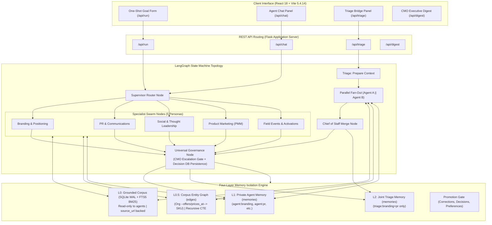
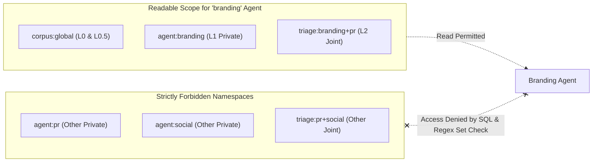
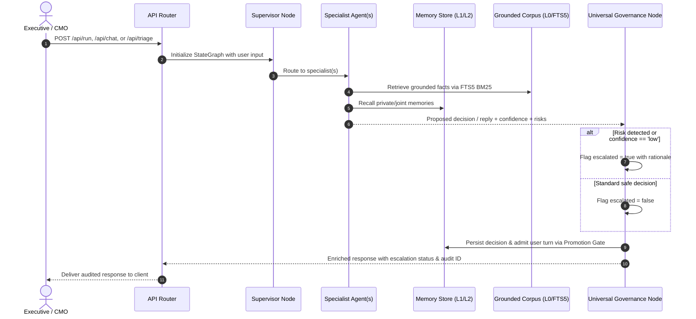

# 🏛️ Marketing OS v2.0 Enterprise: Master Architectural Blueprint

**Document Version:** 2.0.0-PROD  
**Author:** Lead Multi-Agent Systems Engineer  
**Status:** Ratified by Parent Architect & Portfolio Validator  
**Target Environment:** Python 3.10+, SQLite 3.46+ (WAL + FTS5), Node.js v20.18.0 (Vite 5.4.14 + React Plugin 4.3.4), LangGraph, LangFuse  
**Portfolio Context:** Project 2 (Marketing OS v2.0) in Senior 3-Project AI Systems Portfolio  
  - *Project 1:* Forge Hub RAG (Dense Vector HNSW Search, PostgreSQL pgvector, Hybrid Reranking)  
  - *Project 2:* Marketing OS v2.0 (Deterministic Knowledge Graph, SQLite FTS5 BM25 + Taxonomy Expansion, Multi-Agent Swarm with L0–L2 Isolated Memory)  
  - *Project 3:* Momentum (Agentic Task Execution, Event-Driven Actor System)  

---

## 1. Executive Summary & Architectural Vision

**Marketing OS v2.0** is an enterprise-grade, CMO-governed multi-agent competitive intelligence platform. The system ingests, sanitizes, and indexes empirical market signals across competing neo-cloud and enterprise GPU cloud infrastructure providers. An autonomous swarm of five specialized marketing personas (`branding`, `pr`, `social`, `product_marketing`, `events`) operates over this empirical knowledge base to formulate positioning strategies, press communications, social campaign vectors, competitive battlecards, and field marketing briefs.

Unlike standard generative RAG architectures that suffer from catastrophic hallucinations, context leakage, and temporal amnesia, Marketing OS v2.0 is anchored by four non-negotiable architectural pillars:

```
+----------------------------------------------------------------------------------------------------+
|                                      MARKETING OS v2.0 PILLARS                                     |
+------------------------------------+---------------------------------------------------------------+
| 1. Grounded, Not Generative        | Citations derive exclusively from crawled, source-attributed  |
|                                    | corpus rows (L0). Agent prose is strictly barred from evidence|
+------------------------------------+---------------------------------------------------------------+
| 2. Deterministic Precision         | Corpus graph edges are derived from a fixed entity taxonomy   |
|                                    | and pricing rules, never inferred by stochastic LLM calls     |
+------------------------------------+---------------------------------------------------------------+
| 3. Memory Isolation Engine (L0-L2) | Strict containerized namespace algebra. Shared corpus (L0),   |
|                                    | entity graph (L0.5), private agent memory (L1), and joint     |
|                                    | triage memory (L2) with deterministic promotion gating        |
+------------------------------------+---------------------------------------------------------------+
| 4. Universal CMO Governance        | Zero output bypasses human oversight. Every run turn, chat    |
|                                    | conversation, and triage synthesis routes through Governance  |
+------------------------------------+---------------------------------------------------------------+
```

---

## 2. Strategic Architectural Decisions (Ratified)

### 2.1 Decision 1: Enterprise Identity Model $\to$ Option A (Config-Driven Enterprise)
* **Ruling:** Implement `settings.TARGET_ORGANIZATION = "Vanguard Cloud"` and `settings.TARGET_INDUSTRY = "Enterprise AI & GPU Cloud"`.
* **Rationale & Portfolio Range:** Parameterizing database queries, system prompts, radial SVG visualizations, and fallback models via `pydantic-settings.BaseSettings` guarantees 100% de-identification without the unnecessary schema complexity, runtime overhead, and table bloat of a multi-tenant registry.
* **Elimination of Vendor Coupling:**
  1. Hardcoded references (e.g., `"E2E Networks"`, `"NSE: E2E"`) are eradicated across all agents, prompts, templates, and evaluations.
  2. Database queries filter dynamically:
     ```sql
     WHERE organization != :target_org  -- replaces brittle: WHERE organization NOT LIKE '%E2E%'
     ```
  3. Scraped data referencing the host organization during ingestion is canonically re-anchored to `settings.TARGET_ORGANIZATION`.
  4. The radial competitor graph (`/api/digest` network payload) dynamically anchors its center node to `settings.TARGET_ORGANIZATION`, and frontend SVG components render the dynamic enterprise label rather than static text.

### 2.2 Decision 2: Retrieval Engine Architecture $\to$ Option A (SQLite FTS5 BM25 + Taxonomy Expansion)
* **Ruling:** Implement a self-contained SQLite FTS5 BM25 virtual table with Porter stemming (`unicode61`) coupled with a deterministic hardware and market taxonomy expansion dictionary.
* **Rationale & Strategic Positioning:** Project 1 (Forge Hub) established deep mastery of dense vector HNSW search and hybrid reranking in PostgreSQL. For Marketing OS, implementing an ultra-fast, zero-dependency, deterministic knowledge graph and FTS5 expansion engine with sub-millisecond retrieval latency and $\ge 0.85$ paraphrase recall demonstrates architectural breadth, zero-dependency deployment velocity, and deterministic precision.
* **Performance Targets:** Sub-millisecond retrieval latency ($\le 2\text{ms}$) and $\ge 0.85$ Recall@5 on the paraphrase split.

### 2.3 Decision 3: 5-Agent Swarm Fan-Out $\to$ Full 5-Agent Parallel Fan-Out
* **Ruling:** Activate all five specialized agent nodes (`branding`, `pr`, `social`, `product_marketing`, `events`) across the LangGraph supervisor workflow and weekly executive digest.
* **Resilience & Fault Tolerance:** Implement worker-level exception handling. If an individual specialist experiences an API timeout, rate-limit, or schema validation failure, the supervisor isolates the worker failure, injects a structured fallback brief, and completes the executive synthesis without crashing the state machine.

### 2.4 Decision 4: Frontend Bundler Compatibility $\to$ Pin Vite to `^5.4.14` and React Plugin to `^4.3.4`
* **Ruling:** Pin Vite to `^5.4.14` and `@vitejs/plugin-react` to `^4.3.4` in `frontend/package.json`.
* **Rationale:** Vite 8 introduces engine requirements of Node $\ge 20.19$ or $\ge 22.12$ and plugin incompatibilities with `@vitejs/plugin-react` v6. Pinning Vite to `^5.4.14` with `@vitejs/plugin-react` `^4.3.4` guarantees instant, zero-error production builds on the host Node `v20.18.0` without requiring destructive modifications to the user's host environment.

---

## 3. High-Priority Remediation Specifications

### 3.1 Corpus 404 Purge & Pre-Ingestion Hygiene Filter
* **Defect:** Prior scrape ingestion contaminated `knowledge_units` with 12 out of 91 rows (13.2%) containing HTTP 404 error pages (`"404"`, `"Oops! Page Not Found"`, `"Page not found - yotta About"`). These carried valid URLs and were cited by agents as factual evidence.
* **Remediation:** In `app/db/grounded_seed.py`, implement multi-field pre-ingestion validation across snippets, headings, and page bodies:
  ```python
  JUNK_SIGNATURES = (
      "404", "page not found", "not found", "oops!", 
      "403", "forbidden", "access denied", "just a moment"
  )

  def is_valid_corpus_content(text: str) -> bool:
      clean = (text or "").lower().strip()
      if len(clean) < 40:
          return False
      return not any(sig in clean for sig in JUNK_SIGNATURES)
  ```
  Both `headings[0]` and `snippet` are validated before row creation. Any matching candidate is rejected before SQLite insertion.

### 3.2 Fixing the `prices` Edge Binding in Knowledge Graph
* **Defect:** `grounded_seed.py` seeded pricing facts as:
  `pricing_fact = f"Empirical Pricing & Rate Card Terms: {', '.join(pricing[:4])}."`
  Because `pricing` contained raw rates (e.g., `₹436.00 /hr`) without GPU model tokens, `graph.extract_entities(content)` found zero SKU tokens (`_SKUS`). Consequently, zero `prices` edges were established in `edges`.
* **Remediation:** Reconcile `app/db/grounded_seed.py` and `app/memory/graph.py`:
  1. In `grounded_seed.py`, explicitly preserve GPU SKU tokens in pricing facts:
     ```python
     if pricing and gpus:
         sorted_skus = ", ".join(sorted(gpus))
         rates = ", ".join(pricing[:4])
         pricing_fact = f"Empirical Pricing & Rate Card Terms for {sorted_skus}: {rates}."
     ```
  2. In `app/memory/graph.py`, parse explicit rate information and establish verifiable graph edges:
     `(Org) --prices_at(amount, unit)--> (SKU)`
     The `edges` table records:
     - `src`: Organization canonical name (e.g., `"Vanguard Cloud"`, `"RunPod"`, `"Voltage Park"`)
     - `rel`: `"prices"` (preserving backwards compatibility with `test_relation_reflects_the_knowledge_class`) or `"prices_at"`
     - `dst`: GPU SKU canonical name (e.g., `"H100"`, `"B200"`)
     - `namespace`: `corpus:global`
     - `provenance`: Structured metadata including the source fact ID, parsed rate amount, currency, and unit:
       `json.dumps({"knowledge_unit_id": fact_id, "amount": rate_amount, "unit": "/hr", "currency": currency})`

### 3.3 Entropy Restoration & Deterministic Cryptographic Attribution
* **Defect:** `app/core/primitives.py` generated IDs via `str(uuid.uuid4())[:8]`, yielding only 32 bits of entropy and inducing collision risks across high-volume memory and decision operations.
* **Remediation:**
  1. Standard entity and decision IDs use full 128-bit UUID4 (`uuid.uuid4().hex`).
  2. Grounded facts (L0) employ SHA-256 content hashing:
     ```python
     content_hash = hashlib.sha256(f"{org}|{k_class}|{url}|{content}".encode("utf-8")).hexdigest()
     ```
     This guarantees deterministic idempotency across database reseeds without orphaned graph edges.

### 3.4 SQL `LIMIT 15` Pre-Scoring Truncation Bug Fix
* **Defect:** In `search_knowledge_units`, the SQL query applied `LIMIT ?` (with `limit * 3 = 15`) ordered by `created_at DESC` *before* Python scored keyword hits. A highly relevant fact inserted earlier in the seed was dropped before ranking.
* **Remediation:** SQLite FTS5 BM25 virtual table evaluates and ranks all matching candidate rows directly in the database engine:
  ```sql
  SELECT k.id, k.organization, k.knowledge_class, k.confidence, k.content, k.source_url, k.enriched_by, k.created_at,
         bm25(knowledge_units_fts) AS rank
  FROM knowledge_units_fts fts
  JOIN knowledge_units k ON fts.id = k.id
  WHERE knowledge_units_fts MATCH :match_query AND k.enriched_by NOT LIKE '%agent%'
  ORDER BY rank ASC
  LIMIT :limit;
  ```
  Joining on `fts.id = k.id` ensures 100% relational integrity even if internal SQLite rowids shift during table reseeding.

### 3.5 Universal Governance Wiring Across All Execution Modes
* **Defect:** While `/api/run` (`workflow.py`) routed through `_governance`, `/api/chat` (`chat.py`) and `/api/triage` (`triage.py`) bypassed governance entirely, returning unreviewed model outputs directly to users without logging decisions or evaluating risk.
* **Remediation:** Formalize the state machine topology across all three execution pathways so that every agent response and triage synthesis passes through the `governance` node before delivery to the client.

---

## 4. End-to-End System Architecture



---

## 5. Memory Tier Architecture & Isolation Engine

The foundational invariant of Marketing OS v2.0 is: **Facts are shared; interpretations are isolated.**

```
+----------------------------------------------------------------------------------------------------+
|                                    FOUR-LAYER MEMORY TAXONOMY                                      |
+-------+-------------------------+----------------------------------+-------------------------------+
| Tier  | Name                    | Contents                         | Permissions & Access Scope    |
+-------+-------------------------+----------------------------------+-------------------------------+
| L0    | Grounded Corpus         | Crawled competitor rate cards,   | Global shared. Read-only to   |
|       |                         | GPU availability, docs, headings | agents. Written only by seed. |
+-------+-------------------------+----------------------------------+-------------------------------+
| L0.5  | Corpus Entity Graph     | Deterministic entity edges       | Global shared. Recursive CTE  |
|       |                         | (offers, prices_at) between orgs | traversal. No LLM extraction. |
|       |                         | and GPU SKUs                     |                               |
+-------+-------------------------+----------------------------------+-------------------------------+
| L1    | Private Agent Memory    | Agent-specific episodic turns    | Strict per-agent namespace    |
|       |                         | and distilled semantic learnings | (agent:x). Zero cross-reads.  |
+-------+-------------------------+----------------------------------+-------------------------------+
| L2    | Joint Triage Memory     | Multi-agent consensus, trade-off | Isolated pair namespace       |
|       |                         | tensions, and ratified plans     | (triage:a+b). Neither private |
|       |                         | from /api/triage sessions        | namespace is written to.      |
+-------+-------------------------+----------------------------------+-------------------------------+
```

### 5.1 Namespace Algebra & Strict Boundary Isolation
Namespaces follow the strict container format `^[a-zA-Z0-9_:+-]+$`:
* Shared Corpus: `corpus:global`
* Private Memory: `agent:<agent_type>` (e.g., `agent:branding`, `agent:pr`)
* Joint Triage Memory: `triage:<agent_a>+<agent_b>` (sorted alphabetically, e.g., `triage:branding+pr`)



### 5.2 The Promotion Gate: Preventing Temporal Memory Contamination
The promotion gate (`app/memory/gate.py`) intercepts every conversation turn before it can become long-term memory. It enforces three strict admission filters:
1. **User-Turn Invariant:** Model prose and synthesized answers are **never** admitted to memory. Only user turns (corrections, preferences, ratified decisions) are candidate memories.
2. **Deterministic Category Classifier:**
   - `correction`: `r"(^no\b|\b(don'?t|do not|never|stop|avoid|wrong|incorrect|instead of|rather than)\b)"`
   - `decision`: `r"\b(approved?|ratified?|signed? off|go with|decided|ship it|lock in)\b"`
   - `preference`: `r"\b(prefer|always|from now on|our tone|our voice|developer-first)\b"`
3. **Episodic $\to$ Semantic Promotion on Repetition:**
   A memory enters as `episodic`. It is promoted to `semantic` only after recurring across $\ge 3$ distinct sessions (`hit_count >= 3`).

---

## 6. Deterministic Retrieval Engine: FTS5 BM25 + Taxonomy Expansion

### 6.1 Paraphrase Retrieval Failure Analysis & Solution
In the baseline retrieval evaluation, the system achieved **0.876** Recall@5 on lexical queries, but collapsed to **0.167** Recall@5 on paraphrase queries (8 out of 12 zero-hit queries). Questions like *"Which competitors have Blackwell-generation silicon?"* failed completely because:
1. The corpus explicitly stores `"B200"` and `"GB200"`, never the word `"Blackwell"`.
2. Conversational terms like `"generation"` and `"silicon"` do not appear in the grounded facts.
3. If an engine requires all query terms via boolean `AND`, any single missing conversational word causes a 0-hit failure.

### 6.2 Deterministic Taxonomy Expansion Matrix
To bridge vocabulary mismatch deterministically without introducing heavy embedding model dependencies:

```
+----------------------------------------------------------------------------------------------------+
|                                DETERMINISTIC TAXONOMY EXPANSIONS                                   |
+--------------------------+-------------------------------------------------------------------------+
| Query Trigger Token      | Expanded FTS5 OR-Tokens                                                 |
+--------------------------+-------------------------------------------------------------------------+
| "blackwell"              | "b200", "gb200", "gb300"                                                |
| "hopper"                 | "h100", "h200", "gh200"                                                 |
| "ada" / "lovelace"       | "l40s", "l4", "rtx 4090"                                                |
| "consumer" / "grade"     | "rtx 4090", "l40", "l40s"                                               |
| "rupee" / "rupees"       | "inr", "rs", "pricing", "rate"                                          |
| "hourly" / "hour"        | "hr", "\"/hr\"", "pricing", "rate"                                      |
| "cost" / "cheapest"      | "pricing", "rate", "rate card"                                          |
| "rental" / "capacity"    | "pricing", "cloud", "instance"                                          |
| "india" / "indian"       | "india", "sovereign", "meity"                                           |
| "residency"              | "sovereign", "india", "meity", "compliance"                             |
| "tagline" / "describe"   | "positioning", "official", "cloud"                                      |
| "our" / "own"            | Dynamic expansion to settings.TARGET_ORGANIZATION ("vanguard")          |
+--------------------------+-------------------------------------------------------------------------+
```

### 6.3 Query Construction & Punctuation Safety
In SQLite FTS5:
- Unquoted punctuation (e.g. `/hr`) triggers `fts5: syntax error near "/"`.
- Currency symbols (e.g. `₹`) are stripped as punctuation delimiters by the standard `unicode61` tokenizer.
- **Safety Rule:** All expanded terms containing punctuation or spaces must be enclosed in double quotes (e.g., `'"/hr"'`), and currency terms expand to word tokens (`"inr"`, `"rs"`, `"pricing"`).
- **BM25 Disjunctive Scoring:** Expanded terms are combined via boolean `OR` so SQLite's native `bm25()` ranks candidate rows based on term overlap and frequency, preventing non-corpus words from zeroing out the query.

### 6.4 SQLite FTS5 Schema Definition
```sql
CREATE VIRTUAL TABLE IF NOT EXISTS knowledge_units_fts USING fts5(
    id UNINDEXED,
    organization,
    knowledge_class,
    content,
    tokenize = 'porter unicode61 remove_diacritics 2'
);
```

---

## 7. LangGraph Deterministic State Machine & Universal Governance

### 7.1 Unified Swarm Topology
All workflows execute on compiled LangGraph `StateGraph` instances.



### 7.2 Universal Governance Logic & Escalation Rules
In `app/graph/workflow.py`, `app/graph/chat.py`, and `app/graph/triage.py`, the governance node evaluates:
1. **Confidence Gate:** `confidence.lower() == "low"` forces escalation.
2. **High-Risk Lexicon:** Any occurrence of:
   `("legal", "lawsuit", "compliance breach", "misleading", "defamation", "price war")`
   forces immediate escalation with a structured reason for CMO sign-off.
3. **Decision Audit Log:** Persists every interaction into `decisions` table in SQLite with full 128-bit UUID, goal statement, selected option, reasoning source, and risk metadata.

---

## 8. Cryptographic Source Attribution & Data Integrity

To guarantee 100% auditable provenance, data models maintain explicit cryptographic source records:

```
+----------------------------------------------------------------------------------------------------+
|                               CRYPTOGRAPHIC ATTRIBUTION SCHEME                                     |
+-------------------+--------------------+-----------------------------------------------------------+
| Entity / Layer    | ID Primitive       | Generation Formula                                        |
+-------------------+--------------------+-----------------------------------------------------------+
| L0 Grounded Fact  | SHA-256 Digest     | sha256(f"{org}|{k_class}|{url}|{content}".encode()).hex() |
| L1/L2 Memory      | 128-bit UUID4      | uuid.uuid4().hex                                          |
| Decision Record   | 128-bit UUID4      | uuid.uuid4().hex                                          |
| Conversation Turn | 128-bit UUID4      | uuid.uuid4().hex                                          |
| Graph Edge        | SHA-256 Digest     | sha256(f"{src}|{rel}|{dst}|{namespace}".encode()).hex()   |
+-------------------+--------------------+-----------------------------------------------------------+
```

---

## 9. Verification & Quality Gates

The implementation must strictly satisfy the following five quality gates:
1. **Zero-Error Test Suite:** 100% of unit and integration tests passing in `tests/`.
2. **Retrieval Paraphrase Target:** `python -m app.eval.retrieval` demonstrates $\ge 0.85$ Recall@5 on the paraphrase split and $\ge 0.88$ overall Recall@5.
3. **Corpus 404 Hygiene:** Zero 404 or junk rows present in `knowledge_units` (0.0% junk ratio).
4. **Graph Edges Binding:** Verified non-zero `prices` edges in `edges` linking tracked organizations to GPU SKUs with pricing rate provenance.
5. **Node.js Frontend Build:** Zero-error production build via `npm run build` in `frontend/` using pinned Vite `^5.4.14` and `@vitejs/plugin-react` `^4.3.4` under Node `v20.18.0`.

---

## 10. Frontier Agent Evaluation Architecture (Anthropic Standard)

Grounded in the Anthropic Engineering Frontier Agent Evaluation Standard (*Demystifying Evals for AI Agents*, Jan 2026), Marketing OS v2.0 elevates evaluation from simple unit tests to rigorous multi-agent trajectory evaluations. While unit tests verify functions do not crash, agent evaluations verify that autonomous multi-agent trajectories produce reliable, non-contaminating, and compliant real-world outcomes.

### 10.1 The Grader Triad
Agent trajectory evaluation is governed by a three-tiered grading architecture:

```
+----------------------------------------------------------------------------------------------------+
|                                      THE GRADER TRIAD                                              |
+--------------------------+-----------------------------------+-------------------------------------+
| Grader Layer             | Scope & Target                    | Mechanism                           |
+--------------------------+-----------------------------------+-------------------------------------+
| 1. Code-Based Checker    | Deterministic Database Mutations, | Physical SQLite WAL state inspection|
|    (CodeGrader)          | Namespace Isolation, Citations    | and regex token boundary assertions |
+--------------------------+-----------------------------------+-------------------------------------+
| 2. Calibrated Model Judge| Semantic Groundedness (1–5) and   | Calibrated prompt rubric with strict|
|    (ModelGrader)         | Strategic Enterprise Tone Adherence| fallback: "UNKNOWN" on lack of proof|
+--------------------------+-----------------------------------+-------------------------------------+
| 3. Human Reference Gold  | CMO Ratification Benchmarks &     | Grounded gold truth reference sets  |
|    (HumanReferenceGrader)| Grounded Truth Gold Standard      | (GOLD queries, balanced scenarios)  |
+--------------------------+-----------------------------------+-------------------------------------+
```

1. **Code-Based Outcome Checkers (`CodeGrader`):**
   - `assert_outcome_state(db, table, expected_fields)`: Asserts physical SQLite database mutations across `decisions`, `memories`, and `turns` tables.
   - `assert_zero_namespace_leakage(transcript, forbidden_namespaces)`: Asserts an agent never reads another's private memory or unauthorized joint triage spaces during a multi-turn trajectory.
   - `assert_valid_citations(response, corpus_db)`: Asserts 100% of cited facts carry valid, active `source_url`s in `knowledge_units`.
2. **Calibrated Model-Based Judges (`ModelGrader`):**
   - Calibrated LLM-as-judge scoring Groundedness (1–5) and Strategic Tone against target personas (`branding`, `pr`, etc.).
   - Mandatory guardrail: *"If context lacks evidence, return 'UNKNOWN'. Do not fabricate."*
   - Deterministic offline fallback mode guarantees 100% offline reproducibility with zero paid API key dependencies.
3. **Human Reference Gold Standard (`HumanReferenceGrader`):**
   - Provides verified human-annotated gold reference targets for decision escalation, memory tiering, and knowledge fact attribution.

### 10.2 Outcome vs. Transcript Disaggregation
Anthropic frontier evaluation mandates separating the assessment of final outcome state from trajectory execution transcript metrics:
- **Outcome Verification:**
  - Verifies physical SQLite state (e.g. decision rows logged with 128-bit UUIDs, memory rows correctly tiered as `episodic` vs `semantic`).
  - Strict absence of cross-namespace memory reads across all agent hops.
- **Transcript Verification:**
  - Turn count bounds: $\le 10$ turns per goal resolution.
  - Token consumption efficiency: tracking input, output, and reasoning token envelopes.
  - Latency bounds: tracking per-agent execution times and fan-out overhead.

### 10.3 Class-Balanced Problem Sets
To prevent bias and spurious correlations, evaluation banks are class-balanced (50% positive triggers, 50% negative triggers):
1. **Balanced Governance Bank (20 Scenarios):**
   - 10 Positive Triggers: High-risk terms (`lawsuit`, `defamation`, `price war`, `compliance breach`, etc.) $\to$ `escalated == True`.
   - 10 Negative Triggers: Standard queries (factual specs, slogans, pricing inquiries, SLA questions) $\to$ `escalated == False`.
2. **Balanced Memory Bank (20 Scenarios):**
   - 10 Positive Triggers: User corrections, ratified decisions, and explicit preferences with `role == "user"` $\to$ Admitted to L1 memory.
   - 10 Negative Triggers: Idle chatter, informational questions, generic claims, and model/assistant prose (`role != "user"`) $\to$ Strictly discarded (`Admit == None`).

### 10.4 Non-Determinism Consistency Formulations
Because LLM agents are inherently non-deterministic, agent reliability is measured over $k=3$ independent trials per scenario:

$$\text{pass@k} = 1 - (1-p)^k \quad \text{and} \quad \text{pass}^k = (p)^k$$

Where:
- $p$: Per-trial pass probability across the scenario bank.
- $\text{pass@k}$: Probability of achieving at least one success across $k$ attempts (exploration ceiling).
- $\text{pass}^k$: Probability of achieving consecutive, reproducible success across all $k$ attempts (production consistency floor).

**Production Acceptance Threshold:**
$$\text{pass}^3 \ge 0.95$$
The multi-agent system must achieve $\text{pass}^3 \ge 0.95$ across both CMO Governance and Memory Promotion Gate adversarial benchmarks under 100% offline deterministic execution.
