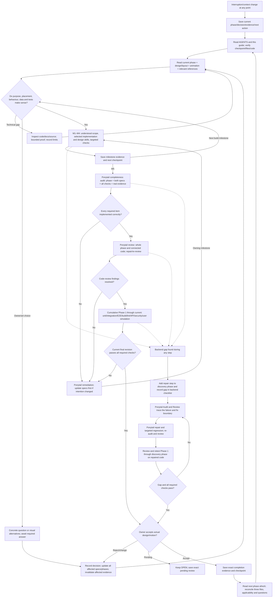

# Marketing OS — how to execute and resume every phase

Updated: 19 November 2026 (Asia/Calcutta).
Owner-requested operating procedure and local project memory. **Read before any
phase build, remediation, review or resumption.** This applies to every phase,
not just Phase 3. It explains how to USE the three specs and skills, not another
visual blueprint or another copy of the 39 design checks.

Local-only, Git-ignored. Do not stage, commit, push, deploy or publish this guide
or the three planning files without a new owner instruction. See the saved
checkpoint and its linked evidence for the actual application results.

## 1. Mandatory starting sequence

1. Read [the saved checkpoint](#12-saved-checkpoint--resume-here), then inspect the
   current branch, Git status and actual implementation. Verify the named files,
   installed skills/tools and evidence still exist after an environment change.
   Do not infer filesystem state, implementation or approvals from chat memory.
2. Find the current phase in [the blueprint](MARKETING_OS_BLUEPRINT_PLAN.md):
   its scope/completion contract in §6, architecture/correspondence in §10,
   common gates in §5, execution checklist in §11, and decision register in §12.
   Read its current scope and standing decisions. Use the
   [phase reading table](MARKETING_OS_BLUEPRINT_PLAN.md#phase-to-specification-and-verification-table)
   and [milestone sequence](MARKETING_OS_BLUEPRINT_PLAN.md#milestones-for-every-phase).
   Look one phase ahead for interfaces, accepted artifacts and decisions this
   work must hand over.
3. Read that phase's actual requirements and all-phase counterpart in
   [design/layout](DESIGN_AND_LAYOUT.md) and [animation](ANIMATION.md). Read the
   relevant entries in the [website study](/workspace/reviews/WEBSITE_REFERENCE_STUDY.md)
   when the phase reading table identifies a technique or an open question.
   The study supplies selective mechanics and evidence confidence.
4. Compare those documents with what was actually built. Identify inherited code,
   broken/rejected work, preserved functionality, missing requirements and stale
   documentation. Read the owning code/contracts before changing them.
5. Complete the readiness/placement checks below. Ask about material owner
   decisions; research technical unknowns. Do NOT code an unknown design or
   behaviour just to make progress. Independent understood work may continue.
6. Record the phase's understood scope, decisions, relevant skill/agent assignments,
   implementation milestones and verification evidence needed. Show the proposed
   user flow and explain the decisions that matter before implementing them.
   Start the first milestone whose purpose and acceptance are understood.

Use headings, phase IDs and stable links, not memorized line numbers. A previous
phase PASS applies to its recorded revision/scope. New requirements can reopen
its affected checks; preserve actual historical results.

## 2. How the files work as one specification

| Source | Question it answers | How it is used |
|---|---|---|
| Blueprint | What belongs in this phase; what depends on it; what closes it? | Owns phase scope, acceptance ledger, order, decisions and evidence |
| Design/layout | Where does it go, how is it composed, and why does it belong? | Read the mapped component/page/palette/art/UX requirements and all 39 original checks |
| Animation | What drives it, when does it move/stop, and what if it fails? | Read clocks, state, trigger, interruption, selection, rendering, fallback and budgets |
| Website study | What did the references actually demonstrate? | Learn selective mechanics/asset craft with evidence confidence; do not assume their identity or unverified behaviour is ours |
| Actual code and tests | What is implemented and how do frontend/backend connect? | Trace the real entry/state/data/API path; documents cannot establish runtime truth |
| This guide | How do I turn all that into a completed phase and resume correctly? | Follow the procedure and save the last verified milestone with its evidence |

Use the same blueprint requirement IDs in all four readings. For each active
milestone, carry a short record of the design/layout section, the animation
section, the relevant study passage or accepted prior evidence, and the
observation or test that will close the work. Later phases inherit the accepted
behavior recorded there. Examples include the Phase 4 comparison selection,
the Phase 8 shared agent identity, the Phase 9 header and section glides, and
the Phase 12 touch and reduced-motion behavior.

A phase ledger is not a rigid feature list. New owner feedback, a new relevant
reference or a discovered integration fact must be reconciled into ALL affected
phases and corresponding sections in BOTH other files. Resolve contradictions,
mark superseded choices and invalidate affected evidence before continuing.
Do not quietly implement against one file while the other two describe another
experience. The owner's latest explicit decision takes precedence; ambiguity is
an owner question, not permission to guess.

## 3. Understand, research or ask — before coding

| Situation | Action before dependent work |
|---|---|
| Already confirmed decision | Read and use it; do not ask the owner to explain it again |
| Library/API/scroll/rendering technique is unclear | Inspect existing code and official source/docs, run a small isolated proof if useful, record what it establishes and its limits |
| Reference behaviour is uncertain | Read supplied study/source or inspect available evidence; mark unknowns honestly and design our explicit contract |
| Product intent, placement, copy, hierarchy or feel is unclear | Name the affected user path. Offer a recommendation and a concrete alternative or still. Ask the owner the question that changes the build. Keep dependent decisions pending. |
| Owner cannot judge a visual choice from words | Produce bounded composition/still comparisons for review, label proposals; do not require the owner to invent the placement or approve unseen final art |
| Existing documents disagree | Reconcile all three with the latest decision; ask if the intended product consequence remains ambiguous |
| Needed tool/skill is missing | Check actual tool inventory and installed manifest; select an appropriate existing alternative or explain the specific capability gap before adding a new dependency/integration |

Ask concise, specific questions with the reason and a recommendation. Do not
substitute repeated general inspiration requests for implementation. Research
must answer a defined uncertainty. Use the existing app, study, upstream docs or
a small proof for mechanics. If the answer depends on what the visitor should
see, ask before implementing that choice. A reference video can clarify timing
or composition when needed. Record its limits if it only shows touch or scroll.
Keep independent work moving while a required answer is pending.

## 4. Placement and behaviour record for every chosen technique

Before implementing a trend/component, record these fields in the active phase:

```text
Technique/component and requirement ID:
Product/visitor purpose:
Exact page/section/object and size/composition relationship:
Trigger and clock: scroll, pointer/focus, explicit click, actual asset/API pending:
When ON / when OFF / what the final readable state is:
Data/source binding and allowed backend effects:
Interaction, cancellation, keyboard and focus behaviour:
Static/reduced-motion/failed-asset equivalent:
Relevant palette/art/spacing/contrast/performance constraints:
Current decision: confirmed / proposed trial / pending visual comparison:
Owner question or technical research still needed:
Owning phase + later phases that inherit/test it:
Implementation and evidence required:
```

“Dithering is liked,” “use a loader,” or “add the component somewhere” is not a
ready placement record. Do not automatically add every technique to every phase;
assign meaningful ownership and preserve/test accepted treatments in later work.
An omitted optional technique gets a reason; an absent REQUIRED feature is not N/A.

### Current placement understanding — 19 November

| Item | Confirmed meaning / current placement | Trigger, limits and next evidence |
|---|---|---|
| Paper/graphite | Existing light page; compare subtle static graphite with plain | Site surface stays quiet/readable; exact grain comparison still reviewed |
| Dithering | WEBSITE-WIDE visual direction, explicitly not limited to agent previews | Exact hero/page treatment still needs visual composition work alongside Wordmark; do not filter all text/UI or assume agent-only scope |
| Pixel loading | INSIDE the loading visual/agent stage; page/navigation remain usable | Actual assets/components loading only; immediate ready/cached path, honest failed/retry state; no full-page arrival cover, fake percentage or artificial delay |
| Vector Wordmark | Current-size first-screen product name, with Marketing Helper as working copy | Nearby letters reveal pointer-local guides, squares and coordinates. Preserve a crisp resting heading and a reduced-motion equivalent. |
| Spider Button | Explore the agents, confirmed earlier | Stable native action/focus/hit area; bounded palette-adapted effect, direct exploration and no inference |
| Clockwise gallery | Five-role circular/spiral discovery, confirmed earlier | Main scroll holds/reverses; all roles directly reachable; identity/content synchronized, no idle drift |
| Section glide and header | Normal-flow headline and actions, quiet intro then orbit. Trial visible links and a bounded expandable alternative. | A scroll-linked handoff holds on pause and reverses on reverse. Hover and focus give feedback. Explicit activation opens an optional drawer. Phase 9 settles the chosen treatments. |
| Role explanation | Separate How it works action, one shared stage, PR first | 2D proof in Phase 5, timed playback in Phase 6 and independent remaining-role work in Phase 7. Preserve review-state truth and readable fallbacks. |

The owner corrected an agent-only dithering assumption. The next design task is
not “where do you want me to put dithering?” again. Prepare concrete original
arrival/page compositions showing Wordmark and dithering together, for example
an atmospheric dithered artifact/image field supporting readable foreground
identity versus a larger dithered focal artifact carried toward discovery. These
are candidate compositions, not adopted assets, final layouts or automatic code.
Compare them with plain/graphite so the treatments have distinct jobs. Bring
actual frames for review; maintain the exact palette and the connected story.

These decisions propagate beyond the initial phase: comparison, scene art,
production choreography, engineering/console surfaces where appropriate, device
review and release must preserve the chosen system. Do not force dithering onto
reading surfaces or recreate the effect in every phase simply to tick a box.

## 5. Choose and load skills deliberately

First read the relevant SKILL.md and any referenced material needed for the actual
step. Check the installed [inventory](/workspace/agent-toolkit/README.md),
[manifest](/workspace/agent-toolkit/manifest.json) and
[workspace rules](/workspace/agent-toolkit/WORKSPACE_RULES.md). Installed files are
usable directly here; their presence does not create new tools or web-menu entries.

| Work | Required/default skill or role | Concrete use / limit |
|---|---|---|
| Phase implementation/remediation | [Ponytail](/workspace/agent-toolkit/skills/ponytail/SKILL.md) by default | Choose the installed implementation skill that best matches the work. Pair it with a focused second skill when useful and record why. Preserve the complete scope and gate. |
| Design craft and rendered review | [Hallmark](/workspace/agent-toolkit/skills/hallmark/SKILL.md) | Apply our custom identity, quality gates and real rendered evidence; no random theme/palette or rule that ends required fixes early |
| Translate actual design evidence to code | [build-design](/workspace/agent-toolkit/skills/build-design/SKILL.md) | Map supplied/reviewed frames to project tokens/components and compare actual render; inspiration is not a pixel-perfect brief; estimates are labelled |
| React state/components/motion integration | [React specialist](/workspace/agent-toolkit/agents/react-specialist.toml) | Delegate a specific implementation or review boundary, permitted files and acceptance; no vague “improve UI” assignment |
| Phase completeness audit | [Ponytail audit](/workspace/agent-toolkit/skills/ponytail-audit/SKILL.md) | Explicitly extend report scope to every phase item + both counterpart specs + actual design evidence; skill alone is not a magic checklist verifier |
| Phase/connected-code review | [Ponytail review](/workspace/agent-toolkit/skills/ponytail-review/SKILL.md) | Read all implemented phase code and connected frontend/backend callers/tests, including relevant unchanged paths |
| Broader interface gap | better-interface, better-layout, better-ui, typography/colour/accessibility skills | Load the specific skill matching the observed gap; do not stack every skill by default |
| Backend/API/data/security/evaluation gap | Installed backend/API/Python/database/security/test/LLM/eval roles | Select by actual boundary; provide exact task/context/output and preserve session/model scope |
| Browser reproduction/capture | Existing project Playwright harness; webapp-testing helpers where useful | Keep real test configuration and dev/built paths; helper success does not prove app success |
| Missing capability | Inspect available tools/skills, then identify the smallest sufficient addition | Do not pretend a skill supplies unavailable Figma/browser access; preserve user-invoked-only restrictions and real permissions |

Hallmark/build-design help with the phase's design work; they do not define a new
product. For a backend-only change, verify its effect on existing UI/data contracts
instead of inventing a new visual. Phase 0 uses source/document/decision review,
not fictitious app renders/tests. Pair skills by purpose. Use Hallmark with build-design for visual work, and use
the existing Playwright harness with webapp-testing or better-accessibility for
a concrete browser or keyboard question. At the last milestone run the
required audit and review plus the selected checks from the owning skills.
Consider an addition only for a specific known capability gap.

### Subagent handoff and return contract

Give each delegated agent: current phase/revision, source/decision links, exact
scope/files, parent-known issues, owner choices, acceptance items, allowed writes,
required tests/evidence and what it must not change. Ask for questions before it
implements an unknown design. Require the return to identify changed files,
findings, actual commands/results, unverified items and remaining decisions.
The parent reads and integrates the result, then checks combined behaviour. An
agent saying “done” does not close the phase or establish a test/visual PASS.

## 6. Build, completeness audit and remediation

<a id="milestone-checkpoints"></a>
### Milestone checkpoints

Follow the blueprint's [five milestones per phase](MARKETING_OS_BLUEPRINT_PLAN.md#milestones-for-every-phase).
M1 captures inherited behavior, the milestone deliverables, owner choices and
the evidence expected at each stop. M2–M4 produce bounded, inspectable
artifacts with targeted tests. Save the completed milestone's exact code
revision or worktree state, reviewed artifact, observed evidence and next action.
Keep at least two meaningful atomic commits per authorized implementation
phase. A milestone may refer to several commits or a working checkpoint.

If an artifact is rejected or a later check fails, locate the owning milestone,
preserve the accepted evidence elsewhere and repair the affected work. Keep
the repository history intact and rerun the dependent checks. M5 reviews the
whole phase on the final candidate.

1. Build the understood milestone with the selected implementation and focused design/React support.
   Make coherent bounded changes and targeted checks, preserving existing code,
   data, backend contracts and the original capture/Claude snapshots.
2. Run Ponytail audit as a READ-ONLY report of the implemented phase against the
   current phase contract, design/layout, animation and relevant reference/owner
   decisions. Include all 20 unslop and 19 slop-indicator checks, relevant V/C/M/P/A
   criteria and every assigned component/background/motion treatment.
3. For each requirement report `ID | exact requirement | implementation/file |
   observed evidence/test/revision | PASS/FAIL/BLOCKED/N/A + reason`.
   Check that an effect is in the right place and behaves correctly, not merely
   that an import/file/keyword exists. Runtime/design evidence cannot be replaced
   by source-only assertions or an unchecked copied checklist.
4. Audit/review do not silently edit. Use a separate Ponytail implementation pass
   to fix missing/wrong work; repeat the relevant audit until the required result
   is supported or a precise real blocker needs the owner. Do not discard a row,
   change requirements to match the code or misuse N/A to hide incomplete work.
5. When feedback changes the intended design, update all affected specs/phases
   BEFORE rebuilding. Record what was rejected and why. A new composition still
   needs actual review; a trial approval is not approval of an unseen final design.

## 7. Code review and complete verification loop

After completeness remediation, run Ponytail review on the whole implemented
phase and connected code. Read callers, dependencies, tests and frontend/backend
boundaries; do not limit it to the diff. Fix concrete findings in a build pass
and re-review. At M5 run the complete gate **from Phase 1 through the current
phase or child** on the final revision. Map shared suites to all applicable
phases and record each phase's distinct acceptance checks in order. For
example, Phase 5 includes all Phase 1–5 checks on the same candidate:

- Backend and frontend unit tests; backend integration tests.
- Browser end-to-end integration in development AND compiled-app mode, through
  actual frontend→Flask authentication/session/response contracts.
- Frontend build/lint, meaningful console/page-error and state regressions.
- Registered API healthy/auth/cache/origin contracts and the existing backend
  phase security checklist with stack applicability and real unresolved limits.
- All five specialist runs, chat continuation/scoped memory, triage, digest,
  history/detail, decision-specific human review/reload/new decision, export/logout.
- Normal-motion visual/interaction inspection, static/reduced-motion/failure
  equivalents, relevant performance/resource and existing device safeguards.

Use the actual commands in blueprint §5 and the existing tools/verify_phase.py
runner. Controlled inference/test identities/temp databases are routine; do not
make paid captures for every replay/screenshot or disable quotas/validation to
make tests pass. A documentation-only change does not claim those suites ran.

### Simulate how a visitor actually uses this phase

Traverse its full journey, not isolated components: enter normally and directly,
scroll forward/back/stop, select all reachable roles, click/keyboard/focus, change
selection mid-transition, leave/return/deep-link/back, resize/zoom, slow/fail
assets/API, toggle reduced motion, and inspect useful loading/empty/error/results.
Verify consistent padding/type/colour/icons/art and actual focus/hit targets.
Showcase actions remain read-only; explicit console actions reach the correct
backend and retain real review/session state. Carry prior accepted treatments
through these paths. Test only actually owned/available systems; recorded
infrastructure-layer limits are not invented passes.

Return a failure to the owning milestone, fix it, repeat the affected audit
and code review, then rerun cumulative verification on the new revision.
Record owner visual acceptance and technical evidence separately before
opening the next phase.

### Backend gap discovered during any phase

1. **Log it in the discovery phase immediately.** Add a named extra repair step
   to that phase's blueprint contract and assign a stable ID in the
   [backend checklist](BACKEND_PHASE_CHECKLIST.md#backend-gap-register).
   Record the phase and date found, affected contracts and earlier phases, and
   the observed failure. Keep the discovery phase even if the defect is older.
2. **Audit and review the cause.** Use read-only Ponytail Audit to trace the
   connected paths and Ponytail Review to check the failure mechanism and fix
   boundary. Record failure-before evidence and the exact expected behavior.
3. **Fix it in the active phase with Ponytail.** Make the smallest complete
   repair. Run the targeted regression, re-audit, then run Ponytail Review on
   the repaired code and connected callers. Repeat if either finds a problem.
4. **Restart verification at Phase 1 and work through the discovery phase.**
   Review each phase's full contract with both counterpart specs on the current
   cumulative code. Run its distinct acceptance and workflow checks, including
   affected failure states and the recorded gap regression. Run all six shared
   test lanes and the complete applicable backend/security checklist on that
   same revision. Link one shared run to each phase that uses identical suites
   and record the distinct acceptance evidence and verdict for every phase in
   order. Example: a Phase 4 discovery requires the Phase 1, 2, 3 and 4 checks.
5. **Close with evidence.** Keep the gap open until the targeted repair and the
   full cumulative cycle pass. A failure or a new gap returns to the relevant
   audit/repair step and restarts verification on the repaired revision. Mark
   the gap verified and retain the historical failure and fix record. Track
   unavailable required checks as blocked and keep the existing owner visual
   review in force for the phase. Resume remaining work in the discovery phase
   from its updated contract.
6. **Publish the verified backend fix on `main`.** Use the owner's standing
   instruction and verify the actual GitHub revision. If the repair was made
   while on `feat/frontend-overhaul`, split out the backend code and its tests
   for `main`, preserving the API-only entry point. Keep the fix available to
   the overhaul and cover any affected browser flows there. Record the `main`
   commit and backend test evidence in the gap register.

## 8. Operating diagram — follow it, do not just store it



## 9. Finish one phase, then understand the next

After a real phase exit, open the next phase's contract, design/layout and
animation sections and the reference cue in the blueprint's phase reading
table. Compare them with the accepted implementation. Record what carries
over, what changes and which checks still apply. Save the dependencies, open
owner choices and first milestone of that next phase.
Ask new dependent questions; research unfamiliar mechanics before coding. Update
that phase contract and both counterparts. Do not implement the next phase by
remembering an old fixed plan or blindly cloning the previous phase's effects.
For example, after Phase 3 passes, read Phase 4 comparison requirements; do not
assume its selection, pair layout and stage handoff are already solved by gallery
rotation. The same procedure repeats through every phase and child phase.

## 10. Living record, not perfect chat memory

This file and local AGENTS.md are the durable lookup mechanism in this workspace.
They do not guarantee perfect model memory or survive a workspace recreation by
themselves. At resumption verify presence; if missing, report it and recover from
available evidence rather than claim to have read them. Do not reinstall or
reapply changes merely because the environment was published.

Update the checkpoint before yielding/after meaningful decisions, changes,
reviews, failures or tests. Keep references in the three authoritative specs and
phase evidence records; this guide points to them rather than duplicating entire
reports. Do not store keys or private runtime values. No unsupported PASS or
silent transformation of a pending proposal into a confirmed requirement.

## 11. Checkpoint fields to maintain

```text
Current phase + contract revision + actual status:
Active milestone and last verified milestone:
Branch/HEAD + relevant uncommitted changes:
Inherited behavior, planned deliverables and next-phase dependencies:
Last owner decisions and superseded assumptions:
Requirement IDs and linked design/layout, animation and relevant study evidence:
Feature placement/trigger decisions and pending visual questions:
Technical unknowns + research/proof outcomes:
Skills read/used and scoped agent assignments:
Actual code/assets changed, preserved data and important boundaries:
Completeness audit, remediation and code-review results:
Tests run against which revision + evidence paths + untested items:
Backend gap IDs, discovery phase and cumulative verification status:
Owner visual review: accepted/rejected/pending, exact artifact:
What remains, the single next action and the milestone to reopen on failure:
Next-phase eligibility and why:
```

## 12. Saved checkpoint — resume here

- **Phase and milestone:** Phase 3 implementation M1–M4 is complete at
  `cfb4db1` on `feat/frontend-overhaul`. The exact cumulative gate passed
  with 423 backend tests, 64 frontend units and 27 browser tests per mode.
  M5 stays OPEN for the owner's integrated motion review.
  [Phase 3 audit](/workspace/reviews/phase-3-final/completion-audit.md)
  · [Walkthrough](/workspace/reviews/phase-3-final/walkthrough.mp4)
  · [Exact revision gate](/workspace/reviews/phase-3-final/final-verification/report.json)
- **Branches:** GitHub's backend-only `main` was last recorded at `26e809a`.
  On 20 November the owner requested a GitHub review branch for Anti Gravity.
  GitHub's `feat/frontend-overhaul` was verified at `cfb4db1` after publishing
  the two Phase 3 code commits, `d86a0d5` and `cfb4db1`. The earlier Phase 3 grounding,
  recording, API security and SQLite startup fixes were applied to `main` in
  `e784184`, `37a26ca` and `26e809a`. Main passed 409 backend tests and three
  fresh two-worker container smoke checks. Further verified backend repairs
  ship to `main` as they are found and fixed. Use `feat/frontend-overhaul`
  for redesign work. A merge preview confirmed that the eventual merge retains
  the full frontend. [Branch verification](/workspace/reviews/phase-3-backend-main/branches-after.txt)
- **Prior evidence:** The earlier passing report tested the preview's application,
  asset and test files as working changes on base `91d3a01`. Repair commit
  `ae0f902` and preview commit `de85bb2` record the two changes separately.
- **Pushed cleanup:** The connected draft is the sole homepage. The
  former showcase, static foundation and paper study have been removed from
  the source. The current gallery, art, and wordmark are editable draft material
  for the owner's upcoming references. Company profile and replacement corpus
  work follow a separate discussion around real companies. The
  [current gate](/workspace/reviews/phase-3-frontend-cleanup/verification/report.json)
  and [render comparison](/workspace/reviews/phase-3-frontend-cleanup/render-comparison.json)
  record this cleanup.
- **Review entry:** Start at `/` and inspect the existing candidate. The
  earlier treatment URLs and bookmark redirects belong to historical evidence.
  Revision 7 acceptance covers the named anchors, `/console` and retirement of
  the old previews.
  See the [scroll recording](/workspace/reviews/phase-3-connected/scroll-review.mp4) and
  [candidate audit](/workspace/reviews/phase-3-connected/ponytail-candidate-audit.md).
- **Current design and interaction:** Type-led opening and visible Agents,
  Results and How it’s built links. Wordmark responds locally to the pointer.
  Spider Explore goes to the gallery. The quiet first scroll precedes a
  sphere of 25 original work images. The local drag rotates the sphere and
  independent tile activation brings the image forward and opens the saved
  dossier. The same five roles remain accessible without motion.
  [Clip study](/workspace/reviews/WEBSITE_REFERENCE_STUDY.md#orbit-sphere-and-moss-island)
- **Verification:** Ponytail baseline and code audits, React specialist review,
  Hallmark custom check and build-design comparisons are in the audit.
  The compiled gate found a two-worker seed race. The startup empty check and
  replacement now run together inside a SQLite transaction. The retest is recorded
  in the [six-lane report](/workspace/reviews/phase-3-connected/final-verification/report.json) and
  [backend checklist](BACKEND_PHASE_CHECKLIST.md). All technical lanes passed
  after the fix.
- **Backend gap:** `P3-GAP-01` was found in Phase 3 compiled-app verification.
  The repair is in the [Phase 3 contract](MARKETING_OS_BLUEPRINT_PLAN.md#phase-3-backend-gap-p3-gap-01).
  Targeted and cumulative Phase 1 through Phase 3 checks passed, and the
  [backend gap register](BACKEND_PHASE_CHECKLIST.md#backend-gap-register) records
  the gap as verified.
- **M1 evidence on the current baseline:** Four connected-foundation
  development browser tests and nine targeted geometry/agent-example unit
  tests passed. Chromium exercised pointer guides, wheel hold and reverse,
  explicit dossier open/close, focus return, reduced motion and the review
  drawer in the separate storyboard. The storyboard does not change the
  live app or establish its new visual acceptance.
- **M2 evidence:** 58 frontend unit tests and nine focused browser tests in
  each of development and compiled Flask modes passed. Build and lint
  completed with existing warnings. The wheel geometry and saved catalog
  stay as the baseline for M3.
- **Resume:** Review the actual walkthrough for the quiet section glide,
  drag, selected-image pull-forward, dossier, return and results release.
  Resolve owner visual feedback in Phase 3 and repeat the affected checks.
  The existing four-phase explanation sequence and Phase 10 corpus replacement
  keep their assigned scopes.
- **Next phase:** Phase 4 follows a passing Phase 3 technical gate and recorded
  owner acceptance. Reconcile its requirements in all three specs before build.
