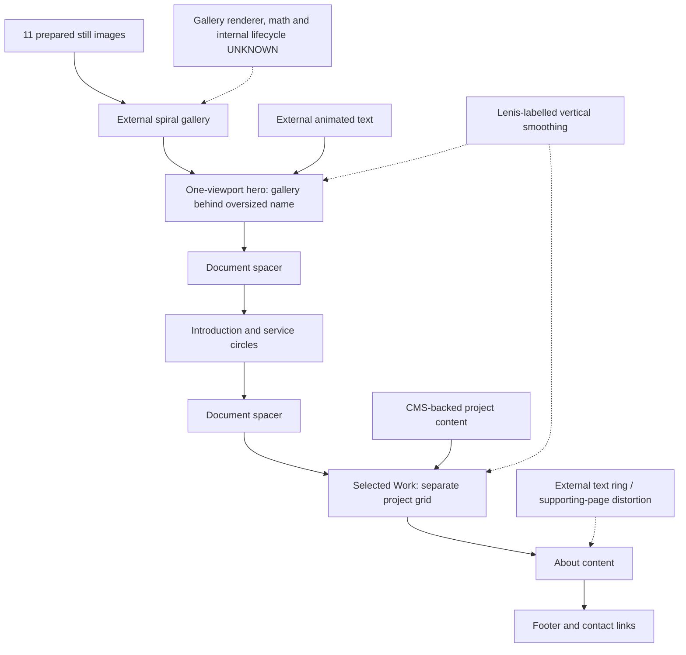
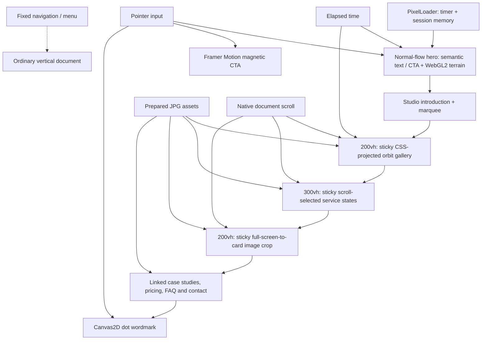

# Website reference study — Marketing OS

Updated: 19 November 2026 (Asia/Calcutta).
Storage: local study outside the Git repository. No commit, push, deployment or
application change is authorised by this document.

## Purpose and reading rules

Study the three websites supplied by the owner independently, then compare
their relevant composition, content, CTA, motion and implementation principles.
Their generated recreation prompts are reference context, not instructions to
copy their branding, assets, palette, claims, sections or dependencies.

Keep these evidence levels distinct:

- **Reported configuration:** the supplied website AI says it inspected a
  project setting, layout, hover state or screenshot. We have read its report;
  we have not independently inspected that source or reproduced the behaviour.
- **Supplied source excerpt:** behaviour can be reasoned about directly from
  code quoted in an attachment. This is stronger than a descriptive claim, but
  is not independent verification of the full deployed source/runtime.
- **Inference:** a plausible explanation, not established by exposed code.
- **Unknown:** the report explicitly cannot establish the implementation.
- **Marketing OS proposal:** a possible adaptation, not a fact about the
  reference and not an owner-approved implementation unless stated otherwise.

The owner's established light paper/ink/yellow palette, desktop priority, Spider
Button on Explore the agents, and clockwise circular/spiral agent discovery
remain the project direction. The Vector Wordmark belongs on the product name
in the first screen. Freeland and Strata have detailed supplied studies.
Antimatter includes the owner's original description and follow-up reports on
pointer response and the first scroll.

| Entry | Reference | Study status |
|---|---|---|
| 1 | Freeland | Supplied description and detailed implementation Q&A read in full; entry below |
| 2 | Strata Studio | Supplied audit, source excerpts and generated reference brief read in full; entry below |
| 3 | Antimatter | Supplied description and follow-up reports on Leaf Field (front) and the hero-to-intro handoff. Source excerpts and independent runtime verification are pending |

## 1. Freeland

URL supplied earlier by the owner: <https://freeland.framer.website/>.
Current source: uploaded `Pasted text.txt`, file
`file_00000000a4d881fa964af367dc015c6a`, 18,335 bytes, local attachment
`/workspace/attachments/b97e6a40-28ca-4c02-b7ff-9518fc0418ac/Pasted text.txt`.

The attachment contains an initial descriptive/recreation brief followed by a
more specific answer to eight implementation questions. Prefer the latter's
qualified findings when they narrow or contradict the earlier description.
The reference AI defines its own “verified” as project configuration/screenshots,
**not an interactive scrolling test**. This study preserves that limitation.
An earlier attempt to open the live URL was denied by the environment's network
proxy; there is no independent live-runtime verification here.

### 1.1 What the website communicates

Freeland presents an individual designer, creative director or independent
studio. It establishes identity, displays work and directs visitors toward
project exploration and enquiries. Its editorial presentation is image-first;
it does not need to explain a software workflow or prove an agent's capabilities.

Its reported visual signature is oversized typography over a dimensional image
spiral, restrained supporting navigation/labels, substantial spacing, and later
project imagery. Prepared images carry much of the colour and subject detail.
The dark palette and small monospaced labels are Freeland's styling, not new
Marketing OS requirements. The report's proposed font names in its recreation
prompt are not independently established installed fonts.

### 1.2 Information architecture and page composition

Reported home-page order:

1. One-viewport hero: oversized name/text in front of an independently positioned
   gallery layer.
2. Large spacer.
3. Introduction and service circles.
4. Large spacer.
5. Selected Work project grid.
6. About content.
7. Footer/contact content.

Additional pages described: Work, individual project details, About and Contact.
Exact route paths, navigation labels and every destination are not provided.
The project presentation is described as a two-card row, a full-width feature,
then another two-card row, using CMS-backed project cards.

The home page is an ordinary vertical document in the inspected layout.
**No native fixed/sticky section was reported.** The hero gallery is absolutely
positioned, which does not establish viewport pinning. Any internal pinning or
scroll interception inside the external gallery remains unknown.

### 1.3 Conceptual architecture

This reconstructs reported relationships, not a verified JavaScript module graph.
Solid arrows indicate reported placement/data relationships; dashed arrows mark
an opaque effect whose internal implementation was not available.



Important boundary: no exposed binding connects a particular hero-gallery image
to a particular CMS project card. A gallery-to-project shared-element morph is
not established. No backend/API architecture is described in the supplied report.

### 1.4 CTA, navigation and action hierarchy

| Surface | What is reported | Limits / interpretation |
|---|---|---|
| Project cards | Normal navigation links, native hover variants | Not an exposed selected-agent/item state machine |
| Pill buttons | Background and label-colour changes over 0.36s; no hover movement/tilt | Exact copy, page placement, destinations and colour values are not supplied |
| Read Bio link | Separate external effect; magnetic displacement enabled, maximum 38px; pointer cursor | Exact attraction formula, return trajectory and destination URL unknown |
| Large contact links | Arrow becomes visible and scales into place using a spring | Exact spring constants and complete navigation behaviour unknown |
| Hero gallery | Image/video inputs; this instance uses still images | No exposed per-item link, selected-item control or click-to-focus setting |

The overall conversion goal is enquiries, but that does not establish a specific
hero CTA label or location. Do not invent “Contact me,” a hero booking button or
a detailed CTA placement diagram as an observed fact.

The source's magnetic link is not evidence that every button or card is magnetic.
For Marketing OS, Spider Button remains its own owner-selected CTA treatment,
not a component discovered in Freeland.

### 1.5 Motion systems and timing

Freeland combines triggered entrances, scroll-scrubbed text, external automatic
gallery movement and an external fold. These should be understood separately.

| Element | Reported configuration | Type of motion |
|---|---|---|
| Gallery entrance | 0.5s entrance, 0.03s card stagger, initial scale 80% | Triggered entrance; internal trigger details unknown |
| Oversized name | Word-by-word, entering from below/transparent; 0.7s initial delay and 0.7s duration | Triggered/time-based |
| Introduction statement | Character reveal from 20% opacity, no vertical travel, scrub inertia disabled | Scroll-scrubbed; interaction with a reported one-time flag unknown |
| Selected Work heading | One-time entrance | Triggered |
| Project grid | Fade/upward travel 36px over 0.7s after 0.2s delay | One-time triggered entrance |
| Spiral gallery | Slow upward automatic movement plus scroll folding enabled | Two possible drivers; interaction between them unknown |
| Gallery fold | Staggered folding; target stack scale 78% | Scroll-related external effect; interval/path unknown |
| Later text ring | Smooth scroll scrubbing enabled | Scroll-related external effect |
| Page scroll | Lenis-labelled vertical smoothing enabled; infinite scroll disabled; no snapping configuration found | Scroll transport, not proof of synchronised animation |

Stopping: triggered entrances are expected to finish once started, whereas a
scrubbed reveal should hold near its settled progress. Those are inferences.
The gallery's idle motion/fold handoff is unknown. Reversal, fast-scroll clamping,
skipped states and external-animation interruption are also not verified.

This corrects the earlier broad idea that the reference is one continuously
scroll-controlled, pinned experience. Smooth scrolling alone establishes neither
pinning nor deterministic progress across every visual effect.

### 1.6 Spiral geometry and depth

Reported exposed settings:

- 11 still images in a two-turn spiral.
- Portrait width/height ratio 0.78.
- 5px corner radius.
- Slow upward automatic movement.
- Rear brightness 65%.
- Card bowing disabled.
- Separate relative controls for cylindrical radius, vertical span and camera
  distance; their conversion to pixels/scene units is not exposed.

The report says a screenshot shows overlap, larger foreground cards, smaller
rear cards, darkened rear imagery and repeated images. A vertical helix with
varying card orientation is a plausible interpretation, not a verified formula.

Unknowns include angle distribution, duplication/wrapping, projection/camera,
depth sorting, occlusion, world scale and whether cards are CSS planes or graphics
meshes. Exact source snippets were unavailable. **Clockwise rotation and five
selectable items are Marketing OS requirements, not confirmed Freeland settings.**

Prepared still-image subjects provide the photographed lighting/material detail.
The external gallery supplies spatial presentation. This is not evidence of 11
fully modelled physical objects. Planar imagery can look dimensional when its
composition, prepared assets, perspective and motion are carefully designed.

### 1.7 Hover, pointer and click behaviour

| Element | Reported response | Return / uncertainty |
|---|---|---|
| Native project card image/video | Scales to 107% within its clipped container | 0.5s hover transition; returns through configured normal variant |
| Project title | Outgoing copy moves upward and fades; incoming copy becomes visible | A copy-exchange effect, not a demonstrated text morph |
| Project arrow | Exchanges copies; outgoing arrow travels diagonally up/right | Same native hover-transition context |
| Native project card | No configured pointer-follow, tilt or magnetic movement | External effects could differ; do not generalise |
| Pill button | Colour changes only | 0.36s; no configured motion/tilt |
| Read Bio | Up to 38px magnetic displacement; staggered enter/exit with reversed exit order | Formula and settling path unavailable |
| Supporting-page distortion | 6% centred hover zoom; 0.65s enter and exit; edge bending, bottom narrowing, scroll strength and subtle gloss settings | Affected image selection, compositing and renderer unknown |
| Hero gallery/headings | No hover interaction exposed | Internal handling unknown |

A foreground gallery card is not confirmed to be a selected item. The source
exposes no selected-ID, click-to-rotate, focus, queue or interruption contract.
Ordinary project navigation is separate. Do not copy an assumed selection model
into Marketing OS without designing and testing our own.

### 1.8 Rendering, loading, accessibility and resilience

Reported: Framer native layouts and tween/spring settings plus external gallery,
scrolling, animated-text, text-ring and distortion effects. React appears in local
demonstration overrides, but those overrides are not attached to the inspected
site layers. The supplied evidence does not establish Three.js, React Three
Fiber, GSAP, shader code or graphics-backend versions.

The distortion effect exposes a pixel-density cap of 1.35. That specific setting
does not establish a whole-site performance budget. Offscreen pausing, asset
preload/decode, texture disposal, context recovery and loading placeholders remain
unknown. Important supporting content exists independently of the gallery, but
external animated headings have unverified failure behaviour.

The report explicitly says respect for reduced motion is **switched off** in
the gallery, text ring and animated-text settings. That is a source limitation,
not a setting to adopt. Marketing OS must retain readable DOM content, keyboard
controls, reduced-motion/static equivalents and sound lifecycle management.

### 1.9 Potential fit for Marketing OS — proposals only

| Principle worth evaluating | Product adaptation | What must not be assumed/copied |
|---|---|---|
| One memorable spatial composition | Five agent dossiers on a controlled circular/spiral path | No requirement for 11 cards, two turns, duplicated items or Freeland's relative values |
| Foreground/rear hierarchy | Bring a selected specialist forward while preserving discovery of the others | Appearance in front must map explicitly to our selected-agent state |
| Folding into a compact arrangement | Prototype continuity from gallery into our expanded agent dossier | The reference does not prove a gallery-to-results morph; this is our own choreography |
| Typography over a dimensional field | Trial Vector Wordmark with readable explanation and stable Spider Explore CTA | No adoption of dark palette, exact font, arbitrary mono labels or source text assets |
| Restrained native hover | Local image/arrow/title feedback that does not fight the main timeline | Do not apply magnetic movement to every control |
| Prepared assets plus spatial transforms | Design meaningful agent-specific card faces from actual roles/content | No generic box illustration, fake client imagery or fabricated metrics |

The key engineering additions for our product are explicit selection, synchronised
role/brief/result content, direct entry through Explore, safe interruption and
readable fallback. These are required because we explain five functional agents,
not merely show independent portfolio images. Public saved-example selection
continues to make no generation/review/memory request.

Freeland's automatic upward drift is not automatically compatible with our
stop-holds/reverse-scroll contract. Define separate motion owners or omit idle
drift; do not silently combine time and scroll on the same transform. Existing
React/Motion, CSS 3D or an existing 3D renderer can be evaluated against the
chosen prototype; the unknown template engine is not a reason to add libraries.

### 1.10 Open evidence and comparison notes

Source-dependent details still unknown: gallery math, its internal pinning/fold
range, selection support, renderer, lifecycle/failure behaviour and exact CTA
placement. These gaps do not require the owner to invent technical constants or
block an original implementation. A recording/source could refine understanding;
our prototype must establish its own measurable geometry and behaviour.

Entry-level understanding: the reference's strength is oversized typographic
identity over well-prepared imagery with spatial depth and selective motion.
The detailed answer supplies less evidence of a unified scroll story than the
initial descriptive prompt suggests. Preserve that distinction when comparing
the other entries. Current sitewide dispositions are in blueprint §20; no implementation is made here.

## 2. Strata Studio

Source received: 17 November 2026 (Asia/Calcutta).
No live site URL was supplied for this entry; do not infer one from the name.

- Owner's detailed audit description in chat.
- `strata-source-evidence.md`, file `file_00000000a2b881faaf77beeb66b71914`,
  75,446 bytes / 1,404 lines. Local attachment:
  `/workspace/attachments/05d41155-e6ba-496e-8f9f-a6d902739734/strata-source-evidence.md`.
- `strata-agent-prompt.md`, file `file_00000000afd48211b96bf96bb7b87cbd`,
  6,120 bytes. Local attachment:
  `/workspace/attachments/fc54db52-1b94-48f3-8d1d-7aa9fbb4ced3/strata-agent-prompt.md`.

The evidence file says its author audited the Home page, all 13 available custom
sources and representative JPG assets. We have read that report and all supplied
excerpts, not independently inspected the full project or tested its runtime.
The quoted excerpts cover ten named modules: OrbitGallery, StickyServices,
ZoomReveal, VoxelField, MagneticButton, Picture, Reveal, PixelLoader,
PixelWordmark and LogoMarquee. The reconstruction prompt is not an implementation
request from the owner. It includes suggested improvements that must not be
mistaken for features already implemented in Strata.

### 2.1 Purpose, identity and content

Strata is a creative-studio portfolio and lead-generation site offering website
design, creative development, maintenance and search growth. Its recurring
voxel/pixel identity connects the live hero terrain, prepared work imagery,
loader and footer. Its reported visual system uses dark/graphite surfaces,
oversized editorial text, restrained utility typography and ember-orange accents.

The lesson is the relationship between a clear visual motif, carefully prepared
assets and selective motion. It does not establish that Marketing OS should use
terrain, orange, a dark theme, studio pricing, a logo marquee or agency claims.
Inter Tight/JetBrains Mono are reported reference styling, not adopted fonts.

### 2.2 Information architecture and section boundaries

| Section | Reported extent / behaviour | Main content |
|---|---|---|
| Pixel-logo introduction | Once per browser session; timer-based overlay | Logo pixels, decorative counter/bar, exit reveal |
| Hero | Approximately 100vh; ordinary document scrolling, not pinned | Websites with real gravity headline, CTA content and procedural voxel field |
| Studio introduction / logo marquee | Normal flow | Studio positioning and logo/name strip |
| Work, in orbit | 200vh container with 100vh sticky stage | Eight prepared project images around a central title |
| Services | 300vh container with 100vh sticky stage | Four scroll-selected services with descriptions/media |
| Landmark | 200vh container with 100vh sticky stage | Same prepared image contracts visually from full screen into a card |
| Case studies | Normal flow, linked work | Prepared project imagery and supporting content |
| Engagement/pricing, FAQ and contact | Normal flow | Lead-generation content; exact submission/backend implementation not supplied |
| Footer | Normal flow with Canvas2D effect | Dot-matrix wordmark and pointer interaction |
| Floating navigation | Fixed across sections | Site navigation and full-screen menu; complete route/focus contract not supplied here |

This is a sequence of separate sections, three with their own sticky stages.
It is not a single globally pinned scene. Shared colours/voxel assets provide
continuity; no hero-to-gallery or gallery-to-services shared-object morph is
established. Mobile layout notes in the source are reference facts, not new
mobile-polish work for our current desktop-first phase.

### 2.3 Conceptual rendering and motion architecture

Reconstructed from supplied page settings and excerpts; no backend architecture
is inferred. Each sticky section measures its own document travel.



| Subsystem | Actual technique in excerpts / report | Ownership |
|---|---|---|
| Main page | Framer/native readable layout; React custom components | Semantic content and section sizing |
| Gallery | JavaScript projection applied to DOM/CSS cards | Scroll target + smoothed angle + independent idle angle |
| Services | Scroll index plus browser `element.animate()` | Scroll selects state; elapsed time completes wipes/zoom |
| Landmark | CSS `clip-path`, transforms, opacity and SVG noise texture | Smoothed section progress |
| Hero terrain | WebGL2, GLSL, instanced cube geometry | Time and pointer, not scroll |
| CTA | Framer Motion values/springs plus layered CSS transforms | Hover/focus/pointer |
| Footer | Canvas2D particle/dot simulation | Entry assembly, pointer forces and resting/sleep state |

The audit reports imports of Framer, React, React DOM for the menu and Framer
Motion for the CTA. No Three/R3F/GSAP/ScrollTrigger/Lenis/Locomotive imports were
found in the inspected custom source. That is a scoped finding, not proof that
every dependency in Framer's private runtime is absent. Exact versions are unknown.

### 2.4 CTA and navigation mechanics

The detailed main CTA is described as Start a project. `MagneticButton.tsx`
accepts label/link/new-tab and colour/spacing/strength props. It uses an anchor;
the actual page-configured target URL and exact placement are not reproduced
in these excerpts. Do not invent a contact modal, booking flow or form backend.

Source-backed interaction layers:

- A Framer Motion spring follows pointer displacement, using stiffness 220,
  damping 18 and mass 0.6. Label/icon motion is 45% of the outer spring value.
- Pointer offset is measured from the unshifted centre by subtracting the current
  spring displacement, avoiding a position-feedback loop.
- On entry, a fill rises from below; its leading edge has changing rounded
  curvature. On leave, the spring targets reset to zero and the fill exits upward
  with duration 85% of its entrance duration.
- Duplicate label copies roll vertically; the duplicate is aria-hidden.
  Two arrow copies exchange positions rather than morphing their paths.
- Keyboard focus invokes the visual entry state; blur invokes leave. Touch and
  reduced motion bypass pointer attraction. Reduced motion shortens the fill to
  0.01s, but the separate label/icon CSS transitions still exist in the source.

The expanded magnetic area and exact configured strength/sweep duration are not
fully specified in the supplied excerpt. The native link remains the action;
pointer choreography is not an authentication or content-selection mechanism.

For Marketing OS, the chosen Explore CTA remains Spider Button. Strata's CTA
provides a reference for layered feedback and reset behaviour, not permission
to replace it or combine every web, magnetic, cursor and rolling-text effect.

#### Follow-up — floating “Custom website” enquiry control

The owner supplied a follow-up from the site assistant about the bottom-left
promotional widget. Its behavior is reported configuration. The main desktop
site navigation still needs separate evidence.

| Input | Reported behavior |
|---|---|
| Scroll down or overlap | The floating controls can collapse to icons. Hover or keyboard focus reveals the labels again. |
| Hover or focus | Hover lifts and slightly enlarges the active button, adds a pointer-following highlight and slightly shrinks its neighbors. Focus adds a visible accent outline and highlight. The enquiry panel stays closed until activation. |
| Click, Enter or Space | The panel expands, dims the page and locks background scrolling. Focus enters the form and Tab stays within it. The panel stays open as the pointer crosses into it or leaves it. |
| Dismissal | Close button, backdrop click or Escape dismisses the panel. The close animation takes about a quarter-second and focus returns to the trigger. Reduced motion skips the animation. |
| Rapid activation | The trigger always requests opening. Once the panel covers that location, a second physical click can land inside the panel. |

The assistant reported that the promotional widget only runs on approved domains
and ordinarily disappears on a remixed site's published domain. For our header
trial, use the separation of hover/focus feedback and explicit opening for any
disclosure. Keep focus trapping and background scroll lock for an actual modal.

### 2.5 Orbit geometry, depth and counter

Reported current page settings: eight images, base size 260×325px, radius 36% of
stage width, ring tilt 16 degrees, perspective distance 1400px, scroll contribution
0.75 turns, idle speed 0.06 radians/s, smoothing 0.6 and maximum rear darkening 0.7.
The geometry/projection itself is visible in `OrbitGallery.tsx` lines 169–214.

For card i, the source calculates:

```text
a     = displayedAngle + (i / cardCount) * 2π
R     = stageWidth * radiusFraction
x     = sin(a) * R
z0    = cos(a) * R
y     = z0 * sin(tilt) * 0.6
z     = z0 * cos(tilt)
scale = perspective / max(60, perspective - z)
depth = (z0 / R + 1) / 2
yaw   = -sin(a) * 28 degrees
```

The browser receives projected x/y translation, scale, a local perspective and
card yaw. Depth sets CSS z-index (approximately 0–1000), while a DOM overlay
darkens rear cards. The title uses z-index 500, placing it between front and
rear layers. Cards remain broadly camera-facing; they are not tangent-facing
rigid panels around a wheel. There is no card bending or gallery shader.

Responsive scale is `clamp(stageWidth / 1440, 0.5, 1.15)`. Card faces are actual
JPG images with cover fitting, lazy loading and asynchronous decoding. Shadow,
outline and ambient glow are CSS styling; they are not rendered physical lights.

The nearest-depth card updates only a numeric counter. It does not establish
selected content, click-to-centre, hover tilt or a navigation target. Cards start
at zero opacity until positioned, creating a failure case if initialization fails.
Missing image source can show a generated placeholder; an existing broken URL is
not automatically replaced by that placeholder.

### 2.6 Scroll, idle motion and interruption

Gallery progress is calculated from its own section:

```text
targetProgress = clamp(-sectionTop / max(1, sectionHeight - viewportHeight), 0, 1)
k             = 1 - exp(-dt * (2 + (1 - smoothing) * 18))
displayed     += (targetProgress - displayed) * k
idle          += dt * idleSpeed
angle          = -displayed * scrollTurns * 2π - idle
```

Reduced motion sets k to 1 and disables idle accumulation; scroll-driven rotation
remains. Frame delta is capped at 0.05s. IntersectionObserver skips layout updates
offscreen, but requestAnimationFrame continues scheduling. Cleanup cancels the
loop and disconnects observers.

With the reported settings, the scroll contribution is 270 degrees. Idle adds
about 3.44 degrees/s (a full revolution in about 105s); these are calculations
from the supplied values, not measured browser performance.

Stopping lets the smoothed target settle while idle spin continues. Reversing
changes the target while idle retains its original direction. Fast scrolling can
skip intermediate poses. No card-selection or click-interruption implementation
is shown because orbit cards are noninteractive visual items.

This is not automatically compatible with Marketing OS's stop-holds and reverse-
reverses contract. Our five-item discovery must explicitly choose scroll ownership,
coverage of every agent and direct selection. The reference's eight-image counter
and 0.75-turn interval do not establish that product behaviour.

### 2.7 Services: discrete state plus timed visual response

`StickyServices.tsx` lines 160–221 maps section progress to one of four bands.
It updates a progress rail, records the previous/active indices and captures
direction. Scroll/resize updates are batched with at most one pending frame.

Crossing a band runs a direction-aware clip wipe on the incoming image, with
reported reveal duration 0.9s. An independent zoom settles from 118% over 1.3×
that duration. Reduced motion replaces the wipe with a 300ms fade. Previous and
active media are layered; other images are hidden. Headings brighten and move
8px right through opacity/transform transitions; hover does not select them.

The headings are real buttons with a minimum 44px height and aria-current.
Clicking requests native smooth scrolling to the middle of a band's travel.
Selection follows actual scroll thresholds, not the click immediately. This can
activate intermediate services during the scroll.

There is no explicit queue/lock or cancellation of older animation handles in
the excerpt. Rapid input can replace the active/previous pairing before a prior
reveal finishes; exact browser smooth-scroll interruption is untested. A safe
agent selector needs deliberate retargeting/cancellation and consistent visual/
brief/result identity instead of assuming these source semantics are sufficient.

### 2.8 Landmark: retained image, changing crop and composition

`ZoomReveal.tsx` retains the same prepared media layer. The configured page uses
a JPG, although the component also supports video. No city geometry or buildings
animate. There is no physical fold or gallery-to-landmark shared object.

- Progress 0.02–0.72 drives an eased crop through `clip-path: inset(... round ...)`.
- The final card is reported as 72% of viewport width, 56% of height, 40px above
  the bottom with 16px corners. Its horizontal/top/bottom insets interpolate from
  full screen, using actual stage dimensions.
- The image translates toward the crop's centre and settles from scale 1.12 to 1.
- The dark overlay decreases; the hint fades during progress 0–0.12.
- Text appears above the retained image over progress 0.3–0.8, moving upward
  from a 40px offset. A fixed SVG turbulence texture adds grain.

The section has its own smoothing factor and visibility guard. Once near its
target it avoids redundant visual updates, but still schedules frame callbacks.
Reduced motion removes smoothing, not the crop transformation. Headline/copy
start transparent and depend on initialization to appear. Optional video
play/pause code does not mean this configured page is using a video.

### 2.9 Procedural hero: what is genuinely live WebGL

`VoxelField.tsx` obtains WebGL2 and renders a 64×64 grid (4096 instances) of
repeated cube geometry, with per-instance cell coordinates. The vertex shader
combines layered procedural noise, a slow swell and a soft local pointer lift,
then quantizes height into six steps per unit. This is time/pointer driven;
the hero itself scrolls normally.

The fragment shader supplies directional face lighting, edge darkening, an
orange travelling highlight, sparse bright high cubes, a small rim contribution,
distance fog, top/bottom fades and vignette. The apparent bevel is face shading,
not bevelled geometry. No shadow-map/bloom pipeline appears in the excerpt.

Pointer input eases camera offsets and local lift. Leaving the canvas's vertical
region/document decays disturbance intensity; the camera target coordinates are
not explicitly reset to centre. This differs from the CTA spring's reset.
Resolution is capped at DPR 2 and geometry is instanced. Offscreen/static guards
skip drawing, while the frame loop still schedules callbacks. Reduced motion
freezes the scene time; full actual device performance is not measured.

Absent WebGL2 or context loss sets a CSS grid/gradient fallback. Shader compile
failure merely logs a warning in the excerpt; explicit link validation/fallback
and context restoration are not demonstrated. Cleanup removes main pointer
listeners/observer and requests context loss; the excerpt does not show a full
resource-restoration lifecycle. Do not equate this with failure-proof rendering.

### 2.10 Other interactions, loading and accessibility

| Area | Supplied source behaviour | Important qualification |
|---|---|---|
| Case-study images | Picture.tsx: clipped image zoom to 1.035 over 0.7s; lazy/async image; reduced-motion CSS removes transitions/zoom | Simple scale, no shader distortion; broken-image recovery not shown |
| Ordinary reveals | Readable content first; initialization adds waiting/reveal classes below the fold; one-time IntersectionObserver | Better progressive enhancement here does not prove every page effect is failure-safe |
| Focus styling | Reveal.tsx injects a visible anchor/button focus outline | Global styling is shown; complete menu/focus/navigation testing is not |
| Pixel loader | 0.6s decorative timer progress, 0.1s hold, 0.5s upward exit; session storage remembers completion | Counter is not asset-download progress; scroll unlocks at exit start; final hide cleanup is later |
| Loader reduced motion | Less animation/fade path; cleanup restores previous overflow | An initial overlay can still obstruct content when scripts never run |
| Footer wordmark | Canvas2D home-position springs, local pointer repulsion and entry assembly | Physics sleeps after low energy, but scheduled callbacks still exist; new pointer/resize can wake it |
| Logo marquee | Visible-region updates, eased speed and wrap; hover decelerates toward configured stop and names brighten | Not all callbacks are cancelled offscreen; no site-wide custom cursor is established |

Reduced motion is implemented unevenly across effects rather than removing all
movement. It must be evaluated per subsystem. Native text remains separate from
the hero canvas, but gallery opacity, landmark copy and the loader have specific
initialization dependencies. Source review does not prove measured frame rate,
low-end performance, every image failure or browser-specific interruption.

### 2.11 Prepared assets versus functioning interfaces

The orbit cards contain JPGs of complete miniature websites, including their
typography, buttons, illustration and lighting. Those apparent buttons are pixels,
not embedded live interfaces. Service product views/scroll-map bars and landmark
city are also prepared JPG content. Original asset-authoring software is unknown;
appearance is not evidence of Blender, Cinema 4D, AI generation or another tool.

This explains part of the reference's polish without attributing all visual
detail to runtime 3D. For Marketing OS, prepared illustrative art may support
depth, but actual brief/result/controls should remain readable, semantic and
truthful. No screenshot should be represented as an operating agent interface.

### 2.12 Potential fit for Marketing OS — proposals only

| Principle worth evaluating | Possible product adaptation | Boundary |
|---|---|---|
| DOM cards with explicit projection/depth | Five-agent circular discovery with controllable foreground hierarchy | Our selection, focus and content synchronization must be built; source cards do not provide them |
| Title between rear/front layers | Explore typography and agent imagery in one spatial composition | Preserve readable essential labels and stable Explore CTA; keep our palette |
| Section-local progress | Bound gallery travel and agent-stage reveal to meaningful regions | No need to pin the entire website or reproduce exact 200/300vh lengths |
| Scroll-selected content with a visual reveal | Coordinate active agent title, brief and result | Handle interruption/stale callbacks explicitly; no implication of running the model on scroll |
| Retained-media full-screen-to-card crop | Explore a continuous focal-artifact transition into a dossier | This becomes our own product choreography, not evidence Strata already morphs its hero/gallery into data panels |
| Layered CTA feedback | Evaluate focus/reset and visual continuity alongside the owner-selected Spider interaction | Do not automatically replace Spider or stack every magnetic/web/cursor effect |
| Shared prepared visual language | Original agent artwork that belongs with the actual product | No copied voxel landscape, dark/orange palette, fake logos, pricing or agency testimonials |
| Visibility/reduced-motion engineering | Per-effect budgets, readable fallbacks and cleanup | Improve known initialization/resource limitations; do not claim they were already solved by the template |

The timed percentage loader, unrelated procedural terrain, ambient glow and
footer physics are not automatic Marketing OS requirements. An immersive visual
reference does not require adopting all of its effects. Preserve settled project
decisions; the earlier Antimatter description supplies the contextual third entry.
No new general-site upload is a blocker; current dispositions are in blueprint §20.

### 2.13 Source index, uncertainties and comparison notes

Key excerpt locations within `strata-source-evidence.md`:

- Geometry/depth/counter: OrbitGallery.tsx 169–214; progress/idle 228–267;
  sticky stage/cards 286–367; title layering 369–408.
- Service state/wipe/click: StickyServices.tsx 160–221; headings 286–328;
  active/previous media 348–387.
- Landmark grain: ZoomReveal.tsx 110–116; crop/text 226–261; smoothing/lifecycle
  275–324; actual media markup 341–445.
- Hero shaders: VoxelField.tsx 34–112; setup/instancing 174–236; input/draw loop
  238–321; CSS fallback 327–354.
- CTA: MagneticButton.tsx 97–157 and 241–295.
- Supporting images/reveals: Picture.tsx 14–48; Reveal.tsx 16–50.
- Loader/footer/marquee: PixelLoader.tsx 168–259; PixelWordmark.tsx 380–446;
  LogoMarquee.tsx 134–175 and 240.

Still unknown or untested: live runtime/click interruption, true frame pacing,
complete source/build dependency graph and versions, original asset production,
full menu/contact backend behaviour and every initialization/failure path. No
Strata code was executed or imported. A source excerpt supports reasoning about
its visible logic, not a guarantee that the deployed version is identical.

Provisional understanding: coherent voxel/pixel imagery connects independent
sections, while rendering complexity is concentrated where it contributes.
Different subsystems use different clocks and control contracts. Preserve that
specific architecture rather than calling the whole site a single WebGL scene
or continuous shared-object morph. The synthesis below and blueprint §20 now
apply the lessons across the site; exact original artwork still requires review.

## 3. Antimatter — contextual reference from the earlier description

Evidence: the owner pasted a site assistant's explanation and later answers
describing the first scroll and foreground leaf interaction. Settings and
behavior below come from those reports. Antimatter source excerpts and
independent runtime observations are still pending.

Reported identity: creative work grows from a seed. Sculptural grainy leaves,
vines and layered typography repeat that idea across the site. Reported motion
includes growth, pointer-responsive foliage, a horizontal project showcase,
masked image reveals and gently magnetic actions. Home, work/case studies,
about, journal and contact form its described content architecture. Exact CTA
labels/destinations, scroll ranges, selection/interrupt contracts and geometry
are unknown from the supplied explanation.

The report attributes depth to React/Framer, SVG, Canvas2D and CSS rather than
requiring full WebGL. We cannot independently confirm its complete renderer or
dependency inventory. Its useful lesson is coordinated artwork, layering and
movement around one identity. Botanical assets, green/dark colours, agency
content and specific typography are not selected for Marketing OS.

### Pointer response — Leaf Field (front)

The reported implementation subtracts the current element's top-left bounds
from the window pointer coordinates on each frame, which accounts for scroll.
Each foreground leaf pivots around its own base. The container and wordmark
stay in place. Influence tapers across a radius of 38% of the hero diagonal
(about 548 px in the inspected 1200 × 800 hero). The pointer contributes up to
roughly 18° of rotation in either direction, and each frame covers 9% of the
remaining angle. A separate idle sway continues. Pointer tracking remains
active beyond the hero bounds, so nearby leaves can respond until the pointer
moves out of range. Leaving the browser clears the pointer contribution.
The assistant reports that reduced motion disables the animation.

For our Wordmark, use the principle of a stable container and a pointer effect
localized to nearby elements. Reveal guides around nearby letters and settle
on leaving the name. The reported leaf radius, rotation and smoothing are
reference values.

### First scroll — hero into the introduction

| Motion input | What happens when you stop or reverse |
|---|---|
| Direct scroll | The front and back leaf layers grow as the hero exits, with more scale in front. The Intro statement brightens progressively. Both hold when scrolling stops and retrace on reverse. |
| Smoothed scroll | The Intro vine draws down and its leaves unfold. It catches up briefly and holds on a pause, then retracts and folds on reverse. |
| Pointer and elapsed time | Pointer response settles on its own. Visible leaves continue their idle sway, and initial growth can finish independently. Scroll reversal leaves those effects running in their original direction. |
| Normal document flow | The hero title and buttons travel with the page. |

For Phase 3, start with the hero title and actions in normal document flow
and one direct, reversible visual change into the quiet introduction. Verify
the first small scroll, a pause halfway through and a reverse. Keep the
pointer-only Wordmark independent of the handoff and let the orbit begin
after the introduction.

## Cross-reference synthesis for the whole Marketing OS website

| Reference | Supported lesson | Limit on applying it |
|---|---|---|
| Freeland | Reported upright spiral cards, foreground/background hierarchy and prepared artwork | Internal gallery math/renderer unknown; autoplay and missing reduced-motion support are not our contract |
| Strata | Supplied projection/depth code; separate scroll, time and pointer clocks; hybrid rendering | Orbit counter is not selectable-agent state; idle drift, dark/orange identity and timed loader are not adopted |
| Antimatter | Reported separation of direct scroll, smoothed scroll, local pointer response and elapsed-time motion | Use the separation of inputs. The observations come from the site assistant's report. |

Marketing OS combines its own decisions: light paper/ink/yellow; Spider Explore;
wanted Vector Wordmark with hero placement trial; five clockwise circular/spiral
agent dossiers; connected centred-arrival to expanded agent stage; genuine brief
and result; no inference on exploration. A shared foreground-card expansion is
our proposed bridge, not a verified effect copied from these sites. The PR checkpoint remains a later deliverable. The latest 2D scope is in §4.

Implement a bounded desktop motion prototype using one progress and selection
contract, hold/reverse semantics, interruptible direct entry and readable
fallbacks. Review original artwork, composition, wordmark placement and measured
travel in that prototype. Enough general research exists; missing production
assets and visual acceptance must not be relabelled as missing reference sites.

The three local planning files now apply this synthesis sitewide: blueprint
§1–§12 and §20 revise the roadmap, architecture, decisions, gates and full
retain/revise/discard audit; design/layout §1–§16 reconcile identity, components,
comparison, asset production, data, original research inventories and review;
animation §1–§16 reconcile the page/component/scene clocks, geometry, state,
rendering, lifecycle, failure, performance, principles and all-phase acceptance.
The detailed source facts/unknowns above remain reference evidence rather than
copied implementation mandates. F01/F02 and historical execution records remain
retained; rejected visual assumptions are explicitly superseded.

Blueprint §20 maps R01–R28 reference lessons to current sections/phases and
records all 52 numbered sections' changes or deliberate retention. Current work
is original composition/art and the connected F03 prototype; later comparison, role-specific 2D explanations, engineering content and
console inherit that system. No extra
site or repeated broad questionnaire is needed to know the intended direction.

This study and the three planning files stay local. No application, capture,
commit, push, deployment or phase PASS is implied.

<a id="phase-motion-and-case-study-research"></a>

## 4. Landing motion, navigation, hover and case-study research

**Owner update, 18 November 2026.** Keep the current-scale, pointer-reactive
hero wordmark, sitewide Phase 3 dither, scroll-linked clockwise gallery and
five distinct, explicitly opened How it works explanations. See §5 for
the subsequent spherical gallery direction. Use brief text
reveals where useful. Set aside dedicated SVG animation, a separate slider,
WebGL shaders, physics and live 3D animation. The gallery retains visual depth
through CSS projection. The earlier physical-scene proposal recorded above
is superseded by role-specific 2D explanations.

The product is the whole system. The landing site is one branch, with the
hero, quiet introduction, agent gallery, results and navigation as its parts.
Each effect has a local job. Pointer guides belong to the hero name, the
section glide belongs to the transition, the scroll-linked orbit belongs to
discovery, and each clicked explanation belongs to its own agent. The console
and evidence data support the experience through their own contracts.

### Scroll and the glide between sections

| Source and observation | Trial for this site |
|---|---|
| Strata uses ordinary flow for its hero and intro, then pins a stage within a finite scroll range. Its orbit adds idle rotation. Its landmark uses a stable image and scroll-linked crop and scale. | Keep the first scroll for the quiet introduction. Use finite section progress for the orbit, with a stationary hold, reversible travel and release into results. Reuse the idea of visual continuity from the landmark. [Strata source study](#2-strata-studio) |
| CSS distinguishes page scroll progress from an element's progress through the viewport. Sticky positioning is bounded by its scroll container and containing block. Motion exposes progress for a target and configurable offsets. | Compare A, regular document flow with a small progress-linked position/opacity change between sections, and B, a short sticky overlap at the introduction-to-orbit boundary. Use the same copy and art. Keep the alternative only if the handoff feels clearer in real use. [CSS animation-timeline](https://developer.mozilla.org/en-US/docs/Web/CSS/Reference/Properties/animation-timeline) · [CSS positioning](https://developer.mozilla.org/en-US/docs/Web/CSS/Reference/Properties/position) · [Motion useScroll](https://github.com/motiondivision/motion/blob/main/packages/framer-motion/src/value/use-scroll.ts) |
| React Bits CircularGallery handles wheel input and drives its own independent gallery transport. | Study its depth and spacing. Keep our native page scroll, visible access to all five agents and a separate clicked dossier. [React Bits CircularGallery source](https://github.com/DavidHDev/react-bits/blob/main/src/content/Components/CircularGallery/CircularGallery.jsx) |

For the comparison, use a small first scroll, stop halfway in each handoff,
reverse, flick past the orbit, take the direct Explore link and return. Check
wheel, trackpad, keyboard, resize and reduced motion. The page retains native
scroll throughout. The wordmark responds only to the pointer over the name.
The orbit follows scroll, while its dossiers and explanations change only on
their explicit actions. Keep both introduction lines visible at rest and with
reduced motion. Finish the selected production handoffs in Phase 9.

The [Antimatter first-scroll report](#first-scroll--hero-into-the-introduction)
supports testing a single direct change against normally scrolling copy and
actions. Compare Strata's actual orbit entry and release when usable footage
is available. A phone-screen capture can show scroll and tap. A recording
of the desktop with a visible cursor can also show hover and timing.

### Animated navigation and purposeful hover

| Source and observation | Trial for this site |
|---|---|
| React Bits PillNav animates a visual fill on stable links. Strata layers label/arrow changes inside its CTA. | First trial a compact header with persistent direct links and a restrained fill or underline on focus/hover. Keep Open console visible. Spider remains the Explore action and uses a stable hit area with the existing bounded visual response. [PillNav source](https://github.com/DavidHDev/react-bits/blob/main/src/content/Components/PillNav/PillNav.jsx) · [Strata CTA](#24-cta-and-navigation-mechanics) |
| The Radix navigation example implementation distinguishes pointer state and has delayed opening and a close timer. shadcn's Navigation Menu wraps Radix with a styled trigger and viewport. WAI's disclosure navigation uses ordinary links and a button with expansion state. | Compare a single expandable panel only if there are enough links to group. Click, keyboard and tap control expansion. If mouse hover also opens it, use a small delay, let the pointer cross into the panel, keep it open while in use and support Escape. Return focus to the trigger on keyboard dismissal. Test timings on the actual header. [Radix source](https://github.com/radix-ui/primitives/blob/main/packages/react/navigation-menu/src/navigation-menu.tsx) · [shadcn source](https://github.com/shadcn-ui/ui/blob/main/apps/v4/registry/new-york-v4/ui/navigation-menu.tsx) · [WAI disclosure navigation](https://www.w3.org/WAI/ARIA/apg/patterns/disclosure/examples/disclosure-navigation/) · [WCAG hover or focus](https://www.w3.org/WAI/WCAG22/Understanding/content-on-hover-or-focus.html) |
| React Bits Magnet isolates a stationary hit region from a transformed visual layer. CSS can target devices with a hover-capable input. | Use the stable-target idea for the wordmark bounds and Spider. Cards and links may change ink, border or underline to confirm availability. Hover leaves the chosen role and scroll position alone. Preserve visible keyboard focus, resting labels, tap behavior and reduced motion. [Magnet source](https://github.com/DavidHDev/react-bits/blob/main/src/content/Animations/Magnet/Magnet.jsx) · [CSS hover feature](https://developer.mozilla.org/en-US/docs/Web/CSS/Reference/At-rules/@media/hover) |

Phase 3 establishes the usable header, hover grammar and a concrete expansion
trial. Phase 9 settles the menu and carries the accepted pattern across the
site. Use shared controls and styles where they fit. Final grouping, expansion
behavior and timings remain visual review decisions.

The [Strata enquiry-widget report](#follow-up--floating-custom-website-enquiry-control)
supports starting the disclosure trial with opening by click or keyboard
activation and using hover and focus for feedback. Keep the visible-link
header as the first proposal, with **Open console** visible and Spider on
**Explore the agents**. The owner subsequently selected visible desktop
links. The additional desktop reference below answers the
interaction and source questions for a main navigation. Strata's own main
navigation remains unverified.

#### Additional reference — desktop side drawer

Evidence comes from the owner's pasted inspection report for a new site.
Its name and URL were unspecified. The report describes project configuration
and source inspection. Live keyboard interaction remains unverified.

| Question | Reported behavior |
|---|---|
| Component and resting state | A fixed reusable `Navbar` in the shared `Template` layout has open and closed desktop states. Only the home-linked K–F logo and two-line menu control are visible at rest. Main links and links to social profiles and templates appear inside the drawer. |
| Opening and persistence | Activating the menu control opens or closes the drawer. It blocks background scroll while open. The open state persists as the pointer crosses into the drawer or leaves it. The inspected background layer has no outside-click dismissal action. |
| Link behavior | Home, About, Work and the logo navigate and close the drawer. Let's Talk opens Cal.com in a new tab without a configured close action. |
| Hover and focus | `Side Nav Item` shifts the label, reveals a rotating and scaling arrow, fills an underline and rolls the small number using duplicate text. Social icons reveal tooltips and template links animate an underline. The report found no explicit focus animation or Escape action. It did not establish browser-default focus feedback, focus order or focus restoration. |
| Motion source | Native Framer `Navbar` states spring the drawer in from the right, animate its skewed edge and fade the background layer. Link feedback runs approximately 0.4 seconds. The separate `Navbar with Effect` on Home animates page entry from above. |

For Phase 3, the drawer gives us a concrete alternative to visible header
links. If selected, open it on activation, preserve the open state across
pointer movement, and try a short edge or underline reveal within our
palette. Keep **Open console** visible. Verify visible focus, keyboard
opening, Escape dismissal, focus return and reduced motion. Use a focus
trap and scroll lock if the drawer behaves as a modal.

### Short case previews with evidence on demand

Strata gives each case a company name, a specific outcome line and a consistent
link into the case. GitHub Customer Stories uses brief browseable summaries and
a longer detail page for context and results. Use that difference in depth.
The landing should name the real company, explain the decision in a concrete
headline and use one or two lines for the finding or recommendation. Use one
clear link into the evidence. A first draft can aim for roughly 20–35 words of
summary, with the rendered layout deciding the final length. [Strata study](#22-information-architecture-and-section-boundaries)
· [GitHub Customer Stories](https://github.com/customer-stories)
· [Spotify customer story](https://github.com/customer-stories/spotify)

Use the site's own structure in the detail. Show what the company does, the
decision brief, a useful output, why it follows from the evidence, and links
to relevant public sources. Label the work as a demonstration using public
evidence. Distinguish our recommendation from an action the company took or a
measured result it achieved. For Events, a company profile and brief supply
audience, market, goals and constraints. Public competitor agendas, session
pages and announcements give the agent evidence to compare formats and
positioning. Use “researches published competitor events” for the current saved
demonstration. A live tracking claim requires an actual monitoring workflow.

**Ground seed status.** The bundled starter corpus now contains concise
observations attributed to public source pages. Startup replaces the managed
legacy corpus and its search and graph data. Saved decisions and operator
memory are retained. The public agent gallery uses clearly labeled
illustrative briefs and reviewed citations.

Before publishing separate real-company case studies, agree on the profile
and brief, check current primary evidence, and capture fresh genuine examples
privately. Keep raw capture data outside the public build.
[Phase 10 contract](MARKETING_OS_BLUEPRINT_PLAN.md#phase-10-completion-contract)

### Put the findings into the phases

Use the [blueprint phase reading table](/workspace/Marketing-OS/docs/MARKETING_OS_BLUEPRINT_PLAN.md#phase-to-specification-and-verification-table)
to reach the design/layout sections, animation sections and reference cues
for each phase. Read with the [milestone sequence](/workspace/Marketing-OS/docs/MARKETING_OS_BLUEPRINT_PLAN.md#milestones-for-every-phase).
At a later phase, begin with accepted evidence from earlier milestones. Open
this study when a visual or technical question needs a reference. Record the
specific lesson, its boundary and how the phase will verify it. Study research
can inform a proposal. Acceptance comes from the observed project behavior
and the owner's review where required.

| Phase | Concrete work and evidence |
|---|---|
| 3 | Storyboard the first three sections, compare section glides and header behaviors, adapt pointer-only Vector and Spider, verify scroll-linked orbit/scroll exit, and use existing dither throughout. Reserve readable results/case space and research component candidates for five explanations. |
| 4 | Carry stable hover, focus and selection into pair comparison and the shared-stage handoff. |
| 5, 6 and 7A–D | Prove the PR checkpoint as readable 2D states, then animate it and develop four distinct role patterns. Click starts the explanation and a static equivalent preserves the result. |
| 8 and 9 | Preserve agent identity and focus on return. Finish the accepted section glides, menu, hover and footer motion across the combined journey. |
| 10 | Verify short real-company cases and linked methodological detail. Track corpus replacement, migration and recapture against Phase 2 provenance. Schedule that data dependency earlier if the pilot needs it. |
| 11–14 | Apply the accepted shared controls and dither to console, then check input modes, reduced motion and performance, and verify the full journey at release and any requested deployment. |

Research confidence is based on the supplied Strata study and inspection of
published documentation and component source. X search returned a network
403 in this environment. No X examples or new interactive tests of the
references are claimed.

<a id="orbit-sphere-and-moss-island"></a>

## 5. Orbit Sphere and Moss Island clips

The owner provided two Motionsites phone clips and rejected the M1 wheel.
The new preference is a rounded shell of agent images that responds to
pointer movement and brings the chosen image forward. Five images per agent
was a proposed starting density. The footage establishes appearance and
visible state changes. Exact event drivers, rendering stack and library
choices remain unverified.

| Clip | Visible behavior | Project application |
|---|---|---|
| **Orbit Sphere**, 6.52 seconds | Small rectangular images are spread over a spherical form. Tiles at different depths change scale and facing as the shell turns. Around 5 seconds a rocket image comes forward while the surrounding tiles remain in view. By about 6 seconds the frame is back to a wider view. | Prototype a shell of original work images around the five agent IDs. Try up to 25 optimized thumbnail planes, with a selected tile pulled forward and the corresponding dossier bound to its agent. [Owner clip](/workspace/attachments/26d5febe-1bca-436c-9dd4-93203da71874/WhatsApp%20Video%202026-11-19%20at%2015.16.08.mp4) |
| **Moss Island**, 7.70 seconds | The preview moves between a wide view of an airborne island and a low view over the moss with an instrument and information overlays. The close scene has clear near and far layers. The island remains the subject as the framing changes. | Give each transition visual depth by changing how the visitor sees a product artifact. Carry one useful object across a handoff, such as a brief becoming the evidence beside a recommendation. Keep our type-led palette and original marketing imagery. [Owner clip](/workspace/attachments/841c60c9-af52-409b-a4ae-48fae0835d3c/WhatsApp%20Video%202026-11-19%20at%2015.16.12.mp4) |

**Prototype recommendation.** Keep the headline and quiet intro in ordinary
scroll. Let scroll bring the spherical stage into view and release into
results. Give rotation inside the stage a separate, local pointer input.
Pointer movement changes the view. Click or keyboard activation brings a
tile forward and opens the matching dossier. Keep agent identity independent
of the frontmost tile and preserve five directly reachable agent controls
for keyboard, touch and reduced motion. Preserve the existing read-only
saved-data boundary. Compare hover-driven rotation with drag only if the
reference or prototype shows a material usability difference.

Start with DOM image planes and CSS 3D projection. Measure readability,
overlap hit targets, frame pacing, decode time and repeated open/close.
A more complex 3D renderer needs a concrete visual or performance reason.
The prompts are optional for this direction. The Orbit Sphere prompt would
be the most useful follow-up if freely available, especially for the
pointer-to-rotation mapping and selection transition. Phase 3 owns the
sphere prototype. Phase 8 inherits explicit agent selection and focus
return. Phase 9 carries purposeful depth through the accepted transitions.
